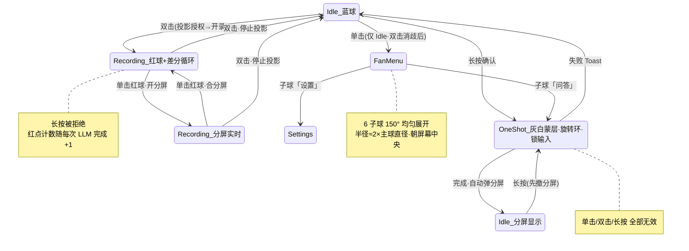

# 老参谋 v3 方案：单击菜单 / 长按单次参谋 / 双击连续参谋

> 初版：2026-10-13（v3，已实施并验收） · 修订：2026-10-14（手势与扇形菜单调整，**已实施并验收，见 §9.2**） · 分支：`laocanmou`
> 前置文档：[`AGENTS.md`](../AGENTS.md)（分支铁律）、[`docs/ARCHITECTURE.md`](ARCHITECTURE.md)（上游架构）

---

## 1. 需求 → 设计决策

| 用户需求                                                                                                                                               | 最终设计                                                                                                                                                                                                                                                         |
| ------------------------------------------------------------------------------------------------------------------------------------------------------ | ---------------------------------------------------------------------------------------------------------------------------------------------------------------------------------------------------------------------------------------------------------------- |
| **单击**悬浮球：弹出扇形子菜单（6 子球，布局规格见本节下文）；**长按**悬浮球：先无障碍、后非 MediaProjection 截屏，避免黑/白屏，OCR→LLM→自动弹上下分屏 | 单击仅在 Idle 蓝球态弹菜单（经 ~300ms 双击消歧窗口确认，双击时不误弹）；**长按**走四级感知阶梯（§3）：长按一经系统判定，主球立即**变色并蒙一层灰白 + 旋转动画**，进入 OneShot 态锁定一切输入；分屏在首个感知事件后弹出（截屏时屏幕保持原样，防自身 UI 污染 OCR） |
| 双击悬浮球：授权 MediaProjection 后连续录屏，内容差分后连续 OCR→LLM，红点计数提示完成                                                                  | **FrameDiffEngine 差分循环**（§5）：运动检测 → 静默判定 → 掩膜 OCR → 文本去重 → 串行 LLM 队列 → 红点徽章 +1                                                                                                                                                      |
| 录屏中单击红球 → 分屏实时输出；再双击 → 停止恢复                                                                                                       | 录制态单击红球 = 分屏开/合切换；双击 = 停止投影、恢复蓝球                                                                                                                                                                                                        |
| 单击弹菜单仅 Idle 态可用；任务期间拒绝无关手势                                                                                                         | `GestureDetector` 状态机门控：`ONESHOT` 态单击/双击/长按全部忽略；`RECORDING` 态仅保留单击红球（分屏开合）与双击（停止），长按拒绝                                                                                                                               |
| 扇形菜单含「设置」子球，调起一个设置界面聚合所有配置                                                                                                   | `FloatSettingsActivity`（§6）：老参谋专属设置 + 权限直达 + 会话管理                                                                                                                                                                                              |
| 避开自身分屏窗口；连续模式用户会打开分屏观看                                                                                                           | 单次模式像素路径**先撤自身浮层再截屏**；连续模式**几何掩膜**（窗口位置已知，OCR 前涂黑矩形，零误判）                                                                                                                                                             |
| 保活与耗电；录屏帧率可设且要低                                                                                                                         | 空闲零轮询；连续模式四层节流 + **息屏自动暂停** + 时长上限；抓帧节奏 3 档可设（§7）                                                                                                                                                                              |

**扇形菜单布局规格**（单击蓝球弹出，视觉按商业产品标准打磨）：

- 共 **6 个子球**：问答 / 主界面 / 设置 / 隐藏 / 关于 / 退出（「问答」即手动触发一次单次参谋，等价于长按主球）。
- 6 个子球在以主球中心为顶点的 **150° 圆心角内均匀分布**，相邻子球圆心角间隔 30°。
- **或左或右、朝向屏幕一侧展开**：主球在左半屏时扇形向右展开，右半屏时向左展开——开口恒朝屏幕中央，常态为纯水平扇形。仅当球贴上下边缘、纯水平会让包子球出屏时，中轴向屏内压最小倾角（1° 步进），任何位置子球都完整在屏内。
- 每个子球中心到主球中心距离相等，**展开半径 ≈ 2× 主球直径**。
- 保留错峰弹出/收回动画；统一阴影、层级与回弹节奏，整体美观精致。

**已批准的关键取舍**：

- 接受 3 处 `[upstream-touch]` 纯增量（§4），启用无障碍截屏 API（API 30+，无对话框）。
- MediaProjection 在 Android 14+ 的一授权一投影限制下：单次参谋路径（长按）**不依赖**投影（无障碍优先），投影仅作兜底与连续模式载体，**拍完即关**。

## 2. 状态机



## 3. 感知阶梯（`ScreenPerceiver`）

```
① a11y 文本   AccessibilityBridge.screenText()      ≥30 字直接命中（无障碍树只含活动应用
                                                     窗口，天然免疫自身浮层/FLAG_SECURE）
② a11y 截图   AccessibilityService.takeScreenshot() API 30+，无对话框无投影；
                                                     32×32 亮度均值/方差质检，空白帧重试 1 次
③ (备用) Shizuku screencap —— exec 只回文本，待 shell 桥支持字节输出后接入
④ 投影        ScreenshotProvider.capture()          需授权框；同样质检；拍完即关
```

- 长按第一触点（ACTION_DOWN）即**预热**读 a11y 文本（与系统 ~500ms 长按判定并行，预热窗口比原 300ms 更充裕），长按确认进入单次参谋后若预热文本足够直接进 LLM——**不撤窗、零闪烁、毫秒级**。单击只弹菜单、不触发任何感知；其 ~300ms 等待仅用于双击消歧（避免双击连续模式的第一跳误弹菜单）。
- 帧质检判据：32×32 灰度 μ<10 且 σ<5 判黑（息屏/过渡黑场/FLAG_SECURE），μ>245 且 σ<5 判白。

## 4. 上游增量（`[upstream-touch]`，全部纯追加）

| 文件                                                                  | 改动                                                            |
| --------------------------------------------------------------------- | --------------------------------------------------------------- |
| `device/impl/.../res/xml/accessibility_service_config.xml`            | + `android:canTakeScreenshot="true"`（1 行）                    |
| `device/impl/.../a11y/Baic2AccessibilityService.kt`                   | + `captureScreenCompat()`（takeScreenshot → PNG bytes，~40 行） |
| `device/api/AccessibilityBridge.kt` + `AndroidAccessibilityBridge.kt` | + `suspend fun captureScreen(): Result<ByteArray>` 门面         |

其余全部落在 `app/.../floatball/`（上游零触碰）：
`FloatBallService`（状态机/手势/窗口）、`ScreenAdvisor`（会话管道+LLM 队列）、`ScreenPerceiver`、`FrameDiffEngine`、`FrameQuality`、`AdvisorPrefs`、`FloatUi`（三态球/扇形/分屏）、`TranscriptView`、`FloatSettingsActivity`、`FloatCaptureActivity/Bridge`、`OverlayPermissionScreen`。

## 5. 连续参谋差分算法（`FrameDiffEngine`）

```
每 pollIntervalMs（默认 800ms，3 档可设）:
  capture() → 32×32 灰度帧（一次解码，质检/差分共用）
  motion = 8×8 分块平均亮度差(prev, cur)
  motion > 0.035        → 画面在动：候选帧作废
  静止满 2×interval      → 定格候选帧
  → 已知矩形涂黑（分屏窗口 + 红球，几何掩膜）→ JPEG(90) 转 OCR
  → OCR 文本与上次相似度(Jaccard 2-gram) > 0.8 → 丢弃
  → ScreenAdvisor.submitTurn()（Mutex 串行 LLM 队列，永不并发）
  → AgentEvent.AssistantMessage 落库 → turnCompletions → 红点+1 → 分屏实时刷新
```

保护：息屏 `ACTION_SCREEN_OFF` 暂停轮询；单次时长上限（默认 30 分钟，可设不限）自动停止；投影丢失自动停止并提示。

**已知取舍**：静止屏 VirtualDisplay 不推帧，`capture()` 返回 lastFrame 缓存 → diff 恒 0，零 OCR 零 LLM（这正是省电设计）。它意味着"屏幕完全静止但会话上下文值得重发"的场景不会自动触发——用户手动长按主球（或菜单「问答」子球）即可补一次。

## 6. 「设置」子球 → `FloatSettingsActivity`

- **连续参谋**：抓帧节奏（省电 2s/标准 0.8s/灵敏 0.5s）、单次时长上限（15/30/60 分钟/不限）——存 `AdvisorPrefs`（SharedPreferences，floatball 私有，不碰上游 SettingsRepository），运行中修改下一轮生效。
- **权限状态**（实时徽章）：无障碍服务、悬浮窗 → 一键跳系统页；投影为说明文字。
- **老参谋会话**：在主界面打开 / 清空消息（`ConversationRepository.clearMessages`）。
- **关于**：许可证 + 保活提示（国产 ROM 需允许后台自启）。

## 7. 保活与耗电

- 保活 = `START_STICKY` 前台服务（系统正规机制），无轮询无唤醒锁。
- 空闲零开销；单次模式秒级突发即释放投影；连续模式靠「可设节奏 + 静默判定 + 文本去重 + LLM 串行」节流，息屏即停。

## 8. 显示层说明（重要取舍）

分屏浮窗的转录渲染经历两版：

1. `ComposeView` + 主界面同款 `MarkdownMessage`——在 Service overlay 窗口需要完整 `SavedStateRegistryOwner` 宿主，而 savedstate 1.3 的 `performAttach()` 时序与 Recreator 消费时机存在兼容坑（实测 `Recreator.onStateChanged` / `ViewTreeSavedStateRegistryOwner not found` 两类崩溃）。
2. **最终采用轻量 `TranscriptView`（TextView 气泡）**：数据 100% 来自同一「老参谋」会话（`ConversationRepository`/`transcript: StateFlow`），主界面里该会话仍是完整 Compose 聊天界面。**会话同源的本质诉求不受影响**，浮窗仅是显示层，且更省资源。

## 9. 验收记录（2026-10-13，Galaxy_Intel_API_36 模拟器）

> **以下为 v3 初版（旧手势：单击=单次参谋 / 长按=扇形菜单）的历史验收，留存备查。**
> 2026-10-14 已修订为 **单击=扇形菜单 / 长按=单次参谋**（见 §1、§2），新版实施后须重新回归并在下方补记。

- ✅【旧手势】单击（无障碍文本路径命中）：无任何系统对话框，分屏弹出，LLM 回答精准（如"屏幕停在 DeepSeek 的对话列表，两个会话都还没有消息…"）；主界面同时出现「老参谋」会话——双端同源。
- ✅【旧手势】长按 6 子球扇形（问答/主界面/设置/隐藏/关于/退出）错峰动画；设置页全项可用、权限徽章实时。
- ✅ 双击/`record` 命令 → 授权一次 → **红球 ●** + 状态栏投影计时；静止 8s 零 OCR 零 LLM（日志证实）；滑动制造变化 → `motion=0.62 → stable → dispatching turn` → 红点「1」；单击红球开分屏实时转录。
- ✅ 长按在任务期间被拒绝；`ScreenPerceiver`/`FrameDiffEngine` 诊断日志正常。
- ✅ 修复并回归：`maskRects` immutable bitmap 崩溃；`showBall` 重建后未恢复录制外观；分屏转录首帧空白（StateFlow 无新值不发射，创建后需喂当前快照）。

### 9.2 修订版验收（2026-10-14，Galaxy_Intel_API_36 模拟器）

- ✅ **单击=扇形菜单**：单击蓝球经 ~300ms 双击消歧后弹出 6 子球；实测球在右半屏时扇形水平向左展开、开口朝屏幕中央，6 球 150° 均匀、等轨道（2× 主球直径 = 112dp），错峰回弹动画，截图 `dev\smoke-menu-*.png`；再点空白收回。
- ✅ **长按=单次参谋**：`input swipe x y x y 600` 长按后主球进入变色+灰白蒙层+旋转环态；a11y 文本路径两次命中（主屏 102 字、对话列表 159 字），无授权框，分屏自动弹出且回答精准，截图 `dev\smoke-split-*.png`。
- ✅ **双击连续模式回归**：`record` → 自动完成「共享整个屏幕」授权 → 红球●+状态栏投影计时；`record-stop` → 投影释放、恢复蓝球，截图 `dev\smoke-rec*.png`；静止屏零 OCR 的既有节流不受影响。
- ✅ 任务态门控：OneShot 期间单击/双击/长按全部无效；RECORDING 长按拒绝。
- ✅ **附带修复**：授权等待期双击停止后，晚到的授权回调不再能把差分循环在非 RECORDING 态拉起（回调落地前校验 `mode`，否则立即释放投影）。
- ✅ **清理**：删除重复的 450ms 自家长按 Runnable、`FanGesture` 调试日志、`expandMenu` 中无用的 `downward/mirrorX` 变量；扇形菜单由「斜指屏幕中心的旧几何」重写为「水平朝向 + 贴边最小倾角」（窗口尺寸恒定、`place()` 每帧重算，拖动跟随不重建）。
- ✅ 编译通过、license 门禁通过、crash buffer 无 FATAL。

## 10. 测试工具（`build-client.ps1` 增补）

- `grant`：追加**无障碍服务授权**（写入后读回校验；被清则启动 App 后重写——规避"无进程时 put 被清"的模拟器怪癖）。
- `smoke`：一键冒烟——冷启动 →（进程活时）授权 → 等悬浮球（按窗口块解析 dumpsys，取球窗口中心）→ 单击验扇形菜单出现（截图 `dev\smoke-menu-*.png`）再点空白收起 → **长按**触发单次参谋 → 等分屏（App overlay 中 fillx 宽块，截图 `dev\smoke-split-*.png`）→ crash 检查。
- `record` / `record-stop`：触发/停止连续参谋（service action `START_RECORDING`/`STOP_RECORDING`，与双击同一状态机入口；adb 注入模拟不了真双击——300ms 系统窗口 vs 命令抖动）。

**排障中固化的模拟器怪癖**（已沉淀到 AGENTS.md §8 教训 6-8）：`install -r` 与
`force-stop` 均会清空无障碍授权；无进程时 `settings put` 也会被清——授权必须在
App 进程活着时执行；PowerShell `>` 重定向写坏二进制截图。

## 11. 遗留与后续

- a11y 截图阶梯在本次模拟器上未单独验证命中（文本路径稳定命中掩盖了它）；真机/API 26-29 降级路径待回归。
- Shizuku `screencap` 备用级未接（需 shell 桥字节输出）。
- 分屏转录可考虑后续升级为 Compose（待 savedstate 兼容方案明确）或加轻量 Markdown 渲染。
- 录制态会话历史增长：当前取最近 16 条，超大回合量下可加压缩策略（复用上游 AuxiliaryTasks.COMPRESS）。
