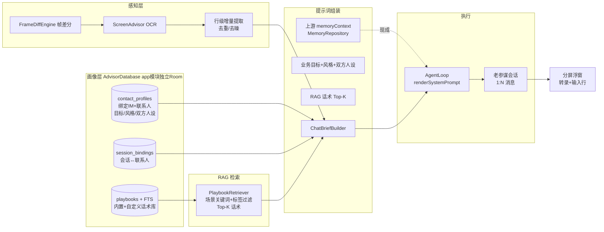
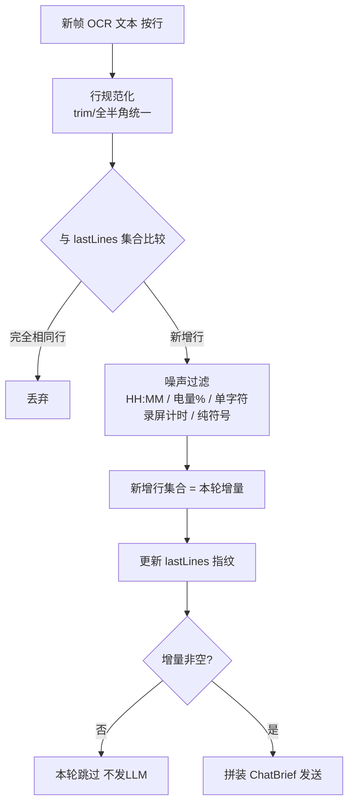
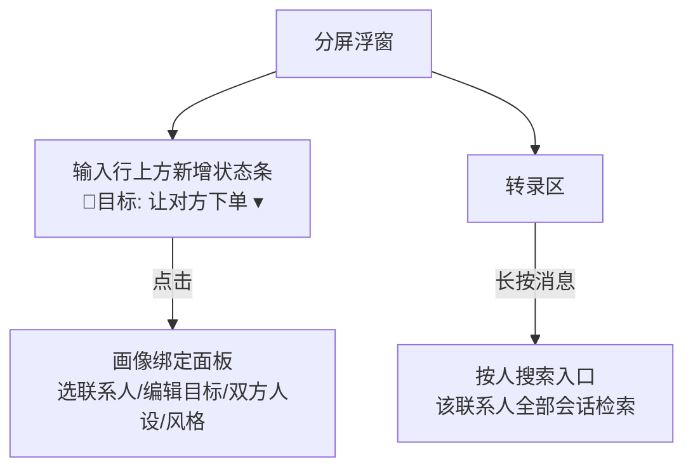
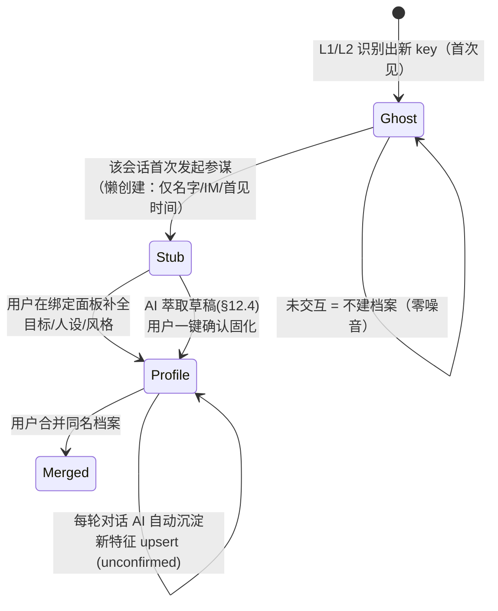
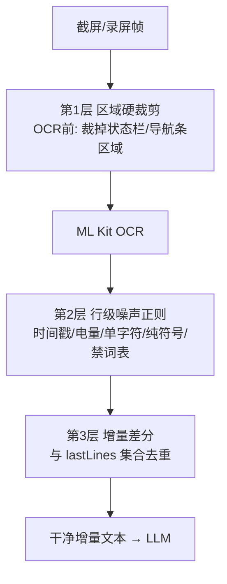

# 老参谋 AI 辅助自动化聊天功能方案架构设计（v3）

> 日期：2026-10-14（v3 据评审六条意见细化：多名称与合并、画像字段体系、记忆双写纪律、多屏拼接、录屏裁切）· 状态：**方案评审稿（未实施）** · 分支：`laocanmou`
> 版本：v2 增补竞品调研/联系人识别/OCR 噪声治理；v3 逐条落实评审意见（落点见 §14）
> 前置：[`AGENTS.md`](../AGENTS.md)、[`2026-10-13-老参谋v3-单击与连续参谋方案.md`](2026-10-13-老参谋v3-单击与连续参谋方案.md)

---

## 0. 一句话定位

把「老参谋」从**看屏幕的参谋**升级为**懂业务的贴身谈判参谋**：为每个聊天对象绑定
业务目标、语言风格与双方人设，参谋在每次支招时以「我」的身份、朝着业务目标、
用匹配的话术（RAG 增强）给出可发送的建议回复。

## 1. 需求抽象（来自用户原话）

| # | 需求 | 抽象 |
|---|---|---|
| N1 | 绑定 IM 软件和具体的人来设定「让对方下单」这类目标 | 联系人画像 + 业务目标提示词 |
| N2 | 我的人设：职业/职位、学历、硬技能、性格特点、语言交谈风格 | 我方 Persona |
| N3 | 对方人设：职业/职位、学历、硬技术、性格特点 | 对方 Persona |
| N4 | 发给 LLM = **增量无重复无垃圾的 OCR** + 业务目标 + 双方人设 + **缓存历史** | 提示词组装流水线（增量压缩） |
| N5 | 文件数据库：每个对象画像，1:N 对话记录，按人按字符搜索 | 本地结构化存储 + 检索 |
| N6 | 内置参谋知识库（职场/销售/官场/恋爱话术），RAG 增强专业性 | 本地检索增强生成 |

## 2. 现有代码盘点（复用优先，逐项核实过）

| 能力 | 现状 | 复用方式 |
|---|---|---|
| 消息搜索 | `MessageDao.searchMessagesIn(conversationIds, pattern, from, to, limit)` **已存在**（LIKE ESCAPE，支持按会话集合+时间窗） | N5 的"按人按字符搜索"几乎现成，只差"人→会话集合"的映射 |
| 会话/消息存储 | `ConversationEntity/MessageEntity`（Room v18），会话 1:N 消息 | N5 的"1:N 对话记录"**天然满足**，画像表只需挂 `conversationId` 引用 |
| 画像类存储 | `NoteEntity`：`kind=PROFILE/PREFERENCE`、`entities` 标签、`importance/strength/expiresAt`、`source` | 双方人设的**细粒度事实**可存 Note（复用检索/过期/合并）；**结构化画像字段**另建小表（见 §4） |
| 记忆检索 | `MemoryRepository.recall(terms)`（线索激活+扩散）+ `MemoryPrompt.context()` | 人设/目标的提示词组装直接复用 |
| Agent=LLM 配置 | `AgentEntity(provider/baseUrl/model/systemPrompt/apiKey)` + `Conversation.agentId` | 每个"联系人画像"可**绑定一个 Agent**——不同对象用不同模型/温度 |
| 本地大知识库先例 | `GazetteerIndex`：29,796 条地名 JSON 资产 + 内存网格索引（离线检索） | **话术库照此模式**：内置 JSON 资产 + 内存索引，证明本地可行 |
| 感知与去重 | `FrameDiffEngine`（帧差分）+ `ScreenAdvisor`（OCR→submitTurn） | N4 的增量 OCR 在此基础上做**行级 diff**（§6） |
| 提示词骨架 | `renderSystemPrompt(mode, custom, planContext, memoryContext)` | 业务目标/人设/话术全部走 `custom` 段拼装 |
| 历史压缩 | `AuxiliaryTasks.COMPRESS`（上游已有压缩总结） | "缓存历史"的压缩复用 |

## 3. 总体架构



**核心思想**：LLM 收到的每一轮 = `增量屏幕内容（只含新聊天的行）` + `以"我"的人设、
朝"业务目标"、参考"话术库"的系统提示` + `该会话的历史缓存`。LLM 化身为用户本人，
看到对方新消息后直接支招。

## 4. 数据模型（`AdvisorDatabase`，app 模块独立 Room）

**关键决策：不动上游 Baic2Database（DB v18），在 app 模块建独立 Room 库**——
避免 DB 迁移级别的 `[upstream-touch]`（上游每次发版都可能 bump version，迁移
冲突面大）。画像表通过 `conversationId`/`agentId` 逻辑引用上游表。

```sql
-- 1) 联系人画像与绑定（唯一键 = IM 包名 + 联系人标识）
CREATE TABLE contact_profiles (
  id INTEGER PRIMARY KEY AUTOINCREMENT,
  imPackage TEXT NOT NULL,          -- 如 com.tencent.mm
  contactKey TEXT NOT NULL,         -- 首见标识（备注名/ID，OCR 可见名优先）
  displayName TEXT NOT NULL,        -- 当前显示名（改名时更新）
  contactType TEXT NOT NULL DEFAULT 'person',  -- person=单聊对象 / group=群（v1 群只绑目标，不萃取成员画像，见 §4.4）
  goal TEXT,                        -- 业务目标提示词："让对方下单购买我的商品…"
  style TEXT,                       -- 语言风格："正式商务"/"朋友闲聊"…
  myPersonaId INTEGER,              -- 我方人设（全局一份，见 persona_fields my_ 前缀）
  agentId INTEGER,                  -- 可选：绑定上游 Agent（LLM 配置）
  mergedInto INTEGER,               -- 软合并指针：非空表示已并入其他档案
  createdAt INTEGER NOT NULL,
  updatedAt INTEGER NOT NULL,
  UNIQUE(imPackage, contactKey)
);

-- 1a) 联系人多名称（对方改名/备注/昵称/群内显示名 都归到同一档案）
CREATE TABLE contact_aliases (
  id INTEGER PRIMARY KEY AUTOINCREMENT,
  contactId INTEGER NOT NULL,       -- → contact_profiles.id
  alias TEXT NOT NULL,              -- 规范化后的名称（NFKC/去空白/去角标，匹配键）
  rawAlias TEXT NOT NULL,           -- 最近一次命中的原始标题（展示用）
  source TEXT DEFAULT 'ocr',        -- ocr / a11y / user
  lastSeenAt INTEGER NOT NULL,      -- 最近命中时间（合并候选排序、陈旧别名清理）
  hitCount INTEGER NOT NULL DEFAULT 0,
  UNIQUE(contactId, alias)
);
-- 识别查询: alias 命中任意一条即归属该档案; 新标题自动追加为 alias 并提醒确认。

-- 1b) 对方人设结构化字段（每字段独立更新，拒绝"一坨字符串"）
CREATE TABLE persona_fields (
  id INTEGER PRIMARY KEY AUTOINCREMENT,
  contactId INTEGER NOT NULL,       -- → contact_profiles.id
  field TEXT NOT NULL,              -- occupation/position/education/hardSkills/
                                    -- personality/interests/city/relationStage/…
  value TEXT NOT NULL,
  source TEXT DEFAULT 'llm',        -- llm(萃取) / user(人工)
  confirmed INTEGER DEFAULT 0,      -- LLM 萃取的草稿需用户确认
  evidence TEXT,                    -- 萃取依据（OCR 原句，可追溯；合并冲突旧值也落这里）
  updatedAt INTEGER NOT NULL,
  UNIQUE(contactId, field)
);

-- 1c) 萃取拒绝抑制：用户否决的（字段,值类）在冷却期内不再重复建议
CREATE TABLE extraction_holds (
  contactId INTEGER NOT NULL,       -- → contact_profiles.id
  field TEXT NOT NULL,
  untilAt INTEGER NOT NULL,         -- 冷却截止（默认 30 天）
  PRIMARY KEY(contactId, field)
);

-- 2) 会话绑定（上游 conversationId → 联系人画像 + 增量游标）
CREATE TABLE session_bindings (
  conversationId INTEGER PRIMARY KEY,   -- 上游 conversations.id
  contactId INTEGER NOT NULL,
  lastOcrFingerprint TEXT,              -- 上一轮已发 OCR 的指纹（增量基线）
  lastSentMessageId INTEGER,            -- 增量历史游标
  lastExtractAt INTEGER,                -- 上次 AI 画像萃取时间（节流，默认每 5 轮，见 §4.2）
  baselineAnchor TEXT,                  -- 最后一条对方消息文本（滚动防误判锚点，见 §9-2）
  createdAt INTEGER NOT NULL
);

-- 3) 话术库（内置资产 + 用户自定义共用一张表）
CREATE TABLE playbooks (
  id INTEGER PRIMARY KEY AUTOINCREMENT,
  category TEXT NOT NULL,     -- sales / workplace / official / romance / ...
  scenario TEXT NOT NULL,     -- 场景："客户嫌贵犹豫"
  tags TEXT NOT NULL,         -- 逗号标签："报价,异议,促成"
  content TEXT NOT NULL,      -- 话术正文
  priority INTEGER DEFAULT 5, -- 检索排序权重
  source TEXT DEFAULT 'user'  -- builtin / user
);
CREATE VIRTUAL TABLE playbooks_fts USING fts4(
  scenario, tags, content,    -- FTS4 中文按字分词，与上游 Gazetteer 同期技术
);
```

**我方人设（myPersona）**：全局唯一一份（属于"用户本人"），同样用
`persona_fields` 结构化存储（field 以 `my_` 前缀：`my_occupation`/
`my_education`/`my_hardSkills`/`my_personality`/`my_style`…），设置页表单
逐字段编辑。`contact_profiles.myPersonaId` 预留多身份（工作号/生活号切换）
扩展位，v1 恒空。

**联系人合并流程**（对方改名/重名场景）：
1. 识别层命中 A 档案的 alias，但用户确认当前实为 B 档案 → 执行合并；
2. 合并动作 = B.mergedInto 不动，把 A 的 aliases 全部改指 B、A 的
   persona_fields 逐字段择优并入 B（冲突时保留 user 确认过的）、
   session_bindings.contactId 迁移到 B、A 软删除（mergedInto=B）；
3. 关联的**上游会话不受影响**（session_bindings 迁移后，旧 conversationId
   照常命中 B 档案——"对应会话也关联起来"即由此保证）。

**存量迁移**：内置话术 JSON 资产放 `app/src/main/assets/playbooks/*.json`
（首次启动导入；Gazetteer 同模式）。

### 4.1 发送边界与代发架构预留（v3 细化，回应意见②）

**v1 明确不做自动代发**：v1 唯一实现 `UiHintSender`——产出建议文本，用户自行
复制/粘贴/点发送。分屏面板的「+」入口仅用于：绑定当前聊天对象 / 新建画像 /
切换已绑定档案，**不含任何"代发"动作**。

发送抽象（v1 只落接口与 HINT 档；FILL/AUTO 档为 P5+ 评估项，接口先留好）：

```kotlin
interface MessageSender {
    val mode: SendMode               // HINT_ONLY（v1 唯一）/ FILL_ONLY / AUTO_SEND
    suspend fun draft(text: String)  // HINT_ONLY：展示建议 + 一键复制
    suspend fun fill(text: String)   // FILL_ONLY：写入对方输入框，不点发送
    suspend fun send(text: String)   // AUTO_SEND：写入并点发送
}
```

- `A11ySender`（未来）：复用现成 `AccessibilityBridge.findText("发送")` /
  `typeText()` / `tap()` 定位输入框与发送按钮，不新增权限、不改上游接口；
- 未来实现时的强制安全闸：按联系人**单独 opt-in**（默认全关）、找不到唯一输入框/
  发送按钮即 fail-closed 中止、金额/验证码/转账/密码类关键词黑名单拦截、
  本地发送审计留痕、**FILL_ONLY 必须先于 AUTO_SEND 发布**（先给"一键填入"过渡档）；
- 合规口径不变：模型输出只是提案；即使将来做自动档，也只对已明示风险的高级用户开放，
  不做群发、不做无人值守的批量自动化。

### 4.2 画像字段体系：字段目录驱动，拒绝"一坨字符串"（v3 新增，回应意见③）

字段多、按字段独立增删改，靠的是**一份字段目录驱动三处**（萃取提示词 / 编辑表单 /
提示词渲染），而不是在代码和表里硬编码：

`app/src/main/assets/advisor/persona_schema.json`（首次启动随库导入，可热更新；
新增字段 = 改 JSON，不改表结构、不发版）：

```json
{
  "fields": [
    { "key": "occupation", "owner": "their", "group": "职业教育", "type": "text",     "label": "职业",   "extract": true },
    { "key": "personality",  "owner": "their", "group": "性格沟通", "type": "tags",     "label": "性格标签", "extract": true },
    { "key": "intentStage",  "owner": "their", "group": "商机",     "type": "enum",     "label": "意向阶段", "extract": true,
      "options": ["破冰", "询盘", "比价", "犹豫", "促单", "成交", "售后"] }
  ]
}
```

类型 `type` 仅五种：`text`（短文本）/ `textarea`（≤500 字长文本）/ `tags`
（多标签）/ `enum`（单值，options 在目录内）/ `date`（日期或日期+事项）。

**对方（their）v1 字段目录：**

| 分组 | 字段 key | 标签 | 类型 |
|---|---|---|---|
| 基本信息 | genderHint / ageRange / city / hometown | 性别推测 / 年龄段 / 所在城市 / 家乡 | enum / enum / text / text |
| 职业教育 | occupation / position / company / industry / seniority | 职业 / 职位 / 公司 / 行业 / 资历 | text×4 / enum |
| 职业教育 | education / school / major / hardSkills | 学历 / 院校 / 专业 / 硬技能 | enum / text / text / tags |
| 性格沟通 | personality / commStyle / formality / humorStyle | 性格标签 / 沟通风格 / 称谓距离 / 玩笑接受度 | tags / enum / enum / enum |
| 兴趣话题 | interests / recentTopics | 兴趣爱好 / 近期关注话题 | tags / tags |
| 关系 | relationType / relationStage / decisionRole | 关系类型 / 关系阶段 / 采购角色 | enum / text / enum |
| 商机 | needs / painPoints / budget / intentStage / objections / timeline | 核心需求 / 痛点 / 预算水平 / 意向阶段 / 主要顾虑 / 采购时间窗 | textarea / textarea / text / enum / tags / text |
| 承诺与禁忌 | commitments / nextMeeting / taboos / preferredTime | 承诺待办 / 下次约定 / 雷区禁忌 / 方便联系时间 | textarea / text / textarea / text |

**我方（my_ 前缀，全局一份，设置页逐字段编辑）：**
my_occupation / my_position / my_company / my_industry / my_product（我卖的产品或服务）/
my_hardSkills（tags）/ my_education / my_personality（tags）/ my_style（默认语言风格；
`contact_profiles.style` 作为按对象覆盖）/ my_taboo（我不能说的话）/ my_defaultGoal。

**存储编码**：tags 的 `value` 存 JSON 数组字符串（`["报价","账期"]`），渲染时顿号
拼接；text/enum/date 原样；`evidence` ≤120 字 OCR 原句。空字段不进行、不渲染
（沿 v2"无占位垃圾"原则）。

**AI 萃取的写入与更新规则：**

1. **触发节流**：仅对已绑定 person 档案的会话；距 `lastExtractAt` 已满 N 轮新对方
   发言（N 默认 5），在该参谋回合结束后以低优先级跑 `AuxiliaryTasks.complete`
   （现成无工具小任务通道，不阻塞支招主流程）。
2. **提示词约束**：只输出本轮增量中有**原话证据**的字段，目录外字段一律不许输出；
   JSON 形如 `[{"field":"budget","value":"50万左右","action":"set","evidence":"…原句…"}]`，
   `action ∈ set / add / remove`，单次 ≤5 条，宁缺毋造。
3. **逐字段合并**：
   - text/enum/date：新值覆盖**未确认草稿**；目标字段若已是 confirmed，LLM 不得覆盖，
     只能生成"建议修改"挂起项，UI 标黄待决；
   - tags：按 action 做集合 add/remove，保留其余标签；
   - `source='user'` 或 `confirmed=1` 的值**永远不被模型自动覆盖/删除**。
4. **用户确认流**：画像页分组展示草稿（字段名 / 新值 / 原话证据），逐字段 ✓/✕。
   ✓ → `confirmed=1` 固化 + 触发上游记忆双写（§6.5）；
   ✕ → 删草稿并写 `extraction_holds`（同 contactId+field 冷却 30 天不再重复建议）。

### 4.3 联系人合并详则（v3 新增，回应意见①"考虑联系人合并、对应会话也要关联"）

**触发**：(a) 用户在画像列表手动选 A→B 合并；(b) 标题与 A 命中但和另一档案 B
的主名/别名编辑距离 ≤2，绑定面板弹"这是不是同一人？"（决策表见 §11.1）。
合并方向固定 = **保留 B（目标档案），并入 A**。

单事务（`ContactRepository.mergeContacts(a, b)`，AdvisorDatabase 内）：

1. **别名迁移**：A 的 aliases 全部改指 B；与 B 重名的去重，`hitCount` 相加、
   `lastSeenAt`/`rawAlias` 取新。
2. **字段择优**（逐 key 裁决，不是整条覆盖）：
   - 一方空缺 → 取另一方；
   - 双方均 confirmed：`source=user` 优先于 llm；同源取 `updatedAt` 新者；
   - 仍冲突（如同为用户手填的不同公司名）→ 保留 B 值，A 值写入该字段
     `evidence` 备注"合并冲突旧值：…"，UI 标黄待裁决；
   - tags 类型一律取并集（再矛盾也不丢用户确认过的标签）。
3. **会话迁移（"对应会话也关联起来"的落点）**：A 名下全部 `session_bindings`
   改指 B；`lastOcrFingerprint`/`baselineAnchor` 取 `updatedAt` 最新的一条
   （防止合并瞬间把旧屏当新增刷屏），重复 conversationId 行去重。
   上游会话/消息**零搬运**。
4. **目标字段**：goal/style 非空优先保留 B，B 空则取 A；
   `contactType` 不同（人 vs 群）禁止合并，UI 直接拦截。
5. A 置 `mergedInto=B` 软删除，不物理删。

**按人取数的兑现**：按人搜索/取历史 = 查该 contactId 下**全部**
session_bindings 的 conversationId 集合 → 现成
`MessageDao.searchMessagesIn(conversationIds, pattern, from, to, limit)`
（public DAO，零上游改动）。合并后 A 的历史会话自动并入 B 的检索范围——
历史"跟着人走"即由此保证。

**撤销合并（30 天内）**：凭 `mergedInto` 一键 undo：A 的别名/绑定回迁、
并入字段回滚（冲突备注丢弃）；已双写的上游 Note 不回滚——内容本身无错，
且其 entities 旧名标签在 A 回迁后仍可经 alias 召回（§6.5），无清理负担。

### 4.4 群聊的 v1 边界

群聊标题 = 群名，可绑定 `contactType='group'` 的档案（群目标/群话术生效），但：
- 不自动萃取"对方人设"（多人发言互相污染）；气泡上方的发言人昵称行保留进正文，
  渲染为「【昵称】内容」前缀供 LLM 区分语境；
- 群成员个人画像（speaker→profile 二级映射）列入 P5。

## 5. 与上游的边界（遵守 AGENTS.md）

| 动作 | 性质 |
|---|---|
| app 模块新增 `AdvisorDatabase`/`PlaybookRetriever`/`ChatBriefBuilder` 等 | 本分支自有，零上游触碰 |
| 上游 `MessageDao.searchMessagesIn` 直接调用 | 零触碰（已存在的 public DAO） |
| 上游 `AgentEntity/ConversationEntity` 逻辑引用（外键不建） | 零触碰 |
| `ScreenAdvisor` 扩展增量提取与 ChatBriefBuilder 接线 | 本分支自有文件 |
| **唯一上游触碰**：无（本轮设计做到零上游改动） | ✅ |

## 6. 核心流程与算法

### 6.1 增量 OCR 提取（无重复、无垃圾）



- **指纹**：`session_bindings.lastOcrFingerprint` 存上一轮行集合的 hash；
  连续参谋模式重启后仍可正确续增量。
- **典型噪声**（微信场景）：顶部联系人名（已在画像里）、时间戳、电量、
  "正在输入…"、键盘候选栏文字。噪声行表可配置。

### 6.2 提示词组装（ChatBriefBuilder）

发给 LLM 的 `customSystemPrompt` 模板（拼进 `renderSystemPrompt` 的 custom 段）：

```
【本次聊天的业务目标】
{goal}                        ← contact_profiles.goal

【我的语言风格】
{style}

【我的人设】
{myPersona}                   ← 用户一次性配置，多轮复用

【对方的人设】
{theirPersona}

【可参考的话术】（结合当前场景选用，不要照搬）
1. {playbook#1}               ← PlaybookRetriever 以「对方最新发言+目标关键词」检索
2. {playbook#2}
3. {playbook#3}

【输出要求】
以「我」的身份给出 2~3 条建议回复（标注各自意图与风险），
并给出一句话策略提示。不要复述屏幕内容。
```

- **检索 query**：本轮增量 OCR 的最后 K 行（对方最新发言）+ `goal` 关键词
  → `playbooks_fts` MATCH + `category` 权重 + `priority` 排序 → Top-3。
- **人设渲染**：`persona_fields` 按字段逐行渲染（而非塞一坨字符串）——
  LLM 对"字段名: 值"的结构化输入遵循度远高于自由文本；空字段自动跳过
  （无占位垃圾）。

### 6.3 历史缓存策略

| 历史 | 策略 |
|---|---|
| 最近 N 条（默认 16） | 全文随 `history` 进 AgentLoop（现行为） |
| 更早的对话 | 首次绑定时可用上游 `AuxiliaryTasks.COMPRESS` 压缩成摘要 Note（kind=SUMMARY）挂会话 |
| 增量历史游标 | `session_bindings.lastSentMessageId`：只把上次之后的新消息纳入 history，避免长会话 token 膨胀 |

### 6.4 RAG 本地可行性论证（回应"是否必须服务器"）

**结论：本场景无需服务器，本地完全够用且更快更私密。**

1. **话术库是结构化小知识**（场景→话术，预计几百~几千条），不是自由文档语料。
   检索的本质是「关键词+标签匹配」，SQLite FTS4/LIKE 完全胜任——上游
   `searchMessagesIn` 与 `GazetteerIndex`（3 万条离线检索）已证明该量级在
   Android 本地毫秒级。
2. **不需要 embedding**：话术条目自带 `category/scenario/tags` 结构化检索键；
   LLM 本身负责语义泛化（检索只需召回"候选话术"，选择与改写交给 LLM）。
3. **隐私即卖点**：聊天内容与人设是高敏数据，本地 RAG = 数据不出设备，
   与上游「本地优先」原则一致。
4. **可选云增强**（后期）：若将来话术库膨胀到数万条或需要语义模糊召回，
   增加「调用 embedding API 离线批量化 → 本地向量文件 + 暴力余弦扫描」
   的可选档——仍无需常驻服务器。

### 6.5 上游「沉淀记忆」的使用分工（v2.1 新增）

上游 `MemoryRepository`（Note + recall 线索激活 + MemoryPrompt）与新的
联系人档案**定位不同、双轨并用、写入有纪律**：

| 数据 | 归属 | 理由 |
|---|---|---|
| 我方稳定画像（我的职业/产品/偏好） | **上游记忆**（Note kind=PROFILE） | 跨联系人通用，主界面普通聊天也应召回 |
| 跨对象的通用经验（谈判技巧心得等） | **上游记忆**（kind=EVENT/SUMMARY） | 同上 |
| 联系人 A 的目标/人设/阶段 | **AdvisorDatabase 档案**（结构化字段） | 按对象隔离，**绝不能**泄漏到 B 的参谋提示词 |
| 联系人 A 的关键事实（合同额/约见时间） | **双写**：档案结构化字段（主）+ 上游 Note（entities 标签=A 的名字，kind=PROFILE/FLOAT） | 让主界面会话也能按名召回；recall 是全局激活，靠 entities 标签收敛 |

**参谋提示词的取数纪律**：
- 目标/人设/风格 **只取 AdvisorDatabase**（按 contactId 精确）；
- 上游 `memoryContext` 照常接入（现有 `MemoryPrompt.context`），但
  `MemoryRepository.recall` 的 terms 追加当前联系人 alias —— 线索命中天然
  偏向该联系人的 Note；跨联系人误召回的行由 LLM 按「是否与本对话相关」
  自行忽略（与主界面行为一致）。
- **不反向污染**：连续参谋模式不向上游写 Note（feedback=false 已保证）；
  只有 AI 萃取经用户确认的画像事实才双写（见 §12.4）。

这样上游记忆保持「关于我」的全局大脑，AdvisorDatabase 承担「关于每个他」
的业务卷宗，职责清晰、互不膨胀。

**v3 落地细则（取数 / 写入 / 删除三条纪律）**

取数（每轮参谋，全部走现成管线，零上游改动）：

```kotlin
// terms 带主名 + 全部别名（含合并带来的旧名）+ 目标 + 本轮增量
val terms = MemoryText.terms(buildString {
    append(profile.displayName).append(' ')
    aliases.joinTo(this, " ") { it.alias }
    profile.goal?.takeIf { it.isNotBlank() }?.let { append(' ').append(it) }
    append(' ').append(incrementLines.takeLast(400).joinToString(" "))
})
val memoryContext = MemoryPrompt.context(core, memoryRepository.recall(terms), now)
```

旧名必须进 terms：合并/改名前写下的 Note 挂的是旧 entities 标签，旧名在
召回线索里才能继续命中；这也是合并后无需回写上游 Note 的原因。

写入（**唯一双写时机 = 用户在画像页 ✓ 确认草稿**；调现成
`MemoryRepository.addNote(...)`，自带去重/合并裁决）：

| 确认内容 | kind | source | importance | entities | 特殊字段 |
|---|---|---|---|---|---|
| 职业/公司/城市/学历等稳定事实 | `PROFILE` | `USER` | 3 | [主名, 全部alias] | — |
| 承诺事项 / 下次约见 | `AGREEMENT` | `USER` | 4 | [主名] | `whenAt`=约定时间 |
| 预算 / 意向阶段等易变商情 | `FACT` | `ASSISTANT` | 3 | [主名] | `expiresAt`=+90 天 |
| 成交 / 合作终止等大事件 | `EVENT` | `USER` | 4 | [主名] | `whenAt`=事件时间 |
| 用户手填的我方人设字段 | `PROFILE` | `USER` | 4 | ["我"] | 同步建议进 coreMemory user 槽 |

source 语义遵循上游 source monitoring：**用户确认 = USER**（可信度等同用户亲述）；
LLM 萃取但未确认的草稿绝不入上游。

负面清单（一律不写上游记忆）：原始 OCR / 转录流水、`unconfirmed` 画像草稿、
`contact_profiles.goal` 业务目标、话术库内容、噪声行。goal 是按人隔离的私有策略，
进全局大脑后会在**其他人**的参谋轮次误召回——这正是双轨制要防的串档。

删除档案（"忘记此人"）：Advisor 侧档案/草稿/别名/绑定整删；上游 Note 默认保留
（归属上游、可能跨对象有用），画像页提供二次勾选项"同时清除相关记忆"——执行通道
优先复用上游 noteDao 已有的 suppress/hold 能力；若 Repository 无 public 入口，
列入 P5 评估，**不为此改上游接口**。

### 6.6 单次模式多屏上滑拼接（v3 细化，默认开启，回应意见⑤）

用户需求：单次截屏默认**向上滑 2 下**多截几屏，OCR 行集拼接，给 LLM 更多上下文；
作为设置项默认开启。

**设置项（AdvisorPrefs 新增，运行中改下一轮即生效）：**

| key | 默认 | 说明 |
|---|---|---|
| `autoScrollScreens` | 2 | 额外上滑几屏（0=关闭，回到现行单屏；上限 3） |
| `scrollSettleMs` | 800 | 每次滑动后等待渲染（可调 600~1500） |
| `scrollBack` | true | 拼接完成后下滑同数回到底部，恢复原阅读位置 |
| `swipeHeightRatio` | 0.72 | 滑动距离占内容区高度比例（<1 故意留重叠带） |

**前置条件（任一不满足 → 静默回退现行单屏，不打断用户）：**

1. 该会话**已绑定联系人画像**（未绑定可能是网页/地图，滑动有刷新/缩放误触风险）；
2. 无障碍已连接——滚动依赖现成 `AccessibilityBridge.swipe(x1,y1,x2,y2,durationMs)`
   （已核 API，零新增权限）；
3. IME 已收拢：`editableFocused()` 为真时先发一次 back 收键盘（微信首按只收键盘
   不退页）；下一帧仍为真则放弃滚动（异常 ROM 保护）。

**采集时序（N = autoScrollScreens）：**

```
截第 0 屏（当前视图，最新消息在底部）
for i in 1..N:
    swipe(cx, 内容区上沿78%Y → cx, 内容区上沿6%Y, 300ms)  // 手指上滑，露出更早消息
    settle(scrollSettleMs) → FrameQuality 帧质检 → 截第 i 屏
    行集与第 i-1 屏 Jaccard ≥ 0.95 → 判定"没动"（已到历史顶部/手势失效）→ 提前结束
行集拼接（见下）
scrollBack=true → 反向 swipe 同数（每次 settle 500ms；到底后继续下滑本身无副作用）
```

采集通道优先级：无障碍 `captureScreen()`（API30+，无授权弹窗、序列内可连续截）
＞ MediaProjection（须在**整个序列期间持有投影**、序列结束再 release，不再
"一拍即关"）。两者都不可用（含投影未授权）→ **不触发授权弹窗、不滚动**，
直接回退单屏现行流程。

**行集拼接算法（`OcrProvider.recognize()` 返回带包围盒的 OcrLine，已核 API）：**

1. 每屏经第 1/2 层处理后按 `top` 排序得有序行 L_i（上→下 = 旧→新）。
2. 相邻屏存在重叠带：swipeHeightRatio=0.72 时理论重叠 ≈28% 屏高。维护已合并
   序列 M（旧→新，初始 = L_0）；加入更老的一屏 L_i 时，在「L_i 尾部 ↔ M 头部」
   的理论重叠窗口内找最佳对齐：规范化后逐行精确匹配计锚点数，OCR 抖动行用现成
   `FrameQuality.textSimilarity ≥ 0.8` 兜底；要求 **≥3 个锚点行或重叠区匹配率 ≥60%**。
3. 对齐成立（重叠 k 行）：结果 = L_i 重叠前的头部 + M；未达阈值：保守丢弃 L_i
   底部理论重叠长度的行后再前置——**宁可少一行，不可重复一行**（重复行比缺行
   对 LLM 干扰更大）。
4. 日期分割行（"昨天"/"10月12日"）保留（是有效上下文，与 HH:MM 时钟噪声区分对待）。
5. 拼接产物照旧过第 3 层增量差分与 autoScreenContent 收缩——多屏只扩上下文，
   不改变"增量无重复"契约；三屏（N=2）典型微信页约 30~60 行 / 800~1500 字，
   收缩后 token 可控。

**副作用评估**：微信/QQ 在**已打开的会话内**上滑浏览历史不产生已读回执、不撤销
未读红点（进入会话的动作才标已读——而发起参谋时用户本就已在会话内）；回底下滑
为纯本地视图位移。实施时以冒烟实测复核该结论，若发现某 IM 上滑触发已读，
将该 IM 包名加入禁滑名单（AdvisorPrefs 配置）。

### 6.7 思考中的输入约定（v2.1 明确）

LLM 思考/流式期间，输入行的发送键显示为「■ 停止」：此时发送动作被排除
（不排队、不丢失文字），用户可点 ■ 打断当前回答后重发——输入框文字始终
保留。（录制连续模式下同一约定；上游主界面 `turnGate` 已有同语义行为。）

## 7. 交互设计（分屏浮窗扩展）



- 绑定面板复用 `FloatSettingsActivity` 的 Compose 风格，新增「联系人画像」页
  （列表 + 编辑表单 + 会话列表按人过滤——过滤即 `session_bindings` 查询）。
- 单次参谋模式：绑定后每次 OCR 自动带画像与话术；未绑定 = 现行为（纯屏幕参谋）。
- 录制连续模式：同上，且画像增量提取持续生效。

## 8. 分期实施计划

| 期 | 内容 | 规模 |
|---|---|---|
| P1 数据层 | `AdvisorDatabase`（3 表+FTS）+ `AdvisorPrefs` 扩展 + 内置话术 JSON 资产（职场/销售/官场/恋爱 各 30~50 条）+ `PlaybookRetriever` | M |
| P2 流水线 | `ChatBriefBuilder`（目标/人设/话术/风格拼装）+ `ScreenAdvisor` 行级增量提取 + 噪声过滤 + 接线 `submitTurn` | M |
| P3 交互 | 分屏状态条 + 绑定/画像编辑面板 + 按人搜索会话（复用 searchMessagesIn） | M |
| P4 增强 | 历史压缩接入、可选 embedding 档、话术库管理 UI（增删改查/导入导出） | S |

## 9. 风险与开放问题

1. **联系人识别准确率**：OCR 提取「对方是谁」依赖屏幕顶部名字行；v1 手动绑定 +
   名称模糊匹配兜底，识别失败即按未绑定处理（不阻断现有功能）。
2. **增量误判**：滚动历史消息会把「旧内容」当「新增」——缓解：连续模式下以
   「最后一次可见的对话气泡锚点」为基线（记录最后一条对方消息文本，新增判断
   基于其后内容）；误发一次的成本可接受（LLM 会指出无新内容）。
3. **提示词长度**：目标+双 Persona+话术 Top3 ≈ 600~900 token，可控；话术只给
   Top-3 不贪多。
4. **合规边界**：功能定位是「辅助建议」（用户自行决定发送），不自动代发消息、
   不做批量营销自动化——与上游"模型输出只是提案"原则一致。

---

## 10. 竞品调研与借鉴（v2 新增，2026-10-14 联网调研）

### 10.1 国际「Rizz 类」约会/聊天助手

| 产品 | 核心工作流 | 可借鉴 |
|---|---|---|
| [Plug AI](https://apps.apple.com/us/app/plug-ai-rizz-dating-assistant/id6748056633)（iOS/Android 双端） | **截图上传 → 选风格 → 一键生成回复**；支持 Tinder/Hinge/Wizz/iMessage 场景 | ① **风格选择器**（对应我们"语言风格"字段，做成可切换 chip）② 附件/截图上传作为输入源 |
| [RIZZ](https://rizz.app) / [Rz AI](https://play.google.com/store/apps/details?id=com.ai.dating.rizzgpt) | 截图上传、开场白生成、一键回复 | 开场白生成（首次接触场景单独成功能） |
| [SmoothRizz](https://www.smoothrizz.com/ai-texting-assistant) | 粘贴对话即得回复，免截图 | 多输入通道（粘贴/截图/OCR）降低使用门槛 |

形态局限：iOS 无悬浮窗能力，全部依赖**手动截图上传**——我们 Android overlay
+ 按键直达是**代差优势**。

### 10.2 国内话术/聊天助手类

| 产品 | 核心功能 | 可借鉴 |
|---|---|---|
| [恋小助](https://apps.microsoft.com/detail/xp9lw98v74672p)（Windows） | **追爱键盘**（不切屏一键高情商回复）、**AI 识图帮回**、土味情话/话题库 | 键盘式一键生成 + 话题库 |
| [回复神器](https://sj.qq.com/appdetail/com.ysyk.hfsq)（应用宝） | **40 万条恋爱话术库**一键搜索 + 智能恋爱键盘 | 话术库规模与分类检索（我们 FTS 方案可承载） |
| 蜜小助 / 恋爱键盘 | 高情商回复生成、输入法集成 | 输入法集成为远期可选形态 |
| [聊天宝客服助手](https://www.bangkefu.com) | **悬浮精灵**：微信/QQ 界面直接唤起、一键复制回复（客服场景） | 悬浮窗唤起形态与我们一致，验证了 Android 可行性 |

### 10.3 B2B 销售 Copilot（模式最接近"参谋"定位）

| 模式 | 代表 | 对我们的启发 |
|---|---|---|
| 实时话术指导 | [Clari Copilot / Salesloft](https://www.salesloft.com/platform/conversation-intelligence-software)：通话中实时提示异议处理 | 我们的**连续参谋**（差分循环实时支招）= 同构能力 |
| **AI 自动更新 CRM** | [Mixmax Meeting Copilot](https://www.mixmax.com/blog/ai-meeting-assistant-crm)：会后自动把结论写入联系人记录 | **每轮对话后 LLM 自动萃取对方新特征 → 更新联系人画像（unconfirmed）**——本方案 §12 采纳 |
| 按用例分级指导 | [实时销售助手综述](https://www.caretta.so/blog/best-real-time-ai-sales-assistants) | 按业务目标阶段（破冰/报价/促单）切换话术策略 |

### 10.4 借鉴结论

1. **截图→OCR→回复**是全行业验证过的主流路径，我们的"自动截屏+悬浮窗直达"
   是其上的自动化增强，无方向性风险。
2. **风格选择器、话术库订阅、对方 Profile、AI 自动沉淀档案**四项为竞品标配，
   全部纳入本方案（§4/§6/§12）。
3. 差异化壁垒 = **Android 悬浮窗免截图直读 + 联系人档案持久化 + 业务目标导向**；
   商业形态参考竞品的订阅制话术包（分渠道/行业扩展）。

---

## 11. 联系人识别与档案生命周期（v2 新增）

### 11.1 识别的四级置信分层

| 级 | 手段 | 准确度 | 成本 | 说明 |
|---|---|---|---|---|
| L1 | **无障碍窗口标题**：`rootInActiveWindow.window.title`（微信聊天页标题=对方昵称） | 高 | 零（a11y 已启用） | 首选；群聊时为群名 |
| L2 | **OCR 顶部名字区**：截图顶部 15% 区域的 OCR 文本（聊天气泡上方的最后发言者昵称也提取） | 中高 | OCR 已做 | L1 失败（a11y 未启用）时 |
| L3 | **手动绑定**：分屏面板一键「绑定联系人」选择已有画像或新建 | 确定 | 一次点击 | 兜底与修正入口 |
| L4 | **会话绑定表回查**：`session_bindings.conversationId` 已绑定的会话直接命中 | 确定 | 零 | 首次绑定后长期生效 |

**contactKey 规则**：`{imPackage}:{标题文本规范化}`（小写去空格）为**首见
标识**；此后所有标题变体进 `contact_aliases`（对方改昵称/备注/群内显示名
均归同一档案）。识别查询 = `contactKey` 精确 + `contact_aliases` 全表匹配。

**改名与合并**（v2.1 细化）：标题命中失败时按 `displayName + aliases` 模糊
匹配（编辑距离 ≤2），命中即自动追加为新 alias（零打扰续档）；未命中且编辑
距离近的**其他档案**提示用户确认合并（合并 = aliases 并入、persona_fields
逐字段择优、session_bindings 迁移、原档案软删除——对应会话经迁移的
session_bindings 自动关联到新档案，历史对话"跟着人走"）。完整合并事务与
撤销规则见 §4.3。

**标题规范化规则（v3 新增）**（规则存 `app/src/main/assets/advisor/title_rules.json`，
可热更新）：① NFKC 全半角统一 → trim → 去全部空白 → 拉丁字母小写；
② 去尾部未读角标：`（\d+条新消息）`、`\(\d+\)`、`•\d+`；③ 去状态尾巴：
"正在输入…"/"对方正在输入…"/"连接中…"；④ 去群人数后缀"（36）"；
⑤ "企业微信"等壳后缀剥离入匹配键、同时原文保留为 rawAlias。

**命中与新名决策表（v3 新增，自动匹配的边界全在这张表）：**

| 情况 | 自动动作 |
|---|---|
| 规范化标题命中某档案 contactKey / alias | 归属该档案；`hitCount++`、`lastSeenAt`/`rawAlias` 更新 |
| 未命中，但与**当前已绑定档案**主名编辑距离 ≤2（繁简、多个 emoji/空格） | 自动追加 alias 零打扰续档，状态条轻提示"已按新昵称续档" |
| 未命中，且与**其他档案**主名/alias 编辑距离 ≤2 | **不自动合并**：弹一次确认条"当前是【X】吗？"→ 是则合并（§4.3），否则新建 |
| 完全陌生标题 + 会话**已绑定**档案 | 按"可能切人"处理：弹窗走 L3 手动确认，绝不静默套用旧档（防 A 档案套到 B 的聊天） |
| 完全陌生标题 + 会话未绑定 | 不建档案零噪音；首次发起参谋时懒创建 Stub（§11.2） |

### 11.2 档案生命周期（何时建立、如何关联）



- **懒创建（Stub）**：首次对该对象发起参谋时自动建轻量档案——不打扰、不猜测；
  目标/人设空缺时提示词自动跳过对应小节（无空字段垃圾）。
- **AI 萃取（对齐 B2B Copilot 的 CRM 自动更新）**：每 N 轮（默认 5）把该会话
  增量内容交给 LLM 提取「对方新透露的特征」（职业/城市/性格/意向）→ 以
  `unconfirmed` 标记写入画像草稿区 → 用户在画像页一键确认 → 固化进
  `theirPersona`（同时按上游 Note kind=PROFILE 写入记忆，双端可见）。
- **合并与防串**：同名档案列表化由用户手动合并；切联系人检测（标题变化）
  时未绑定会话强制走 L3 确认，杜绝把 A 的档案套到 B 的聊天上。

### 11.3 最快最准的数据通路

一次参谋触达画像的路径被压到最短：
`a11y 标题（0ms）→ contactKey → AdvisorDatabase 单条索引查询（<5ms）→
画像+目标+风格齐备 → 与增量 OCR、话术 Top3 同轮进入提示词`。
若 a11y 未启用或识别失败，立即降级 L2/L3，**不阻塞参谋主流程**。

---

## 12. OCR 噪声治理（v2 新增）

### 12.1 噪声源分析

| 噪声源 | 单次截屏 | 连续录屏 | 例 |
|---|---|---|---|
| 状态栏（时间/电量/信号/录屏计时） | 有 | 有（时间每分钟跳动必产生"新增"） | `13:14`、`00:08`、`LTE` |
| 系统导航条/手势条 | 有 | 有 | 底部横条偶发 OCR |
| 输入法候选栏 | 有 | 有 | 聊天页输入框候选词 |
| 应用 UI 框架（标题/按钮/Tab） | 有 | 有 | 「返回」「发送」 |
| 对话历史（非新增部分） | 有 | 差分后残留 | 重复的旧气泡文本 |

### 12.2 治理方案：三层漏斗（OCR 前裁 → OCR 后滤 → 增量去重）



**第 1 层：几何分区（v3 修订：底部位图掩膜 + 一次 OCR 后按包围盒分流）**

v2 原设想"裁掉顶部再送 OCR"，评审后修正：顶部标题行是 L2 联系人识别的输入，
物理裁掉会把识别依据一起裁没；且 `OcrProvider.recognize()` 返回的 `OcrLine`
自带包围盒（已核 API），一次 OCR 即可按坐标分流，无需"裁两刀识别两次"：

- **底部区（手势条/三键导航/IME 候选栏）**：解码后位图黑色掩膜再送 OCR——
  纯系统像素区，物理切除最干净；复用现成 `FrameQuality.maskRects`（JPEG 管线），
  同风格新增一个 `cropBands(bytes, bottomPx)` 纯函数（本分支自有文件）。
- **顶部状态栏区**：不掩膜，OCR 后按 `line.top < statusBarHeight` 整行丢弃；
  连续模式录屏计时红胶囊同区消失。
- **标题带（状态栏下、正文上，约 48dp）**：该区 OcrLine 分流给联系人识别器
  （L2），不进参谋正文。
- **群聊发言人昵称行**（正文内、气泡上方的居左短行）：保留并改写为
  「【昵称】内容」前缀进正文（§4.4）。
- 高度取系统 dimen：`status_bar_height` / `navigation_bar_height`，缺省回退
  比例 top 5% / bottom 4%；检测到 IME（见下）期间底部带按 14% 计。
- IME 精确高度**不新增上游接口**（铁律）：v1 只用现成
  `AccessibilityBridge.editableFocused()` 布尔判定键盘弹起即加宽底部带；
  精确 imeHeight（a11y `TYPE_INPUT_METHOD` 窗口）待上游将来贡献接口再升级——
  本地不反射、不另起第二个无障碍服务。

**第 2 层：行级噪声正则库（`OcrNoiseFilter`，可配置可扩展）**

```kotlin
// 每条规则 = 正则 + 类别；命中即丢行。噪声库随实测持续补充。
 listOf(
   Regex("""^\d{1,2}:\d{2}$"""),                 // 13:14 / 00:08（含录屏计时）
   Regex("""^\d{1,2}:\d{2}[:]\d{2}$"""),          // 00:08:15
   Regex("""^\d+%$"""),                           // 电量
   Regex("""^[2-9][0-9]?$"""),                    // 孤立数字
   Regex("""^[\p{P}\p{S}\s]+$"""),                // 纯符号/空白
   Regex("""^.{0,1}$"""),                         // 单字符
   Regex("""正在输入|对方正在输入|已读|未读|4G|5G|LTE|HD|VoLTE"""),
 )
```

- **豁免规则**：画像绑定后的联系人名（出现在过滤行时改为白名单保留）；
  首行（顶部名字区）在 L2 阶段单独提取供联系人识别，不进正文。
- 规则存 assets JSON，可热更新，不需要发版。

**第 3 层：增量差分（已有，v3 方案 §5）**

- 行集合与 `lastLines` 去重；集合差 + 相似度过滤（Jaccard>0.8 丢弃）。
- 与第 1/2 层正交：裁剪与正则先把噪声干掉，差分只处理干净行。

### 12.3 两种模式下的组合

| 模式 | 第 1 层 | 第 2 层 | 第 3 层 |
|---|---|---|---|
| 单次截屏 | 顶部/底部硬裁剪 | 行级正则 | 与历史 OCR 集合差分（一次性） |
| 连续录屏 | **同上（每帧都裁，不可省）** | 同上 | 稳定期差分 + 文本相似度去重 |

**回应「连续录屏是否可省去裁剪」：不可省，且有反例**——状态栏时钟每分钟
跳动一次，若不裁剪/过滤，每分钟都会被差分误判为"屏幕变化"而触发一轮无意义
OCR→LLM（伪触发）。第 1/2 层负责"噪声不进识别"，第 3 层负责"重复不进
LLM"，三层各司其职。裁剪成本可控：解码+裁剪+压缩约 20~50ms，相对 800ms
抓帧周期占比 5% 以下。

**量化预期**：以微信聊天页 720×1280 为例，状态栏+导航裁剪后 OCR 行数约减
20~30%；正则再滤 5~10%；增量差分保证稳态零输出。LLM 实收文本 = 纯聊天内容。

### 12.4 连带增强：AI 自动沉淀画像（借力第 3 层产物）

干净增量文本除了发给参谋 LLM，**同时**（每 N 轮）交给萃取任务：提取「对方新
特征」→ 写入画像草稿（§11.2 的 AI 萃取）——一份干净数据两处受益。

### 12.5 连续"按 App 录屏"能否省去裁剪？（v3 新增，回应意见⑥）

**结论：v1 不能省。单次与连续、无论是不是只录前台 App，第 1/2/3 层照做。**

关键事实：v1 的两种像素采集——无障碍 `captureScreen()` 与 MediaProjection
全屏采集——拿到的都是**整屏像素**：状态栏时钟/电量、导航手势条、输入法候选栏
一律在帧内。"录的是这个 App"只是发起意图，MediaProjection v1 并不按前台 App
裁切画面。反例（连续模式代价翻倍）：状态栏时钟每分钟跳动一次 → 帧差分必检出
顶部运动块 → 若不裁不滤，每分钟触发一次无意义 OCR→LLM 伪回合，token 与打扰
双浪费。所以"连续模式省裁剪"不成立。

| 采集路径 | 系统栏/IME 是否入帧 | 第 1 层 | 第 2 层 | 第 3 层 |
|---|---|---|---|---|
| a11y 文本阶梯（`screenText()`） | 状态栏本非节点不入树；IME 候选词偶入交互窗口 | 不适用（无位图） | 必做（按钮/候选词） | 必做 |
| a11y `captureScreen()`（单次/连续） | **全含** | **必做** | 必做 | 必做 |
| MediaProjection 全屏采集（单次/连续，v1） | **全含** | **必做** | 必做 | 必做 |
| Android 14+ 单 App 窗口共享（P5 验证项） | 系统栏/IME/其他 App 窗口由系统排除 | 可按设备能力动态关闭（连自身浮层掩膜或也可省） | 必做 | 必做 |

唯一可能"省掉第 1 层"的路径是 API 34+ 系统授权弹窗里用户选**单 App 共享**：
该模式 VirtualDisplay 只呈现目标 App 窗口，系统栏与 IME 天然不入帧。但需 P5
在真机实测确认（含国产 ROM 行为、自身悬浮球是否被排除），验证通过后也只是
动态豁免第 1 层——**第 2 层正则与第 3 层差分在任何路径下都不省**（App 自身
UI 框架文字与重复气泡仍在）。

---

## 13. 更新后的分期实施计划（v3）

| 期 | 内容 | 规模 |
|---|---|---|
| P1 数据层 | `AdvisorDatabase`：contact_profiles（含 contactType）/ contact_aliases（含 lastSeenAt、hitCount）/ persona_fields / extraction_holds / session_bindings（含 lastExtractAt、baselineAnchor）/ playbooks+FTS；`persona_schema.json` + `title_rules.json` 资产；内置话术 JSON；`PlaybookRetriever`；`ContactRepository`（绑定/别名/合并/撤销单事务） | M |
| P2 流水线 | 噪声三层（底部掩膜 `cropBands` + 顶部/标题带几何分流 + 行级正则 + 增量差分）；**单次多屏上滑拼接**（swipe 时序/重叠带对齐/到顶早停/回底/禁滑名单）；行级增量提取；`ChatBriefBuilder`（目标/人设/话术/风格拼装）+ 接线 submitTurn | L |
| P3 识别与档案 | L1 a11y 标题识别 + L4 绑定回查；标题规范化与新名决策表；懒创建 Stub；AI 萃取节流调度（`AuxiliaryTasks`，每 5 轮）+ 草稿确认/拒绝冷却；上游记忆双写（§6.5 纪律） | M |
| P4 交互 | 分屏状态条；绑定面板/画像字段表单（字段目录驱动）+ 草稿 ✓/✕；改名续档轻提示 + 合并确认条/撤销；按人搜索（searchMessagesIn）；风格选择器 chip；群档案 | M |
| P5 增强 | L2 OCR 标题带识别；历史压缩接入；embedding 可选档；话术库管理 UI；Android 14+ 单 App 共享的第 1 层动态豁免实测；群成员二级画像；"清除相关记忆"入口；MessageSender 的 FILL_ONLY 档评估 | S |

---

## 14. v3 变更摘要：评审六条意见落点

| # | 评审意见 | 结论 | 落点 |
|---|---|---|---|
| ① | 手动绑定 + 顶部名字自动匹配是否可接受；联系人多名、改名、合并、会话关联 | **自动匹配采纳**；一人多名（aliases 带命中统计）、规范化与新名决策表防串档；合并走单事务（别名迁移/字段择优/绑定迁移/软删除）且 30 天可撤销；会话零搬运、经 session_bindings 自动"跟着人走"，按人搜索走现成 searchMessagesIn | §4.3、§11.1 |
| ② | 定位"给建议、用户自己发"，不做自动代发；将来可以做 | v1 仅 `UiHintSender`；「+」只做绑定/新建/切换档案；`MessageSender` 三档接口预留，未来 A11ySender 带 opt-in/关键词拦截/fail-closed 安全闸，FILL_ONLY 先于 AUTO_SEND | §4.1 |
| ③ | 画像属性字段要多、要分字段更新，禁止"一坨字符串" | `persona_schema.json` 字段目录（对方 30 字段/我方 11 字段，5 种类型）驱动萃取、表单、渲染；LLM 按字段 set/add/remove、带证据、confirmed 与 user 值不可被模型覆盖；逐字段确认、拒绝冷却 30 天 | §4.2 |
| ④ | 上游"沉淀记忆"如何使用 | 双轨：关于"我"/通用经验归上游，关于"每个他"归 Advisor 档案；召回 terms 带主名+全部 alias+目标+增量；仅用户确认的事实按 kind/source/importance/entities/expires 纪律双写；列负面清单与删档策略，全程零上游改动 | §6.5 |
| ⑤ | 单次截屏默认上滑 2 下多屏拼接，做成默认开启的设置项 | 采纳：`autoScrollScreens=2`（可关/最多3）+ 回底开关；a11y swipe 时序、重叠带锚点对齐拼接、到顶早停、已绑定+键盘收拢护栏、无 a11y/未授权静默回退单屏；上滑历史不产生已读回执（实测复核+禁滑名单兜底） | §6.6 |
| ⑥ | 连续按 App 录屏是否不用裁剪去噪 | **不能省**：v1 两种像素采集都是整屏像素，系统栏/IME 必入帧，时钟每分钟跳动造成连续模式伪触发；三层漏斗两种模式照做。仅 Android 14+ 单 App 窗口共享路径经 P5 真机验证后可动态豁免第 1 层，第 2/3 层永不省 | §12.3、§12.5 |

**仍开放、留待实施验证的问题**：(a) 各 IM（微信/QQ/抖音私信）上滑历史是否触发
已读回执——P2 冒烟实测，异常包名入禁滑名单；(b) 国产 ROM 上单 App 窗口共享的
帧内容边界——P5 实测；(c) 群聊气泡发言人昵称行的几何识别精度——P4 面板灰度验证。
