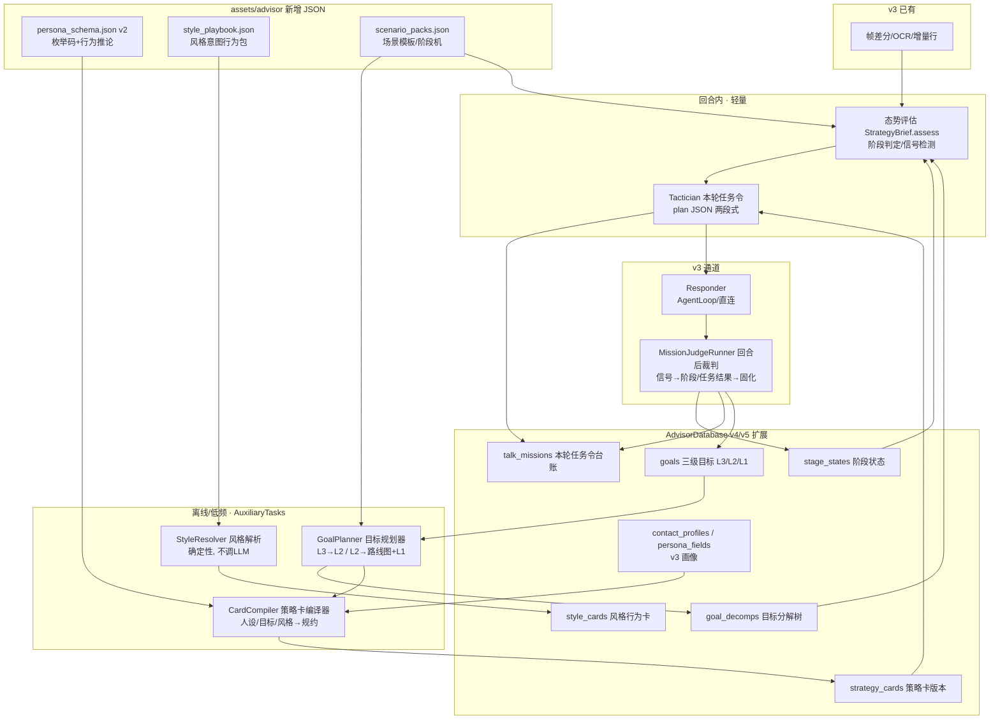

# 智能优化增强的聊天策略方案（老参谋 v4 · 策略大脑）

> 状态：**P0 / P1 / P2 / P3 已全部实施完成**（P2 全链路冒烟 2026-10-16 通过；
> P3 全量实施于 2026-10-16 完成：有向图阶段机、reroute、增强档双调用、行内纠偏、
> DB **v6**、群实体场景等 12 子项，单测/编译/冒烟/logcat 全绿）。**P0~P3 收口，不设 P4**。
> 本文已于 2026-10-16 按落地实现全面更新：Room **v6**、**13 个场景包（含群实体 group_general）**、
> **L3→L2→L1→mission 四级链**、
> **L1 建议只在目标页提示（不弹分屏）**、阶段机为**有向图（四边 + 私有支线 + locked，
> edges 缺省时退化为 P2 线性链）**。评审决议见 §14（原始 4 条 + 追加 2 条）。
> 日期：2026-10-15（2026-10-16 按 P3 实现再次校订）
> 适用分支：`laocanmou`
> 上游文档关系：本文是 [`2026-10-14-老参谋AI辅助自动化聊天功能方案架构设计.md`](2026-10-14-老参谋AI辅助自动化聊天功能方案架构设计.md)（下称 **v3 架构**）
> 在"提示词怎么产生"这一横切面上的**演进方案**，不推翻 v3 的感知/绑定/画像/双写骨架；
> v3 的章节号（§4 数据模型、§6.2 提示词组装、§6.5 记忆分工）在本文中被引用处均标注。
> 涉及代码位置一律以当前分支实际代码为准。同期实施明细见
> [.trae/documents/P1\_风格行为化与场景包\_plan.md](../.trae/documents/P1_风格行为化与场景包_plan.md)、
> [.trae/documents/P2\_三级目标与策略卡\_plan.md](../.trae/documents/P2_三级目标与策略卡_plan.md)、
> [.trae/documents/P3\_有向图阶段机与全量增强\_plan.md](../.trae/documents/P3_有向图阶段机与全量增强_plan.md)
> （三份 plan 均已加盖"已实施"状态戳；与本文有数字出入时，以本文与代码为准）。

---

## 0. 一句话概括

**把"属性 → 提示词 → 回复"的一跳，升级为"目标分解 → 策略编译 → 态势决策 → 回复"的流水线**：
远期/中期/近期三级目标（L3/L2/L1）以不同深度分解，并继续落到每回合的任务令（mission），
形成 **L3→L2→L1→mission 四级链条**并固化为记忆；风格与人设从"裸值"升级为
"带行为定义的资产"；每回合先决策"这一步该干什么、不该干什么"，再产出回复。
LLM 只在需要推理的环节出现，风格解释等确定性知识永不交给它现场发挥。

---

## 1. 背景与问题诊断

### 1.1 现状（已逐行核实）

v3 落地后，单次参谋回合的提示词由 [ChatBriefBuilder.kt](../app/src/main/java/com/verlintas/baic2/floatball/advisor/ChatBriefBuilder.kt)
与 [ScreenAdvisor.runAdvisorTurn](../app/src/main/java/com/verlintas/baic2/floatball/ScreenAdvisor.kt) 拼装，结构是：

```
ADVISOR_STYLE（基调+字数）
【本次聊天的业务目标】   ← contact_profiles.goal（一句话）
【我的语言风格】         ← contact_profiles.style（一句话）
【我的人设】【对方人设】  ← persona_fields 逐行 "标签: 值"
【可参考的话术】Top3      ← PlaybookRetriever FTS
【与X的交往脉络】         ← recallByEntity + 到期承诺 + 成交要件 + 转折铁律
上游 memoryContext        ← getCore + recall(整屏 OCR 抽取的 terms)
```

### 1.2 五个结构性缺陷

| #   | 缺陷                            | 具体后果（真实例子）                                                                                                                                        |
| --- | ------------------------------- | ----------------------------------------------------------------------------------------------------------------------------------------------------------- |
| D1  | **目标只有一层、一跳注入**      | `goal="约对方出来吃饭约会"` 直接进提示词。模型无法区分"终极意图"与"本轮动作"，弱关系首轮就可能直奔邀约，把天聊死                                            |
| D2  | **风格是口号不是行为**          | `style="制造话题，维持聊天，引起关注和兴趣"` 没有可执行定义，每个回合由模型重新解释，风格跨回合漂移，且每回合白烧 token                                     |
| D3  | **画像是档案不是处境**          | `沟通风格: 惜字如金` 只陈述事实，模型得自己推导"所以我要短、别查户口"；30 个字段平铺，与当前情境无关的字段全是噪音                                          |
| D4  | **属性→回复之间缺决策层**       | 聊天是多回合博弈（试探、进退、节奏、时机），现状把战略问题压缩成一次"代写回复"，急功近利，效果取决于模型当场发挥，不可积累、不可复盘                        |
| D5  | **同一事实重复注入 + 召回噪声** | 已确认画像双写上游 Note 后，人设段、脉络段、通用召回三处重复同一条事实（重复还会被模型当成强调权重）；召回 terms 用整屏 OCR，混入时间/标题/按钮文字，易召偏 |

### 1.3 用户的三条明确要求（本方案的需求源头）

1. 聊天是复杂的事，**不能把人设属性、用户级目标、沉淀属性直接生成输入词就出回复**；
2. 目标分三级：**长期目标**（时间积累，逼近用户自身的人设目标）、**短期目标**（1~3 个月可交付成果）、
   **单次目标**（本次上下文化的 talk 目标）；三级目标与 LLM 交互时**分解步骤长度不同，越往后越直接**；
   要用算法参数把不同目标分解成任务、固化成记忆，最后才落到单次聊天；
3. 双方人设、文字风格等属性，录入方式尽量做成**下拉选项 + 手工填写**，数据要仔细设计。

> 术语映射（需求原话 → 落地口径）：长期目标 = L3 远期愿景；短期目标 = L2 中期成果；
> "单次目标"在设计中细化为两层——**L1 近期目标**（本周级，进 goals 表）与
> **mission 本轮任务令**（每回合生成，进 talk_missions），即 §4 的四级链条。

---

## 2. 设计原则（贯穿全文的裁决依据）

| 原则                          | 含义                                                                                                                                                                                      |
| ----------------------------- | ----------------------------------------------------------------------------------------------------------------------------------------------------------------------------------------- |
| P-1 **采集 ≠ 注入**           | 用户填写/自动萃取的原始值是"数据"；进提示词前必须经过"编译/渲染"，变成第二人称的情境规约。原始值只入库，不裸奔                                                                            |
| P-2 **编译一次，复用 N 回合** | 目标分解、风格行为化、画像推论都在"保存时/低频后台"完成并固化；回合内只做取值与选择，不重复推理                                                                                           |
| P-3 **确定性优先**            | 能用资产（枚举码→行为模板）解决的，绝不调 LLM；LLM 只处理开放式目标/语境的推理。风格解释 100% 资产化                                                                                      |
| P-4 **草稿人文本**            | 一切 AI 编译产物（策略卡、目标分解、自定义值的行为化解释）默认是待审核草稿，用户 ✓ 后才参与回合；沿用 v3 §4.2 既有闸门，不新增自动信任                                                    |
| P-5 **零上游侵入**            | 新表全部进 app 模块 `AdvisorDatabase`（v3→**v4** P1 风格卡→**v5** P2 五表，均已落地）；新字段进 `assets/advisor/*.json`；记忆读写仍只走 `MemoryRepository`/public DAO；不新建 Gradle 模块 |
| P-6 **只增不毁**              | Advisor 库迁移只加表/加列/做数据映射，沿用现有幂等 PRAGMA 补列纪律，不清空任何画像与目标数据                                                                                              |
| P-7 **失败静默降级**          | 策略层任何一步失败，退回 v3 的 brief 基线提示词，绝不让参谋回合开天窗                                                                                                                     |

---

## 3. 总体架构

### 3.1 在 v3 架构上新增"策略层"与"决策层"



### 3.2 两种时间尺度（整个方案的节拍器）

| 尺度               | 组件                                             | 何时跑                                                  | 频率                | 用户可感知         |
| ------------------ | ------------------------------------------------ | ------------------------------------------------------- | ------------------- | ------------------ |
| **慢车道（战略）** | GoalPlanner / CardCompiler / StyleResolver       | 新建/修改目标、改人设风格、阶段跃迁、定期复评           | 每联系人每月 0~数次 | 画像页/目标页审核  |
| **快车道（战术）** | 态势评估（StrategyBrief.assess）/ Tactician      | 每次参谋回合开始                                        | 每回合一次（极轻）  | 分屏"本轮策略"一行 |
| **回合后（复盘）** | MissionJudgeRunner + v3 既有 digest/persona 萃取 | 每个成功回合后（共用既有 `consolidationLock` 互斥协程） | 每回合              | 阶段/进度静默更新  |

---

## 4. 三级目标体系（核心）

### 4.1 定义与对比

| 维度         | L3 远期目标（愿景层）                                      | L2 中期目标（成果层）                                                            | L1 近期目标（战术层）                                                                                            |
| ------------ | ---------------------------------------------------------- | -------------------------------------------------------------------------------- | ---------------------------------------------------------------------------------------------------------------- |
| 别名         | 关系愿景 + 理想自我                                        | 战役目标                                                                         | 本周级小目标；其下每回合再生成 **mission 任务令**                                                                |
| 时间尺度     | 3 个月以上或开放                                           | 1~3 个月，**有 deadline**                                                        | 数天～两周（`withinDays` 1~14）；mission 则是本次聊天窗口、分钟级                                                |
| 回答的问题   | "我想在这段关系里成为谁、走向哪"                           | "这一两个月要交付什么结果"                                                       | "这几步要拿下什么"；mission 回答"这轮对话具体推进什么、禁做什么"                                                 |
| 成功判据     | 特质/关系状态的迁移（主观+行为证据）                       | SMART 可验证成果                                                                 | 1~2 周内可验证的小结果；mission 看当场对方反应                                                                   |
| 分解深度     | **最深**：拆成 2~4 个 L2 + 若干"自我修炼项"                | 中：拆成阶段路线图（阶段机上的路径+跃迁信号），**顺带产出 1~3 个当前站 L1 候选** | **最浅**：L1 在回合内被 Tactician 细化为 1 个 mission + ≤3 个动作 + 红线                                         |
| LLM 任务形态 | STRATEGIST（战略规划，maxTokens 900 / temp 0.4）           | PLANNER（路线图 + L1 候选一次出，700 / 0.3）                                     | L1 候选随 PLANNER 产出；mission 由 TACTICIAN 在回复流中两段式产出（150~220 输出 token）                          |
| 谁写/谁改    | 用户写种子，AI 编译分解，**必须人工确认**                  | 用户可写；AI 派生 provisional 立即生效 + **分屏**轻确认（决议 #2）               | L1 可手建；AI 建议为 provisional，**仅在目标 Tab 提示**（决议 #6，绝不弹分屏）；mission 系统生成、无需确认       |
| 存哪         | `goals(horizon=3)` + `goal_decomps`                        | `goals(horizon=2)` + `stage_states`                                              | **`goals(horizon=1)`，`parentId` 指向 L2**；mission 进 `talk_missions`（每回合一行，每联系人保留 60 条）         |
| 例子（约会） | "成为她生活里自然、可信、有趣的人；关系走向稳定暧昧"       | "11 月底前完成一次线下吃饭，并在饭后进入舒适互动期"                              | L1："本周用 livehouse 话钩重启对话，拿到她周末空档的态度（不邀约）"；mission："本轮先聊乐队经历再反问，不催答复" |
| 例子（销售） | "成为客户眼中专业可靠、先于其需求的顾问型销售（理想自我）" | "Q4 签下 A 客户年度框架，金额 50 万±10%"                                         | L1："本周约成一次 15 分钟线上选型会"；mission："先锚定总拥有成本、再给两个会议时间，本轮不报价"                  |

**L3 的两面性**（回应"逼近用户自身人设目标"）：长期目标 = `关系愿景(relationshipVision)`
＋`理想自我(aspirationalSelf)`。后者描述"我希望自己在聊天中成为什么样的人"
（如"情绪稳定、不讨好、有边界感"），它不是对对方的诉求，而是**所有 L1 动作的风格与人格约束源**，
随时间积累、靠每回合的行为选择逼近。它复用我方人设资产（`my_*` 字段）做现状画像，
编译时计算"现状 → 理想"的差距项，生成"自我修炼项"（如"连续 3 次对话不主动秒回式讨好"）。

**四级链条与互斥上限（落地口径）**：

```
L3 远期愿景（goals horizon=3，active ≤1）
 └─ L2 中期成果（goals horizon=2，parentId→L3；active+provisional ≤2）
     └─ L1 近期目标（goals horizon=1，parentId→L2；active+provisional ≤3）
         └─ mission 本轮任务令（talk_missions，每回合一条，留 60 条/联系人）
```

- L1 与 L2/L3 **复用同一张 `goals` 表**（仅 `horizon` 与 `parentId` 不同），不另设表；
- 上限常量在 `GoalRepository` 强制（`CAP_L3=1 / CAP_L2=2 / CAP_L1=3`，
  采纳计数排除自身，避免满额时无法采纳）；超限返回 `LIMIT_REASON`，UI 提示先归档；
- provisional L1 7 天未确认在取数时惰性清理为 abandoned；L1 完成始终由用户手动勾选，
  P3 起 Judge 高置信（≥0.8 且规则同向）仅产出"看起来已达成？"建议条，绝不自动完成。

### 4.2 目标树与分解算法

```text
L3 远期愿景（1 个主愿景，可挂修炼项）
 ├── L2-A 中期成果（deadline、成功判据、优先级；active+provisional ≤2）
 │    ├── 阶段路线：weak 弱联系 → rebuild 重建对话 → attract 吸引/舒适 → probe 试探 → confirm 敲定
 │    │    （站点序列来自 scenario_packs；PLANNER 只填每站 goal/exitSignals，
 │    │     stage code 必须在包内，越界整项丢弃；P3 起 roadmap 可带 edges/privateStages
 │    │     描述分叉/回退/跳站动态边，缺省仍为隐式顺序链）
 │    │    └── 每个阶段：进入条件 / 退出信号(advance) / 退缩信号(retreat) / 该站 missionHint
 │    └── 当前站 L1 近期目标 1~3 个（active+provisional ≤3，仅目标页提示）
 ├── L2-B 中期成果（并行不超过 2 个激活，防止策略互斥）
 └── 自我修炼项（贯穿所有 L2，进策略卡的"自我约束"）

mission 本轮任务令（每回合由 Tactician 在回复流中两段式生成，不另建目标）
 = 当前激活 L1（无则当前阶段 missionHint）+ 当前阶段 + 当前屏态势 → {
     mission: 本轮要推进的一步,
     actions: [≤3 个具体动作],
     forbidden: 本轮禁做（如"不邀约/不报价/不解释过多"）,
     signalsToWatch: [出现什么=可进一格],
     successWhen: 本轮成功判据
   }
```

**分解深度的算法参数（不同 horizon 不同解题型；L1 候选随 L2 一次编译，mission 每回合生成）：**

| 参数                 | L3 STRATEGIST                              | L2 PLANNER（roadmap + L1 候选）                                                                                 | mission TACTICIAN                    |
| -------------------- | ------------------------------------------ | --------------------------------------------------------------------------------------------------------------- | ------------------------------------ |
| 触发                 | 新建愿景/季度复评                          | L3 确认后、L2 完成/放弃后、手动重编                                                                             | 每个策略激活回合                     |
| 输入素材             | 双方人设全貌、关系史摘要、理想自我、场景包 | L3 文本、场景阶段机、当前 `stage_states`、交往脉络                                                              | 当前屏增量、L1/阶段、策略卡、近 2 屏 |
| 输出                 | L2 候选[]（≤4）+ 修炼项[]                  | 每站 goal/exitSignals + 修炼项 + **L1 候选 1~3 个**（stage code 越界丢弃）                                      | 单个 MissionPlan JSON（五字段）      |
| maxTokens            | 900                                        | 700                                                                                                             | 150~220 输出（与回复同一次流式调用） |
| temperature          | 0.4                                        | 0.3                                                                                                             | 0.2                                  |
| 人工确认             | **必须**                                   | 手建项即确认；AI 派生 provisional **立即生效**，L2 走分屏轻确认（✓ 转 active/改则重编/两次不理会归档，决议 #2） | 不需要（mission 仅展示与复盘）       |
| L1 确认口径          | —                                          | 同一次编译顺带产出的 **L1 候选不弹分屏**：只在目标 Tab 标「AI 建议」，✓采纳/忽略，7 天未确认惰性归档（决议 #6） | —                                    |
| 复评周期             | 90 天或连续 3 次 L2 失败                   | 阶段跃迁时 / deadline 前 14 天                                                                                  | 不适用                               |
| 同一目标的重规划抖动 | 同一证据不重复规划；版本递增，旧版归档     | 同左；未确认 draft 不重编                                                                                       | 纯函数式，不缓存                     |

**激活与互斥**：同一联系人 L3 active ≤ 1；L2 active+provisional ≤ 2；L1 active+provisional ≤ 3
（`GoalRepository` 强制）。新建冲突目标时编译器输出"互斥/协同"判定
（如"逼单"与"重建信任"互斥）并提示用户排序。

### 4.3 阶段机（目标推进的轨道）

阶段不是自由文本，而是场景包（`scenario_packs.json`）里定义的**确定性状态机**，
v3 已有的 `intentStage`（破冰/询盘/比价/犹豫/促单/成交/售后）升级为 B2B 销售包的标准阶段；
场景包已做齐 **13 个、分五组**（情感关系/职场/商业/冲突维权/社群，清单见 §6.4）。
每个阶段含：进入条件、`advance`/`retreat` 信号词与语义信号、
本阶段使命模板（missionHint）、默认风格组合、禁忌。阶段判定 = 信号（确定性词表）优先，
语义信号由 Judge（`MissionJudgeRunner`）下一回合节流轻 LLM 低权重更新，
**禁止模型在回合内自行宣布跳阶段**（防止一热情就"她喜欢我"）。

**P2 落地形态：线性链（已实施）**。每个包的 stages 是一条有序站点链：
① 信号达阈值（不同信号键命中 ≥ 站信号数−1）且经 Judge 确认 → 顺序前进一站；
② 手动改站始终允许并留痕（evidence="手动设置"）；③ 命中 retreat 信号只挂"降温/修复"态势、
累计 `failStreak`，**不回退站点**；④ maintain/defend 包的终点站为停留态（不产生跃迁）。
**P3 落地形态：有向图（已实施）**。`RoadmapPayload` 可带 `edges`（advance/branch/
retreat/skip 四种边）与 `privateStages`（随路线版本走的私有支线，可带 pathTag 与
expectedDays）；`StagePolicy.resolveEdge` 在当前站出边中按 **advance（阈值沿用
distinct-key ≥ 信号数−1）→ skip（条件命中）→ retreat（规则强信号且存在 retreat 边）**
裁决。四边语义：

- **advance**：阈值达成自动前进（同 P2）；
- **branch**：`needConfirm=true`，只产出"待确认跃迁"轻确认条（"局势出现新分支"），
  用户确认才移动，沉默两次不再弹；
- **retreat**：语义较 P2 放宽——**无 retreat 边时保持 P2 行为**（只挂降温态势 +
  failStreak，不回站）；有 retreat 边且命中时才回站，history 标"策略性回撤"；
- **skip**：条件命中自动执行，`stage_history` 留痕，GoalTab 可一键退回上一站。

另有 **locked**：手动改站自动加锁（也可点锁解除），锁定时自动边不得移动，只放行
manual/reroute。**edges 缺省（现存 13 个内置包与旧 roadmap）= 隐式顺序 advance 边，
行为与 P2 线性链逐字一致**；终点站（骨架末站无出边）保持停留态。每次移动（含 init/
manual/reroute）统一写 `stage_history`（滚动 50 条）。reroute 产物可带 `stageMapping`
完成新旧路线站点迁移，详见 §9.2 与 P3 plan §四/§六。

---

## 5. 策略流水线：从一次截屏到一条回复（新主链路）

替换 v3 §6.2 的拼装位置（[ScreenAdvisor.runAdvisorTurn](../app/src/main/java/com/verlintas/baic2/floatball/ScreenAdvisor.kt)），
新链路 6 步，前 2 步轻量、可与取数并行：

```text
T0 感知：增量 OCR（v3 不变）
T1 取数（并行）：confirmed 策略卡 + stage_states + active L2/L1 + 风格卡 + 记忆（去重后，见 §8）；
     同时惰性清理超 7 天未确认的 provisional L1
T2 态势评估（落地为 StrategyBrief.assess，确定性零 LLM）：
     - retreat 信号词表命中、advance 候选粗筛、上轮 pending mission 待裁
     - 当前阶段复核（信号驱动；与 stage_states 不符→只计数，待下一回合 Judge 确认，不直接跳）
T3 Tactician 生成本轮 mission（两段式：输出协议要求 <plan>JSON</plan> 前缀）：
     输入 = 当前 L1（无则阶段 missionHint）+ 阶段 + 态势 + 策略卡；输出 MissionPlan 五字段（§4.2）
T4 Responder 生成回复（与 T3 同一次流式调用）：
     system = 规约总纲 + 角色处境 + 阶段/近期目标/红线 + 本轮 mission + 行为化风格
              + 相关画像推论 + 话术Top3 + 交往脉络
     （PlanStreamFilter 对用户隐藏 <plan>；只注入与本阶段/本 mission 相关的画像行）
T5 展示：正文气泡（无 JSON 残留）+ 策略条三态（planning/L2 轻确认/本轮策略只读行）
───────────── 回合后（consolidationLock 内 persona 萃取之后）─────────────
T6 Judge 复盘（落地为 MissionJudgeRunner：当回合规则，下一回合节流轻 LLM）：
     - 对照 mission.successWhen 与对方最新来信 settle mission 结果
     - advance 信号跨键达阈值才顺序推进一站并写 evidence；retreat 命中时若 roadmap
       存在 retreat 出边则回站（history 标策略性回撤），无边则保持 P2 行为：只挂降温
       态势 + failStreak，不移动；所有移动统一写 stage_history（见 §9.2）
     - 更新 L2 progressNote；承诺/报价沿用 v3 既有萃取通道
     - failStreak 达 3 → 标记 L2 review 建议复评，不自动改目标
```

**T3/T4 合并还是分两次调用？** P2 只交付默认档**一次调用两段式**（已实施）：
模型先输出且只输出一个 `<plan>…MissionPlan JSON…</plan>`，空一行后直接写回复正文；
`PlanStreamFilter` 在流式层把规划块对用户隐藏（跨 chunk 安全、未闭合/超 1200 字畸形兜底全文上屏），
首字延迟仅增加规划块的 150~220 输出 token，并用"正在定本轮策略…"等待提示（最短 400ms）消解白等感。
**增强档双调用（P3 已实施）**：设置页开放"增强"档（`STRATEGY_ENHANCED=2`）。
增强档且智能通道回合，主调用**之前**先跑一次 Tactician 预分析（AuxiliaryTasks，
≤300 tok、temp 0.2、8s 预算），输出严格 JSON
`{hardActions,donts,mustAnswer,toneGuard}`，经确定性校验器（字段/长度/非法指令）
校验；通过则作为"本轮战术硬约束"块注入主调用 system prompt（物理位置：策略卡内容
之后、红线块之前，见 §8.1）。预调用异常/超时/解析失败 → 静默回退一段式（日志记
`REASON_ENHANCED_FALLBACK`，最终行为退化为智能档）。仅增强档、仅智能通道、严格串行，
新增成本只发生在用户手选时。读到非法档位仍回退智能档（1）。
两档产出的 mission 都落 `talk_missions`，保证可复盘。`talk_missions` 保留最近 60 条/联系人，
超期自动裁剪，不做长期库。

---

## 6. 数据设计（重点，回应"仔细设计数据"）

### 6.1 枚举值：下拉选项 + 手工填写的统一表示

**设计抉择**：资产里的每个选项有稳定 `code`（与显示文案解耦，改文案不失效、可多语言）；
存储一律存 **code**；手工值以固定前缀 `~` 标识（code 命名限定 `[a-z0-9_]`，永不冲突）。

- `enum` 单值：`value = code` 或 `value = "~用户原文"`
- `tags` 多值：JSON 数组，元素同上，例 `["music_livehouse","~成都美食"]`
- `text/textarea/date`：原文不变

**存量迁移（v3→v4 数据不丢）**：v3 的 enum 存的是中文 label（如 `"惜字如金"`）、
tags 存的也是 label 数组。迁移时按 schema v2 的 `options[].label → code` 映射表
在首次打开画像页时惰性转换（幂等，转换失败的原样保留并视为 custom）；映射用一次性
DAO 批处理，不用 LLM。

### 6.2 `assets/advisor/persona_schema.json`（v2，向后兼容追加）

字段定义在 v3（`key/owner/group/type/label/extract/options/memory`）基础上**追加**：

```json
{
  "key": "commStyle",
  "owner": "their",
  "group": "性格沟通",
  "type": "enum",
  "label": "沟通风格",
  "allowCustom": true,
  "salience": "high",
  "options": [
    {
      "code": "direct",
      "label": "直接干脆",
      "impl": "对方要结论不要铺垫：你先给答案、一句话说清，不绕弯、不寒暄过载",
      "topicHook": false
    },
    {
      "code": "terse",
      "label": "惜字如金",
      "impl": "对方话少是习惯不是冷淡：你每次不超过两句、不连环提问填空，她短句回应就换话题",
      "topicHook": false
    }
  ]
}
```

新增属性语义：

| 属性                     | 取值             | 作用                                                                                  |
| ------------------------ | ---------------- | ------------------------------------------------------------------------------------- |
| `allowCustom`            | bool，默认 true  | UI 是否给"手工填写"入口；false 则只能选枚举                                           |
| `salience`               | high/normal/low  | 与当前阶段/mission 的相关度基线；low 字段（家乡/院校…）默认不进提示词，仅作话题素材库 |
| `options[].code`         | string           | 稳定标识                                                                              |
| `options[].label`        | string           | 下拉显示文案                                                                          |
| `options[].impl`         | string           | **确定性行为推论模板**（"对方是X → 你要Y"），渲染时直接拼，零 LLM                     |
| `options[].topicHook`    | bool             | 该值是否可作话题钩子（兴趣/家乡=true；沟通风格=false）                                |
| 字段级 `implTpl`（可选） | string，含 `{v}` | text/textarea 类的推论模板；`{v}` 为原文。无模板的开放式字段不自动推论，交策略卡编译  |
| `staleAfterDays`（可选） | int              | 时效性（见 §8.3），如 budget 设 60；到期渲染自动加"请先验证"措辞                      |

**双方人设新增字段（下拉为主）**——在现有目录追加组：

| owner | key                        | label          | type              | 选项/说明                                                                  |
| ----- | -------------------------- | -------------- | ----------------- | -------------------------------------------------------------------------- |
| my    | `my_aspiration`            | 我的理想自我   | tags(枚举+自定义) | 情绪稳定/有边界感/不讨好/幽默有料/专业可靠/真诚直接…（来自风格资产同码表） |
| my    | `my_relation_goal_default` | 默认关系愿景   | enum+custom       | 长期伴侣/稳定暧昧/普通朋友/客户信任/师長印象…                              |
| their | `emotionStyle`             | 情感表达       | enum              | 外放/慢热/回避型未知…（带 impl）                                           |
| their | `replyPace`                | 回复节奏       | enum              | 秒回/时段性活跃/常隔数小时（话题节奏控制用）                               |
| their | `loveLanguage`             | 吃哪种好感方式 | tags              | 被赞美/被倾听/实用帮助/共同体验/幽默感（约会包专用）                       |

### 6.3 `assets/advisor/style_playbook.json`（新增 · 风格行为化的根）

风格分两层：**基调 tone（单选）** ＋ **风格意图 intents（多选 chip）** ＋ 可选一句自定义补充。
每个意图是一个"行为包"，编译期与回合期都只做查表拼接：

```json
{
  "tones": [
    { "code": "pro", "label": "专业严谨", "voiceRule": "用陈述句与数据，少语气词，称谓用"您"" },
    { "code": "buddy", "label": "朋友式轻松", "voiceRule": "口语短句，可少量表情，不端着，但不油" }
  ],
  "intents": [
    {
      "code": "spark_topic",
      "label": "制造话题",
      "do": [
        "每条回复结尾保留一个开放式话钩，不用是非问句收尾",
        "话题从对方画像（兴趣/家乡/近期关注）或她最近的动态取材",
        "一次只推进一个话题，对方接住再深入"
      ],
      "dont": ["连续提问不超过2个，杜绝查户口", "不连发三条以上无回应消息"],
      "good": "对了，你之前提过喜欢livehouse——这周末有个乐队来，有关注吗？",
      "bad": "在吗？忙吗？吃饭了吗？",
      "fitStages": ["rebuild", "attract"]
    },
    {
      "code": "hold_warmth",
      "label": "维持聊天热度",
      "do": ["回应先共情/复述情绪，再延展观点", "记住她提过的细节并在后续自然复用"],
      "dont": ["不只用哈哈/嗯嗯收尾", "不在她低谷时硬转话题"]
    },
    {
      "code": "show_value",
      "label": "引起关注与兴趣",
      "do": ["用具体故事/细节展示生活密度，不自我标榜", "观点要有信息量或趣味，给她接话空间"],
      "dont": ["不炫耀、不贬低别人抬自己", "不长篇大论超过三句"]
    },
    {
      "code": "push_close",
      "label": "推进邀约/成交",
      "do": ["给出具体时间地点二选一，不问'要不要去'", "邀约前先用一句共同语境铺垫"],
      "dont": ["信号不足时不提前使用本意图（由阶段门禁用，见 §7）"]
    }
  ]
}
```

`fitStages` 让风格意图与阶段机联动：未到 `probe/close` 阶段时，`push_close`
即使被选中也只作为"长期意图"记录、**不渲染进本回合**，从资产层根治 D1 的时机错误。

### 6.4 `assets/advisor/scenario_packs.json`（P1 新建、P2 扩至 12 包、P3 加群包至 13 包 · 已落地）

每个包两个元数据字段：`pathKind`（`pursue` 推进型 / `maintain` 经营型 / `defend` 防守型，
默认 pursue；defend 终点为止损切割、红线最前置且永不注入"推进关系"措辞）与
`group`（`romance` / `workplace` / `business` / `conflict` / `social`，场景选择器按五组分段）。
**13 包全清单（dating/sales_b2b 为 P1 存量，10 个 P2 新增，group_general 为 P3 新增）：**

| 组         | code                 | 场景                                                 | pathKind | 站点链（顺序）                                                                     |
| ---------- | -------------------- | ---------------------------------------------------- | -------- | ---------------------------------------------------------------------------------- |
| 情感关系   | `dating`             | 恋爱/暧昧                                            | pursue   | weak → rebuild → attract → probe → confirm                                         |
| 情感关系   | `couple`             | 情侣/夫妻长期经营                                    | maintain | daily → cooling → repair → cocommit（停留）                                        |
| 情感关系   | `family`             | 父母/长辈代际沟通                                    | maintain | greet → gap → insist → compromise（停留）                                          |
| 职场       | `workplace_superior` | 与上级                                               | maintain | settle → trust → delegated → promoted（停留）                                      |
| 职场       | `colleague`          | 同事平级                                             | maintain | ice → familiar → mutual → ally（停留）                                             |
| 职场       | `job_hunt`           | 求职/面试/谈 offer                                   | pursue   | apply → interview → offer → onboard                                                |
| 商业       | `sales_b2b`          | B2B 销售                                             | pursue   | ice → inquiry → compare → hesitate → push → deal → after                           |
| 商业       | `sales_c`            | C 端销售（零售/保险/微商）                           | pursue   | ice → need → trust → close → repurchase                                            |
| 商业       | `vendor`             | 供应商/乙方管理（我是甲方）                          | maintain | inquiry → compare → contract → delivery → partnership（停留）                      |
| 商业       | `networking`         | 贵人/弱关系经营                                      | maintain | added → kept → exchange → deep（停留）                                             |
| 冲突维权   | `adversarial`        | 人际冲突/对立方                                      | defend   | hold → clarify → boundary → resolve（停留）                                        |
| 冲突维权   | `complaint`          | 消费投诉/服务维权                                    | defend   | state → escalate → settle → close（停留）                                          |
| 社群（P3） | `group_general`      | 群聊/社群经营（群=单一对方实体，relationType=group） | maintain | g_show 破冰露面 → g_present 稳定在场 → g_trust 关键人互信 → g_rep 口碑沉淀（停留） |

> **P3 群聊口径**：不建多参与者模型，群整体绑定为一个 ContactProfileEntity（群名=对方名，
> 画像字段描述群整体/关键角色），复用一对一全部链路；persona schema 其侧加群类型
> （工作/兴趣/家长/邻里）/群规模/关键角色字段，编辑器按 relationType=group 显隐；
> 分屏与目标页文案按 relationType 切"群里/大家"，不出现私聊措辞。defend/职场专用意图库
> （hold_line/disengage/fact_anchor/manage_upward/credit_share/de_escalate 六个）同期落地，
> retreat 类意图只在 defend 包与 retreat 边命中后上浮。

下面 JSON 仅给出两个存量包的结构示例（**完整 13 包逐字内容以资产文件为准**）：

```json
{
  "packs": [
    {
      "code": "dating",
      "label": "恋爱/暧昧",
      "relationTypes": ["暧昧对象", "朋友"],
      "goalTemplates": [
        {
          "horizon": 3,
          "text": "和{name}走向稳定、自然的亲密关系；同时我成为{aspiration}的人"
        },
        {
          "horizon": 2,
          "text": "在{deadline}前完成一次自然的线下邀约（吃饭/看展），饭后互动不冷场"
        }
      ],
      "defaultTone": "buddy",
      "defaultIntents": ["spark_topic", "hold_warmth", "show_value"],
      "stages": [
        {
          "code": "weak",
          "label": "弱联系",
          "exit": { "advanceSignals": ["主动发起过话题", "连续两次回复≥2句"] }
        },
        { "code": "rebuild", "label": "重建对话" },
        { "code": "attract", "label": "吸引/舒适" },
        { "code": "probe", "label": "试探邀约" },
        { "code": "confirm", "label": "敲定见面" }
      ],
      "retreatSignals": ["拒绝", "算了", "呵呵", "已读不回超过24小时"],
      "taboos": ["查户口式提问", "深夜连续试探", "提前任/查岗"]
    },
    {
      "code": "sales_b2b",
      "label": "B2B销售",
      "stages": ["破冰", "询盘", "比价", "犹豫", "促单", "成交", "售后"],
      "taboos": ["未确认预算前报价", "对已转意向客户继续强调痛点"]
    }
  ]
}
```

场景包随 APK 预置、不联网更新；用户选场景 = 一次性把阶段机、目标模板、默认风格配齐，
空配置用户开箱即有合格策略；上线后措辞问题直接热修 JSON 资产，无需发版。
新建目标对话框与风格编辑页共用同一个按 `group` 五组分段的场景选择器（资产驱动，新增包零代码改动）。

### 6.5 AdvisorDatabase 表结构（v4 / v5 / v6 三次迁移，均已落地）

版本演进（只增不毁，沿用 `CREATE TABLE IF NOT EXISTS` + `ensureColumn` 幂等纪律）：

| 版本                          | 迁移            | 内容                                                                                                                                                                                             |
| ----------------------------- | --------------- | ------------------------------------------------------------------------------------------------------------------------------------------------------------------------------------------------ |
| v3 → **v4**（P1，2026-10-15） | `MIGRATION_3_4` | 新建 `style_cards`；`contact_profiles` 补 `scenarioCode`。enum 的 label→code 搬运不进 SQLiteMigration，由 `PersonaValueMigrator` 惰性完成                                                        |
| v4 → **v5**（P2，2026-10-15） | `MIGRATION_4_5` | 新建 `goals` / `goal_decomps` / `stage_states` / `strategy_cards` / `talk_missions` 五表；`contact_profiles` 补 `activeCardId`。只建结构不搬数据                                                 |
| v5 → **v6**（P3，2026-10-16） | `MIGRATION_5_6` | `stage_states` 补 `roadmapVersion`/`pathTag`/`locked` 三列；新建 `stage_history` 时间线表；`session_bindings` 补 `lastIncomingAt`（24h 时序信号）。旧行 roadmapVersion=null 自动退化为 P2 线性链 |

```sql
-- ①【v5】三级目标同表：L3/L2/L1 以 horizon 区分；mission 不进此表，进 talk_missions
CREATE TABLE goals (
  id INTEGER PRIMARY KEY AUTOINCREMENT,
  contactId INTEGER NOT NULL,              -- 0 = 跨联系人的"理想自我"类全局目标
  horizon INTEGER NOT NULL,               -- 3=L3 远期 2=L2 中期 1=L1 近期
  parentId INTEGER,                        -- L2→L3；L1→L2
  scenarioCode TEXT,                       -- 场景包 code
  title TEXT NOT NULL,                     -- 用户原话种子
  successCriteria TEXT,                    -- 成功判据（L2 必填，编译产物，待确认）
  deadlineAt INTEGER,                      -- L2 必填；L3 可空
  -- draft=未生效待确认; provisional=AI派生观察期(立即用;仅 L2 分屏轻确认,见决议#2/#6);
  -- active=已确认; done/abandoned=终结; review=连续失败建议复评
  status TEXT NOT NULL DEFAULT 'draft',
  promptCount INTEGER NOT NULL DEFAULT 0,  -- 仅 L2 分屏轻确认计数（≤2）；L1 恒 0（只在目标页提示）
  priority INTEGER NOT NULL DEFAULT 5,
  source TEXT NOT NULL DEFAULT 'user',     -- user / ai(派生)
  confirmed INTEGER NOT NULL DEFAULT 0,    -- 确认后置1（provisional→active）
  failStreak INTEGER NOT NULL DEFAULT 0,   -- 连续失败计数（达3→建议复评）
  progressNote TEXT,                       -- Judge 回写的最新进度证据（≤200字）
  reviewedAt INTEGER,
  createdAt INTEGER NOT NULL,
  updatedAt INTEGER NOT NULL
);
CREATE INDEX index_goals_contactId_status ON goals(contactId, status);
CREATE INDEX index_goals_parentId ON goals(parentId);
CREATE INDEX index_goals_contactId_horizon_status ON goals(contactId, horizon, status);

-- ②【v5】目标分解树（L3→L2 outcomes、L2→阶段路径 roadmap(含 L1 候选)、practices 修炼项；版本化）
CREATE TABLE goal_decomps (
  id INTEGER PRIMARY KEY AUTOINCREMENT,
  goalId INTEGER NOT NULL,
  version INTEGER NOT NULL DEFAULT 1,
  kind TEXT NOT NULL,                      -- outcomes(L3拆L2) / roadmap(L2阶段路径) / practices(修炼项)
  payloadJson TEXT NOT NULL,               -- 见 §6.6 结构
  confirmed INTEGER DEFAULT 0,
  supersededBy INTEGER,                    -- 新版本指针
  createdAt INTEGER NOT NULL
);
CREATE INDEX index_goal_decomps_goalId_version ON goal_decomps(goalId, version);

-- ③【v5/v6】联系人 × 场景 的阶段状态
-- v6 追加三列：roadmapVersion（当前遵循的 roadmap decomp 版本；null=pack 骨架线性链=P2 行为）、
--              pathTag（当前所在私有支线；null=主线）、locked（1=手动锁定，自动边不得移动）
CREATE TABLE stage_states (
  contactId INTEGER NOT NULL,
  scenarioCode TEXT NOT NULL,
  stageCode TEXT NOT NULL,                 -- 当前阶段
  enteredAt INTEGER NOT NULL,
  advanceHits TEXT NOT NULL DEFAULT '{}',  -- 跃迁信号计数 JSON {signal:count}
  evidence TEXT,                           -- 最近一次阶段变化的对话证据短句
  roadmapVersion INTEGER,                 -- 【v6】
  pathTag TEXT,                           -- 【v6】
  locked INTEGER NOT NULL DEFAULT 0,      -- 【v6】
  PRIMARY KEY(contactId, scenarioCode)
);

-- ③b【v6】阶段移动时间线（每联系人×场景滚动保留 50 条，DAO trim）
CREATE TABLE stage_history (
  id INTEGER PRIMARY KEY AUTOINCREMENT NOT NULL,
  contactId INTEGER NOT NULL,
  scenarioCode TEXT NOT NULL,
  fromCode TEXT,
  toCode TEXT NOT NULL,
  edge TEXT NOT NULL,     -- advance/branch/retreat/skip/manual/reroute/init
  reason TEXT,            -- 信号短语 / 手动设置 / reroute 映射等
  at INTEGER NOT NULL
);
CREATE INDEX index_stage_history_contact ON stage_history(contactId, scenarioCode, at);

-- ④【v5】策略卡（编译一次复用N回合；人/场景变更或目标改版时重编，版本递增）
CREATE TABLE strategy_cards (
  id INTEGER PRIMARY KEY AUTOINCREMENT,
  contactId INTEGER NOT NULL,              -- 0 = 我方默认卡（理想自我/默认风格）
  version INTEGER NOT NULL DEFAULT 1,
  scenarioCode TEXT,
  payloadJson TEXT NOT NULL,               -- §6.6 策略卡结构
  status TEXT NOT NULL DEFAULT 'draft',    -- draft/confirmed/archived
  createdAt INTEGER NOT NULL
);
CREATE INDEX index_strategy_cards_contactId_status ON strategy_cards(contactId, status);

-- ⑤【v4 · P1】风格卡（tone + intents + 自定义补充的行为化结果；确定性，不调LLM；
--    P3 起 customNote 走 LLM 行为化编译：compiledCustomJson 非空时为 draft，
--    StyleCardActivity 确认条采用后 confirmed=1 才渲染进 prompt；重编/放弃均留痕）
CREATE TABLE style_cards (
  id INTEGER PRIMARY KEY AUTOINCREMENT,
  scope TEXT NOT NULL,                     -- my_default / contact
  contactId INTEGER NOT NULL DEFAULT 0,    -- scope=contact 时为联系人 id
  toneCode TEXT,
  intentCodes TEXT NOT NULL DEFAULT '[]',  -- JSON 选中的意图码
  customNote TEXT,                         -- 用户手写一句补充
  compiledCustomJson TEXT,                 -- 自定义补充的 do/dont 编译结果（待确认）
  confirmed INTEGER DEFAULT 1,             -- 纯选项组合即时生效；含自定义编译才需确认
  updatedAt INTEGER NOT NULL
);
CREATE UNIQUE INDEX index_style_cards_scope_contactId ON style_cards(scope, contactId);

-- ⑥【v5】本轮任务令台账（mission 及其结果；短期保留，每联系人/会话各裁剪至 60 条）
CREATE TABLE talk_missions (
  id INTEGER PRIMARY KEY AUTOINCREMENT,
  conversationId INTEGER NOT NULL,
  contactId INTEGER,
  turnMessageId INTEGER,                   -- 触发本任务令的 USER 消息 id
  stageCode TEXT,
  goalId INTEGER,                          -- 服务的 L1（缺省时挂 L2）
  mission TEXT NOT NULL,                   -- 本轮一句话任务
  actionsJson TEXT NOT NULL DEFAULT '[]',  -- ≤3 动作
  forbiddenJson TEXT NOT NULL DEFAULT '[]',-- 本轮禁做
  signalsJson TEXT NOT NULL DEFAULT '[]',
  planBlockJson TEXT,                      -- 完整规划块（复盘原料）
  result TEXT NOT NULL DEFAULT 'pending',  -- pending/advanced/held/regressed/ignored
  adoptedIndex INTEGER,                    -- 【P3 启用】用户采纳的建议序号（行内 ✓采纳 回写；重生成回合置空）
  createdAt INTEGER NOT NULL
);
CREATE INDEX index_talk_missions_conversationId_id ON talk_missions(conversationId, id);
CREATE INDEX index_talk_missions_contactId ON talk_missions(contactId);
```

> 上为字段结构示意；精确列定义、默认值与索引名以
> [AdvisorDatabase.kt](../app/src/main/java/com/verlintas/baic2/floatball/advisor/data/AdvisorDatabase.kt)
> 的 `MIGRATION_3_4` / `MIGRATION_4_5` / `MIGRATION_5_6` 为唯一准绳。

`contact_profiles` 两次各追加一列（v3 的 goal/style **保留只读兼容**，新链路读新表；
有 active L2 时旧 goal 行被抑制但永不删除，不删列）；v6 另给既有 `session_bindings`
追加来信时间列（帧感知层按来信文本指纹去抖后写入，供 silence_24h 中性信号消费）：

```sql
-- v4（P1）：
ALTER TABLE contact_profiles ADD COLUMN scenarioCode TEXT;   -- 当前场景包
-- v5（P2）：
ALTER TABLE contact_profiles ADD COLUMN activeCardId INTEGER; -- 当前生效策略卡
-- v6（P3）：
ALTER TABLE session_bindings ADD COLUMN lastIncomingAt INTEGER; -- 对方最后来信时间
```

Room version **3 → 4 → 5 → 6（当前版本 6）**：`MIGRATION_3_4` 只建 style_cards +
scenarioCode；`MIGRATION_4_5` 建五表 + activeCardId；`MIGRATION_5_6` 加 stage_states
三列 + stage_history + lastIncomingAt，旧数据 roadmapVersion=null 无感退化为线性链。
§6.1 的 enum label→code 映射始终在 Room 之外
由 `PersonaValueMigrator` 惰性完成（首次打开画像页/风格页触发，不塞进 SQLiteMigration）。

> 冒烟期实测两则实现教训：① 模板填充正则结尾大括号在 Android ICU 必须转义
> （`"\\{([a-zA-Z_]…)\\}"`），OpenJDK 单测测不出裸 `}` 崩溃；② L1 采纳计数必须排除自身
> （DAO `countActiveExcept`），否则满 3 候选时无法采纳。

### 6.6 关键 JSON 产物结构

`goal_decomps.payloadJson`（L2 路线图示例）：

```json
{
  "stages": [
    {
      "code": "rebuild",
      "goal": "无压力重启对话",
      "exitSignals": ["主动追问", "回复≥2句并带情绪词"]
    },
    {
      "code": "attract",
      "goal": "建立舒适与好奇",
      "exitSignals": ["主动开启新话题", "延续私聊超过3天"]
    },
    {
      "code": "probe",
      "goal": "试探线下意愿",
      "exitSignals": ["对邀约提议给积极回应"]
    },
    {
      "code": "confirm",
      "goal": "敲定时间地点",
      "exitSignals": ["确认具体时间或地点"]
    }
  ],
  "practices": [
    "不因对方短回而追加消息",
    "把'引起兴趣'落实为每回合一个有信息量的细节"
  ],
  "l1": [
    {
      "title": "本周用 livehouse 话钩重启对话，拿到她周末空档态度",
      "successCriteria": "她明确表示去/不去或给出可用时间",
      "withinDays": 7,
      "priority": 5
    }
  ]
}
```

> `l1` 为 PLANNER 编译 roadmap 时顺带产出的当前站近期目标候选（1~3 个，落 `goals` horizon=1
> provisional，仅目标页提示，见决议 #6）；stage code 越界的 stages 项整项丢弃，
> 缺漏站保留资产 `missionHint` 兜底。

`strategy_cards.payloadJson`（编译产物，回合内直接消费）：

```json
{
  "roleLine": "你是用户本人，正在微信和「小夏」（20-29岁，暧昧初期、联系尚浅）聊天；她话少是习惯不是冷淡。",
  "selfConstraints": [
    "情绪稳定，不讨好、不秒回式追问",
    "每轮一个有信息量的表达"
  ],
  "theirImplications": [
    "她习惯短回复 → 你每次不超过两句、先给结论",
    "她对严肃玩笑接受度低 → 不玩梗试探，靠内容推进"
  ],
  "topicBank": [
    "livehouse",
    "成都美食（她家乡，可作备选题，她提起前不强攀老乡）"
  ],
  "taboos": ["不查户口", "本轮及弱联系阶段不邀约"],
  "cardVersion": 1
}
```

> 实现上四个列表段的每项是 `{text, source}`（`source=ai/user`）：用户在审核页改写/新增的条目
> 标 `user`，重编时按指纹保留、不被覆盖；`theirImplications`（对方推论）**只进审核卡供人审阅，
> P2 不重复注入回合**（人设段已有，避免 D5）；`topicBank` 仅 pursue 包生成，
> defend 包的 pack.taboos 排最前并带"冲突期"分组前缀。

---

## 7. 阶段门控：把"时机"变成算法而不是感觉

Tactician 生成 mission 时受确定性门控约束（全部来自资产，不调 LLM）：

1. **意图门**：风格意图 `fitStages` 不含当前阶段 → 不渲染；**跨包兼容规则**：某意图只在
   "对本包声明过门控（fitStages 与本包站点集有交集）但不含当前站"时才过滤——从未对本包声明
   门控的意图视为通用意图全站点放行，避免新 10 包误杀用户已选意图；
2. **动作门**：按 `packCode:stageCode` 与 pathKind 取硬约束（dating 弱联系站禁邀约、
   销售早期站禁报价逼单、defend 全包禁拉近关系/禁情绪化措辞、maintain 禁越界替人承诺等）；
3. **红线门**：场景 taboos + `persona_fields.taboos` 永远注入 forbidden；
4. **承诺一致性门**：mission 涉及价格/时间时，交往脉络中的有效 AGREEMENT/FACT
   必须被引用且不得冲突（复用 v3 成交要件与转折铁律）；
5. **回退门**：命中 `retreatSignals` → 强制 mission 降级为"降温/修复"类，
   连续两次回退写 `failStreak` 并建议复评 L2。

---

## 8. 提示词契约（修复 D3/D5）

### 8.1 新 system prompt 段落顺序（固定，冲突时自上而下）

下列为**语义段落契约**（冲突时自上而下裁决）；落地的物理拼装顺序见段后说明。

```text
【规约总纲】（置首，P0）
你是用户本人，不是助手。信息冲突时的优先级：
当前屏幕事实 > 本轮任务 > 有效承诺与约定 > 长期自我约束 > 历史画像。
历史只代表当时；当前屏出现矛盾信号一律顺应当前屏（沿用 v3 转折铁律并升级为总纲）。

【你的角色与处境】        ← strategy_cards.roleLine（编译产物，非字段堆砌）
【当前阶段】/【近期目标】  ← stage 站点 goal/missionHint；active L1.title+成功判据（无 L1 省略）
【本轮战术硬约束】(仅增强档) ← Tactician 预调用 JSON 校验通过后注入（hardActions/donts/mustAnswer/toneGuard）；位置在策略卡内容之后、红线之前；校验失败整块消失，回退智能档
【红线（本轮绝对禁止）】    ← StageGate 红线门：pack.taboos + 双方 taboos（defend 前置）
【自我约束】/【本轮态势】  ← selfConstraints（非空才出）；retreat 命中时出降温段；silence_24h 出中性【时序观察】段（只陈述，不催促）
【本轮任务】              ← MissionPlan：mission / actions / forbidden / signalsToWatch / successWhen
【说话方式】              ← style_cards 查表渲染：voiceRule + 所选 intents 的 do/dont（含 P3 defend/职场六意图，按真实阶段/pathKind 过滤）；confirmed 的 customNote 编译结果
【关于对方（与本轮相关）】 ← 人设段；P3 起 selectPersonaFields 裁剪至 ≤6 条（当前站信号相关优先），双方 taboos/红线字段永不裁
【话题素材】              ← topicHook 字段；pursue 包由策略卡 topicBank 生成，P3 起 maintain 包话题池同步扩充
【可参考的话术】Top3       ← v3 PlaybookRetriever 不变
【与X的交往脉络】          ← v3 ContactBriefSection（到期承诺置顶），去重后
【记忆】                  ← 上游 memoryContext（见 8.2 去重与收窄）
【输出协议】              ← 先输出一个 <plan>MissionPlan JSON</plan>，空行后写回复正文（正文不复述 JSON）
```

**物理拼装顺序**（两通道共用同一 customSystemPrompt）：PREAMBLE → styleWithLength →
strategySection（角色/阶段/近期目标）→ **【本轮战术硬约束】（仅增强档，预调用通过才出，
位于策略卡内容之后）** → 红线 → 自我约束/话题/本轮态势（含时序观察）→ brief.styleSection →
directionSection → brief.section（有 active L2 时抑制旧 goal 行）→ contactSection → 输出协议。
策略卡 `theirImplications` 段**只进审核页、不注入回合**（与人设段去重，修 D5）。

### 8.2 去重与召回收窄（修 D5）

- **跨段去重**：注入前对"画像推论 / 脉络 / memoryContext / 话术"按归一化文本指纹
  （抽数字+核心名词）去重；同一事实保留信息量最高的一处（优先级：承诺 > 当前相关画像 > 通用笔记）。
- **召回 query 收窄**：`recall` 的 terms 不再用整屏 OCR，改用「对方最后一条来信正文
  ＋ 当前 L1/阶段关键词」（P0 的 IncomingCue 收窄，取数发生在 LLM 调用之前），
  噪声大幅下降；`recallByEntity` 维持现状。
- **只读纪律不变**：全部 `feedback=false`，看屏不反写权重（v3 §6.5）。

### 8.3 画像时效性（P3 已启用）

`persona_schema.json` 为年龄/城市/职业等易变字段标注可选 `staleAfterDays`
（首批 180/365 天，价值观类不标）。超龄字段**保留不删**，渲染措辞改为
"（早期信息，可能已变化，请先验证）"；裁剪与时效由纯函数
`selectPersonaFields(fields, stage, limit=6)` 统一处理（当前站信号相关优先、
salience normal>low、新者优先，禁忌/红线字段硬豁免）。
FACT 类 90 天 TTL 的上游双写纪律维持不变。

---

## 9. 记忆固化与记忆体系更新

### 9.1 三级目标如何"固化形成记忆"

- L3/L2/**L1** 及其分解存 Advisor 库（私有策略，**按 v3 §6.5 负面清单不双写上游**，避免串档）；
- L2 完成/放弃、阶段跃迁是事件型事实：经 Judge（`MissionJudgeRunner`）确认后写入
  `stage_states`（当前站 + evidence + advanceHits 计数），**事件型语义、不套 90 天 FACT TTL**；
  P3 起每一次移动（init/advance/branch/retreat/skip/manual/reroute）统一追加
  `stage_history`（每联系人×场景滚动 50 条），GoalTab 阶段条下方可展开最近 5 条历程；
- L2 中涉及承诺/约见的具体事项（"周五前给报价"）仍走 v3 既有通道双写上游 `AGREEMENT`，
  接前瞻记忆提醒；目标本身不双写。
- "理想自我"是关于"我"的稳定事实 → 用户确认后按 v3 我方人设通道双写上游
  （`entities=["我"]`，kind=PROFILE），主 App 普通对话同样受益。

### 9.2 Judge 复盘写入项（实现：当回合规则计数 + 下一回合节流轻 LLM）

| 信号               | 写入                                                                                                                                                                               |
| ------------------ | ---------------------------------------------------------------------------------------------------------------------------------------------------------------------------------- |
| mission 完成/推进  | `talk_missions.result`（settle）、阶段 `advanceHits` 计数、`progressNote` 回写                                                                                                     |
| retreat 命中       | 当回合规则即判 regressed + 证据；active L2 `failStreak+1`、挂降温态势；roadmap 有 retreat 出边才回站并写 history，无边不移动                                                       |
| 信号达阈值         | `resolveEdge` 裁决 advance/skip（retreat 见上、branch 只出确认条），applyEdge 移动 + evidence，逐跳写 `stage_history`                                                              |
| 承诺/报价原话      | v3 PersonaExtractor 既有通道：AGREEMENT 带 whenAt / 报价数字高置信草稿                                                                                                             |
| L2 连续 3 次未推进 | `goals.failStreak=3, status=review`，目标页黄条给【重新规划路线】按钮（reroute 必须手动触发，确认后才迁移站点，绝不静默重规划）                                                    |
| L1 疑似完成（P3）  | Judge 输出 completedL1，仅 confidence≥0.8 且规则同向才在 GoalTab 出建议条；**绝不自动勾选**，"还没"后本生命周期不再提示                                                            |
| 用户行内纠偏（P3） | ✓采纳回写 `adoptedIndex` 并复制该条；长按三档（太直接/太软/换方向）即时重生成一次（每回合限 1，旧 mission 置 ignored、新气泡对照保留）；"依据：…记错了"以 addNote 更正记忆，不直删 |

---

## 10. 界面设计（Compose，走 Baic2Theme）

### 10.1 目标管理（混合入口，评审决议 #1）

- **联系人侧**：联系人详情页顶部「画像 / 目标」TabRow，"目标"Tab 四个折叠分区：
  远期愿景 L3 / 中期目标 L2 / **近期目标 L1** / 本回合（只读 mission 台账，近 20 条）；
  Tab 顶部固定一张全局"我的理想自我 · 默认风格"只读快捷卡，点击跳设置页；
  另含"策略卡"入口行（草稿待审核 / 已确认 vN / 未生成）；
- **全局侧**：老参谋设置页"我的聊天策略"区：策略模式（关闭/智能/**增强**——P3 起开放，
  注明"每回合多一次快速分析，响应略慢、更克制"）、
  默认策略卡行，以及 P1 已有的理想自我（aspiration tags）、默认关系愿景、默认风格卡——全局一份复用；
- 新建目标：层级三选一分段 → 选场景包（五组 13 包，P3 新增 social 组群实体包）→ 模板一句话种子（可改，`TemplateFill`
  填 `{name}/{aspiration}`，未知占位符替换下划线）→ 保存即后台编译；L1 必须关联一个 L2；
- L3/L2 编译结果以卡片展示（成功判据、deadline、阶段路线进度条），逐张 ✓/✕/编辑；
  目标页阶段条支持点站手动改站（P3 起手动改站自动加锁防自动边拉走、写 history，可解锁；
  私有支线以虚线节点+pathTag 色块渲染，下方可展开最近 5 条历程），maintain/defend 终点站显示停留徽章；
- L2 卡片显示阶段进度条与最新证据；`review` 状态顶部黄条给【重新规划路线】（P3 reroute 入口，
  另两个入口：同站连续 retreat×2 的分屏条、停留超 expectedDays×1.5 的小字提示）；AI 派生 L2 卡片标"观察期"角标，
  状态说明为"已在辅助你，确认前会在参谋面板再次征求同意"；
- **L1 卡片为轻量卡**（标题+判据+deadline+勾选圈）：AI 派生 provisional L1 只在本页标「AI 建议」，
  ✓采纳/忽略，**不弹分屏**（决议 #6）；7 天未采纳已惰性归档；达上限（3 条）新建置灰；
  L1 完成以手动勾选为准，P3 起 Judge 高置信（≥0.8 且规则同向）仅在卡顶出"看起来已达成？"建议条，绝不自动勾选。

### 10.2 人设与风格录入（落实"下拉+手工"）

- 所有 enum 字段：下拉选 + 末尾"✎ 自定义…"，自定义值在 UI 上以描边 chip 区分；
- tags：常用选项 chip 点选 + 输入框自定义回车添加；
- 风格编辑：基调单选 + 意图多选 chip（do/dont 在下方只读预览，所见即所得）+ 一句自定义补充；
  纯选项组合立即生效；含自定义补充时，**P3 起**走慢车道 LLM 行为化编译（≤3+3 条 do/dont），
  StyleCardActivity 顶部确认条【这样理解对吗：…】[采用]/[重新理解]/[放弃]，采用后才注入 prompt。
- 策略卡审核页：角色处境/自我约束/对方推论/话题/红线分区展示，可逐句改写
  （改写即升级为 user 来源，重编时不覆盖）。

### 10.3 分屏面板（策略条三态互斥，同一时刻最多一个策略 UI）

- **planning 等待提示**：策略激活回合进入流式时显示"正在定本轮策略…"（最短 400ms 防闪烁，
  正文首字符放行后清除）；
- **观察期 L2 轻确认条**（评审决议 #2，**仅 provisional L2**，置顶于本轮策略之上）：
  "我理解你这阶段的目标是「{L2 标题}」，对吗？" → ✓ 确认 / ✎ 改一下 / 本次先跳过；
  同一目标最多出现 2 次（计 `goals.promptCount`，展示即计数），两次不理会自动归档并退回基线；
  **provisional L1 永不进此条**——L1 建议只在目标 Tab 出现（决议 #6）；
- **本轮策略只读条**：单行"**本轮策略**：{mission}｜本轮不做：{forbidden 前 2 条}"，
  点击展开 actions / forbidden / signalsToWatch / successWhen 小字；`<plan>` JSON 本身不对用户可见；
- **待确认事项条（P3 通用化）**：L2 轻确认通道扩展两类——`branch`（"局势出现新分支：
  {label}，要切过去吗？[切过去] [先不]"，沉默两次不再弹）与 `reroute`（"新路线已生成，
  当前站将调整为 {label} [采用新路线] [先不]"，拒绝则新版 decomp 留存不激活）；
- **建议气泡行内交互（P3）**：参谋回复内编号建议（2~3 条）逐条带"✓采纳"（回写
  `talk_missions.adoptedIndex` + 复制正文，已采纳标"✓已采纳"）；长按任一条弹三档
  【太直接了/太软了/换个方向】即时重生成（每回合限 1 次，固定中文指令模板，新气泡追加、
  旧 mission 置 ignored）；气泡下方"依据：X、Y · 记错了"——点记错了就地输入更正，
  走 MemoryRepository.addNote 冲突裁决，不直删记忆；
- 每条建议回复的意图/风险标注沿用 v3 现状。

---

## 11. 调度、Token 与降级

| 项           | 策略（落地现状）                                                                                                                                                                                                                                                                               |
| ------------ | ---------------------------------------------------------------------------------------------------------------------------------------------------------------------------------------------------------------------------------------------------------------------------------------------- |
| 慢车道编译   | `StrategyRuntime` 单例：IO 协程 + 编译 Mutex + inFlight 去重；仅保存目标/确认 L2/手动重编触发，未确认 draft 不重编，月均个位次数                                                                                                                                                               |
| 快车道 T2/T3 | T2 态势评估是确定性规则（零 LLM，并入 `StrategyBrief.assess`）；T3 默认并入 T4 同一次流式调用（`<plan>` JSON 前缀）；**增强档（P3）在主调用前串行一次 Tactician 预调用（≤300 tok/8s），校验通过注入战术硬约束，失败静默回退一段式**                                                            |
| token 增量   | 智能档每回合 +约 150~220 输出 token（规划块，不新增请求数）；增强档另 +一次 ≤300 tok 预调用（仅用户手选增强档、仅智能通道回合）；Judge 轻复盘 ≤200 输出且 ≥3 回合才节流一次；D5 去重 + 画像 ≤6 条裁剪在输入端省回                                                                              |
| 失败降级     | 模式关/无联系人/目标卡阶段全无 → 等同 P1；MissionPlan 解析失败 → 全文当普通回复、不写 mission；`<plan>` 未闭合 → hidden 补还气泡完整；编译器失败 → 旧 confirmed 卡或基线；Judge 失败/超时 → 只应用规则结果；增强档预调用异常/超时/非法 JSON → 整段丢弃回退智能档（`REASON_ENHANCED_FALLBACK`） |
| 并发取数     | **已落地**：T1 只读数据并行 `async`（P0 五路，P2 再插 strategyDeferred），降低首字延迟                                                                                                                                                                                                         |
| 开关         | `AdvisorPrefs.strategyMode`：0 关 / 1 智能（默认）/ 2 增强（P3 开放，设置页可选，注明成本与时延）；读到非法值回退 1；关闭时完全等同 P1 链路                                                                                                                                                    |

---

## 12. 与上游边界（合规核对）

- 新增文件全部在 `app/.../floatball/`：慢车道与数据在 `advisor/`
  （GoalPlanner/CardCompiler/GoalRepository/StrategyCardRepository/StrategyBrief/
  MissionJudgeRunner/StyleResolver/StyleAssets/PersonaValueCodes 等），
  快车道纯函数在 `advisor/strategy/`（StrategyRuntime/Tactician/PlanStreamFilter/
  SignalRules/StagePolicy/StageGate/TemplateFill/CardPayloads/StrategyPrompt/StrategyModels）；
  态势评估（Situator 职责）并入 `StrategyBrief.assess`，Judge 落地为 `MissionJudgeRunner`；
- 资产放 `app/src/main/assets/advisor/`（style_playbook.json / scenario_packs.json / persona_schema.json）；
- Advisor 库 **3→4→5→6** 三次迁移只增不毁；上游 Baic2Database 零改动；
- LLM 调用：慢车道走 `AuxiliaryTasks.complete`，快车道走现有两通道
  （`ProviderFactory` 直连 / `AgentLoop`），不新造 HTTP；
- 不引入向量库/embedding（延续 v3 §6.4 结论）；
- 白名单文件无新增触碰；全部新文案进 `strings.xml` 加 `float_*` 键；
- 每个新 `.kt` 带 GPL-3.0-or-later 头。

---

## 13. 分期实施与验收

### P0（地基）—— ✅ 已完成 2026-10-15

1. T1 取数并行化（五路并发）；2. 跨段去重（PromptDedup 两级指纹）+ 召回 query 收窄
   （IncomingCue 来信收窄，看屏只读 feedback=false）；3. 规约总纲固定 system prompt 首位。
   验收：冒烟通过；同一 prompt 内同事实不重复；回答质量不回退。

### P1（风格行为化 + 场景包，确定性先行）—— ✅ 已完成 2026-10-15

4. `style_playbook.json`（**8 基调 + 10 意图**，销售/约会两用）；
5. `scenario_packs.json` 首批两包（dating / sales_b2b，P2 扩至 12 包）；
6. `style_cards` 表（DB **v3→v4**）+ StyleResolver + 风格编辑 UI（StyleCardActivity，
   联系人可覆盖、可恢复跟随默认）；7. persona schema v2（code/impl/salience/allowCustom）
   - PersonaValueMigrator 惰性 label→code 迁移。
     验收：风格选择后输出行为符合 do/dont；旧值零丢失、覆盖安装不 clear-data 升级无崩溃。
     原决议 #4 的**灰度门**（≥7 天 / ≥50 真实回合 do/dont 符合率 ≥85%、无资产缺失高频反馈）
     原定是 P2 开工硬门；2026-10-15 评审拍板 **P2 不切片、全量实施**（决议 #5），
     该门转为 P1/P2 合并试用期的持续观察项——不达标仍先补资产，不向 P3 推进。

### P2（三级目标 + 策略卡，核心）—— ✅ 已全量实施 2026-10-15；2026-10-16 全链路冒烟通过

8. DB **v4→v5**：goals / goal_decomps / stage_states / strategy_cards / talk_missions
   五表 + `contact_profiles.activeCardId`（`MIGRATION_4_5`，只增不毁）；
9. GoalPlanner（STRATEGIST L3→L2、PLANNER L2→roadmap+L1 候选）+ StrategyRuntime 编译队列；
10. CardCompiler（五段确定性拼接 + roleLine 唯一 LLM 段，失败有兜底）+ StrategyCardActivity 四分区审核页；
11. **12 个场景包一次做齐**（四组，pathKind pursue/maintain/defend）+ 场景选择器分组；
12. 线性阶段机（StagePolicy 阈值跃迁、手动改站、retreat 不回站）+ StageGate 五道门
    （含意图跨包兼容）；13. StrategyBrief.assess / Tactician / PlanStreamFilter /
    MissionJudgeRunner 接入主链路（**默认档一次调用两段式** `<plan>`，planning 等待提示）；
13. talk_missions 落库/裁剪（60 条）+ 分屏"本轮策略"只读条 + provisional **L2** 轻确认条；
14. 目标页（GoalTab：L3/L2/L1/台账四分区 + 阶段进度条 + 场景分组新建对话框）、
    设置页策略模式区与默认策略卡；AdvisorPrefs 关/智能两档（增强档当时置灰，P3 已开放）。
    冒烟期修复两则实现偏差：模板正则结尾 `}` 转义（Android ICU）、L1 采纳计数排除自身。

### P3（有向图与全量增强）—— ✅ 已全量实施 2026-10-16；单测/编译/冒烟/logcat 全绿

实施唯一依据为 [P3 plan](../.trae/documents/P3_有向图阶段机与全量增强_plan.md)（12 子项）：

16. DB **v5→v6**（`MIGRATION_5_6`）：stage_states 加 roadmapVersion/pathTag/locked、
    新 stage_history 表、session_bindings 加 lastIncomingAt（旧行退化线性链，无感升级）；
17. **阶段有向图**：RoadmapPayload 扩 edges/privateStages/expectedDays，StagePolicy
    重构为 resolveEdge/applyEdge（advance→skip→retreat 裁决、locked 拦截、branch 必确认），
    edges 缺省与 P2 线性链逐字等价；MissionJudgeRunner 适配；
18. **stage_history 时间线**：七类移动统一入口写入、滚动 50 条；GoalTab 支线节点/锁/历程；
19. **reroute 路线重规划**：三入口（failStreak≥3/同站连续 retreat×2/停留超时）全部手动触发，
    runReroute 产 stageMapping，轻确认后才迁移站点并解锁，拒绝则新版留存不激活；
20. **增强档双调用**：STRATEGY_ENHANCED=2 开放；Tactician 预调用（≤300 tok/8s）→ 确定性
    校验 → 战术硬约束注入（策略卡后、红线前），失败静默回退智能档；
21. **customNote LLM 编译确认流**：慢车道编译 do/dont，StyleCardActivity 确认条采用后才生效；
22. **行内纠偏 + 依据小字**：✓采纳回写 adoptedIndex 并复制、长按三档即时重生成（每回合限 1、
    固定中文指令、旧 mission ignored）、"依据：…记错了"走 addNote 更正不直删；
23. **L1 Judge 高置信完成建议**（confidence≥0.8 且规则同向，仅建议条绝不自动勾）、
    画像 selectPersonaFields ≤6 裁剪（禁忌硬豁免）+ staleAfterDays 时效措辞；
24. **defend/职场六意图**（hold_line/disengage/fact_anchor/manage_upward/credit_share/
    de_escalate）+ **silence_24h 中性时序信号**（pursue 轻触达、maintain/defend 继续等待）；
25. **群实体场景包 group_general**（新增 social 组，共五组 13 包）：群=单一对方实体，
    复用一对一绑定与全部链路，persona schema 加群类型/规模/关键角色字段，文案按
    relationType 切换；maintain 包 topicBank 扩充；
26. **断言剧本落 app/src/test**（不碰上游 `:eval` 模块）：StageGraphTest（线性等价/四边/
    locked/支线/retreat 有无边）、RerouteTest（mapping 迁移/版本指针/拒绝不激活）、
    PersonaSelectTest（≤6/禁忌豁免/时效）、SignalRulesTest（silence_24h 三态）及增强档
    预调用 JSON 校验器等，全量 `:app:testDebugUnitTest` 绿。

> **收口声明（2026-10-16）**：P0~P3 全部完成，本特性**不设 P4**。P2 plan §十四备忘的
> 更远想法（多参与者群模型、自动勾选 L1 等）经评审明确不做：群聊按"群=单一对方实体"
> 落地，L1 永不自动完成。后续如有新需求，另立方案。

**验收剧本 S1~S7**（以 app 模块 JVM 单测 + 冒烟承载；上游 `:eval` 模块零改动）：

- S1 弱关系首轮：mission 含"不邀约"，三条回复无一直奔吃饭；
- S2 阶段未到：选中 push_close 意图但回复不出现邀约动作（资产门控生效）；
- S3 风格稳定：同一情境连续 10 回合，长度/问句数/话题数符合所选意图 do/dont 约束；
- S4 转折：旧脉络显示拒绝、当前屏同意 → 回复顺应成交闭环且报价自洽；
- S5 目标分解：L3"稳定关系"不会被编译成单回合任务；L2 必有 deadline/判据；
- S6 自定义值迁移：v3 label 存量 100% 可渲染，不丢失、不乱码；
- S7 降级：删除策略卡后退回 v3 基线，不报错、不开天窗。

**提交门槛**沿用 AGENTS.md §6：license 门禁 + assembleDebug + 冒烟 + logcat 无崩溃。
策略纯函数 JVM 单测覆盖 StyleResolver/PersonaValueCodes/PlanStreamFilter/SignalRules/
StagePolicy/StageGraph/StageGate/Tactician 解析/TemplateFill/CardPayloads/
PersonaSelect/Reroute 等；P3 收口全量 `:app:testDebugUnitTest` 通过（113 测试）、
assembleDebug 通过、build-client.ps1 grant+smoke 通过（扇形菜单+分屏均现）、logcat 无 FATAL。

---

## 14. 风险与开放问题

| 风险                                       | 对策                                                                                                                                                                                 |
| ------------------------------------------ | ------------------------------------------------------------------------------------------------------------------------------------------------------------------------------------ |
| 一次调用两段式，小模型不按 JSON 输出规划块 | `<plan>` 流式剥离 + 宽松解析（截首对 `{}`）；未闭合/超 1200 字全文交还上屏；解析失败全文当普通回复、不写 mission；增强档另有预调用 JSON 确定性校验，不过整块丢弃回退一段式（已落地） |
| 层级过多导致"军师感"太重、回复变慢         | 不新增请求数（智能档）；策略条三态互斥、mission 单行折叠；13 包开箱即有完整路径，不需要用户填三层；增强档额外一次调用仅用户手选且明示成本                                            |
| 阶段误判（语义信号）                       | 模型无权当场跳阶段；词表只计数、跨信号阈值、Judge 下一回合节流确认；手动改站自动加锁；branch 必问、retreat 有边才回、skip 留痕可退（均已落地）                                       |
| 用户不愿填目标                             | 场景模板一键生成 L2/L3 草稿，用户只做 ✓；无目标/不绑联系人/关开关时编译器永不运行，等同 P1                                                                                           |
| 自定义枚举值无 impl 导致行为缺失           | 自定义值经 LLM 编译为 do/dont 且确认后才注入（P3 已落地）；未编译时以中性模板渲染（"对方提到：X，结合语境拿捏分寸"）                                                                 |
| 策略卡与人设重复                           | 编译时统一指纹去重；theirImplications 只进审核卡不注入回合；策略卡只放"处境化推论"，原始字段仍是唯一事实源                                                                           |
| 模板填充在 Android 上崩溃（冒烟实测）      | 填充正则结尾大括号必须转义 `\\}`（ICU 与 OpenJDK 行为差异）；TemplateFill 单测 + 真机冒烟双保险                                                                                      |

### 评审决议（#1~#4 为 2026-10-15 原始决议，#5/#6 实施前追加，#7 为 2026-10-16 P3 追加）

1. **目标入口＝混合制**【已落地】：按人的 L1/L2/关系愿景放联系人详情页"目标"Tab（就近编辑）；
   "理想自我/默认风格/默认策略卡"是全局资产，放老参谋设置页，并在联系人"目标"Tab 顶部放
   只读快捷卡可点入。不做独立"策略"页。
2. **L2 派生目标＝观察期生效 + 分屏轻确认**【已落地，范围收窄为仅 L2】：派生 L2 立即按
   "观察期(provisional)"状态投入使用（不空转），但在分屏顶部弹一条轻确认条
   "我理解你这阶段的目标是 X，对吗？✓ / 改一下 / 本次先跳过"；最多提示 2 次，用户始终不理会
   则自动归档、该联系人退回基线。**不采用"默认接受+7 天撤销"原案**（沉默期无感知）。
   **L1 不适用本条**，见决议 #6。
3. **默认档一次调用两段式**【已落地】：`<plan>` JSON 前缀 + 回复同一次流式调用，保首字延迟；
   两次独立调用仅作为"增强档"可选项——**P3 已开放增强档**（预调用校验失败静默回退智能档）。
4. **P1 先单独灰度**【已被 #5 修订】：原意是 P1 独立交付、灰度达标后再启动 P2、不合批；
   2026-10-15 同日评审改判为 #5，灰度门保留为持续观察项而非开工硬门。
5. **P2 不切片、全量实施**（2026-10-15 追加）【已落地】：P2 一次交付五表（DB v5）+
   两编译器 + 线性阶段机 + StrategyBrief.assess/Tactician/MissionJudgeRunner + talk_missions + 全部 UI +
   **12 个场景包**（四组、pathKind 三类）；路线动态调整（有向图/分叉/回退/跳级/reroute）
   全部归入 P3；**只存在 P0~P3，不设 P4**。
6. **L1 降噪：AI 建议只进目标页**（2026-10-15 追加）【已落地】：L1 近期目标的 provisional
   建议**不弹分屏轻确认条、不计 promptCount**，只在联系人"目标"Tab 标「AI 建议」，
   用户顺手 ✓采纳/忽略；7 天未确认惰性归档为 abandoned；active+provisional 上限 3
   （L3 ≤1、L2 ≤2）。分屏轻确认条为 provisional L2 专属，两档目标打扰级别不同。
7. **P3 严格全量、群按单一实体**（2026-10-16 追加）【已落地】：按 P3 plan 12 子项一次
   实施（DB v6、有向图四边 + 私有支线/locked、stage_history、reroute 手动触发+轻确认、
   增强档双调用、customNote 编译确认、行内纠偏、L1 仅建议不自动勾、画像 ≤6 裁剪+时效、
   defend/职场六意图、silence_24h 中性信号、app 内断言剧本）。**群聊不建多参与者模型，
   群=一个对方实体**（group_general 包，social 组）；eval 断言落 `app/src/test`，不碰上游
   `:eval` 模块。P3 完成即收口，无 P4（见 §13 收口声明）。
