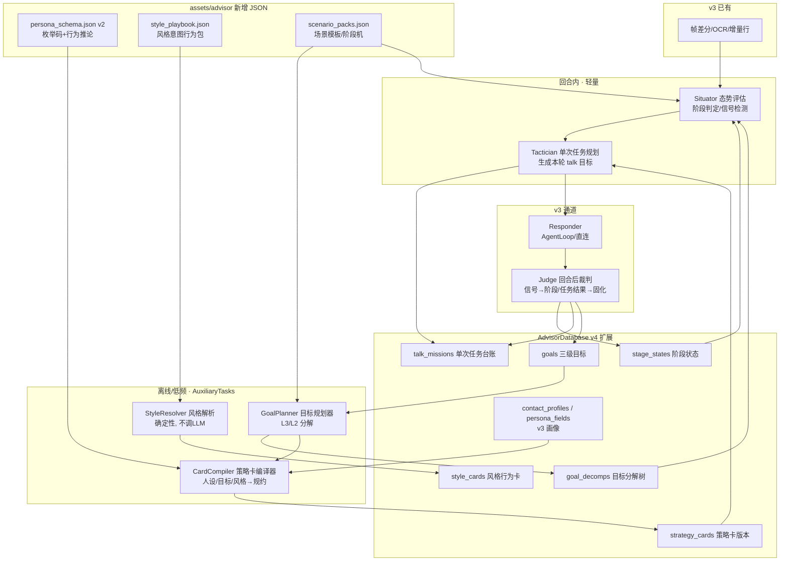

# 智能优化增强的聊天策略方案（老参谋 v4 · 策略大脑）

> 状态：**四个评审决策点已决（2026-10-15，见 §14），整体方案待批准后按 P0→P1→P2→P3 实施；本文不代表已开工**
> 日期：2026-10-15
> 适用分支：`laocanmou`
> 上游文档关系：本文是 [`2026-10-14-老参谋AI辅助自动化聊天功能方案架构设计.md`](2026-10-14-老参谋AI辅助自动化聊天功能方案架构设计.md)（下称 **v3 架构**）
> 在"提示词怎么产生"这一横切面上的**演进方案**，不推翻 v3 的感知/绑定/画像/双写骨架；
> v3 的章节号（§4 数据模型、§6.2 提示词组装、§6.5 记忆分工）在本文中被引用处均标注。
> 涉及代码位置一律以当前分支实际代码为准。

---

## 0. 一句话概括

**把"属性 → 提示词 → 回复"的一跳，升级为"目标分解 → 策略编译 → 态势决策 → 回复"的流水线**：
长期/短期/单次三级目标以不同深度分解为任务并固化为记忆；风格与人设从"裸值"升级为
"带行为定义的资产"；每回合先决策"这一步该干什么、不该干什么"，再产出回复。
LLM 只在需要推理的环节出现，风格解释等确定性知识永不交给它现场发挥。

---

## 1. 背景与问题诊断

### 1.1 现状（已逐行核实）

v3 落地后，单次参谋回合的提示词由 [ChatBriefBuilder.kt](../app/src/main/java/com/verlintas/baic2/floatball/advisor/ChatBriefBuilder.kt)
与 [ScreenAdvisor.runAdvisorTurn](../app/src/main/java/com/verlintas/baic2/floatball/ScreenAdvisor.kt) 拼装，结构是：

```
ADVISOR_STYLE（基调+字数）
【本次聊天的业务目标】   ← contact_profiles.goal（一句话）
【我的语言风格】         ← contact_profiles.style（一句话）
【我的人设】【对方人设】  ← persona_fields 逐行 "标签: 值"
【可参考的话术】Top3      ← PlaybookRetriever FTS
【与X的交往脉络】         ← recallByEntity + 到期承诺 + 成交要件 + 转折铁律
上游 memoryContext        ← getCore + recall(整屏 OCR 抽取的 terms)
```

### 1.2 五个结构性缺陷

| #   | 缺陷                            | 具体后果（真实例子）                                                                                                                                        |
| --- | ------------------------------- | ----------------------------------------------------------------------------------------------------------------------------------------------------------- |
| D1  | **目标只有一层、一跳注入**      | `goal="约对方出来吃饭约会"` 直接进提示词。模型无法区分"终极意图"与"本轮动作"，弱关系首轮就可能直奔邀约，把天聊死                                            |
| D2  | **风格是口号不是行为**          | `style="制造话题，维持聊天，引起关注和兴趣"` 没有可执行定义，每个回合由模型重新解释，风格跨回合漂移，且每回合白烧 token                                     |
| D3  | **画像是档案不是处境**          | `沟通风格: 惜字如金` 只陈述事实，模型得自己推导"所以我要短、别查户口"；30 个字段平铺，与当前情境无关的字段全是噪音                                          |
| D4  | **属性→回复之间缺决策层**       | 聊天是多回合博弈（试探、进退、节奏、时机），现状把战略问题压缩成一次"代写回复"，急功近利，效果取决于模型当场发挥，不可积累、不可复盘                        |
| D5  | **同一事实重复注入 + 召回噪声** | 已确认画像双写上游 Note 后，人设段、脉络段、通用召回三处重复同一条事实（重复还会被模型当成强调权重）；召回 terms 用整屏 OCR，混入时间/标题/按钮文字，易召偏 |

### 1.3 用户的三条明确要求（本方案的需求源头）

1. 聊天是复杂的事，**不能把人设属性、用户级目标、沉淀属性直接生成输入词就出回复**；
2. 目标分三级：**长期目标**（时间积累，逼近用户自身的人设目标）、**短期目标**（1~3 个月可交付成果）、
   **单次目标**（本次上下文化的 talk 目标）；三级目标与 LLM 交互时**分解步骤长度不同，越往后越直接**；
   要用算法参数把不同目标分解成任务、固化成记忆，最后才落到单次聊天；
3. 双方人设、文字风格等属性，录入方式尽量做成**下拉选项 + 手工填写**，数据要仔细设计。

---

## 2. 设计原则（贯穿全文的裁决依据）

| 原则                          | 含义                                                                                                                                                              |
| ----------------------------- | ----------------------------------------------------------------------------------------------------------------------------------------------------------------- |
| P-1 **采集 ≠ 注入**           | 用户填写/自动萃取的原始值是"数据"；进提示词前必须经过"编译/渲染"，变成第二人称的情境规约。原始值只入库，不裸奔                                                    |
| P-2 **编译一次，复用 N 回合** | 目标分解、风格行为化、画像推论都在"保存时/低频后台"完成并固化；回合内只做取值与选择，不重复推理                                                                   |
| P-3 **确定性优先**            | 能用资产（枚举码→行为模板）解决的，绝不调 LLM；LLM 只处理开放式目标/语境的推理。风格解释 100% 资产化                                                              |
| P-4 **草稿人文本**            | 一切 AI 编译产物（策略卡、目标分解、自定义值的行为化解释）默认是待审核草稿，用户 ✓ 后才参与回合；沿用 v3 §4.2 既有闸门，不新增自动信任                            |
| P-5 **零上游侵入**            | 新表全部进 app 模块 `AdvisorDatabase`（当前 v3，本文升至 v4）；新字段进 `assets/advisor/*.json`；记忆读写仍只走 `MemoryRepository`/public DAO；不新建 Gradle 模块 |
| P-6 **只增不毁**              | Advisor 库迁移只加表/加列/做数据映射，沿用现有幂等 PRAGMA 补列纪律，不清空任何画像与目标数据                                                                      |
| P-7 **失败静默降级**          | 策略层任何一步失败，退回 v3 的 brief 基线提示词，绝不让参谋回合开天窗                                                                                             |

---

## 3. 总体架构

### 3.1 在 v3 架构上新增"策略层"与"决策层"



### 3.2 两种时间尺度（整个方案的节拍器）

| 尺度               | 组件                                       | 何时跑                                                  | 频率                | 用户可感知         |
| ------------------ | ------------------------------------------ | ------------------------------------------------------- | ------------------- | ------------------ |
| **慢车道（战略）** | GoalPlanner / CardCompiler / StyleResolver | 新建/修改目标、改人设风格、阶段跃迁、定期复评           | 每联系人每月 0~数次 | 画像页/目标页审核  |
| **快车道（战术）** | Situator / Tactician                       | 每次参谋回合开始                                        | 每回合一次（极轻）  | 分屏"本轮策略"一行 |
| **回合后（复盘）** | Judge + v3 既有 digest/persona 萃取        | 每个成功回合后（共用既有 `consolidationLock` 互斥协程） | 每回合              | 阶段/进度静默更新  |

---

## 4. 三级目标体系（核心）

### 4.1 定义与对比

| 维度         | L3 长期目标（愿景层）                                      | L2 短期目标（成果层）                               | L1 单次目标（战术层）                                                |
| ------------ | ---------------------------------------------------------- | --------------------------------------------------- | -------------------------------------------------------------------- |
| 别名         | 关系愿景 + 理想自我                                        | 战役目标                                            | 本轮 talk mission                                                    |
| 时间尺度     | 6~12 个月或开放                                            | 1~3 个月，**有 deadline**                           | 本次聊天窗口，分钟级                                                 |
| 回答的问题   | "我想在这段关系里成为谁、走向哪"                           | "这一两个月要交付什么结果"                          | "这轮对话具体推进什么、禁做什么"                                     |
| 成功判据     | 特质/关系状态的迁移（主观+行为证据）                       | SMART 可验证成果                                    | 可当场判定的对方反应                                                 |
| 分解深度     | **最深**：拆成 2~4 个 L2 + 若干"自我修炼项"                | 中：拆成阶段路线图（阶段机上的路径+跃迁信号）       | **最浅最直接**：1 个任务 + ≤3 个动作 + 红线                          |
| LLM 任务形态 | STRATEGIST（战略规划，低温长输出）                         | PLANNER（路线图规划）                               | TACTICIAN（小输出，或由确定性模板产出）                              |
| 谁写/谁改    | 用户写种子，AI 编译分解，**必须人工确认**                  | 用户可写可不写；可由 L3 派生，需确认                | 系统按上下文生成，用户可在行内一键纠偏                               |
| 存哪         | `goals(horizon=3)` + `goal_decomps`                        | `goals(horizon=2)` + `stage_states`                 | `talk_missions`（每回合一行，短期保留）                              |
| 例子（约会） | "成为她生活里自然、可信、有趣的人；关系走向稳定暧昧"       | "11 月底前完成一次线下吃饭，并在饭后进入舒适互动期" | "用她感兴趣的 livehouse 话钩重启对话，探出周末空档；**本轮不邀约**"  |
| 例子（销售） | "成为客户眼中专业可靠、先于其需求的顾问型销售（理想自我）" | "Q4 签下 A 客户年度框架，金额 50 万±10%"            | "回应比价：先锚定总拥有成本，再约一次 15 分钟线上选型会；本轮不报价" |

**L3 的两面性**（回应"逼近用户自身人设目标"）：长期目标 = `关系愿景(relationshipVision)`
＋`理想自我(aspirationalSelf)`。后者描述"我希望自己在聊天中成为什么样的人"
（如"情绪稳定、不讨好、有边界感"），它不是对对方的诉求，而是**所有 L1 动作的风格与人格约束源**，
随时间积累、靠每回合的行为选择逼近。它复用我方人设资产（`my_*` 字段）做现状画像，
编译时计算"现状 → 理想"的差距项，生成"自我修炼项"（如"连续 3 次对话不主动秒回式讨好"）。

### 4.2 目标树与分解算法

```text
L3 长期目标（1 个主愿景，可挂修炼项）
 ├── L2-A 短期成果（deadline、成功判据、优先级）
 │    ├── 阶段路线：S0 破冰 → S1 重建对话 → S2 吸引/舒适 → S3 试探 → S4 敲定
 │    │    （阶段来自 scenario_packs，路径可裁剪/排序）
 │    └── 每个阶段：进入条件 / 退出信号(advance) / 回退信号(retreat) / 该阶段常用动作
 ├── L2-B 短期成果（并行不超过 2 个激活，防止策略互斥）
 └── 自我修炼项（贯穿所有 L2，进风格卡的"人格约束"）

L1 单次任务（每回合由 Tactician 现场生成）
 = 当前激活 L2 + 当前阶段 + 当前屏态势 → {
     mission: 本轮要推进的一步,
     actions: [≤3 个具体动作],
     forbidden: 本轮禁做（如"不邀约/不报价/不解释过多"）,
     signalsToWatch: [出现什么=可进一格],
     successWhen: 本轮成功判据
   }
```

**分解深度的算法参数（不同 horizon 不同解题型）：**

| 参数                 | L3 STRATEGIST                              | L2 PLANNER                                                                                                                | L1 TACTICIAN                      |
| -------------------- | ------------------------------------------ | ------------------------------------------------------------------------------------------------------------------------- | --------------------------------- |
| 触发                 | 新建愿景/季度复评/阶段大跃迁               | L3 确认后、L2 完成/放弃后                                                                                                 | 每回合                            |
| 输入素材             | 双方人设全貌、关系史摘要、理想自我、场景包 | L3 文本、场景阶段机、当前 `stage_states`、交往脉络                                                                        | 当前屏增量、阶段、策略卡、近 2 屏 |
| 输出                 | L2 候选[] + 修炼项[]                       | 选定阶段路径 + 每阶段信号/动作                                                                                            | 单个 mission JSON                 |
| maxTokens            | 900                                        | 600                                                                                                                       | 220                               |
| temperature          | 0.4                                        | 0.3                                                                                                                       | 0.2                               |
| 人工确认             | **必须**                                   | 派生项以观察期 provisional 立即生效、分屏现场轻确认（✓ 转 active/改则重编/两次不理会归档，见评审决议 #2）；手建项必须确认 | 不需要（行内纠偏即可）            |
| 复评周期             | 90 天或连续 3 次 L2 失败                   | 阶段跃迁时 / deadline 前 14 天                                                                                            | 不适用                            |
| 同一目标的重规划抖动 | 同一证据不重复规划；版本递增，旧版归档     | 同左                                                                                                                      | 纯函数式，不缓存也行              |

**激活与互斥**：同一联系人同时 `active` 的 L2 ≤ 2；新建冲突目标时编译器输出
"互斥/协同"判定（如"逼单"与"重建信任"互斥）并提示用户排序。

### 4.3 阶段机（目标推进的轨道）

阶段不是自由文本，而是场景包（`scenario_packs.json`）里定义的**确定性状态机**，
v3 已有的 `intentStage`（破冰/询盘/比价/犹豫/促单/成交/售后）升级为销售包的标准阶段；
新增约会、客情、催收等包。每个阶段含：进入条件、`advance`/`retreat` 信号词与语义信号、
本阶段使命模板、默认风格组合、禁忌。阶段判定 = 信号（确定性词表）优先，语义信号由 Judge 回合后低权重更新，
**禁止模型在回合内自行宣布跳阶段**（防止一热情就"她喜欢我"）。

---

## 5. 策略流水线：从一次截屏到一条回复（新主链路）

替换 v3 §6.2 的拼装位置（[ScreenAdvisor.runAdvisorTurn](../app/src/main/java/com/verlintas/baic2/floatball/ScreenAdvisor.kt)），
新链路 6 步，前 2 步轻量、可与取数并行：

```text
T0 感知：增量 OCR（v3 不变）
T1 取数（并行）：策略卡 v✓ + 阶段状态 + 三级目标 + 风格卡 + 记忆（去重后，见 §8）
T2 Situator 态势评估：
     - 对方最新一条来信分类（提问/陈述/情绪/拒绝/邀约信号/寒暄…，确定性词表+轻分类）
     - 当前阶段复核（信号驱动；与 stage_states 不符→产出"疑似跃迁"待 Judge 确认，不直接跳）
T3 Tactician 生成本轮 mission：
     输入 = L2 目标 + 阶段 + 态势 + 策略卡；输出 mission JSON（§4.2 最右一列）
T4 Responder 生成回复：
     system = 规约总纲 + 角色处境 + 本轮 mission + 行为化风格 + 相关画像推论 + 话术Top3 + 交往脉络
     （只注入与本阶段/本 mission 相关的画像行；无关节、无日期的散值不进）
T5 展示：2~3 条建议回复 + 每条标注意图/风险；顶部折叠区显示"本轮策略：mission 一句话"
───────────── 回合后（既有 consolidationLock 协程，追加 Judge）─────────────
T6 Judge 复盘（轻 LLM 或信号规则）：
     - 对照 mission.successWhen 与本回合用户实际采纳/对方反应，记 mission 结果
     - 阶段信号累计：达到阈值才推进/回退 stage_states（事件型留痕，§9.2）
     - 更新 L2 进度证据；触发承诺/报价专项萃取（v3 萃取器扩展）
     - 连续失败计数 → 达阈值标记 L2"建议复评"，不自动改目标
```

**T3/T4 合并还是分两次调用？** 默认**一次调用两段式**（规划块先行，回复块随后，
规划块用短 JSON 且不展示给模型外的任何下游），首字延迟几乎不增；
在记忆档位"增强"时可拆为两次独立调用（Tactician 结果可被规则校验后再喂 Responder，质量更高）。
两档产出的 mission 都落 `talk_missions`，保证可复盘。`talk_missions` 保留最近 60 条/联系人，
超期自动裁剪，不做长期库。

---

## 6. 数据设计（重点，回应"仔细设计数据"）

### 6.1 枚举值：下拉选项 + 手工填写的统一表示

**设计抉择**：资产里的每个选项有稳定 `code`（与显示文案解耦，改文案不失效、可多语言）；
存储一律存 **code**；手工值以固定前缀 `~` 标识（code 命名限定 `[a-z0-9_]`，永不冲突）。

- `enum` 单值：`value = code` 或 `value = "~用户原文"`
- `tags` 多值：JSON 数组，元素同上，例 `["music_livehouse","~成都美食"]`
- `text/textarea/date`：原文不变

**存量迁移（v3→v4 数据不丢）**：v3 的 enum 存的是中文 label（如 `"惜字如金"`）、
tags 存的也是 label 数组。迁移时按 schema v2 的 `options[].label → code` 映射表
在首次打开画像页时惰性转换（幂等，转换失败的原样保留并视为 custom）；映射用一次性
DAO 批处理，不用 LLM。

### 6.2 `assets/advisor/persona_schema.json`（v2，向后兼容追加）

字段定义在 v3（`key/owner/group/type/label/extract/options/memory`）基础上**追加**：

```json
{
  "key": "commStyle",
  "owner": "their",
  "group": "性格沟通",
  "type": "enum",
  "label": "沟通风格",
  "allowCustom": true,
  "salience": "high",
  "options": [
    {
      "code": "direct",
      "label": "直接干脆",
      "impl": "对方要结论不要铺垫：你先给答案、一句话说清，不绕弯、不寒暄过载",
      "topicHook": false
    },
    {
      "code": "terse",
      "label": "惜字如金",
      "impl": "对方话少是习惯不是冷淡：你每次不超过两句、不连环提问填空，她短句回应就换话题",
      "topicHook": false
    }
  ]
}
```

新增属性语义：

| 属性                     | 取值             | 作用                                                                                  |
| ------------------------ | ---------------- | ------------------------------------------------------------------------------------- |
| `allowCustom`            | bool，默认 true  | UI 是否给"手工填写"入口；false 则只能选枚举                                           |
| `salience`               | high/normal/low  | 与当前阶段/mission 的相关度基线；low 字段（家乡/院校…）默认不进提示词，仅作话题素材库 |
| `options[].code`         | string           | 稳定标识                                                                              |
| `options[].label`        | string           | 下拉显示文案                                                                          |
| `options[].impl`         | string           | **确定性行为推论模板**（"对方是X → 你要Y"），渲染时直接拼，零 LLM                     |
| `options[].topicHook`    | bool             | 该值是否可作话题钩子（兴趣/家乡=true；沟通风格=false）                                |
| 字段级 `implTpl`（可选） | string，含 `{v}` | text/textarea 类的推论模板；`{v}` 为原文。无模板的开放式字段不自动推论，交策略卡编译  |
| `staleAfterDays`（可选） | int              | 时效性（见 §8.3），如 budget 设 60；到期渲染自动加"请先验证"措辞                      |

**双方人设新增字段（下拉为主）**——在现有目录追加组：

| owner | key                        | label          | type              | 选项/说明                                                                  |
| ----- | -------------------------- | -------------- | ----------------- | -------------------------------------------------------------------------- |
| my    | `my_aspiration`            | 我的理想自我   | tags(枚举+自定义) | 情绪稳定/有边界感/不讨好/幽默有料/专业可靠/真诚直接…（来自风格资产同码表） |
| my    | `my_relation_goal_default` | 默认关系愿景   | enum+custom       | 长期伴侣/稳定暧昧/普通朋友/客户信任/师長印象…                              |
| their | `emotionStyle`             | 情感表达       | enum              | 外放/慢热/回避型未知…（带 impl）                                           |
| their | `replyPace`                | 回复节奏       | enum              | 秒回/时段性活跃/常隔数小时（话题节奏控制用）                               |
| their | `loveLanguage`             | 吃哪种好感方式 | tags              | 被赞美/被倾听/实用帮助/共同体验/幽默感（约会包专用）                       |

### 6.3 `assets/advisor/style_playbook.json`（新增 · 风格行为化的根）

风格分两层：**基调 tone（单选）** ＋ **风格意图 intents（多选 chip）** ＋ 可选一句自定义补充。
每个意图是一个"行为包"，编译期与回合期都只做查表拼接：

```json
{
  "tones": [
    { "code": "pro", "label": "专业严谨", "voiceRule": "用陈述句与数据，少语气词，称谓用"您"" },
    { "code": "buddy", "label": "朋友式轻松", "voiceRule": "口语短句，可少量表情，不端着，但不油" }
  ],
  "intents": [
    {
      "code": "spark_topic",
      "label": "制造话题",
      "do": [
        "每条回复结尾保留一个开放式话钩，不用是非问句收尾",
        "话题从对方画像（兴趣/家乡/近期关注）或她最近的动态取材",
        "一次只推进一个话题，对方接住再深入"
      ],
      "dont": ["连续提问不超过2个，杜绝查户口", "不连发三条以上无回应消息"],
      "good": "对了，你之前提过喜欢livehouse——这周末有个乐队来，有关注吗？",
      "bad": "在吗？忙吗？吃饭了吗？",
      "fitStages": ["rebuild", "attract"]
    },
    {
      "code": "hold_warmth",
      "label": "维持聊天热度",
      "do": ["回应先共情/复述情绪，再延展观点", "记住她提过的细节并在后续自然复用"],
      "dont": ["不只用哈哈/嗯嗯收尾", "不在她低谷时硬转话题"]
    },
    {
      "code": "show_value",
      "label": "引起关注与兴趣",
      "do": ["用具体故事/细节展示生活密度，不自我标榜", "观点要有信息量或趣味，给她接话空间"],
      "dont": ["不炫耀、不贬低别人抬自己", "不长篇大论超过三句"]
    },
    {
      "code": "push_close",
      "label": "推进邀约/成交",
      "do": ["给出具体时间地点二选一，不问'要不要去'", "邀约前先用一句共同语境铺垫"],
      "dont": ["信号不足时不提前使用本意图（由阶段门禁用，见 §7）"]
    }
  ]
}
```

`fitStages` 让风格意图与阶段机联动：未到 `probe/close` 阶段时，`push_close`
即使被选中也只作为"长期意图"记录、**不渲染进本回合**，从资产层根治 D1 的时机错误。

### 6.4 `assets/advisor/scenario_packs.json`（新增 · 场景模板）

```json
{
  "packs": [
    {
      "code": "dating",
      "label": "恋爱/暧昧",
      "relationTypes": ["暧昧对象", "朋友"],
      "goalTemplates": [
        {
          "horizon": 3,
          "text": "和{name}走向稳定、自然的亲密关系；同时我成为{aspiration}的人"
        },
        {
          "horizon": 2,
          "text": "在{deadline}前完成一次自然的线下邀约（吃饭/看展），饭后互动不冷场"
        }
      ],
      "defaultTone": "buddy",
      "defaultIntents": ["spark_topic", "hold_warmth", "show_value"],
      "stages": [
        {
          "code": "weak",
          "label": "弱联系",
          "exit": { "advanceSignals": ["主动发起过话题", "连续两次回复≥2句"] }
        },
        { "code": "rebuild", "label": "重建对话" },
        { "code": "attract", "label": "吸引/舒适" },
        { "code": "probe", "label": "试探邀约" },
        { "code": "confirm", "label": "敲定见面" }
      ],
      "retreatSignals": ["拒绝", "算了", "呵呵", "已读不回超过24小时"],
      "taboos": ["查户口式提问", "深夜连续试探", "提前任/查岗"]
    },
    {
      "code": "sales_b2b",
      "label": "B2B销售",
      "stages": ["破冰", "询盘", "比价", "犹豫", "促单", "成交", "售后"],
      "taboos": ["未确认预算前报价", "对已转意向客户继续强调痛点"]
    }
  ]
}
```

场景包随版本预置；用户选场景 = 一次性把阶段机、目标模板、默认风格配齐，空配置用户开箱即有合格策略。

### 6.5 AdvisorDatabase v4 新表（DDL 草案）

```sql
-- ① 三级目标（L3/L2 同表；L1 不进此表，进 talk_missions）
CREATE TABLE goals (
  id INTEGER PRIMARY KEY AUTOINCREMENT,
  contactId INTEGER NOT NULL,              -- 0 = 跨联系人的"理想自我"类全局目标
  horizon INTEGER NOT NULL,               -- 3=长期 2=短期
  parentId INTEGER,                        -- L2 派生自哪个 L3
  scenarioCode TEXT,                       -- 场景包 code
  title TEXT NOT NULL,                     -- 用户原话种子
  successCriteria TEXT,                    -- 成功判据（L2 必填，编译产物，待确认）
  deadlineAt INTEGER,                      -- L2 必填；L3 可空
  -- draft=未生效待确认; provisional=AI派生观察期(立即用,分屏轻确认,见评审决议#2);
  -- active=已确认; done/abandoned=终结; review=连续失败建议复评
  status TEXT NOT NULL DEFAULT 'draft',
  promptCount INTEGER DEFAULT 0,           -- provisional 目标在分屏的轻确认提示次数（≤2）
  priority INTEGER DEFAULT 5,
  source TEXT DEFAULT 'user',              -- user / ai(派生)
  confirmed INTEGER DEFAULT 0,             -- 确认后置1（provisional→active）
  progressNote TEXT,                       -- Judge 回写的最新进度证据（≤200字）
  failStreak INTEGER DEFAULT 0,            -- 连续失败计数（达3→建议复评）
  reviewedAt INTEGER,
  createdAt INTEGER NOT NULL,
  updatedAt INTEGER NOT NULL
);
CREATE INDEX idx_goals_contact_status ON goals(contactId, status);

-- ② 目标分解树（L3→L2、L2→阶段路径 的编译产物，版本化）
CREATE TABLE goal_decomps (
  id INTEGER PRIMARY KEY AUTOINCREMENT,
  goalId INTEGER NOT NULL,
  version INTEGER NOT NULL,
  kind TEXT NOT NULL,                      -- outcomes(L3拆L2) / roadmap(L2阶段路径) / practices(修炼项)
  payloadJson TEXT NOT NULL,               -- 见 §6.6 结构
  confirmed INTEGER DEFAULT 0,
  supersededBy INTEGER,                    -- 新版本指针
  createdAt INTEGER NOT NULL
);
CREATE INDEX idx_decomps_goal ON goal_decomps(goalId, version);

-- ③ 联系人 × 场景 的阶段状态（阶段机运行态）
CREATE TABLE stage_states (
  contactId INTEGER NOT NULL,
  scenarioCode TEXT NOT NULL,
  stageCode TEXT NOT NULL,                 -- 当前阶段
  enteredAt INTEGER NOT NULL,
  advanceHits TEXT NOT NULL DEFAULT '[]',  -- 待确认跃迁信号计数 JSON {signal:count}
  evidence TEXT,                           -- 最近一次阶段变化的对话证据短句
  PRIMARY KEY(contactId, scenarioCode)
);

-- ④ 策略卡（编译一次复用N回合；人/场景变更或目标改版时重编，版本递增）
CREATE TABLE strategy_cards (
  id INTEGER PRIMARY KEY AUTOINCREMENT,
  contactId INTEGER NOT NULL,              -- 0 = 我方默认卡（理想自我/默认风格）
  version INTEGER NOT NULL,
  scenarioCode TEXT,
  payloadJson TEXT NOT NULL,               -- §6.6 策略卡结构
  status TEXT NOT NULL DEFAULT 'draft',    -- draft/confirmed/archived
  createdAt INTEGER NOT NULL
);
CREATE INDEX idx_cards_contact ON strategy_cards(contactId, status);

-- ⑤ 风格卡（tone + intents + 自定义补充的行为化结果；确定性，不调LLM；
--    自定义补充的解释可由 AuxiliaryTasks 编译并走确认）
CREATE TABLE style_cards (
  id INTEGER PRIMARY KEY AUTOINCREMENT,
  scope TEXT NOT NULL,                     -- my_default / contact
  contactId INTEGER NOT NULL DEFAULT 0,    -- scope=contact 时为联系人 id
  toneCode TEXT,
  intentCodes TEXT NOT NULL DEFAULT '[]',  -- JSON 选中的意图码
  customNote TEXT,                         -- 用户手写一句补充
  compiledCustomJson TEXT,                 -- 自定义补充的 do/dont 编译结果（待确认）
  confirmed INTEGER DEFAULT 1,             -- 纯选项组合即时生效；含自定义编译才需确认
  updatedAt INTEGER NOT NULL
);

-- ⑥ 单次任务台账（L1 任务与结果；短期保留，每联系人 ≤60 条）
CREATE TABLE talk_missions (
  id INTEGER PRIMARY KEY AUTOINCREMENT,
  conversationId INTEGER NOT NULL,
  contactId INTEGER,
  turnMessageId INTEGER,                   -- 触发本任务的 USER 消息 id
  stageCode TEXT,
  goalId INTEGER,                          -- 服务的 L2
  mission TEXT NOT NULL,                   -- 本轮一句话任务
  actionsJson TEXT NOT NULL,               -- ≤3 动作
  forbiddenJson TEXT,                      -- 本轮禁做
  signalsJson TEXT,
  planBlockJson TEXT,                      -- 完整规划块（复盘原料）
  result TEXT,                             -- pending/advanced/held/regressed/ignored
  adoptedIndex INTEGER,                    -- 用户采纳了第几条建议（-1=自写/无）
  createdAt INTEGER NOT NULL
);
CREATE INDEX idx_missions_conv ON talk_missions(conversationId, id);
```

`contact_profiles` 追加列（v3 的 goal/style **保留只读兼容**，新链路读新表；
首次确认新目标后旧列不再使用，不删列）：

```sql
ALTER TABLE contact_profiles ADD COLUMN scenarioCode TEXT;   -- 当前场景包
ALTER TABLE contact_profiles ADD COLUMN activeCardId INTEGER;
```

Room version **3 → 4**，`MIGRATION_3_4` 只做 CREATE TABLE + ADD COLUMN +
6.1 的 enum 值惰性映射（后者放首次启动/打开画像页，不塞进 SQLiteMigration）。

### 6.6 关键 JSON 产物结构

`goal_decomps.payloadJson`（L2 路线图示例）：

```json
{
  "stages": [
    {
      "code": "rebuild",
      "goal": "无压力重启对话",
      "exitSignals": ["主动追问", "回复≥2句并带情绪词"]
    },
    {
      "code": "attract",
      "goal": "建立舒适与好奇",
      "exitSignals": ["主动开启新话题", "延续私聊超过3天"]
    },
    {
      "code": "probe",
      "goal": "试探线下意愿",
      "exitSignals": ["对邀约提议给积极回应"]
    },
    {
      "code": "confirm",
      "goal": "敲定时间地点",
      "exitSignals": ["确认具体时间或地点"]
    }
  ],
  "practices": [
    "不因对方短回而追加消息",
    "把'引起兴趣'落实为每回合一个有信息量的细节"
  ]
}
```

`strategy_cards.payloadJson`（编译产物，回合内直接消费）：

```json
{
  "roleLine": "你是用户本人，正在微信和「小夏」（20-29岁，暧昧初期、联系尚浅）聊天；她话少是习惯不是冷淡。",
  "selfConstraints": [
    "情绪稳定，不讨好、不秒回式追问",
    "每轮一个有信息量的表达"
  ],
  "theirImplications": [
    "她习惯短回复 → 你每次不超过两句、先给结论",
    "她对严肃玩笑接受度低 → 不玩梗试探，靠内容推进"
  ],
  "topicBank": [
    "livehouse",
    "成都美食（她家乡，可作备选题，她提起前不强攀老乡）"
  ],
  "taboos": ["不查户口", "本轮及弱联系阶段不邀约"],
  "cardVersion": 4
}
```

---

## 7. 阶段门控：把"时机"变成算法而不是感觉

Tactician 生成 mission 时受确定性门控约束（全部来自资产，不调 LLM）：

1. **意图门**：风格意图 `fitStages` 不含当前阶段 → 不渲染；
2. **动作门**：mission 模板按阶段取，`probe/confirm` 类动作在前序阶段不可生成；
3. **红线门**：场景 taboos + `persona_fields.taboos` 永远注入 forbidden；
4. **承诺一致性门**：mission 涉及价格/时间时，交往脉络中的有效 AGREEMENT/FACT
   必须被引用且不得冲突（复用 v3 成交要件与转折铁律）；
5. **回退门**：命中 `retreatSignals` → 强制 mission 降级为"降温/修复"类，
   连续两次回退写 `failStreak` 并建议复评 L2。

---

## 8. 提示词契约（修复 D3/D5）

### 8.1 新 system prompt 段落顺序（固定，冲突时自上而下）

```text
【规约总纲】（新增，置首）
你是用户本人，不是助手。信息冲突时的优先级：
当前屏幕事实 > 本轮任务 > 有效承诺与约定 > 长期自我约束 > 历史画像。
历史只代表当时；当前屏出现矛盾信号一律顺应当前屏（沿用 v3 转折铁律并升级为总纲）。

【你的角色与处境】        ← strategy_cards.roleLine（编译产物，非字段堆砌）
【本轮任务】              ← talk_missions：mission / actions / forbidden / successWhen
【说话方式】              ← style_cards 查表渲染：voiceRule + 所选 intents 的 do/dont
【关于对方（与本轮相关）】 ← 仅 salience=high 且 implication 命中当前阶段的行，≤6 条
【话题素材】              ← topicHook 字段（兴趣/家乡…），仅在 mission 需要时给
【可参考的话术】Top3       ← v3 PlaybookRetriever 不变
【与X的交往脉络】          ← v3 ContactBriefSection（到期承诺置顶），去重后
【记忆】                  ← 上游 memoryContext（见 8.2 去重与收窄）
【输出要求】              ← 2~3 条建议 + 意图/风险标注 + 一句话策略提示
```

### 8.2 去重与召回收窄（修 D5）

- **跨段去重**：注入前对"画像推论 / 脉络 / memoryContext / 话术"按归一化文本指纹
  （抽数字+核心名词）去重；同一事实保留信息量最高的一处（优先级：承诺 > 当前相关画像 > 通用笔记）。
- **召回 query 收窄**：`recall` 的 terms 不再用整屏 OCR，改用「对方最后一条来信正文
  ＋ 当前 mission 关键词」（T3 之后取数），噪声大幅下降；`recallByEntity` 维持现状。
- **只读纪律不变**：全部 `feedback=false`，看屏不反写权重（v3 §6.5）。

### 8.3 画像时效性

带 `staleAfterDays` 的字段超龄后渲染为"（N 天前她提到 X，若与本轮相关请先轻验证）"，
不硬删除；FACT 类 90 天 TTL 的上游双写纪律维持不变。

---

## 9. 记忆固化与记忆体系更新

### 9.1 三级目标如何"固化形成记忆"

- L3/L2 及其分解存 Advisor 库（私有策略，**按 v3 §6.5 负面清单不双写上游**，避免串档）；
- L2 完成/放弃、阶段跃迁是 EVENT：经 Judge 确认后，在联系人时间线留痕
  （Advisor 侧新表 `stage_states` 已承载；阶段变迁沿用既有教训——**用 EVENT 而非 90 天 FACT**）；
- L2 中涉及承诺/约见的具体事项（"周五前给报价"）仍走 v3 既有通道双写上游 `AGREEMENT`，
  接前瞻记忆提醒；目标本身不双写。
- "理想自我"是关于"我"的稳定事实 → 用户确认后按 v3 我方人设通道双写上游
  （`entities=["我"]`，kind=PROFILE），主 App 普通对话同样受益。

### 9.2 Judge 复盘写入项

| 信号               | 写入                                                                              |
| ------------------ | --------------------------------------------------------------------------------- |
| mission 完成/推进  | `talk_missions.result`、阶段 `advanceHits` 计数                                   |
| 信号达阈值         | `stage_states` 跃迁 + evidence；写一条 EVENT 草稿待确认（高频信号可配置自动确认） |
| 承诺/报价原话      | v3 PersonaExtractor 专项扩展：AGREEMENT 带 whenAt / 报价数字高置信草稿            |
| L2 连续 3 次未推进 | `goals.failStreak=3, status=review`，目标页提示复评（不自动改）                   |
| 用户行内纠偏       | 立即覆盖本轮 mission 展示，信号计入对应资产（不热改资产 JSON）                    |

---

## 10. 界面设计（Compose，走 Baic2Theme）

### 10.1 目标管理（混合入口，评审决议 #1）

- **联系人侧**：联系人画像页新增"目标"Tab，三个折叠分区：长期愿景 / 1-3 个月目标 /
  本回合（只读台账）；Tab 顶部固定一张全局"我的理想自我 · 默认风格"只读快捷卡，点击跳设置页；
- **全局侧**：老参谋设置页新增"我的聊天策略"区，编辑理想自我（aspiration tags）、
  默认关系愿景、默认风格卡——全局一份，所有联系人复用；
- 新建目标：选场景包 → 模板一句话种子（可改）→ 保存即后台编译；
- L3/L2 编译结果以卡片展示（成功判据、deadline、阶段路线图），逐张 ✓/✕/编辑；
- L2 卡片显示阶段进度条与最新证据；`review` 状态顶部黄条提醒；
- AI 派生 L2 卡片标"观察期"角标，状态说明为"已在辅助你，确认前会在参谋面板再次征求同意"。

### 10.2 人设与风格录入（落实"下拉+手工"）

- 所有 enum 字段：下拉选 + 末尾"✎ 自定义…"，自定义值在 UI 上以描边 chip 区分；
- tags：常用选项 chip 点选 + 输入框自定义回车添加；
- 风格编辑：基调单选 + 意图多选 chip（do/dont 在下方只读预览，所见即所得）+ 一句自定义补充；
  纯选项组合立即生效；含自定义补充时提交后走"行为化编译 → ✓ 确认"。
- 策略卡审核页：角色处境/自我约束/对方推论/话题/红线分区展示，可逐句改写
  （改写即升级为 user 来源，重编时不覆盖）。

### 10.3 分屏面板

- **观察期目标轻确认条**（评审决议 #2，仅 provisional 目标存在时出现，置顶于本轮策略之上）：
  "我理解这阶段你的目标是「{L2 标题}」，对吗？" → ✓ 确认 / ✎ 改一下 / 本次先跳过；
  同一目标最多出现 2 次（计 `goals.promptCount`），两次不理会自动归档并退回 v3 基线；
- 顶部加一行可折叠"**本轮策略**：用 livehouse 话钩重启对话，探她周末空档｜本轮不邀约"；
- 每条建议回复标注意图与风险（v3 已有要求，改为与 mission 动作编号对应）；
- 长按建议：纠偏（太直接/太软/别这个方向…）→ 即时换一版并记偏好；
- 记忆依据小字（"依据：她上周说周末有空"），可点"记错了"直达画像/遗忘流程。

---

## 11. 调度、Token 与降级

| 项           | 策略                                                                                                    |
| ------------ | ------------------------------------------------------------------------------------------------------- |
| 慢车道编译   | 沿用 v3 后台协程 + 互斥锁模式；编译仅在保存/跃迁/90 天复评触发，月均个位次数                            |
| 快车道 T2/T3 | T2 以确定性规则为主（零成本）；T3 默认并入 T4 同一次调用（规划 JSON 前缀），增强档分两次                |
| token 增量   | 默认档每回合 +约 150~220 输出 token（规划块）；通过 D5 去重 + 画像行裁剪在输入端省回，总量预算持平目标  |
| 失败降级     | 策略卡缺失/未确认 → v3 brief；Tactician 失败 → mission 退化为"按策略卡自然推进"；全线失败 → v3 现状基线 |
| 并发取数     | T1 的六类只读数据改并行 `async`（现状顺序 runCatching），顺带降低首字延迟                               |
| 开关         | AdvisorPrefs 新增：策略模式（关/智能/增强，默认智能）；关闭时完全等同 v3                                |

---

## 12. 与上游边界（合规核对）

- 新增文件全部在 `app/.../floatball/`（建议新建 `floatball/strategy/` 子包：
  GoalPlanner/CardCompiler/StyleResolver/Situator/Tactician/Judge）；
- 资产放 `app/src/main/assets/advisor/`，沿用 Gazetteer/Seeder 模式；
- Advisor 库 3→4 迁移只增不毁；上游 Baic2Database 零改动；
- LLM 调用：慢车道走 `AuxiliaryTasks.complete`，快车道走现有两通道
  （`ProviderFactory` 直连 / `AgentLoop`），不新造 HTTP；
- 不引入向量库/embedding（延续 v3 §6.4 结论）；
- 白名单文件无新增触碰；全部新文案进 `strings.xml` 加 `float_*` 键；
- 每个新 `.kt` 带 GPL-3.0-or-later 头。

---

## 13. 分期实施与验收

### P0（地基，1~2 天，无产品行为变化）

1. T1 取数并行化；2. 跨段去重 + 召回 query 收窄；3. 规约总纲行。
   验收：冒烟链路过；同一 prompt 内同事实不重复（日志抽样）；回答质量不回退。

### P1（风格行为化 + 场景包，确定性先行，单独灰度 · 评审决议 #4）

4. `style_playbook.json` v1（8 基调 + 8~10 意图）；5. `scenario_packs.json`
   （dating/sales_b2b 两包）；6. `style_cards` 表 + StyleResolver + 风格编辑 UI；
5. schema v2（code/impl/salience/allowCustom）+ 惰性 label→code 迁移。
   验收：风格选择后跨 10 回合输出行为一致（人工评审表）；旧值零丢失。
   **灰度门（达标才启动 P2）**：连续试用 ≥7 天 / ≥50 个真实回合中，
   风格行为符合所选 do/dont 的比例 ≥85%，且无"风格资产条目缺失导致空泛"的高频反馈；
   不达标先补资产条目，不带病进 P2。

### P2（三级目标 + 策略卡，核心）

8. goals/goal_decomps/stage_states/strategy_cards 四表与迁移；
9. GoalPlanner（L3/L2 编译、确认流、目标管理 UI）；10. CardCompiler + 审核页；
10. 阶段机与门控；12. Situator/Tactician/Judge 接入主链路（默认档一次调用两段式）；
11. `talk_missions` 与分屏"本轮策略"行。

### P3（打磨）

14. 自定义风格的 LLM 行为化编译确认流；15. 行内纠偏与记忆依据可解释；
15. 画像 staleAfterDays；17. eval 剧本进 `:eval`。

**验收剧本（`:eval` 新增，断言式）：**

- S1 弱关系首轮：mission 含"不邀约"，三条回复无一直奔吃饭；
- S2 阶段未到：选中 push_close 意图但回复不出现邀约动作（资产门控生效）；
- S3 风格稳定：同一情境连续 10 回合，长度/问句数/话题数符合所选意图 do/dont 约束；
- S4 转折：旧脉络显示拒绝、当前屏同意 → 回复顺应成交闭环且报价自洽；
- S5 目标分解：L3"稳定关系"不会被编译成单回合任务；L2 必有 deadline/判据；
- S6 自定义值迁移：v3 label 存量 100% 可渲染，不丢失、不乱码；
- S7 降级：删除策略卡后退回 v3 基线，不报错、不开天窗。

**提交门槛**沿用 AGENTS.md §6：license 门禁 + assembleDebug + 冒烟 + logcat 无崩溃；
策略纯函数（StyleResolver/门控/指纹去重）补 JVM 单测。

---

## 14. 风险与开放问题

| 风险                                       | 对策                                                                                  |
| ------------------------------------------ | ------------------------------------------------------------------------------------- |
| 一次调用两段式，小模型不按 JSON 输出规划块 | 规划块宽松解析（截取首个 `{}`），失败退化为无 mission 基线；增强档双调用兜底          |
| 层级过多导致"军师感"太重、回复变慢         | 默认档零新增调用；策略行默认折叠；场景包保证开箱即有完整路径，不需要用户填三层        |
| 阶段误判（语义信号）                       | 模型无权当场跳阶段；信号计数 + Judge 回合后确认 + EVENT 留痕可回滚                    |
| 用户不愿填目标                             | 场景模板一键生成 L2/L3 草稿，用户只做 ✓；未确认就按 v3 行为跑，不强推                 |
| 自定义枚举值无 impl 导致行为缺失           | 自定义值走一次编译并确认（P3）；此前以中性模板渲染（"对方提到：X，结合语境拿捏分寸"） |
| 策略卡与人设重复                           | 编译时统一指纹去重；策略卡只放"处境化推论"，原始字段仍是唯一事实源                    |

### 评审决议（2026-10-15，已确认）

1. **目标入口＝混合制**：按人的 L1/L2/关系愿景放联系人画像页"目标"Tab（就近编辑）；
   "理想自我/默认风格"是全局资产，放老参谋设置页，并在联系人"目标"Tab 顶部放
   只读快捷卡可点入。不做独立"策略"页。
2. **L2 派生目标＝观察期生效 + 现场轻确认**：派生 L2 立即按"观察期(provisional)"
   状态投入使用（不空转），但在分屏首回合顶部弹一条轻确认条
   "我理解你这阶段的目标是 X，对吗？✓ / 改一下"；最多提示 2 次，用户始终不理会
   则自动归档、该联系人退回 v3 基线。**不采用"默认接受+7 天撤销"原案**（沉默期无感知）。
3. **默认档一次调用两段式**：规划 JSON 前缀 + 回复同一次流式调用，保首字延迟；
   两次独立调用仅作为"增强档"可选项。
4. **P1 先单独灰度**：P1（风格行为化）独立交付并观察风格稳定性与资产完备度，
   达标后再启动 P2；P1/P2 不合批。
