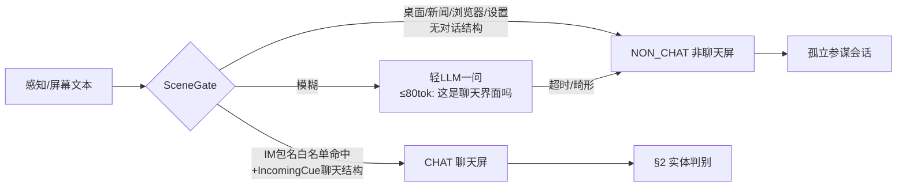
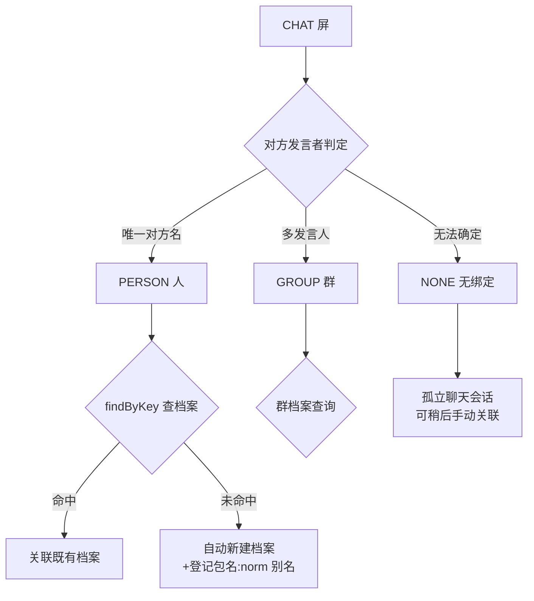
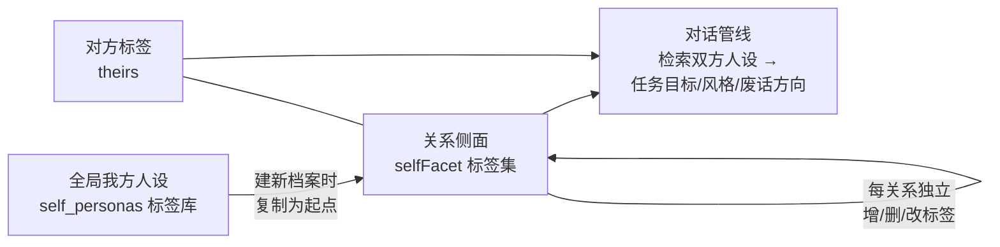
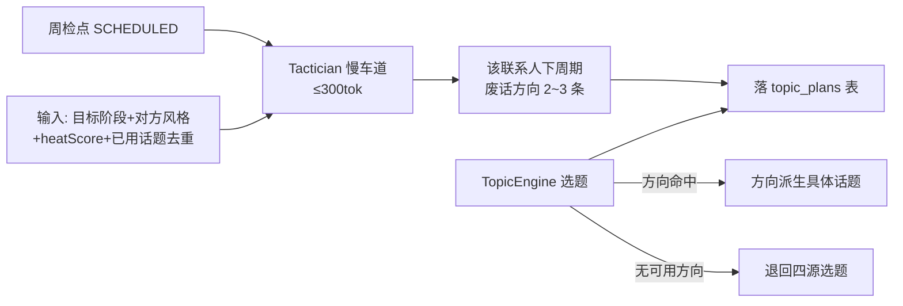

# 场景归属与废话分层修订方案（UltraAdvisor v2.2）

> 状态：**待批准**。批准后按 §8 分期实施。
> 前置：本方案是对《2026-10-18-多代理协作自动参谋方案.md》的行为模型修订，
> 只改归属判定与废话策略层，不动 M0~M3 已落地的 Director/保温/行动/Gatekeeper 管线骨架。
> 日期：2026-10-18 · 依据：用户真机试用反馈 4 条 + 二轮细化反馈 5 条。
>
> **v2.2 修订记录**（用户二轮确认）：
> ① 感知口径=**a11y 优先，截屏/录屏 OCR 兜底**（不依赖单一手段，a11y 不可用时 OCR 独立完成判定）；
> ② 新增**双方人设**模型：档案同时记录对方人设与"我方在该关系中的侧面人设"，
> 我方人设多面（全局人设可复制到各关系，再增删标签）；
> ③ 跨包名合并明确为后台手动操作，合并后**所有会话关联全量更新**；
> ④ 新增**维持度三档**（proactive/reactive/mute，默认 reactive）——
> 自动模式按维持度决定是否发起/参与聊天；
> ⑤ 开放问题三项全部获用户确认（群壳同意/自动建卡同意/热度分两路同意）。

---

## 0. 用户问题与修订映射

| #   | 用户反馈                                                                                                              | 修订项                                                                              |
| --- | --------------------------------------------------------------------------------------------------------------------- | ----------------------------------------------------------------------------------- |
| 1   | 截桌面/看新闻不是聊天，没有"对方"，不该关联人设                                                                       | §1 场景分类门：非聊天屏=孤立参谋，零人设管线                                        |
| 2   | 人设 1:N 会话；先判断"是不是人/群"；是人才建卡；同一人不重复建档；可自动可手动                                        | §2 实体判别：显式"人/群/无"三态判定 + 档案唯一化 + 跨包名合并                       |
| 3   | 尽量复用旧会话，避免垃圾；重大转变才新建                                                                              | §3 会话复用强化：复用优先 + 断崖新开                                                |
| 4   | 废话要看人下菜，按对方人设/认识时长/反馈更新话题，靠近任务目标，定义维护频率                                          | §4 废话分层：对方风格标签 + 话题库风格化 + 反馈热度 + Planner 参与规划 + 频率风格化 |
| 5   | 不要只依赖 a11y——现代聊天软件 a11y 提取不到内容，要用录屏/截屏 OCR 判定                                               | §1.1 感知口径：a11y 优先，OCR 兜底                                                  |
| 6   | 档案要建"**双方人设**"——我方人设多面，全局人设+各关系侧面，对话时检索双方人设定目标/风格/废话                         | §2.4 双方人设模型                                                                   |
| 7   | 允许后台手动合并聊天对象档案，合并后会话关联全量更新                                                                  | §2.5 合并协议                                                                       |
| 8   | 每个聊天对象可设"是否群聊"标识 + **维持度**三档（主动维持/问了才答/不参与），默认"问了才答"；自动模式按维持度决定行动 | §2.6 维持度                                                                         |

---

## 1. 场景分类门（SceneGate）

### 1.1 感知口径：a11y 优先，OCR 兜底（v2.2 修订 ①）

现代聊天软件（微信等）的 a11y 树常提取不到内容——但**能提取时仍是最优信号**
（零解码成本、文本结构干净）。SceneGate 与实体判别的输入口径与项目感知阶梯
（a11y 文本 → a11y 截图 → 投影截图，见 ScreenPerceiver）同序：

- **a11y 优先**：a11y 树可用（聊天软件暴露节点）时，场景分类/实体判定消费 a11y 文本；
- **OCR 兜底**：a11y 提取不到（微信等屏蔽无障碍）或文本为空时，
  自动降级截屏/录屏 OCR——单次截屏与连续模式差分帧 OCR 同源兜底，
  判定逻辑不区分文本来自哪一层（同一套 SceneGate/EntityResolver）；
- 即：**不依赖单一手段，a11y 不可用时 OCR 独立完成全部判定**。

### 1.2 现状与缺口

[IncomingCue.kt](file:///e:/_android_work/NovaBAIC/app/src/main/java/com/verlintas/baic2/floatball/IncomingCue.kt) 已保证"无聊天结构不判定来信、不据此新建档案"，但**没有显式的场景分类**：
任何屏幕都会走同一套"联系人解析 → 分屏人设区 → 保温/目标管线"，
用户在桌面/新闻屏上仍看到"未绑定联系人·点此管理画像"的人设暗示——
这是用户感知"被强塞人设"的根源。

### 1.3 新行为

感知产物流水线第一步插入场景分类（纯函数优先，模糊时轻 LLM）：

**NON_CHAT（非聊天屏）行为**：

- 会话标记 `scene=non_chat`，分屏**隐藏人设区**（不出现"未绑定联系人"暗示），只做纯问答参谋；
- 不进联系人管线：不查档案、不建 stub、不进保温/目标/画像萃取；
- 会话复用范围限于最近的 `non_chat` 会话（不与聊天会话互串上下文）。

**判定规则（确定性优先）**：

- 前台包名 ∈ IM 白名单（与 M2 NotificationGate 同源常量，含微信/QQ 等）且
  `IncomingCue.latestIncoming()` 命中 → CHAT；
- 前台包名 ∉ 白名单，或文本无对话结构（无"我方发言+对方发言"交替标记）→ NON_CHAT；
- IM 包名命中但结构识别失败（截图时机不佳）→ 轻 LLM 一问兜底；LLM 失败保守判 NON_CHAT
  （宁可漏一次关联，不可错建一次人设）。

### 1.4 群聊

用户口径："是一个明确的人，**或者群**，这时才有后台的人设"。群作为独立实体：

- `IncomingCue` 多发言人 → 判定 GROUP，建**群档案**（`isGroup=true`），
  群名即档案名，不做成员级画像（成员画像留后续，本期只建群壳+群会话归属）；
- **"是否群聊"是档案的一个可手动修改属性**（用户口径）：自动判定之外，
  画像页可手动切换该标识（误判修正：把群标成人/把人标成群）；
- 群会话的保温/目标管线按群档案独立运行（废话策略对群默认更保守：低频、不点名）。

---

## 2. 实体判别与档案唯一化（EntityResolver）

### 2.1 三态判定（先判断"对方是谁"）

CHAT 屏进入实体判别，输出三态：

- **PERSON**：唯一对话对象名 → `findByKey(包名:norm)` 命中即关联；
  未命中 → **判定为"人"成立，自动建档**（这是"自动建"的唯一入口，仍受 §1 场景门保护）；
- **GROUP**：同上建群档案；
- **NONE**：不建任何卡片，孤立聊天会话（手动关联入口在分屏人设区保留，但仅 CHAT 屏显示）。

### 2.2 档案唯一化（"张三"就是"张三"）

- **同包名同名**：`包名:norm` 唯一键已有，天然防重；
- **跨包名同人**（微信张三 vs QQ 张三）：**绝不自动合并**（无法确证是同一人），
  画像页提供手动合并入口（协议详见 §2.5）；
- **模糊近邻**（名字轻微变体）：`ContactRepository` 模糊匹配已有，维持只回查不自动建。

### 2.3 档案 ↔ 会话 1:N（口径确认）

现状 `bindConversation` 是会话→联系人单向绑定，一个联系人天然可挂 N 个会话——**模型已支持**，
本方案只做两点强化：

- 画像页新增"该联系人的会话列表"视图（点档案看全部关联会话）；
- 分屏会话切换器按联系人分组显示（同人多会话聚在一起，手动新建入口显式化）。

### 2.4 双方人设模型（v2.2 修订 ②，核心）

档案 = **双方人设**：不仅记录对方标签，同时记录"**我方在该关系中的侧面人设**"。
我方人设是多面的——同一个我，在女朋友面前"博学/风趣/会吃喝/会花钱"，
在领导面前"办事周到/为集体着想/为领导着想/愿意付出"。

- **全局我方人设**（`self_personas` 表）：我方标签库（标签+备注），
  用户在"我的 → 人设"页维护，是各关系侧面的模板源；
- **关系侧面**（联系人档案 `selfFacet` 标签集）：建档案时从全局复制为起点，
  之后**每关系独立增删改**，不随全局变化自动同步（手动"重新对齐全局"按钮可选）；
- **建档即双建**：PERSON/GROUP 判定成立自动建档时，对方侧取默认标签、我方侧复制全局；
- **消费点**：生成回复（Responder 系统提示的我方人设段按当前联系人取 facet）、
  制定任务目标（Tactician 双标签入参）、废话选题（§4 双方风格都参与——
  我方 facet 决定"我以什么身份聊"，对方标签决定"聊什么不冒犯"）；
- **萃取**：画像萃取慢车道一问双产出（对方标签增量 + 我方 facet 增量），
  萃取结果先落"待确认"，画像页人工核阅后转正（防 LLM 自我美化跑偏）。

### 2.5 手动合并协议（v2.2 修订 ③）

用户确认允许后台手动合并"聊天对象"档案（含双方人设），合并后**所有会话关联全量更新**：

1. 画像页选两个档案 → "合并为同一人"（选主档案）；
2. 对方标签并集去重入库；**双方人设 facet 取主档案为准**，被并档案的差异标签
   以"待确认"形式附加（不静默丢弃）；
3. 被并档案的 `包名:norm` 别名全部转为主档案别名（此后两包名都能命中主档案）；
4. **会话 rebind 全量更新**：所有绑定到被并档案的会话行（conversation_binds）
   逐条改绑主档案——用户强调"合并后要保持所有的会话关联更新"，此步原子化；
5. 被并档案降级为别名行（不物理删除，保留审计痕迹），画像页不再显示。

### 2.6 维持度三档（v2.2 修订 ④）

每个聊天对象档案新增 **`engagement` 维持度属性**（手动设置）：

| 档位                            | 含义                                                      | 自动模式行为                                                         |
| ------------------------------- | --------------------------------------------------------- | -------------------------------------------------------------------- |
| `proactive` 主动维持热度        | 少量重点对象（女朋友/客户/领导/重要的人），有目的性的聊天 | PROACTIVE 检点在频控内主动发起；来信照常参谋                         |
| `reactive` **问了才答（默认）** | 大多数人                                                  | **只参谋不主动**：来信才起草/参谋，检点跳过该联系人                  |
| `mute` 不参与                   | 明确不想理会                                              | 通知静默忽略、不起草不出稿；分屏手动问仍可用（人肉操作不算自动参与） |

- **默认 reactive**：新档案一律 reactive，只有手动升级才进入主动维持——
  与 M2 ProactivePolicy 的关系：engagement 是更高层的一手开关，
  ProactivePolicy（dailyCap/minGap/quiet）只对 `proactive` 档生效；
- **与群标识正交**：群也可设维持度（群默认 reactive 更保守）；
- **自动模式行动判定**：侦测到来信 → 先查该联系人 engagement →
  proactive/reactive 走参谋链、mute 静默丢弃（与白名单过滤同层前置）。

---

## 3. 会话复用强化

| 场景         | 行为                                                                                                             |
| ------------ | ---------------------------------------------------------------------------------------------------------------- |
| 默认         | 同联系人已有会话中，按内容相似度回看（已有跨会话相似性实现），取最高者续用——**复用优先，永不主动新建**           |
| 手动新建     | 分屏/画像页显式"新开会话"，新会话仍关联同档案                                                                    |
| 重大话题转变 | 相似度断崖（低于阈值 X 且与最近会话主题明显分叉，由 Tactician 轻判定）→ 自动新开会话并**关联同档案**，旧会话保留 |
| NON_CHAT     | 只复用 `non_chat` 会话池（§1.2）                                                                                 |

阈值 X 与断崖判定进 `AdvisorPrefs` 可调，默认保守（宁可续用，不轻易新建）。

---

## 4. 废话分层策略（TopicEngine v2"看人下菜"）

### 4.1 对方风格标签（画像新维度）

画像萃取（既有慢车道）新增一问 + 画像页手动设置双通道，产出：

| 标签                 | 取值                                   | 用途                                                   |
| -------------------- | -------------------------------------- | ------------------------------------------------------ |
| `identity` 身份类型  | 领导/客户/同事/朋友/家人/暧昧对象/其他 | 话题禁区与语体                                         |
| `chatStyle` 聊天风格 | 严肃/随和/幽默/热情/冷淡               | 话题池过滤                                             |
| `closeness` 亲疏等级 | 0~3（陌生/熟识/亲近/亲密）             | 话题深度 `depth` 门控（种子已有 depth 字段，直接消费） |

> "和严肃的不太熟悉的领导，不能讲吃的、玩的、荤段子"——即
> `identity=领导 + chatStyle=严肃 + closeness≤1` 三重过滤；
> **我方 facet 同席参与**：话题还要符合"我在这个关系里是谁"——
> 领导面前的我（办事周到）不聊吃喝玩乐，哪怕对方风格随和。

### 4.2 话题库风格化

- `topic_seeds.json` 36 条种子补 `tags`（`industry`/`work`/`food`/`fun`/`joke`/`life`/`hobby`…）与
  `minCloseness`（适用亲疏下限）；
- 个人素材（personal_materials）已有 `tag`，录入时沿用同一标签词表；
- 选题过滤：`identity` 定禁区（领导→剔除 joke/food 类）→ `chatStyle` 定池 → `closeness` 定深度。

### 4.3 反馈信号与热度分（heatScore）

- 回合结束后记录对方反馈三信号：回复时延档、回复字数档、是否反问/延续话题（a11y/通知感知，存画像）；
- 累计为 `heatScore`（0~100）：热（≥70）→ 可加大深度与频率；冷（<30）→ 话题转保守、频率降档；
- **反馈冷淡时废话策略自动收缩**——这是"不断根据对方反馈更新废话话题"的数据面。

### 4.4 Planner 参与废话方向规划（靠近任务目标）

- 废话方向由 **目标阶段派生**（商务推进期→行业见闻/工作观察类方向；
  情感升温期→生活分享类方向）——保证"废话靠近正式任务目标"；
- TopicEngine 选题**优先消费** Planner 方向（方向→具体话题由 Responder 现挂渲染），退回四源；
- 方向即"计划家的废话计划"，每周更新，随周报透出给用户（可干预）。

### 4.5 维护频率风格化（ProactivePolicy 默认值分档，仅对 proactive 维持度生效）

> 前置：§2.6 维持度是第一道开关——`reactive`/`mute` 档直接不进入主动维持，
> 以下频率分档只对 `engagement=proactive` 的联系人生效。

| 对方风格              | dailyCap | minGapHours | 说明                     |
| --------------------- | -------- | ----------- | ------------------------ |
| 严肃/领导/closeness≤1 | 1        | 48          | 主动是稀缺资源，低频短句 |
| 普通/同事             | 2        | 24          | 中频                     |
| 亲熟/热情             | 3        | 8           | 可较高频                 |

用户在画像页可覆盖（M2 的 ProactivePolicy UI 已支持逐联系人配置，只改默认值逻辑）。

---

## 5. 数据模型变更（v9 → v10，幂等迁移保数据）

| 变更                 | 内容                                                                                                                                                                                                                               |
| -------------------- | ---------------------------------------------------------------------------------------------------------------------------------------------------------------------------------------------------------------------------------- |
| `contacts` 表加列    | `isGroup INTEGER NOT NULL DEFAULT 0`、`engagement TEXT NOT NULL DEFAULT 'reactive'`、`identity TEXT`、`chatStyle TEXT`、`closeness INTEGER`、`heatScore INTEGER DEFAULT 50`、`selfFacetJson TEXT`（我方关系侧面标签集，JSON 数组） |
| 新表 `self_personas` | `id, tag TEXT UNIQUE, note, createdAt`（全局我方人设标签库，各关系侧面的模板源）                                                                                                                                                   |
| 会话绑定行加列       | `scene TEXT DEFAULT 'chat'`（chat/non_chat）                                                                                                                                                                                       |
| 新表 `topic_plans`   | `id, contactId, cycleStart, directionsJson, createdAt`（每联系人每周一条，upsert）                                                                                                                                                 |
| 种子资产             | `topic_seeds.json` 补 tags/minCloseness（纯资产更新，无迁移）                                                                                                                                                                      |

---

## 6. 代理职责变化（仅列变化项）

| 代理/组件               | 变化                                                                                                                                         |
| ----------------------- | -------------------------------------------------------------------------------------------------------------------------------------------- |
| Perceiver/IncomingCue   | 输出加场景分类（CHAT/NON_CHAT）与实体三态（PERSON/GROUP/NONE）建议；感知序=a11y 优先、OCR 兜底（§1.1）                                       |
| Director                | 路由前过 SceneGate：NON_CHAT → REPLY（孤立会话），跳过联系人管线；来信先查 engagement（mute 静默丢弃）                                       |
| ContactRepository       | +群档案标识（isGroup，可手动改）；自动建档仅在 PERSON/GROUP 判定成立时且**双建双方人设**；+手动合并数据面（§2.5 协议，会话 rebind 原子更新） |
| TopicEngine             | +风格三重过滤（对方 identity/chatStyle/closeness）+ 我方 facet 过滤 + Planner 方向优先 + heatScore 调权                                      |
| Tactician（Planner 面） | +周检点产出废话方向（慢车道，入参含双方人设+heatScore）                                                                                      |
| Responder               | 我方人设段按当前联系人取 selfFacet（多面的我）                                                                                               |
| BriefCompiler           | 周报附"下周期废话方向"（用户可干预）                                                                                                         |
| 画像页（GoalTab）       | +双方人设双区块（对方标签/我方侧面）+ engagement 三档设置 + isGroup 开关 + 手动合并入口 + 该联系人会话列表                                   |

---

## 7. 不变项

- M0~M3 全部管线骨架（Director 路由表/保温四源/Gatekeeper/行动建议/陪伴窗口/起草链）不动；
- 隐私红线（通知即取即用/看屏只读/台账只存指纹）全部继承；
- 既有 317 单测不破坏（新增均为追加）。

---

## 8. 分期与验收

一期完成（三个子任务串行）：

| 子期 | 内容                                                                                                                                                                               | 验收                                                                                                                                                             |
| ---- | ---------------------------------------------------------------------------------------------------------------------------------------------------------------------------------- | ---------------------------------------------------------------------------------------------------------------------------------------------------------------- |
| V-A  | SceneGate（OCR 主路径）+ 实体三态 + 群档案（isGroup）+ 双方人设（self_personas + selfFacet，建档即双建）+ 跨包名手动合并（会话 rebind 全量更新）+ 维持度三档 + NON_CHAT 隐藏人设区 | 截桌面/新闻屏：零人设 UI、零档案创建；微信聊天屏：正确关联既有档案；新联系人：自动建卡（双建双方人设）且第二次不重复；reactive 默认档不主动发起；mute 档通知静默 |
| V-B  | 会话复用强化（断崖新开+同档案关联）+ 画像页会话列表                                                                                                                                | 同联系人连续使用 10 次不新建会话；话题断崖后自动新开且档案不变                                                                                                   |
| V-C  | 风格标签 + 种子风格化 + heatScore + Planner 方向（入参含双方人设）+ 频率分档                                                                                                       | 领导型联系人 10 次选题无 food/joke 类（且我方 facet=办事周到时亦然）；反馈冷淡后 dailyCap 降档；Planner 方向被选题消费且周报可见                                 |

---

## 9. 已确认事项（用户二轮拍板，2026-10-18）

| 事项             | 结论                                                                              |
| ---------------- | --------------------------------------------------------------------------------- |
| 群档案深度       | 同意只建群壳（群名+会话归属+isGroup 属性），不做群成员画像                        |
| 新联系人建档方式 | 同意自动建卡（画像页可删），不弹窗询问                                            |
| 热度分信号来源   | 同意连续模式差分 + 通知链两路都计入                                               |
| 感知手段         | a11y 优先，截屏/录屏 OCR 兜底；不依赖单一手段                                     |
| 双方人设         | 采纳：全局我方人设 + 每关系侧面（多面的我），建档双建，对话检索双方人设           |
| 合并             | 采纳：后台手动合并，会话关联全量更新，差异标签待确认不丢弃                        |
| 维持度           | 采纳：proactive/reactive/mute 三档，默认 reactive（问了才答），重点对象才主动维持 |
