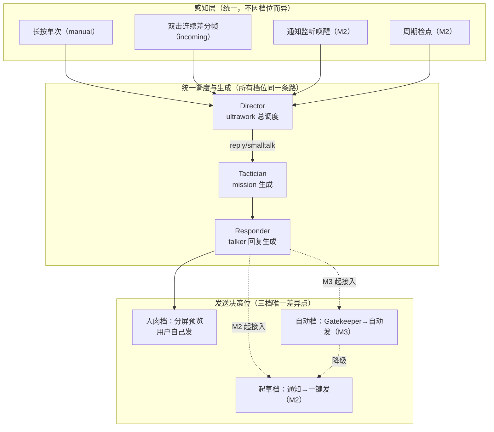
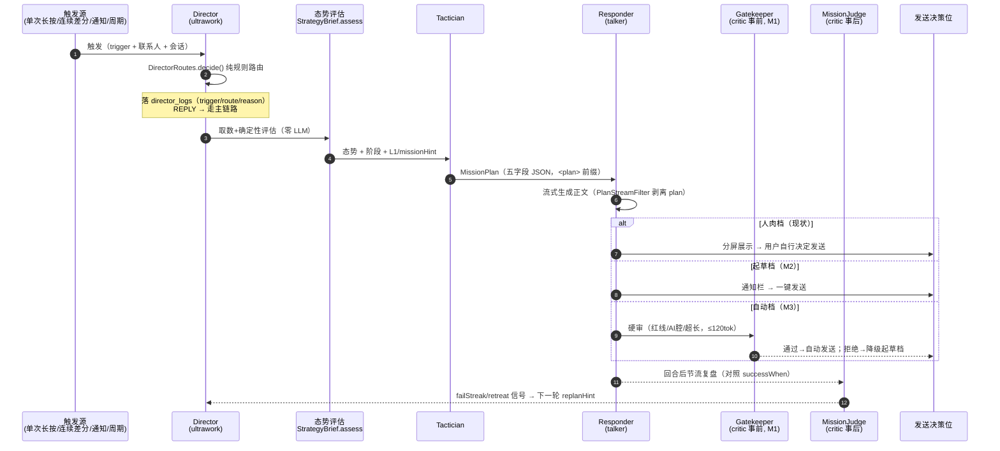
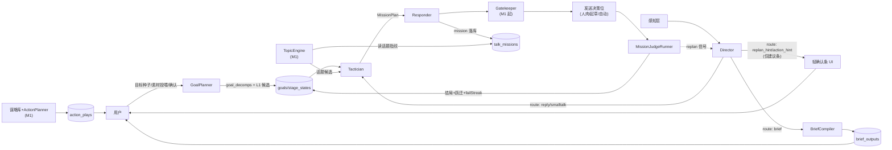
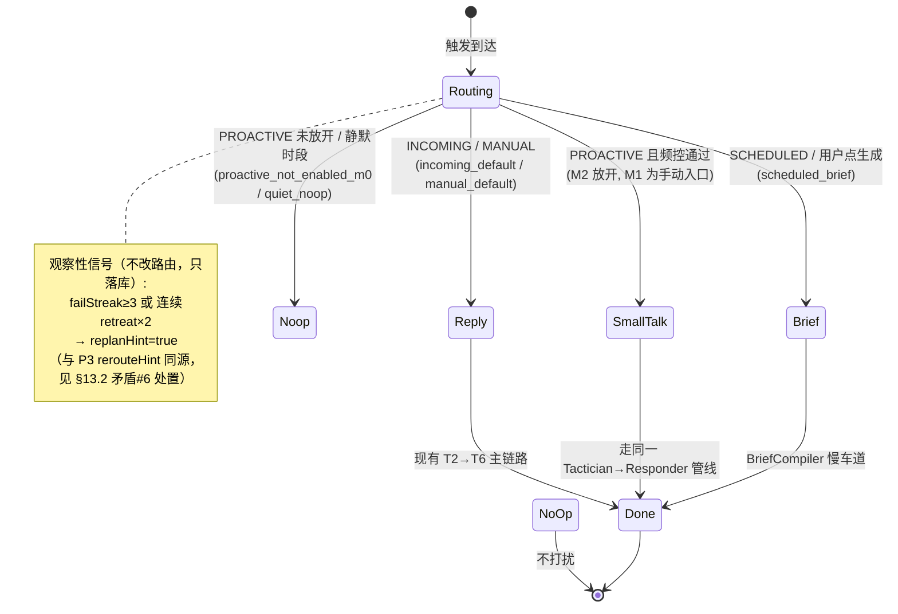
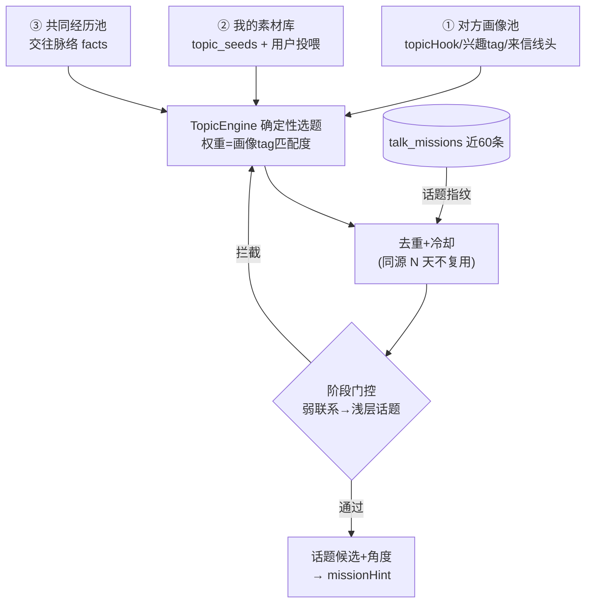
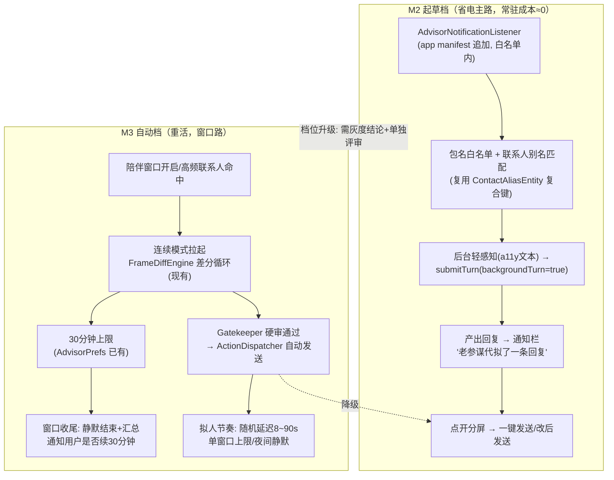

# 多代理协作自动参谋 · 方案文档（UltraAdvisor）

- 状态：**v2 二审修订中**（v1 已批准并实施 M0；本版按评审意见重写架构表述，未批准前不动新代码）
- 日期：2026-10-18（v2 修订同日）
- 分支：`laocanmou`（延续现有扩展模式，全部新代码进 `app` 模块 `floatball` 包）
- 关联：《2026-10-15 智能优化增强的聊天策略方案》（下称"策略方案"，P0~P3 已全量落地）、《2026-10-15 做好 RPA 的基础工作方案》（下称"RPA 方案"）
- 调研对象：`e:\_android_work\oh-my-openagent`（Ultrawork 多代理编排体系）
- v2 修订要点：① 手动/自动模式统一为「发送决策位」三档模型（评审意见 2）；
  ② 各子代理职责/边界/协作机制全面展开并用 Mermaid 表达（评审意见 1）；
  ③ 深度评估章节：矛盾自查清单与 oh-my-openagent 吸收复盘（评审意见 3）；
  ④ 修正 v1 中 6 处分期切割与时序矛盾（见 §13.2）。

---

## 1. 需求还原（用户原始想法的整理）

参考 oh-my-openagent 的多代理 IDE 插件，为本 App 设计「主代理调度子代理协作」：

| 角色                 | 用户定义                                                                                            |
| -------------------- | --------------------------------------------------------------------------------------------------- |
| **ultrawork 总调度** | 按对方回复评估节点节奏，决定：重新规划 / 新话题 / 答复 / 引导话题 / 行动建议 / 汇总简报             |
| **planner 计划师**   | 三大目标节点规划分解，gate→milestone→task→step 结构化可追踪，定义节点行为方法，维持主动聊天时机频率 |
| **talker 聊天师**    | 按上下文+目标+人设+语言风格生成回复                                                                 |
| **criticer 批评家**  | 审核计划与人设/长中短期目标一致性；审核回复是否人性合理；提改进意见                                 |
| **行动建议家**       | 口头聊天外的行动策划（约会/礼品/拜访/送礼），依赖财力/时间/特长，有谋略性（36计、资治通鉴式策略）   |
| **简报专家**         | 随时汇总进展（如"最近半个月与某人的关系进展到哪一步"）                                              |

**自动模式设想**：RPA 感知某 App 某人消息通知 / 主动发起时机 → 触发连续模式录屏（约 30 分钟后停止防杀）→ ultrawork 分析内容、时机、节点、话题 → 后台自动发送 → 循环。

**核心困惑**：80% 聊天是"废话"（塑人设/联络感情/制造话题/维持热度），天南地北无法穷举，AI 如何持续填充这类内容。

**评审意见 2（v2 核心修订）**：长按单次 / 双击连续这些"手动"模式，本质是
**"自动"模式下的特殊场景**——它们走同一条 Director 调度管线，只是发送决策位
固定落在"人肉确认"。详见 §5.1 统一模型。

---

## 2. 调研一：oh-my-openagent 的做法（2026-10-18 逐文件核实）

### 2.1 它是什么

TypeScript 编写的 opencode IDE 插件体系（`packages/omo-opencode` 等 8 个包），核心是
**"编排者不干活"** 的多代理分工：`ulw-plan`（规划技能）→ `ulw-execute`（执行技能）→
按任务形态路由给不同 worker 子代理。

### 2.2 可借鉴的六个设计（v2 补：派发后回环）

| 借鉴点                                  | 它的做法（文件依据）                                                                                                                                                                                                                            | 对本方案的价值                                                                                                            |
| --------------------------------------- | ----------------------------------------------------------------------------------------------------------------------------------------------------------------------------------------------------------------------------------------------- | ------------------------------------------------------------------------------------------------------------------------- |
| **编排者契约**                          | `ulw-execute/SKILL.md`："YOU ARE AN ORCHESTRATOR — NEVER THE IMPLEMENTER"，主代理只做选计划/分解/派发/验收/记证据                                                                                                                               | 总调度与聊天生成严格分层，调度逻辑不碰回复文案                                                                            |
| **计划即文件、状态即 JSON**             | 计划存 `.omo/plans/<slug>.md`（人可读+checkbox），运行状态存 `.omo/boulder.json`；"todo、Boulder、plan 必须永远讲同一个故事"                                                                                                                    | 目标节点必须是结构化数据而非聊天文字——与用户"不要回复性文字"的诉求同源                                                    |
| **委托路由表**                          | 按"任务形态"路由：`quick`（机械小活）/`deep-high`（难决策）/`ultrabrain`（一个真难题给目标不给步骤）；"可拆的并行蜂群，不可拆的整块委托"                                                                                                        | Director 的路由决策表直接套用此思想：按触发源+态势确定性路由，不靠大模型自由发挥                                          |
| **角色细分 + 资格注册表**               | `team-core/types.ts` 的 `AGENT_ELIGIBILITY_REGISTRY`：谁能进团队、谁只能被 `delegate-task` 调用（metis/momus 等只读代理硬拒绝进执行团队）；`metis`=规划前顾问（只读、喂给规划师）、`momus`=计划评审（**批准偏置**：80% 清晰即通过，只拦阻断项） | critic 角色要有明确"只拦什么"清单，否则变成无限挑刺循环；只读/产出型代理权限分离                                          |
| **子代理任务自包含 + 监控状态而非轮询** | 每个派发消息含 TASK/DELIVERABLE/SCOPE/VERIFY 四段；"派发无人盯视=未完成的派发"                                                                                                                                                                  | 老参谋每回合是串行队列，借鉴"自包含任务包"约束各角色的输入输出协议                                                        |
| **派发后验收回环（v2 补）**             | "Arm one watcher per lane, at spawn time"——每次派发必须挂一个完成条件监视器；"tear the watcher down the instant it resolves"；verdict 必须有 evidence 支撑，"never treat watcher silence as a pass"                                             | Director 的每次决策必须可回放验证：决策→回合→结局三层用 turnMessageId 关联（M0 已实装该列），绝不允许"落了日志没人看结果" |

### 2.3 不可照搬的部分（关键判断）

- **它是 IDE 场景**：任务重、回合少、不怕慢、人工全程在场。我们是手机端聊天参谋：
  **秒级首字、省 token、无人值守、错了没得撤回**。所以"主代理用 LLM 自由 spawn 子代理"
  这套**不适合**——每回合多几次大模型往返，成本与延迟不可接受。
- **正解**：借鉴它的**分工边界与协议**，但调度主体用**确定性规则引擎**（我们已有
  `StrategyBrief.assess` 零 LLM 态势评估的地基），LLM 只在"发什么"环节介入，不在"做什么"环节兜圈子。

---

## 3. 调研二：我们已有资产盘点（重要发现）

**策略方案 P0~P3 已于 2026-10-15/16 全量落地**（收口声明见该文档 §13，"本特性不设 P4，
后续如有新需求另立方案"——本文档即该"另立方案"）。逐角色对照：

| 用户设想的角色         | 现状                                                                                                                                                                                                                                                                                                  | 结论                                                                                                                 |
| ---------------------- | ----------------------------------------------------------------------------------------------------------------------------------------------------------------------------------------------------------------------------------------------------------------------------------------------------- | -------------------------------------------------------------------------------------------------------------------- |
| planner                | **已有**：`GoalPlanner`（STRATEGIST L3→L2、PLANNER L2→roadmap+L1 候选）；`goals/goal_decomps/stage_states` 表 = gate→milestone→task 的结构化落地；`talk_missions` = step 级任务令（五字段 JSON：mission/actions/forbidden/signalsToWatch/successWhen）；阶段机 missionHint + 13 场景包 = 节点行为方法 | **不重建，复用**。用户要的"结构化可追踪"已达成                                                                       |
| talker                 | **已有**：`AdvisorResponder`（规约总纲+角色处境+mission+行为化风格+画像推论+话术Top3+交往脉络）                                                                                                                                                                                                       | **不重建，复用**                                                                                                     |
| criticer（事后）       | **已有**：`MissionJudgeRunner`（下一回合节流轻 LLM 对照 successWhen 结局 mission、确认阶段跃迁、failStreak≥3 建议复评）                                                                                                                                                                               | **不重建，复用**                                                                                                     |
| criticer（事前审回复） | **缺**：回复直出无发送前审核                                                                                                                                                                                                                                                                          | **M1 新增 Gatekeeper**（M1 先挂连续模式分屏预览，M2 起接起草档）                                                     |
| ultrawork              | **半有**：`StrategyBrief.assess` 是确定性态势评估，但路由是固定流水线（incoming→reply 一条道），无"主动发起/重规划/行动建议/简报"的多路决策                                                                                                                                                           | **M0 已新增** Director 路由中枢（已实装：`floatball/director/` + `director_logs` 表，接在 `executePrepared` 汇聚点） |
| 行动建议家             | **全缺**                                                                                                                                                                                                                                                                                              | **M1 新增** ActionPlanner + 谋略库（action_plays 表已随 v7 建好）                                                    |
| 简报专家               | **半有**：数据全在（stage_history 时间线、talk_missions 结局、goals.progressNote）                                                                                                                                                                                                                    | **M0 已新增** BriefCompiler 慢车道简报 + GoalTab 简报卡（已实装）                                                    |
| 保温闲聊引擎           | **半有**：persona schema v2 有 `topicHook` 字段、maintain 包有 topicBank、silence_24h 时序信号已有                                                                                                                                                                                                    | **M1 新增** TopicEngine（用户困惑点的正解，见 §7）                                                                   |
| 主动时机               | **半有**：`session_bindings.lastIncomingAt`（v6）、silence_24h 三态信号                                                                                                                                                                                                                               | **M2 新增** ProactivePolicy 频控（表已随 v7 建好）                                                                   |

**其他可复用底座**（均无需改上游）：

- `ScreenAdvisor.submitTurn(content, backgroundTurn=true)`——**后台回合能力已存在**，自动模式直接用；
- 上游 `BaicNotificationListener` + v0.3.0 通知触发器 + `AutomationScheduler`（含精确闹钟、冷却、串行、无人值守策略）——消息到达感知源 **与 M2 周期调度载体**（v2 明确：复用它跑 proactive 检点，不自建定时器）；
- 上游 `ui_control`（tap/type/press_key，a11y 通道）+ RPA 方案的 AccessibilityBridge 增强路线——自动发送的执行器；
- `FrameDiffEngine` 连续差分循环 + `AdvisorPrefs` 时长上限——"30 分钟窗口防杀"的地基已有；
- 感知阶梯 `ScreenPerceiver`（a11y 文本→a11y 截图→投影）——自动模式沿用，**不新增授权形态**。

---

## 4. 可行性评估结论

| 项                 | 评估                                                                                                                                                                                                                                                                                    |
| ------------------ | --------------------------------------------------------------------------------------------------------------------------------------------------------------------------------------------------------------------------------------------------------------------------------------- |
| 六角色分工         | **可行**，且 3.5 个角色已存在。真正的新增面 = 调度中枢 + 三个新角色 + 保温引擎                                                                                                                                                                                                          |
| "自动发消息给对方" | **技术可行**（ui_control/AccessibilityBridge 已具备输入与点击能力），**但属高危功能**：平台风控封号、无人值守错发。统一三档模型见 §5.1，护栏见 §8                                                                                                                                       |
| 30 分钟连续窗口    | **可行**，FrameDiffEngine+AdvisorPrefs 时长上限+KeepAliveManager 三级降级（AGENTS §6.1）构成地基，补"窗口收尾→通知续期"                                                                                                                                                                 |
| 废话填充           | **可行且有明确解法**（§7 专题）：废话=有功能的低风险回合，交给"保温闲聊"意图走既有 Tactician→Responder 管线，素材三源+确定性频率，不让 LLM 决定"发不发"                                                                                                                                 |
| 成本               | 每回合新增 0 次 LLM（Director 默认纯规则）；新角色全部走慢车道 AuxiliaryTasks（简报/行动建议）或复用现有回合调用（保温闲聊）。见 §9 预算表                                                                                                                                              |
| 上游零侵入         | **可达**：通知监听在 app manifest 追加自有 `AdvisorNotificationListener`（白名单允许追加 service 声明），不动上游 listener；M2 周期调度复用上游 automation 运行时（参数化 recipe，不注入新逻辑）；发送动作走 `AccessibilityBridge`（app 已依赖 device:api）。**白名单外上游文件零改动** |

---

## 5. 总体架构：Director 统一调度 + 六角色流水线

### 5.1 统一模型（v2 核心修订）：手动模式 = 自动模式的"人肉档"

评审意见 2 指出的事实：**长按单次、双击连续，与未来的"自动模式"不是两套系统**。
它们与自动模式共享同一条「感知 → Director 调度 → Tactician → Responder」管线，
唯一的差异在末端**发送决策位（Dispatch Gate）**属于谁：

| 档位               | 触发                    | 生成                       | 发送决策位                                     | 期   |
| ------------------ | ----------------------- | -------------------------- | ---------------------------------------------- | ---- |
| **人肉档**（现状） | 手长按单次 / 手双击连续 | 同一管线                   | 用户看分屏，自己复制/自己发——AI 只出稿不碰发送 | 已有 |
| **起草档**         | 通知唤醒 / 周期检点     | 同一管线（后台回合）       | 用户点通知→分屏预览→**一键发送/改后发送**      | M2   |
| **自动档**         | 同起草档 + 陪伴窗口     | 同一管线 + Gatekeeper 硬审 | **Gatekeeper 通过即自动发送**，失败降级起草档  | M3   |



**推论**：M0 已把单次（MANUAL）与连续（INCOMING）两路回合都接入 Director
（`ScreenAdvisor.executePrepared` 汇聚点，旁路记录不改控制流）——手动模式
**已经归 Director 统一管理**，与评审意见 2 的要求一致。三档演进只是在管线末端
逐步挂接新的发送决策位，**前端的调度与生成代码零分叉**。

### 5.2 回合全时序（Mermaid）



### 5.3 六个角色：职责 / 输入 / 产物 / 边界 / 验收

借鉴 oh-my-openagent 的自包含任务包协议（TASK/DELIVERABLE/SCOPE/VERIFY 四段），
每个角色的契约如下表——**角色间只传结构化产物（DB 行/JSON），不传对话式文字**：

| 角色                                     | 职责（TASK）                                        | 输入                                                         | 产物（DELIVERABLE）                                                        | 边界（SCOPE，禁止事项）                                                                                             | 验收（VERIFY）                                                                             |
| ---------------------------------------- | --------------------------------------------------- | ------------------------------------------------------------ | -------------------------------------------------------------------------- | ------------------------------------------------------------------------------------------------------------------- | ------------------------------------------------------------------------------------------ |
| **Director**（ultrawork）                | 决定"本轮干什么"：路由到六个执行方向                | 触发源、联系人、态势摘要、目标健康度、频控                   | `director_logs` 行（route+reason，turnMessageId 可回放）                   | **不生成任何文案**；不改目标/阶段（只产建议条）；不决定"发不发"（M2 前无发送概念，M3 也只做前置审查）               | 决策可回放：每次 route 都能从日志回溯命中规则；规则表 JVM 单测全分支                       |
| **GoalPlanner**（planner）               | 三级目标编译：L3→L2→roadmap+L1 候选                 | 用户目标种子、场景包、交往脉络、现状画像                     | `goal_decomps` 版本化 payload + L1 候选                                    | **不生成回复**；产物 provisional 需确认才 active；同一证据不重复规划（版本递增，旧版归档）                          | S5 验收剧本：L3 不被编译成单回合任务；L2 必有 deadline/判据                                |
| **Tactician**                            | 回合级任务令：把 L1/阶段翻译成本轮 mission          | 态势、阶段、L1/missionHint、策略卡、话题候选（保温时）       | `talk_missions` 行（mission/actions/forbidden/signals/successWhen 五字段） | **不直接面向用户**（PlanStreamFilter 对用户隐藏）；模型无权自行宣布跳阶段                                           | 解析失败全文当普通回复，不写 mission；保温 mission 的 forbidden 必含"不推进/不索取/不查岗" |
| **Responder**（talker）                  | 生成回复正文                                        | 规约总纲+角色处境+mission+行为化风格+画像推论+话术+交往脉络  | 流式正文（无 JSON 残留）                                                   | **不越过 forbidden 红线**；不做目标/阶段决策；不编造时效性事实（D3）                                                | S3 剧本：10 回合风格稳定；行内纠偏三档重生成                                               |
| **MissionJudgeRunner**（critic·事后）    | 复盘上轮 mission 结局、确认阶段跃迁、产出健康度信号 | talk_missions pending 行 + 对方最新来信 + 信号词表           | mission 结局（settled）+ stage_history 跃迁 + failStreak 计数              | **节流**（下一回合才跑）；只在跨键达阈值时移动阶段，单回合无权跳站；L1 永不自动完成（只出建议条）                   | 跃迁必留 evidence；informational mission（保温）直接跳过 settle（M1 豁免规则）             |
| **Gatekeeper**（critic·事前，M1）        | 发送前硬审（仅自动档强制）                          | Responder 成稿 + 红线黑名单 + 上轮文本                       | 放行 / 拒绝（附原因码）                                                    | **只拦三类**：硬红线（钱/承诺/隐私/超阶段）、AI 腔/重复上轮、超长——**批准偏置**，不挑刺文风（学 momus：只拦阻断项） | 拦截样例全绿；拒绝必降级起草档而非丢弃                                                     |
| **ActionPlanner**（行动建议家，M1）      | 口头之外的行动策划：从谋略库选条+按态势定制         | 谋略库（12 条起步）、阶段白名单、财力/时间/特长画像          | `action_plays` 行（title/rationale/steps/cost/risk/prereq）                | **不生成聊天文案**；risk 必填；欺骗/钱财诱导类不入库；只出草案，采纳/完成由用户驱动                                 | 10 个样例全部含 cost/risk；谋略代码必须在阶段白名单内                                      |
| **BriefCompiler**（简报专家，M0 已实装） | 汇总窗口期进展                                      | stage_history、talk_missions、goals.progressNote             | `brief_outputs` 行（五段 JSON）                                            | **不预测不推断**，只汇总给入事实（反幻觉协议）；空窗口不调 LLM                                                      | 输出条目必须能对应给入的 history/mission 行（单测断言）                                    |
| **TopicEngine**（保温选题，M1）          | 从三素材池确定性选题                                | 画像 topicHook、topic_seeds、共同经历、近 60 条 mission 指纹 | 话题候选+角度（拼进 missionHint）                                          | **不决定频率**（ProactivePolicy 管发不发）；不编时事（D3）；阶段门控                                                | 10 连发无重复指纹（M1 手动触发验收）                                                       |

### 5.4 角色协作关系与数据流



### 5.5 Director 路由状态机



**v2 修正（矛盾#2 处置）**：v1 把 `guide` 列在 Director 前置路由中，但推进意图
信号在 T2 态势评估**之后**才产生，Director 前置拿不到——时序倒挂。修正：
**`guide` 不进 Director 路由表**，它是 T2 之后的既有意图系统行为
（push_close 等意图经 StageGate 门控后体现在 mission 里）。Director 路由表
最终收敛为四路：`reply / smalltalk / brief / noop`，外加 `replan_hint / action_hint`
两个**旁路建议**（不占路由，只落日志+出轻确认条）。

### 5.6 Director 与既有信号的双轨关系（矛盾#6 处置）

P3 已有「同站连续 retreat×2 → 分屏亮重规划按钮」（`maybeShowRerouteHint`）。
v1 又让 Director 落 replanHint——同源双轨。v2 统一口径：**两者是同一信号的两个消费面**：

- Director.replanHint = **记录面**（落 director_logs，供回放与 M2 周期检点消费）；
- 现有 rerouteHint = **交互面**（分屏按钮，用户手动触发 reroute）。

M0 实装已遵守：Director 只落库不弹 UI，交互面沿用 P3 代码，零重复弹出。
M2 起 `action_hint` 同理：信号由 Director 记录，UI 只在用户打开 GoalTab 时消费。

---

## 6. 数据设计（AdvisorDatabase v6 → v7，已随 M0 实装）

```sql
-- 1) 调度日志（Director 每次决策一行，滚动 200 条/联系人）
CREATE TABLE director_logs (
  id INTEGER PK, contactId INTEGER NOT NULL, conversationId INTEGER,
  trigger TEXT NOT NULL,        -- incoming/proactive/scheduled/manual
  route TEXT NOT NULL,          -- reply/smalltalk/brief/noop
  reason TEXT,                  -- 命中的规则键（可回放验证）
  turnMessageId INTEGER,        -- 关联回合消息（v2：结局回放锚点，不加 outcome 列）
  createdAt INTEGER NOT NULL
);

-- 2) 行动建议（ActionPlanner 产物，用户采纳驱动）
CREATE TABLE action_plays (
  id INTEGER PK, contactId INTEGER NOT NULL, goalId INTEGER, stageCode TEXT,
  kind TEXT NOT NULL,           -- meetup/gift/visit/care/custom
  stratagemCode TEXT,           -- 谋略库编号（可空）
  payloadJson TEXT NOT NULL,    -- {title,rationale,steps[],cost,risk,prereq}
  status TEXT NOT NULL DEFAULT 'draft',  -- draft/adopted/done/dropped
  resultNote TEXT, createdAt INTEGER NOT NULL
);

-- 3) 简报（BriefCompiler 产物，M0 已实装）
CREATE TABLE brief_outputs (
  id INTEGER PK, contactId INTEGER NOT NULL,
  kind TEXT NOT NULL,           -- weekly/monthly/onDemand
  rangeStart INTEGER NOT NULL, rangeEnd INTEGER NOT NULL,
  contentJson TEXT NOT NULL,    -- {stagePosition,recentEvents[],goalProgress,risks,nextMoves[]}
  createdAt INTEGER NOT NULL
);

-- 4) 主动策略（频控配置，M2 消费）
CREATE TABLE proactive_policies (
  contactId INTEGER PK, enabled INTEGER NOT NULL DEFAULT 0,
  dailyCap INTEGER NOT NULL DEFAULT 1,     -- 每日主动上限
  minGapHours INTEGER NOT NULL DEFAULT 48, -- 两次主动最小间隔
  quietStart TEXT NOT NULL DEFAULT '22:30', quietEnd TEXT NOT NULL DEFAULT '08:30',
  preferSmalltalk INTEGER NOT NULL DEFAULT 1, updatedAt INTEGER NOT NULL
);
```

**v2 说明（吸收"派发后回环"但零额外迁移）**：oh-my-openagent 要求每个派发挂完成
监视器；本方案的对应物是"决策→回合→结局"三层可回放链：
`director_logs.turnMessageId → talk_missions(turnMessageId) → mission.result`。
M0 实装已含 turnMessageId 列，**无需加 outcome 列、无需 v8 迁移**。

新静态资产（JSON，随包分发，照 scenario_packs 惯例）：

- `assets/advisor/action_stratagems.json`：谋略库（§6.1）；
- `assets/advisor/topic_seeds.json`：保温话题种子（§7），按画像 tag 分组。

### 6.1 谋略库口径（回应"36计/资治通鉴"）

以**古典谋略的沟通化转译**呈现，每条含：编号、名称（如"以退为进/借物传情/投石问路"）、
适用阶段（stage code 白名单）、适用路径（pursue/maintain/defend）、模板步骤、风险提示。
ActionPlanner 的职责是**从库中选择 + 结合态势定制**，不是自由发明。初版 12 条
（四类路径各 3 条），评审后可扩。**边界**：谋略只作用于正当社交/经营场景的节奏设计，
禁止用于欺骗、钱财诱导类条目（库内容评审时逐条把关，`risk` 字段必填）。

---

## 7. 专题一：废话填充 =「保温闲聊」引擎（回应用户核心困惑）

### 7.1 认知重构：废话不是噪音，是低风险的功能回合

用户列的四类"废话"全部有明确功能，全部可结构化：

| 废话类型 | 功能                                     | 机制承载（全部已有）                       |
| -------- | ---------------------------------------- | ------------------------------------------ |
| 塑造人设 | 展示 aspirationalSelf 与 my\_\* 现状画像 | persona 字段 + 风格卡 do/dont              |
| 联络感情 | 互动频率本身是关系信号                   | silence_24h 时序信号 + 阶段机 advance 计数 |
| 制造话题 | 提供对方可接的话柄（topicHook）          | persona.topicHook + topicBank              |
| 维持热度 | 保持对话窗口不断冷                       | ProactivePolicy 频控 + maintain 包停留态   |

**结论**：保温闲聊不需要新管线——它是走既有 Tactician→Responder 的一类**意图**
（新增 `warm_chat` 意图，纳入 style_playbook 的 do/dont 约束），但 KPI 从"推进"
换成"自然度+可接性"，且**绝不携带 mission 推进压力**（forbidden 默认含"不推进、
不索取、不查岗"）。

### 7.2 话题从哪来：素材三源 + 确定性选题（TopicEngine）

**不靠 LLM 天马行空**——天马行空正是 AI 味与幻觉的来源。话题=确定性选题算法从三个
有限素材池抽取，LLM 只负责把选中素材"聊活"：

```text
素材池（按对方画像 tag 匹配权重）：
  ① 对方画像：persona.topicHook + 兴趣 tag + 近期来信中未展开的线头（IncomingCue 已提取）
  ② 我的素材库：topic_seeds.json + 用户投喂（"我的趣事/见闻/资源"录入页，M1 附带）
  ③ 共同经历：交往脉络 facts（goals/stage_history/记忆 recallByEntity）
硬规则：
  - 已用话题指纹去重（读近 60 条 talk_missions 的话题标记）
  - 冷却：同一话题源 N 天不复用
  - 阶段门控：弱联系只碰浅层话题（兴趣/见闻），舒适期才碰深层（观点/经历）
  - 时事禁令：默认禁止编造新闻/热点事实（幻觉红线）；用户可投喂当日素材
选题输出 → 拼进 Tactician 输入的 missionHint："本轮保温，话题候选=X（角度=Y），可弃用"
```



### 7.3 频率纪律：主动是稀缺资源

- **发不发**由 ProactivePolicy 确定性决定（dailyCap/minGapHours/quietHours），
  LLM 无权决定"要不要主动发"——只决定"发什么"；
- incoming 永远优先于 proactive（对方先开口绝不抢话）；
- 保温话题占比可配（默认：主动回合中保温:推进 = 3:1，随阶段自动调整）。

---

## 8. 专题二：自动模式 = 发送决策位的档位演进

### 8.1 三档统一链路（v2 重写）

v1 表述"自动模式修正为事件驱动"容易读成独立于现有模式的新链路。v2 澄清：
**不是新链路，是同一条链路的末端档位演进**（见 §5.1）。落地路径：



**M2 周期调度载体（v2 修正，矛盾#5）**：proactive/scheduled 触发不自建定时器，
**复用上游 `AutomationScheduler`**（v0.3.0 通知触发器 + 精确闹钟 + 冷却串行），
通过 app 层注册动态 recipe 实现"每 N 小时检点一次 ProactivePolicy"，遵守
Android 12+ 精确闹钟豁免引导（AGENTS §6.1）。

### 8.2 自动发送（M3）的执行与护栏

- **执行器**：`auto/ActionDispatcher.kt` 编排 AccessibilityBridge 动作序列：
  定位会话输入框 → 注入文本 → 点击发送；每步带存在性校验与一次重试，
  失败即降级起草档（绝不盲点坐标）；
- **拟人节奏**：随机延迟 8~90s、单窗口发送上限、夜间静默（复用 quietHours）；
- **Gatekeeper 硬审**（≤120tok 轻调用 + 确定性黑名单双重）：涉及**钱、承诺、
  敏感隐私、超阶段动作**一律降级起草档；AI 腔/重复上轮/超长 → 降级起草档；
- **红线继承**：现有 forbidden 机制 + 规约总纲全部生效；自动档默认
  `forbidden` 追加"不报价、不转账话题、不代用户做决定"。

### 8.3 风险明示（评审必读）

| 风险                                        | 对策                                                                                |
| ------------------------------------------- | ----------------------------------------------------------------------------------- |
| **平台风控封号**：微信等 ToS 禁止自动化操作 | 自动档默认关闭；白名单联系人 ≤5；频控拟人化；设置页显著风险告知与二次确认           |
| 无人值守错发                                | 起草档默认；自动档 Gatekeeper 双重审 + 全量 director_log 可回溯；发送前文本指纹记录 |
| 操纵感/伦理                                 | 谋略库逐条评审、risk 字段必填；方案定位为"关系经营的节奏参谋"，欺骗类条目不入库     |
| 隐私                                        | 延续本地优先红线：OCR/截屏不落盘、无遥测；通知文本即取即用不持久化                  |

---

## 9. LLM 成本预算（每回合增量）

| 环节               | 调用                                        | 增量成本           |
| ------------------ | ------------------------------------------- | ------------------ |
| Director 路由      | 默认纯规则 0 LLM；模糊时 1 次轻分类 ≤200tok | ~0                 |
| smalltalk 回合     | 复用现有 Tactician+Responder 单次流式调用   | 0（同现有回合）    |
| Gatekeeper         | 仅自动档，≤120tok                           | 自动档 +1 次轻调用 |
| ActionPlanner      | 慢车道，≤500tok，用户点"给点子"才跑         | 按需               |
| BriefCompiler      | 慢车道，≤800tok，weekly/按需                | 按需               |
| replan/action hint | 只产出建议条，复用已有信号计算              | 0                  |

---

## 10. 分期实施与验收（每期独立灰度；v2 修正三处切割矛盾）

| 期                                           | 范围                                                                                                                                                                                                                        | 关键验收                                                                                                                                                                  |
| -------------------------------------------- | --------------------------------------------------------------------------------------------------------------------------------------------------------------------------------------------------------------------------- | ------------------------------------------------------------------------------------------------------------------------------------------------------------------------- |
| **M0 调度中枢+简报** ✅ 已完成（2026-10-18） | Director 规则路由 + director_log；BriefCompiler（weekly/按需）+ GoalTab 简报卡；DB v6→v7                                                                                                                                    | 已验收：单测 145 绿（含路由表 11 测试）；冒烟零回归；advisor.db 实测 v7 四表就位；无联系人只决策不落库符合设计                                                            |
| **M1 保温+行动+事前审**                      | TopicEngine + warm_chat 意图 + topic_seeds + 素材投喂页；ActionPlanner + 谜库 + action_plays 卡片；Gatekeeper（**挂连续模式分屏预览**，矛盾#4 处置）；**MissionJudgeRunner 对 informational mission 豁免 settle**（矛盾#7） | 保温话题 10 连发无重复（**v2 修正矛盾#3：M1 经分屏"来点闲聊"手动入口触发**，非 PROACTIVE）；无时事编造；符合风格 do/dont；行动建议必含 cost/risk；Gatekeeper 拦截样例全绿 |
| **M2 半自动（起草档）**                      | ProactivePolicy + AdvisorNotificationListener + 后台回合 + 起草通知一键发送 + **PROACTIVE/SCHEDULED 触发源放开**（复用上游 AutomationScheduler，矛盾#5）                                                                    | 通知→起草→发送全链路冒烟；频控三参数生效；静默时段零打扰；Director 日志四触发源齐全可回放                                                                                 |
| **M3 自动驾驶（可选，单独评审）**            | 自动档发送 + 陪伴窗口 30 分钟 + 拟人节奏 + 续期通知                                                                                                                                                                         | 白名单联系人实测；错发率 0（Gatekeeper 全绿才发）；封号风险告知确认后开启                                                                                                 |

**节奏纪律**：M0/M1 不改变现有链路风险面，可与 P1/P2 灰度观察并行推进；
**M2/M3 涉及全新风险面，建议在风格灰度（≥7 天/≥50 回合/do-dont ≥85%）结论出来后
单独评审再启动**——延续"P1 达标才进 P2"的既定纪律。

### 提交门槛

沿用 AGENTS.md §6：license 门禁 + `assembleDebug` + 冒烟链路 + logcat 无崩溃；
`floatball/director` 纯函数路由表、TopicEngine 选题、Gatekeeper 判定全部 JVM 单测。

---

## 11. 决策项（评审拍板记录）

| #             | 决策                                | 结论                                                                                      |
| ------------- | ----------------------------------- | ----------------------------------------------------------------------------------------- |
| D1            | 自动发送默认档位                    | **起草档**；自动档 M3 单独评审                                                            |
| D2            | 谋略库规模                          | **12 条起步**，按使用率扩                                                                 |
| D3            | 保温话题是否允许时效性内容          | **默认禁止编造**；用户投喂素材即可用                                                      |
| D4            | 保温闲聊是否计入 talk_missions 台账 | **计入**（话题指纹去重依赖它），result 恒为 `informational`，Judge 豁免 settle（M1 落地） |
| D5            | M0/M1 是否与风格灰度观察并行启动    | **是**；M2/M3 等灰度结论                                                                  |
| D6（v2 新增） | guide 路由归属                      | **移出 Director 路由表**——推进意图在 T2 后产生，属既有意图系统行为，避免时序倒挂          |
| D7（v2 新增） | M2 周期调度载体                     | **复用上游 AutomationScheduler**，不自建定时器                                            |

---

## 12. 风险与开放问题

| 风险                                                     | 对策                                                                                                                |
| -------------------------------------------------------- | ------------------------------------------------------------------------------------------------------------------- |
| Director 规则表过度设计、路由抖动                        | 规则全部可从 director_log 回放验证；四路由+两旁路建议收敛，不再扩（D6）                                             |
| 保温闲聊 AI 味重、被识破                                 | warm_chat 纳入 do/dont 约束 + Gatekeeper AI 腔检测 + 用户行内纠偏（现有能力）复用                                   |
| 通知监听误匹配联系人                                     | 别名匹配沿用现有复合键规则；命中置信不足一律降级为"仅提醒不出稿"                                                    |
| 多联系人间上下文串扰                                     | 延续硬规则：联系人专属会话摘要隔离、看屏只读（项目记忆既有铁律），Director 决策全部带 contactId 隔离                |
| 自动模式被系统杀                                         | 事件驱动为主（通知唤醒不驻留）；窗口模式前台服务+三级降级（现成）；force-stop 后失效属系统行为，UI 不承诺"永久存活" |
| 三档并存的状态混乱（人肉档用户已手动发过，自动档又代发） | 发送决策位互斥：同一联系人同一时间只允许一档激活（AdvisorPrefs 开关+自动档白名单独立），director_logs 记录档位      |

---

## 13. v2 深度评估：可靠性 / 可行性 / 合理性（评审意见 3）

### 13.1 与 oh-my-openagent 的吸收复盘（诚实清单）

| 它的机制                                       | 吸收程度             | 在本方案的落点 / 有意偏离的理由                                                                                         |
| ---------------------------------------------- | -------------------- | ----------------------------------------------------------------------------------------------------------------------- |
| 编排者契约（orchestrator 不实现）              | **已吸收**           | Director 只产路由决策+日志，六角色分工契约表（§5.3）明确"不生成文案/不决定发送"                                         |
| 计划即数据、状态即 JSON、三态同步              | **已吸收**           | goals/decomps/missions/ director_logs 全结构化；本方案新增"决策→回合→结局"回放链（对应它的 boulder/plan/todo 同步纪律） |
| 委托路由表（按形态路由）                       | **已吸收并降维**     | DirectorRoutes 四路由+两旁路；偏离点：不用 LLM spawn，路由纯确定性（IDE 场景 vs 手机秒级约束，见 §2.3）                 |
| 资格注册表（只读代理不进执行团队）             | **已吸收**           | §5.3 边界列：BriefCompiler 只读、Director 不碰文案、ActionPlanner 不碰聊天；Gatekeeper 只拦阻断项                       |
| 批准偏置（momus 只拦 blocking）                | **已吸收**           | Gatekeeper"只拦三类"+ MissionJudge"模型无权跳阶段"；避免无限挑刺循环（它的教训原样照搬）                                |
| 自包含任务包（TASK/DELIVERABLE/SCOPE/VERIFY）  | **已吸收**           | §5.3 五列表格即四段协议的本地化                                                                                         |
| **派发后监视器/verdict 需 evidence**           | **v1 遗漏，v2 补齐** | turnMessageId 三层回放链（§6 v2 说明）；M2 周期检点定期消化 director_logs 对账（进 M2 验收范围）                        |
| 团队模式（team 自由协作）                      | **有意不吸收**       | 聊天回合必须串行（用户等待一个答案），并行蜂群在单联系人对话里无意义；跨联系人并行已由"5 路取数并发"覆盖                |
| 计划重审/对抗性评审（adversarial plan review） | **部分吸收**         | CardCompiler 确认流 + GoalTab 轻确认条承接"人审"环节；全自动对抗评审成本过高，不做                                      |

**复盘结论**：核心协作机制（契约/数据化/路由表/偏置审查/回环）六项中五项在 v1 已吸收、
一项（派发后回环）v2 补齐；两项有意偏离（LLM 自由 spawn、团队模式）均给出场景化理由。
评估：**吸收是实质性的，不是皮毛照抄目录结构**——它的 `AGENT_ELIGIBILITY_REGISTRY`
对应本方案的角色边界列，它的 delegation router 对应 DirectorRoutes，一一可溯源。

### 13.2 矛盾自查与处置清单（v1 → v2）

| #   | 矛盾/缺陷（v1 存在的问题）                                              | v2 处置                                                                                 | 状态                 |
| --- | ----------------------------------------------------------------------- | --------------------------------------------------------------------------------------- | -------------------- |
| 1   | 手动模式与自动模式割裂表述，长按/双击被写成 Director 之外的"现状"       | §5.1 统一模型：三档共享管线，差异仅在发送决策位；M0 已实装 MANUAL/INCOMING 双触发源接入 | 文档修正，代码已符合 |
| 2   | guide 路由时序倒挂（推进意图信号在 T2 之后才产生，Director 前置拿不到） | D6：guide 移出路由表，回归既有意图系统                                                  | 文档修正             |
| 3   | M1 验收"保温 10 连发"但 PROACTIVE 触发源 M2 才放开，M1 无从触发         | M1 改为分屏"来点闲聊"手动入口触发；M2 放开自动时机                                      | 分期修正             |
| 4   | Gatekeeper M1"先接起草档"但起草档 M2 才存在                             | M1 挂载点改为连续模式分屏预览，M2 随起草档迁移                                          | 分期修正             |
| 5   | M2 proactive 定时无调度载体                                             | D7：复用上游 AutomationScheduler（精确闹钟+冷却+串行），不自建                          | 可行性补全           |
| 6   | replan_hint 与 P3 rerouteHint 双轨同源，可能重复弹                      | §5.6：记录面/交互面分离，UI 单点弹出                                                    | 口径统一             |
| 7   | D4 informational mission 会让 MissionJudgeRunner 空转 settle            | M1 范围补 Judge 豁免规则                                                                | 分期修正             |
| 8   | 无"决策结果对账"机制（日志落了没人看）                                  | turnMessageId 回放链 + M2 周期检点消化                                                  | 已补                 |

### 13.3 可靠性 / 可行性 / 合理性总评

| 维度                   | 评估               | 依据                                                                                                                                                                                                                                                                                               |
| ---------------------- | ------------------ | -------------------------------------------------------------------------------------------------------------------------------------------------------------------------------------------------------------------------------------------------------------------------------------------------- |
| **技术可行性**         | **高**（渐进实证） | 最难的三块已验证：DB 迁移真机实测 v7 四表就位；后台回合 `submitTurn(backgroundTurn)` 是既有能力；发送执行器（AccessibilityBridge/ui_control）与通知感知（上游 listener）零上游改动即可用。剩余新面（TopicEngine/Gatekeeper/ActionDispatcher）均为常规实现，无研究性风险                            |
| **架构可靠性**         | **中高**           | 全链路确定性优先（Director 零 LLM、选题纯函数、频控纯规则），LLM 只在"生成文案"与"慢车道汇总"两处出现且都有宽松解析+静默降级；单点故障均在既有降级矩阵覆盖内（plan 解析失败→普通回复、增强档失败→智能档、Gatekeeper 失败→起草档）。**薄弱点**：三档并存期的状态互斥（§12 已列对策，M3 验收含此项） |
| **资源合理性**         | **高**             | 每回合 LLM 增量≈0；新增调用全部按需慢车道；DB 增量四表均带滚动裁剪（200/10/60 条上限），无膨胀风险                                                                                                                                                                                                 |
| **风险合理性**         | **分级正确**       | 最大风险（平台封号/伦理）全部压在 M2/M3 且默认关闭+单独评审+白名单+拟人化；M0/M1 无新增风险面（冒烟已证零回归）                                                                                                                                                                                    |
| **与既有系统的一致性** | **高**             | 复用不重建（3.5 角色既有）；上游零侵入（白名单内 manifest 追加）；与 P1-P3 全量落地的策略方案通过"另立方案"接口衔接，无冲突                                                                                                                                                                        |
| **遗留开放问题**       | 2 项               | ①保温闲聊的"自然度"无客观指标，只能靠灰度期 do/dont 符合率+用户纠偏频率代偿（已列 M1 验收）；②自动档的真实平台风控强度无法本地验证，只能以白名单+频控+拟人化保守假设（M3 验收要求真实联系人实测后再放开）                                                                                          |

**总评**：方案在吸收 oh-my-openagent 协作精髓与适配手机端约束之间取得了正确平衡；
v1 的 8 处瑕疵（1 处架构表述、2 处时序/双轨、4 处分期切割、1 处回环缺失）已在 v2
全部处置。可以按 §10 分期推进，M1 为下一个可开工期。
