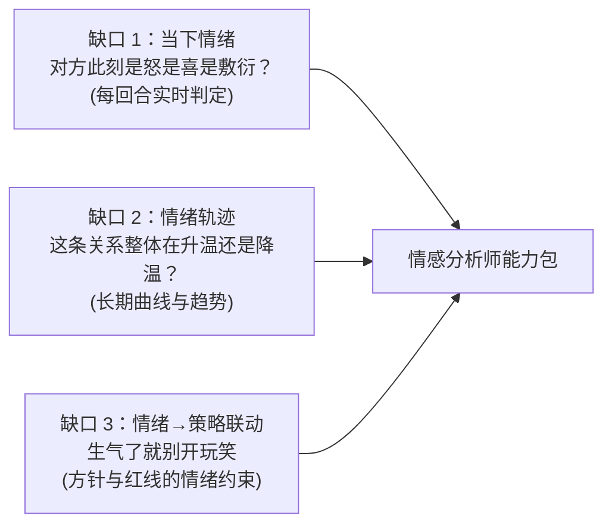
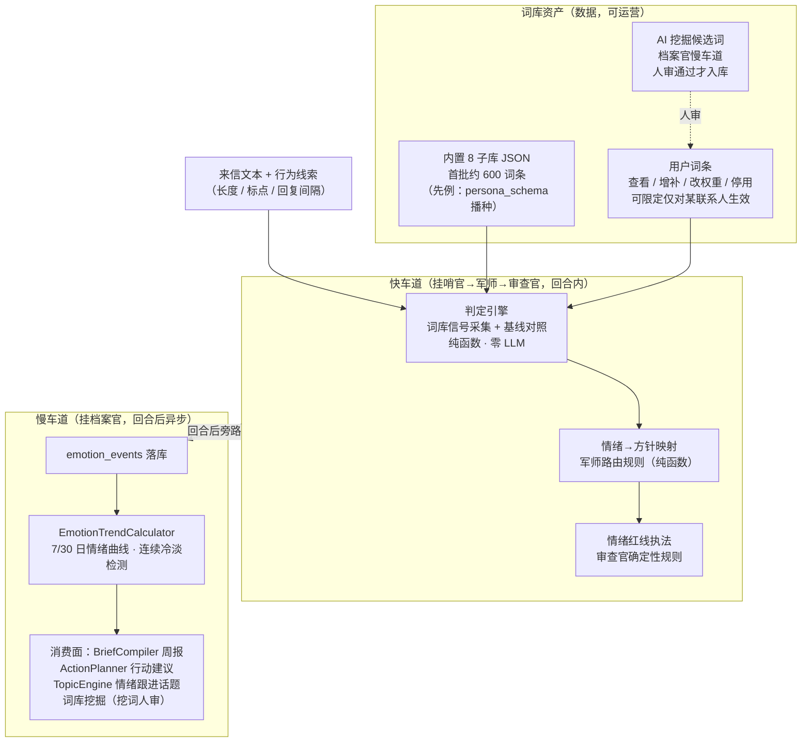
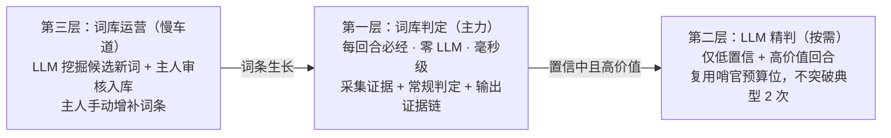
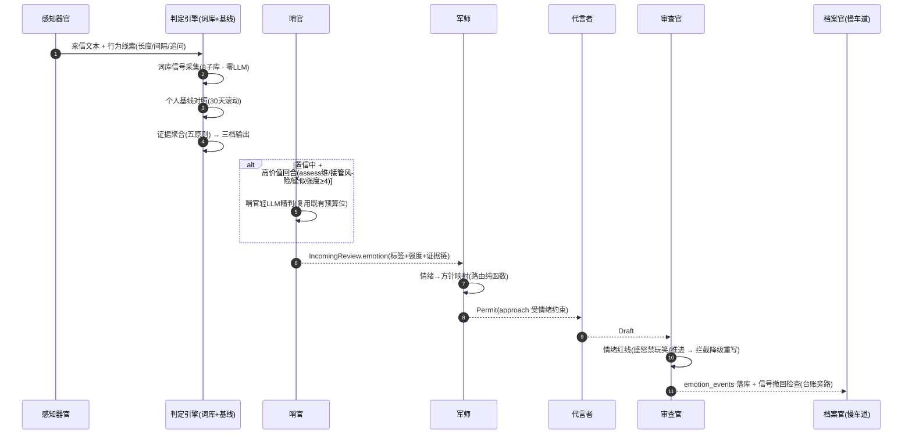
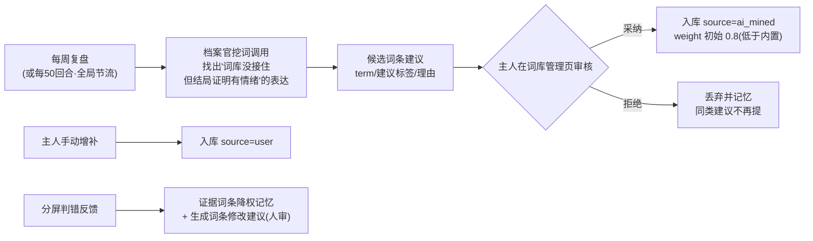

# 情感分析师能力扩展方案（评估与实施设计）

> 状态：**待批准（纯方案零代码）**。v2（2026-10-22，按用户反馈细化）。
> v2 变更：①明确技术路线——**词库为主、LLM 为辅、词库可运营**（§4.2）；
> ②词表扩充为 8 子库可配置体系，用户可查看/增补/调权重/按联系人限定（§4.3）；
> ③新增判定引擎五原则（个人基线校准 + 信号撤回），解决"好的"类中性词误判（§4.4）；
> ④新增词库运营闭环：LLM 挖词人审入库 + 判错反馈（§4.7）。
> 依据：用户 2026-10-22 指令——基于五岗两器官架构评估"新增情感分析师"。
> 铁律：岗位口径先对表入座（[五岗方案](2026-10-21-五岗子代理架构整合方案.md) §五）；
> LLM 预算不突破（典型 2 次 / 上限 4 次）；模型只能提案、代码执法；
> 上游零侵入；数据不出端；文案中文、场景以中文语境为准。

---

## 一、核心结论（TL;DR）

**不建议新增"第六岗"，建议以"情感分析师"能力包形式落地**——组织图保持
五岗两器官不变，能力按职责分拆挂靠四个既有岗位（先例：T1 的"策略官"就是
军师的快车道 LLM 职责，没有单列岗位）：

| 能力                                    | 挂靠岗位                       | 一句话                            |
| --------------------------------------- | ------------------------------ | --------------------------------- |
| 实时情绪判定（来信此刻什么情绪）        | **哨官**（理解对方的自然延伸） | 词库判定为主，读信瞬间出结果      |
| 情绪→打法联动（情绪怎么影响本回合方针） | **军师**                       | 路由规则 + 提示词注入             |
| 情绪护栏（盛怒时禁玩笑禁推进）          | **审查官**                     | 确定性规则执法                    |
| 情绪轨迹沉淀 + 词库运营                 | **档案官**（慢车道）           | emotion_events 落库 + 趋势 + 挖词 |

**技术路线一句话（回答"建库还是每次 LLM"）**：

> **库为主、LLM 为辅、库可运营。** 每回合的信号采集与常规判定全部走
> **本地词库**（零 LLM、毫秒级、证据链可解释、用户可编辑）；LLM 只做两件
> 有限的事：①低置信 + 高价值回合的**精判**（复用哨官既有预算位，典型回合
> LLM 次数零增加）；②慢车道**挖词建议**（从聊天复盘出候选新词，**人审后**
> 才入库——模型只能提案）。词库不是硬编码常量，是**可查看、可补充、
> 可调权重、可按联系人限定的数据资产**（§4.3）。

**为什么不单列第六岗**：① 情绪判定发生在"读信瞬间"，与哨官同时点同输入——
这正是当初场景官并入哨官的理由（时序错位问题）；② 五岗方案刚把 ~12 个历史
称谓收敛到 5+2（子代理最少化宪法）；③ 单列岗位每回合 +1 次 LLM，突破预算纪律。

---

## 二、这是什么功能：现状缺口分析

### 2.1 现有系统的"情感理解"是碎片化的

| 既有能力                          | 位置                      | 管的是什么                                   | 缺口                               |
| --------------------------------- | ------------------------- | -------------------------------------------- | ---------------------------------- |
| 热度分 HeatRules                  | advisor/HeatRules         | **行为频率**指标（回没回 / 快不快 / 长不长） | 只看行为，不看内容情绪             |
| 亲疏度 closeness                  | contact_profiles 画像字段 | **长期静态**关系档位                         | 反映不了"此刻在生气"               |
| 画像萃取 PersonaExtractor         | 档案官慢车道              | **事后沉淀**对方 identity / chatStyle        | 回合结束后才更新，慢一拍           |
| 保温 WarmChatPrompt / TopicEngine | 军师话题                  | **我方主动**让聊天不断片                     | 不知道对方现在想不想聊             |
| 哨官三域合议                      | ExpertPanel               | 来信**意图与危险**（接管 / 隐私 / 达成）     | 判"要不要紧"，不判"什么情绪"       |
| 军师 approach                     | Strategist                | 本回合**话术方针**（empathy / humor…）       | 方针靠目标阶段驱动，看不到对方情绪 |

### 2.2 缺的三块拼图



一句话：**现有系统知道"对方是谁"（画像）和"对方说了什么"（感知），
但不系统性地知道"对方现在感觉如何"——而聊天翻车十有八九栽在这一点上。**

---

## 三、有什么用：三大价值 + 例子

### 3.1 三大价值

1. **更懂人（参谋质量）**：回复不仅贴合人设与目标，还贴合对方当下的情绪状态——
   同一句话在对方兴奋时和盛怒时需要完全不同的回法。
2. **防翻车（安全底线）**：情绪激动时的玩笑 / 推进 / 讲道理是关系杀手；
   情绪护栏把这类稿件在审查官处拦下。
3. **会择时（时机智能）**：推进目标要看窗口——对方兴奋是推进窗口，
   连续敷衍是休眠信号；情绪轨迹给军师和行动建议提供"何时进何时退"的依据。

### 3.2 场景例子（四大场景 × 12 例）

**商业销售**

| #   | 来信                                       | 情绪判定                                                                                                                                                 | 系统反应                                                                                                   |
| --- | ------------------------------------------ | -------------------------------------------------------------------------------------------------------------------------------------------------------- | ---------------------------------------------------------------------------------------------------------- |
| 1   | "你们这价格也太贵了吧，别家便宜多了"       | 不满 + 试探（强度 3，证据："太贵""别家"）                                                                                                                | 军师方针 = empathy + benefit_list，**禁 value_show**（此时炫耀等于火上浇油）；先认可感受再摆价值           |
| 2   | 连续三条："嗯" "好的" "知道了"（且无追问） | 敷衍 / 冷淡（强度 2；\*\*注意：判定的前提是"连续 ≥3 条短确认 + 零主动追问"，单条"好的"永远不判——规则见 §4.4 原则 1/3，若对方随后主动追加消息则立即洗白） | 军师：**停止推进**，TopicEngine 切轻松话题或主动收尾；慢车道：行动建议"客户兴趣衰减，建议换策略或休眠两周" |
| 3   | "哈哈哈这个有意思，发我看看"               | 兴奋（强度 4，证据："哈哈哈" + 主动索取）                                                                                                                | **推进窗口开启**：军师可按 L1 判据推进（约试用 / 约通话）；分屏标注"对方兴趣高涨，适合推进"                |

**恋爱交友**

| #   | 来信                          | 情绪判定                                                                                              | 系统反应                                                                                           |
| --- | ----------------------------- | ----------------------------------------------------------------------------------------------------- | -------------------------------------------------------------------------------------------------- |
| 4   | 回复变慢变短："随便吧" "都行" | 失望 / 敷衍（强度 3，**前提：偏离该联系人日常基线**——话痨变寡言才算；话少型人格不算，见 §4.4 原则 2） | 关系降温预警：军师停"讲自己"，转 empathy；话术库自动调"关心版"风格                                 |
| 5   | "你昨天是不是忘了跟我说晚安"  | 委屈 + 试探（证据：具体事件回溯式提问）                                                               | 高危时刻：正确解 = 认错 + 补偿；系统强制 empathy 方针，**禁讲道理 / 辩解**；可配置为建议交主人确认 |
| 6   | "呵呵"                        | 敷衍 / 生气信号（中文特有负语义，词库单列）                                                           | 军师降温，禁幽默方针；若强度 ≥4 走安抚路径                                                         |

**同事沟通**

| #   | 来信                       | 情绪判定                                 | 系统反应                                                       |
| --- | -------------------------- | ---------------------------------------- | -------------------------------------------------------------- |
| 7   | 领导："这个方案你再看看吧" | 不满（含蓄，强度 2-3，场景潜台词库命中） | 军师：认真修订姿态，禁辩解；分屏提示"领导语气含蓄否定，别硬顶" |
| 8   | 同事连发"？？？"           | 困惑 / 急躁（证据：问号密度）            | 军师：优先澄清事实，禁拖延禁绕弯                               |

**亲朋好友**

| #   | 来信               | 情绪判定       | 系统反应                                                                             |
| --- | ------------------ | -------------- | ------------------------------------------------------------------------------------ |
| 9   | 长辈转发养生文章   | 关心（正面）   | 回复承接关心（"谢谢惦记"），**不反驳内容**——判的是情感不是对错                       |
| 10  | 朋友："最近好累啊" | 低落（强度 3） | empathy 优先，禁说教禁给建议轰炸；TopicEngine 登记**跟进话题**：3 天后主动问"好点没" |

**防翻车（审查官红线例）**

| #   | 情境                                           | 系统反应                                                                          |
| --- | ---------------------------------------------- | --------------------------------------------------------------------------------- |
| 11  | 对方已盛怒（强度 ≥4），代言者草稿里带玩笑 / 梗 | 审查官**情绪红线拦截**：降级重写为安抚稿（不丢稿）；台账记 `emotion_veto`         |
| 12  | 女朋友试探："你是不是不喜欢我了"               | 检出"试探 + 高危"信号 → 按 D2 决策配置：E1 问主人挂起 or 保守真诚稿（禁侥幸话术） |

---

## 四、怎么做：架构设计

### 4.1 能力落位总图



### 4.2 技术路线：库为主、LLM 为辅（定版）



| 为什么库为主     | 说明                                                                |
| ---------------- | ------------------------------------------------------------------- |
| 成本             | 每回合零 LLM，典型回合 LLM 次数不增加（预算红线不动）               |
| 可解释           | 判定有证据链（命中了哪些词 / 偏离基线多少），分屏可展示、可反馈     |
| 可控             | 用户可直接编辑词库纠偏——LLM 的判断用户改不了，词库的判断用户随时改  |
| 速度             | 毫秒级，不拖慢回合管线                                              |
| LLM 的不可替代性 | 复杂语境（反讽 / 一语双关）与词库生长仍需 LLM，但只在限定条件下使用 |

### 4.3 情绪信号词库体系（8 子库，可配置）

#### 4.3.1 子库结构

| #   | 子库           | 内容                                                    | 首批规模                   | 例                                                                                                                         |
| --- | -------------- | ------------------------------------------------------- | -------------------------- | -------------------------------------------------------------------------------------------------------------------------- |
| 1   | 情绪触发词库   | 直接表露情绪的词，按 12 标签（5 基础 + 7 关系信号）分组 | 每标签 30–80 条，合计 400+ | 怒："烦死了""有病吧""够了""行吧你说了算"；喜："太好了""笑死""爱了"                                                         |
| 2   | 强度修饰库     | 放大 / 缩小语气的副词结构                               | 30+                        | "太 / 超 / 死 / 极其 / 疯狂"（放大）"有点 / 稍微 / 一丢丢"（缩小）                                                         |
| 3   | 否定反转库     | 改变极性的结构（引擎处理"可否定词"时查此库）            | 20+                        | "不 / 没 / 别 / 不算 / 谈不上 / 不太"——"不太开心"≠"开心"                                                                   |
| 4   | 语气标点模式库 | 标点密度、重复字符、波浪号、省略号                      | 15+ 条规则                 | "！！！""。。。""～""？？？" "。。。。。。"                                                                                |
| 5   | Emoji 表情库   | emoji → 极性 + 强度映射                                 | 100+                       | 😡（负面强）/ 🙄（负面轻）/ 😂（正面强）/ 👍（正面轻）                                                                     |
| 6   | 中文网络语气库 | **同形异义**：同词不同长度的语义差                      | 40+                        | "哈哈"（礼貌性，弱）vs"哈哈哈哈"（真笑，强）；"嗯嗯"（积极确认）vs"嗯"（冷淡）vs"哦"（终结话题）；"呵呵"（负面，单列）     |
| 7   | 场景潜台词库   | 与既有 **13 场景包对齐**，每场景的高频潜台词            | 每场景 15–30 条            | 销售："再考虑考虑"（犹豫）"和老婆商量下"（缓兵）"预算有限"（试探让价）；职场："你再看看吧"（含蓄否定）"辛苦了"（中性收尾） |
| 8   | 行为信号规则库 | 非词条的行为证据（规则型，非文本匹配）                  | 10+ 条规则                 | 主动追问（正面）/ 主动索取资料（兴趣）/ 深夜主动找（亲密）/ 转发分享（愿意交流）                                           |

> 首批合计约 **600 词条 / 规则**。规模刻意从"够用"起步而非追求一次穷举——
> 因为词库是**可运营资产**（§4.7 生长闭环），后续靠 AI 挖词 + 用户增补持续长大。

#### 4.3.2 词条数据模型

```kotlin
data class EmotionLexiconEntry(
    val id: Long,
    val term: String,          // 词条：词 / 短语 / emoji / 标点模式
    val library: Int,          // 所属子库 1-8
    val labels: List<String>,  // 关联情绪标签（可多标签）
    val polarity: Int,         // 极性 -2..+2；0 = 中性（如"好的"）
    val intensityDelta: Int,   // 强度修正 -2..+2
    val negatable: Boolean,    // 可被否定词反转（"开心"可，"哈哈哈"不可）
    val scopeContactId: Long?, // null=全局生效；否则仅对该联系人生效（人群差异）
    val weight: Float,         // 判错反馈的落点：可被降权
    val enabled: Boolean,      // 用户可停用单条
    val source: String,        // builtin / user / ai_mined（经人审）
    val note: String,          // 给用户看的解释（管理页展示）
)
```

**"好的"的词库定位**：`term="好的", polarity=0, labels=[], negatable=false,
note="中性确认词。单独出现不构成任何情绪证据；仅在连续短确认累积时作为行为
证据之一（见判定引擎原则 3）"`——从数据模型层面杜绝单词定论。

#### 4.3.3 存储与播种

- Room 表 `emotion_lexicon`（DB v14，与 emotion_events / emotion_baseline 同次迁移）；
- 首次启动由 app assets 内置 JSON 播种（先例：`persona_schema.json` /
  `scenario_packs.json` / `AdvisorAssetSeeder`）；
- **版本升级只补新增内置词条，绝不覆盖用户改动**（按 term+library 判重，
  用户改过的条目跳过）；
- 支持导出 / 导入本地 JSON（备份与设备间迁移，不出端）。

#### 4.3.4 可配置管理（用户要求的三件事）

| 要求       | 落地                                                                                                                                                 |
| ---------- | ---------------------------------------------------------------------------------------------------------------------------------------------------- |
| **可查看** | 词库管理页（全屏，AdvisorPage 骨架，设置页入口）：按子库浏览、搜索；每条展示 term / 关联标签 / 极性强度 / 来源（内置/自建/AI 挖掘）/ 解释 note       |
| **可补充** | 页内新增词条（自定 term / 标签 / 极性 / 强度 / 作用范围）；编辑、停用、删除；调权重滑条                                                              |
| **可配置** | ①作用域：默认全局，可"仅对某联系人生效"（对长辈和对朋友的用词差异）；②子库级总开关（如整体停用 emoji 库）；③一键恢复默认（用户词条保留）；④导出/导入 |

### 4.4 判定引擎：五原则（防误判核心，解决"好的"问题）

情绪判定**不是关键词匹配**，是"证据聚合 + 基线校准"的两步判定：

| #   | 原则                       | 规则                                                                                                                                                       | 针对                                                           |
| --- | -------------------------- | ---------------------------------------------------------------------------------------------------------------------------------------------------------- | -------------------------------------------------------------- |
| 1   | **单词不定论**             | 任何单一信号（尤其中性确认词）不构成判定；判负面标签需 ≥2 类**独立**证据共现（词 + 行为 + 趋势）                                                           | "好的"被误判敷衍                                               |
| 2   | **个人基线校准**           | 每个联系人维护 30 天滚动基线（平均长度 / 平均间隔 / 短确认占比 / 主动追加占比）；**信号 = 偏离基线的程度**，不是绝对值。话少型人格的"好的"在基线内，零信号 | 人格差异误判                                                   |
| 3   | **连续窗口累积**           | "敷衍/冷淡"要求连续 ≥3 条短确认且零主动追问才成立；单条短回复只进"观察态"不触发方针                                                                        | 单条误判                                                       |
| 4   | **信号撤回（追加分洗白）** | 疑似冷淡后，对方**主动追加**任何实质消息（追问/补充/新话题）→ 立即清零冷淡计数并追加正面信号                                                               | 用户指出的核心场景："我回'好的'只是知道了，有想法我会再回消息" |
| 5   | **保守偏置 + 置信分级**    | 证据不足输出"平稳/不确定"，宁可漏判不可误判；三档输出：**确定**（影响方针）/ **观察态**（仅记录+分屏提示，不影响方针）/ **平稳**                           | 反讽、歧义不硬判                                               |

**"好的"四情形走查**（单测锁死）：

| 情形 | 输入                                       | 证据链                                                        | 判定                                  |
| ---- | ------------------------------------------ | ------------------------------------------------------------- | ------------------------------------- |
| A    | 话痨型联系人，本次只回"好的"，间隔变长     | 词(中性) + 长度骤降(偏离基线 70%+) + 间隔拉长 = 行为证据 2 类 | **观察态**（疑似冷淡，记录不动作）    |
| B    | 连续 3 条"嗯/好的/知道了"，无任何追问      | 原则 3 累积达标 + 行为证据                                    | **确定：敷衍/冷淡 强度 2** → 军师降温 |
| C    | 回"好的" 30 秒后又发"对了，那个文件发我下" | 原则 4 撤回 + 主动诉求（行为库正面信号）                      | **平稳偏正面**（活跃）                |
| D    | 话少型联系人（基线即短句），全程"好的"     | 原则 2：全部在基线内                                          | **平稳**，零信号                      |

### 4.5 快车道流程（回合内）



### 4.6 情绪→方针映射表（军师路由规则初版）

| 对方情绪       | 强度 | approach 方针          | 禁用手段                    | 话术方向                      |
| -------------- | ---- | ---------------------- | --------------------------- | ----------------------------- |
| 盛怒           | ≥4   | empathy + 认错         | humor / exemplifying / 推进 | 短句、先道歉再解释、给行动    |
| 不满           | 2-3  | empathy + benefit_list | value_show                  | 承认感受 → 摆价值             |
| 犹豫           | 任意 | benefit_list + story   | 逼单式推进                  | 案例与保障降低顾虑            |
| 兴奋           | ≥3   | value_show + 推进窗口  | —                           | 趁热打铁约下一步（L1 判据）   |
| 敷衍（确定档） | 任意 | 降温 + 话题切换        | 推进 / 长篇                 | 轻话题或主动优雅收尾          |
| 失望 / 委屈    | ≥3   | empathy + 补偿         | 讲道理 / 辩解               | 认错 + 具体补偿行动           |
| 试探（高危类） | 任意 | 真诚 + 保守            | 侥幸话术                    | 按 D2 决策：E1 问主人或保守稿 |
| 低落           | 任意 | empathy + 倾听         | 说教 / 推进                 | 陪伴式回应，登记跟进话题      |
| 平稳 / 观察态  | —    | **不干预**             | —                           | 按原有目标阶段驱动            |

> approach 仍是"本回合重点"而非排他许可（既有设计不变）；**观察态与平稳一律
> 不影响方针**（原则 5 的执法面）。映射表全部纯函数可单测。

### 4.7 慢车道（档案官）：沉淀 + 词库运营闭环

**沉淀**：

- **emotion_events 表**（DB v14）：contactId / conversationId / turnMessageId /
  state(确定/观察/平稳) / labels / intensity / confidence / 证据链 JSON /
  createdAt + 双索引；默认保留 90 天（AdvisorPrefs 可调）；
- **EmotionBaseline**（滚动重算，不新增表也可挂 contact_profiles 扩字段，
  实施时按迁移成本定）：avgLen / avgIntervalMs / shortReplyRatio /
  activeFollowRatio / updatedAt；
- **EmotionTrendCalculator**（纯函数）：7/30 日情绪曲线、连续冷淡计数、
  关系温度趋势（升/平/降）；
- 消费面：BriefCompiler 周报"情绪趋势"段；ActionPlanner 行动建议
  （"连续两周冷淡 → 建议破冰或休眠"）；TopicEngine 情绪跟进话题（低落登记、
  3 天后回收）。

**词库运营闭环**（回应"新词差异大、要能生长"）：



- **模型只能提案**：挖出的词永远先进"待审"列表，主人点采纳才生效（铁律一致）；
- 判错反馈不自动改库：只做降权记忆 + 生成修改建议（D7 决策点）。

### 4.8 UI 透出与管理面（卡片式）

| 界面         | 内容                                                                                                                                          |
| ------------ | --------------------------------------------------------------------------------------------------------------------------------------------- |
| 分屏情绪标签 | 本轮气泡下折叠条：标签+强度；**点开证据链**（命中的词条 / 基线对照 / 置信度）；**判错反馈按钮**（"判错了"→ 选正确标签 → 降权记忆 + 词条建议） |
| 画像页情绪区 | 情绪曲线卡片 + 关系温度胶囊 + **基线卡**（"TA 的聊天习惯：平均 12 字/条，偏好短回复"——让主人理解为什么"好的"不算信号）                        |
| 词库管理页   | §4.3.4 四项能力：查看 / 增补 / 配置 / 导入导出；含"AI 挖掘待审"分区                                                                           |
| 设置页       | 情绪功能总开关 / LLM 精判开关 / 挖词开关 / 数据保留时长 / 词库管理入口                                                                        |

---

## 五、LLM 预算影响（红线核对）

| 路径                            | LLM 次数                     | 说明                                                            |
| ------------------------------- | ---------------------------- | --------------------------------------------------------------- |
| 词库判定（绝大多数回合）        | **0**                        | 纯函数，毫秒级                                                  |
| LLM 精判（置信中 + 高价值回合） | ≤1（复用）                   | 占用哨官既有 UNCERTAIN 兜底预算位，**典型仍 2 次、上限仍 4 次** |
| 慢车道趋势 / 周报               | 0                            | 纯计算 + 固定模板（防提示词污染）                               |
| 词库挖掘                        | 每联系人每周 ≤1 次，全局节流 | 慢车道不计入回合预算；产出仅人审建议                            |

---

## 六、风险与对策

| 风险                                                           | 对策                                                                                     |
| -------------------------------------------------------------- | ---------------------------------------------------------------------------------------- |
| 中文情绪词歧义（"呵呵"负义 / "哈哈"长度差 / 反讽"可真有你的"） | 词库偏置保守（宁判平稳不误判）；歧义样例单测锁死；置信中走 LLM 精判                      |
| 中性词误判（"好的"= 敷衍）                                     | 五原则从引擎层面杜绝：单词不定论 + 基线校准 + 连续累积 + 追加洗白（§4.4 四情形单测锁死） |
| 新词 / 人群差异（学生黑话、行业黑话、方言）                    | 词库运营闭环（挖词人审 + 用户增补 + 联系人限定作用域），库持续生长                       |
| 情绪误判导致方针跑偏                                           | 三档输出：观察态/平稳不影响方针；approach 非排他许可；审查官兜底                         |
| 用户改词库改坏                                                 | weight 可回调；一键恢复默认；用户词条与内置词条分源管理                                  |
| 与热度分语义混淆                                               | 画像页分区展示并注明：热度=行为频率，情绪=内容状态；互补不合并                           |
| 挖词建议质量差污染词库                                         | 人审门槛 + ai_mined 初始权重 0.8 + 拒绝记忆；模型永不直接改库                            |
| 情绪数据隐私                                                   | 全本地（三表不出端）；90 天默认保留可调；证据词遵循既有脱敏通道                          |

---

## 七、实施排期（每步独立可编译、可提交；批准后按序动码）

| 步  | 内容                                                                                                    | 关键产物                                        |
| --- | ------------------------------------------------------------------------------------------------------- | ----------------------------------------------- |
| E-a | 判定引擎纯函数核心：词条模型 + 8 子库内置 JSON 首批资产（~600 词条）+ 聚合算法 + **"好的"四情形单测锁** | EmotionLexiconEntry / 引擎 / assets JSON / 单测 |
| E-b | 基线校准：基线统计 + 滚动重算 + 偏离计算 + 单测                                                         | EmotionBaseline + 单测                          |
| E-c | DB v14 一次迁移建三表（emotion_lexicon / emotion_events / 基线）+ 播种 + 用户改动保护                   | AdvisorDatabase v14 + Seeder                    |
| E-d | 哨官挂载：reviewIncoming 输出 emotion（三档）+ LLM 精判条件触发 + 台账键 emotion\_\*                    | ExpertPanel 扩展 + 台账                         |
| E-e | 军师消费：DirectorRoutes 情绪路由 + StrategistPrompt"对方当前情绪"段 + Permit 约束                      | 映射表 + 路由单测                               |
| E-f | 审查官情绪红线：盛怒禁玩笑/推进 → 拦截降级重写（不丢稿）+ 台账 emotion_veto                             | Gatekeeper 规则 + 单测                          |
| E-g | 慢车道：趋势计算 + 周报/行动建议/话题跟进 + **词库挖掘（人审流）**                                      | TrendCalculator + 挖词 + 待审流                 |
| E-h | UI：词库管理页（§4.3.4 全量）+ 分屏证据链与判错反馈 + 画像页情绪区 + 设置项 + 冒烟收尾                  | 四处透出 + float\_\* 文案 + 冒烟                |

---

## 八、验收标准

1. **单测**：词库边界（呵呵/哈哈长度差/否定反转/反讽样例）；**"好的"四情形
   （A/B/C/D）判定锁死**；基线偏离计算；映射表全行；红线拦截（盛怒+玩笑稿必拦）
   全绿；
2. **冒烟**：模拟器发含怒词来信 → 台账 emotion 标注、approach 变 empathy、
   盛怒+玩笑稿降级、分屏证据链可展开、判错反馈可用；词库管理页增删改词条后
   判定即时变化；logcat 无 FATAL；
3. **预算锁**：正常回合 LLM 次数不因本功能增加（台账断言）；
4. **播种保护锁**：升级版本重播种后用户改过的词条不被覆盖（迁移测试）。

---

## 九、决策点（请用户拍板后再动码）

| #   | 决策项                                 | 选项与建议                                                                                     |
| --- | -------------------------------------- | ---------------------------------------------------------------------------------------------- |
| D1  | 首批词库规模                           | 建议 8 子库约 600 词条起步（够用优先，靠运营生长）；如想要更大首发库可加倍，但人工校对成本上升 |
| D2  | 高危试探类（"你是不是不喜欢我了"）处置 | A. E1 问主人挂起（安全，**建议**）；B. 保守真诚稿自动回（流畅）                                |
| D3  | 情绪红线默认开关                       | 建议默认开（盛怒禁玩笑/推进），设置页可关                                                      |
| D4  | 数据保留                               | emotion_events 90 天默认；基线滚动窗口 30 天；均可 AdvisorPrefs 调                             |
| D5  | 分屏情绪标签                           | 建议默认显示（含证据链），设置页可关                                                           |
| D6  | 词库挖掘（AI 建议新词）                | 建议默认开（人审门槛保安全）；也可先关，纯靠手动增补起步                                       |
| D7  | 判错反馈作用范围                       | 建议仅"降权记忆 + 词条修改建议"，不做自动改库                                                  |

---

## 十、决策记录

- 2026-10-22 v1：应用户要求输出评估方案（是什么/有什么用/怎么做）。
- 2026-10-22 v2：用户反馈三点——①确认技术路线（库 vs LLM）→ 定版"库为主
  LLM 为辅可运营"（§4.2）；②词库必须丰富且可配置/可查看/可补充 → 扩为
  8 子库可运营体系（§4.3）；③"好的"类中性词不可单凭词面判敷衍 → 判定引擎
  五原则 + 四情形走查（§4.4）。未动任何代码；待批准后按 §七 排期实施。
