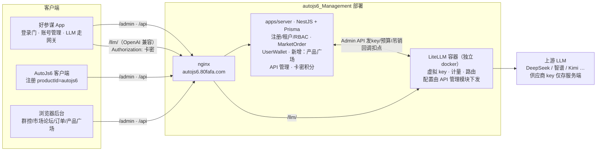

# 商业化方案 v2（重构版）：复用 autojs6_Management + LiteLLM 网关 + 卡密积分 + 产品角色广场

- 日期：2026-10-24
  =- 状态：**待评审**（批准前不动代码）
- 版本：**v2.3**（v2.2 基础上再定稿三项：产品广场开通免费且可关闭、注册改验证码防机器人、新增 CI 自动化部署与 Docker 规划 §9）；替代初版「自研 BFF」路线
- 上游事实源：服务端现状调研自 `d:\work\autojs6_Management`（apps/server = NestJS + Prisma；apps/web = Vue3 + Vite 后台）

---

## 0. v2 重构摘要

初版方案计划自研 BFF（账号/订单/支付）。v2 裁决：**全部复用 autojs6_Management**——注册、订单、充值套餐、钱包流水、多租户 RBAC 菜单体系均已存在，只叠加「产品广场 / API 管理 / 卡密积分」模块和一个独立 LiteLLM docker 容器。

| 维度           | 初版             | v2（本版）                                                                     |
| -------------- | ---------------- | ------------------------------------------------------------------------------ |
| 账号/注册/订单 | 自研 BFF         | **复用** autojs6_Management（注册租户 + MarketOrder + UserWallet）             |
| LLM 网关       | LiteLLM 独立部署 | LiteLLM 作为**独立 docker 容器**并入现有部署                                   |
| 计费           | 虚拟 key 预算    | **卡密点卡 + 积分制**：50 元卡 = 5000 积分，按模型系数扣点（对标 Trae 积分）   |
| 调用凭证       | 虚拟 key         | **卡密即凭证**：绑定使用卡密开始扣点；AI 设置里用同一张卡密请求网关                |
| 授权模型       | 单一用户         | **产品 → 角色 → 菜单**：注册按产品分默认角色，产品广场开通加角色，一账户多角色 |
| 客户端         | 仅好参谋         | **好参谋 + AutoJs6 + 群控（浏览器后台）** 三端共用一套账户体系                 |

---

v2.3 增补：产品广场开通免费且可关闭（§3.4）、注册改验证码防机器人（§5.2）、CI 自动化部署与 Docker 规划（§9）。

## 1. 继承的关键裁决（自初版，仍然成立）

### 1.1 「API Key 不进 App」的精确含义

| key 类型                                        | 是否进 App           | 泄露后果           | 对策                                                                     |
| ----------------------------------------------- | -------------------- | ------------------ | ------------------------------------------------------------------------ |
| 上游供应商总 key（DeepSeek/智谱/Kimi 平台 key） | **绝不**             | 全量成本被盗刷     | 只存服务端（.env/KMS），仅 LiteLLM 容器内使用，永不下发                  |
| 用户卡密（点卡密文）                            | **必须**（调用凭证） | 仅该卡面额积分受损 | 面额封顶 + 有效期 + 限速 + 用尽即吊销；泄露面 = 单张卡余额，不是金库钥匙 |

**必须按卡发凭证，杜绝全 App 共享 key。**

### 1.2 LiteLLM 能力边界（可行性核心）

| 需要                         | LiteLLM（MIT，可商用）提供            | 结论                                                   |
| ---------------------------- | ------------------------------------- | ------------------------------------------------------ |
| 统一接入多家 LLM             | 100+ 供应商统一为 OpenAI 兼容协议     | ✅ 复用现有 `OpenAiCompatibleProvider`，App 协议零改动 |
| 按卡发独立凭证               | Virtual Keys（预算/有效期/限速）      | ✅ 卡密的承载实体                                      |
| 计量                         | spend tracking（按 token 记账）+ 回调 | ✅ 扣点依据                                            |
| 路由/降级                    | 路由、重试、fallback                  | ✅ 上游故障自动切换                                    |
| 注册/角色/订单/卡密/产品广场 | ❌ 不做                               | 由 autojs6_Management 现有 + 新增模块补齐              |

### 1.3 广告定向（远期 P3，不在本期范围）

**形态裁决（v2.3 修订）：App 内没有广告位，只做柔性软广告**——以**原生文字**植入给用户的回答中（与当前回答语境强相关才植入，才有说服力），不做硬广告、不设横幅/卡片式广告位。

| 环节 | 落点                                                                                                                                                                                                                                                                                                                                 |
| ---- | ------------------------------------------------------------------------------------------------------------------------------------------------------------------------------------------------------------------------------------------------------------------------------------------------------------------------------------ |
| 投放 | 广告主素材（文案/商品/落地链接）+ 定向条件（关键词/产品/人格标签）→ 服务端打包**素材包**下发 App                                                                                                                                                                                                                                     |
| 匹配 | **端侧**：App 本地用屏幕正文 + 双方人格画像与素材包匹配，选出 0–1 条**与回答语境强相关**的推荐——相关性是硬门槛，不沾边宁可不植入，**绝不乱推荐**                                                                                                                                                                                     |
| 注入 | **回答后端侧拼接（v2.3 主案，柔性软广告）**：回答生成完毕后，App 在渲染层把命中的推荐句以顺带提及/举例的口吻拼接到回答文字后，**不加「推荐」标识**（用户裁决：软植入不做硬广）、**不混入参谋会话正文落库**；可用 `AuxiliaryTasks` 小任务按语境/画像润色成一句自然话术。「提示词注入」（赞助上下文进 LLM、由 LLM 原生写推荐）降为备选 |
| 计量 | 匿名曝光/点击回传（不回传聊天原文）                                                                                                                                                                                                                                                                                                  |
| 网关 | **litellm 零改动**：不在网关捕获关键词、不注入广告——网关保持哑管道 + 计量                                                                                                                                                                                                                                                            |

柔性软广告规则（用户裁决）：与回答语境不沾边**宁可不植入**（相关性是硬门槛，绝不乱推荐）、不做硬广告、**不加「推荐」标识**。红线不变：关键词匹配在**端侧**完成，服务端/网关不做聊天内容广告挖掘（LLM 请求内容仅经网关转发，§8）。选「回答后端侧拼接」为主案的直接原因：交付确定（命中必出）、零额外 token、广告素材不出端侧。风险提示（记录在案）：软植入与广告可识别性监管要求存在张力，若合规口径收紧，可一键切回带标识模式。本版不展开。

---

## 2. 总体架构



**四条核心数据流**：

1. **注册流**：注册 URL 带 `productId` → 服务端按产品分配默认角色（haocanmou / autojs6 / qunkong）→ 菜单按角色裁剪；
2. **开通流**：产品广场点「开通」→ 为账户追加产品角色 → 菜单即时扩展（一账户多角色，菜单取并集）；
3. **绑定使用流（原「启用卡密」，2026-10-25 修订）**：用户在 App 输入卡密点「绑定使用」→ 绑定账户 + 「开始扣点」+ 服务端调 LiteLLM Admin API 发虚拟 key（预算=账户积分总余额）→ App AI 设置以卡密为凭证；**有效期计时起点=支付回调时刻**（发卡平台付款成功即激活计时，绑定得晚剩余有效期短，见 `docs/2026-10-25-卡密绑定使用与订单台账方案.md`）；
4. **调用与扣点流**：App → `/llm/`（OpenAI 兼容）→ LiteLLM 鉴权（卡密→虚拟 key→预算）→ 上游 LLM；服务端每分钟拉 spend_logs 结算 → 按「基础积分 × 模型系数」扣卡台账（requestId 幂等）→ 余额 ≤ 0 吊销凭证并明确报因。

---

## 3. 产品、角色与菜单

### 3.1 产品目录与角色映射

| 产品         | 产品 ID（注册参数） | 授权角色 key | 面向客户端         |
| ------------ | ------------------- | ------------ | ------------------ |
| 好参谋       | `haocanmou`         | `haocanmou`  | 好参谋 App         |
| AutoJs6      | `autojs6`           | `autojs6`    | AutoJs6 客户端     |
| autojs6 群控 | `qunkong`           | `qunkong`    | 群控（浏览器后台） |

规则：**按购买/开通的产品决定角色，角色决定菜单；一账户可拥有多个角色，菜单取并集。**

### 3.2 角色 → 菜单可见性

| 角色                        | 可见一级菜单                                                              |
| --------------------------- | ------------------------------------------------------------------------- |
| `haocanmou`                 | 订单管理、产品广场                                                        |
| `autojs6`                   | 订单管理、市场论坛、产品广场                                              |
| `qunkong`                   | 系统管理、群控管理、市场论坛、订单管理、产品广场（= 现状菜单 + 产品广场） |
| `admin`（平台超管）         | 全部（含 API 管理）                                                       |
| `tenant_admin` / `employee` | 维持现状不变                                                              |

- 「群控管理」**仅** `qunkong`（群控用户）可见；
- 多角色并集在前端已有支撑（路由过滤 `roles.includes(role)`），后端沿用 `sys_role_menu` 授权 + 租户菜单白名单双层控制；
- 现有内置角色 `admin / tenant_admin / employee` 与白名单**不动**，产品角色为新增受控角色。

**角色绑定铁律（v2.1 修订，消除菜单泄漏矛盾）**：

> `tenant_admin` 的菜单是租户白名单全集（90 项，含群控管理），因此**绝不能**与产品角色同时绑定给产品用户，否则 `haocanmou` 用户会因菜单并集看到全部菜单。

- 按 `productId` 注册的产品用户：**只绑产品默认角色**（`haocanmou` / `autojs6`），不绑 `tenant_admin`、不绑 `employee`；
- `qunkong` 注册（网页现状）：维持现状（绑 `tenant_admin` 等价链路，或对齐为 `qunkong` 角色配置成等价菜单，见 §5.2 裁决）；
- 菜单可见性 = **产品角色的菜单并集**；`admin / tenant_admin / employee` 的既有菜单行为只对其自身注册/管理链路生效；
- 租户创建与数据隔离照旧（注册仍建租户），仅**角色绑定**按产品分流。

### 3.3 注册入口与默认角色（注册 URL 加 productId 参数）

注册 URL：`https://autojs6.80fafa.com/admin/login/register?redirect=/home&productId=<产品ID>`

| 注册入口                              | productId   | 注册后默认角色 | 备注                                       |
| ------------------------------------- | ----------- | -------------- | ------------------------------------------ |
| 好参谋 App（内嵌 WebView 打开注册页） | `haocanmou` | `haocanmou`    | 本方案 P0 重点                             |
| AutoJs6 客户端注册                    | `autojs6`   | `autojs6`      | 仅带参跳转                                 |
| 网页直接注册（不带参）                | 缺省        | `qunkong`      | **兼容现状**，现网页注册用户看到的菜单不变 |

改动点（服务端）：注册接口（现 `/auth/register-company`）新增可选 `productId` 参数 → 映射默认角色 → 在现有角色绑定步骤一并授权。注册验证改为**验证码防机器人**（不强制邮件激活，见 §5.2）。参数非法/缺失回退 `qunkong`。

### 3.4 产品广场（新增一级菜单）

| #   | 功能       | 规则                                                                                                                                                                                                                                              |
| --- | ---------- | ------------------------------------------------------------------------------------------------------------------------------------------------------------------------------------------------------------------------------------------------- |
| PP1 | 产品列表   | 卡片式列出全部产品：AutoJs6、好参谋、autojs6 群控（名称/简介/适用客户端）                                                                                                                                                                         |
| PP2 | 开通状态   | 当前账户已含该产品角色 → 显示「已开通」；否则显示「开通」按钮                                                                                                                                                                                     |
| PP3 | 开通动作   | 点击「开通」→ 服务端为账户授予对应角色（幂等，重复点击无副作用）→ 前端刷新菜单                                                                                                                                                                    |
| PP4 | 多角色     | 账户可累积多个产品角色，菜单取并集；产品广场始终对所有角色可见                                                                                                                                                                                    |
| PP5 | 关闭产品   | 「已开通」的产品提供「关闭/取消开通」（v2.3 定稿）：收回对应产品角色，菜单即时收缩；再次「开通」可恢复。关闭**不影响**账户积分与已购卡密（积分是账户级单账，§4.4），不删租户/历史数据，仅收授权；全部产品关闭后回落基础菜单（订单管理、产品广场） |
| PP6 | 与付费关系 | **v2.3 定稿：开通目前免费**，与购买卡密无关（卡密是账户级积分载体，§4.4，买卡/扣点不依赖开通）；日后是否免费未定，若收费仅在「开通」动作前置计费环节，接口预留价格字段                                                                            |

---

## 4. 卡密、积分与计费

### 4.1 概念定义

| 概念         | 定义                                                                                                                                            |
| ------------ | ----------------------------------------------------------------------------------------------------------------------------------------------- |
| **点卡卡密** | 服务端**事先预置生成**的卡：卡号 + 密文 + 面额积分（如 50 元卡 = 5000 积分）+ 有效期。**充值载体与 LLM 调用凭证合一**（用户诉求：用同一个卡密） |
| **积分**     | 全局计量单位（对标 Trae 积分）                                                                                                                  |
| **模型系数** | 按**模型**粒度的扣点系数（deepseek-flash 0.5、deepseek-pro 0.8 …），在「API 管理」模块维护、随时可调（详见 §4.3）                               |

### 4.2 卡密生命周期（v2.2 定稿）

```
批次预置生成（未售）→ 支付回调激活计时（订单台账）→ 绑定使用（绑定账户）→ 生效扣点
→ 积分用尽 / 到期 → 可再绑定新卡（积分累加）
```

- **订单台账即一卡一行**（2026-10-25 修订，详见 `docs/2026-10-25-卡密绑定使用与订单台账方案.md`）：发卡平台付款成功 → 回调 `POST /point-card/sale-notify`（平台订单号幂等）→ 自动写售价/平台订单号并**激活计时**，此时还不知道用户是谁；
- **有效期从支付时刻起算**（不是绑定时刻）：`expiresAt = 支付时刻 + 批次有效期天数`；绑定得晚，剩余有效期就短（用户口径「买到时就开始计时了」）；
- **多卡积分累加**：绑定新卡即把面额积分并入账户积分台账（单账原则 §4.4）；已绑定的各卡密均可作为调用凭证（同扣账户积分），「当前卡密 ID」展示最近绑定的一张；
- **多卡过期取最晚**：账户过期日 = 所持各卡过期日的最大值；到期后剩余积分失效；
- 「绑定即开始扣点」= 绑定后发生的 LLM 调用从账户积分扣减；**绑定排他**：一经绑定其他账号不可再绑（同账号重复绑定幂等回显）；未售卡（未收到支付回调）不可绑定，报「卡密尚未激活（支付确认中）」。

### 4.3 扣点算法（Trae 式，v2.2 定稿）

**计量基础**：LiteLLM 逐请求统计 `prompt_tokens / completion_tokens / cached_tokens`（spend tracking 持久化进 spend_logs），服务端每分钟拉取 spend_logs 结算折算积分（requestId 幂等，6 小时回看补结算）——token 计量不需要自研。**机制定案（2026-10-25）**：拉取式对账而非 callback webhook——不给容器挂 python 插件文件（litellm 容器保持与 nginx 同级的零文件基础设施，只一个 config.yaml），spend_logs 是 LiteLLM 既有持久化面，拉取 + 幂等键 = 恰好一次扣点，中断/重启可补。

**三步公式**（对标 Trae「基础积分 × 模型系数」结构）：

```
第 1 步 token 计量（LiteLLM spend_logs 回传）：输入 token、缓存命中 token、输出 token
第 2 步 基础积分 B = (输入token × 1.0 + 缓存命中token × 0.1 + 输出token × 3.0) ÷ 1000
第 3 步 实际扣点 D = max(0.1, 向上取整至 0.1(模型系数 M × B))
```

| 规则项          | 取值                         | 依据                                        |
| --------------- | ---------------------------- | ------------------------------------------- |
| token 权重      | 输入 1x、输出 3x             | 对齐行业 API 输入/输出价差（输出贵 3~4 倍） |
| 缓存命中        | 0.1x                         | 对齐 DeepSeek 缓存命中价（约为正常价 1/10） |
| 推理/思考 token | 计入输出                     | 与供应商计费口径一致                        |
| 换算基准        | 1 基础积分 ≈ 1000 token 权重 | **唯一调价旋钮**，运营可调                  |
| 扣点粒度        | 向上取整到 0.1，单次最低 0.1 | 防小额刷调用                                |

**模型系数表（初始档，「API 管理」按模型粒度配置、随时可调）**：

| 档位        | 示例模型                      | 系数                   |
| ----------- | ----------------------------- | ---------------------- |
| 轻量档      | deepseek-flash、智谱 flash 系 | **0.5**                |
| 标准档      | deepseek-pro、智谱 pro 系     | **0.8**                |
| 旗舰/推理档 | deepseek-reasoner、kimi-k2 等 | `[TBD]`（建议 1.2 起） |

（模型系数按模型不按供应商：同一供应商不同模型系数不同，如 deepseek-flash 0.5、deepseek-pro 0.8。）

**校准验算**（50 元卡 = 5000 积分，1 元 = 100 积分）：

| 场景                           | 基础积分 B | 扣点（0.5 档 / 0.8 档） | 一张 50 元卡约可用  |
| ------------------------------ | ---------- | ----------------------- | ------------------- |
| 参谋典型单次（6k 入 + 800 出） | 8.4        | 4.2 / 6.8 积分          | ≈ 1190 次 / 735 次  |
| 短聊单次（2k 入 + 500 出）     | 3.5        | 1.8 / 2.8 积分          | ≈ 2770 次 / 1780 次 |

对照上游成本（DeepSeek 约 ¥2/M 入、¥8/M 出；pro 约 ¥4/M 入、¥16/M 出）：终端定价约为成本 2 倍上下，毛利健康；对用户仍远低于自购官方 key 的门槛。若要更高毛利，只调「换算基准」一个旋钮即可。

扣点记录进积分流水（append-only，含扣点前后余额快照与 token 明细，可对账）。

### 4.4 卡密 ↔ LiteLLM 绑定（v2.1 明确映射，消除双账）

**单账原则：积分只有一本账——账户级积分台账**（复用/扩展 `UserWallet`）。「卡台账」不再单独存在；卡密只是**入账凭证 + 调用凭证**，「剩余积分」永远读账户台账余额。

1. **卡生成时**（批次预置）：只落 `point_card`（卡面密文即虚拟 key 的对外凭证，BYO token 口径）；**虚拟 key 于绑定使用时才在网关创建**（2026-10-25 定案：未绑定的卡在网关无 key = 不能用，比"生成时建 budget=0 key"少一次 Admin API、语义等价），服务端持卡 ↔ 虚拟 key 映射（keyName=`card:{cardNo}`）；
2. **绑定使用卡密**：一次事务完成 ① 卡绑定账户（写 userId/boundAt，绑定排他）② 积分入账（`bizType=RECHARGE_CARD`，面额积分进账户台账）③ 调 LiteLLM 创建/更新虚拟 key，兜底预算同步为**账户积分总余额**（多卡累加口径，非单卡面额）→「开始扣点」；计时不重算（activatedAt/expiresAt 保持支付回调写好的值）；
3. **调用**：App 以卡密向 `/llm/` 发 OpenAI 兼容请求 → LiteLLM 鉴权 + 计量（spend tracking）→ 服务端每分钟拉取 spend_logs 按 §4.3 从**账户台账**扣积分（`bizType=LLM_USAGE` 流水，requestId 幂等）；
4. **双重保护**：账户台账是主账（扣点/展示/对账都以它为准）；LiteLLM 虚拟 key 预算只是**兜底上限**（结算延迟/故障时防超刷），不构成第二本账；
5. 余额 ≤ 0 → 吊销/冻结虚拟 key + 网关拒绝 → App 映射「积分不足，请换卡/充值」。

### 4.5 与现有交易体系的映射（复用，不推倒）

服务端已有（`apps/server/prisma/schema.prisma`）：`UserWallet`（用户余额，分，乐观锁）、`WalletTransaction`（RECHARGE/PAY/ADJUST，append-only 流水）、`RechargePackage`（充值套餐：payAmount/creditAmount）、`MarketOrder`（RECHARGE 订单 + 支付履约入账链路）。

| 新概念       | 复用/扩展                                                                                                                                                                                                                                                                                                   |
| ------------ | ----------------------------------------------------------------------------------------------------------------------------------------------------------------------------------------------------------------------------------------------------------------------------------------------------------- |
| 点卡卡密     | 新增卡密表（批次、面额积分、状态、售价/平台订单号、绑定用户、生效时间/结束时间）；本质是「充值套餐的预置卡化」+ **一卡一行订单台账**；卡面即 LiteLLM 虚拟 key 凭证（§4.4）                                                                                                          |
| 积分账户     | **即 `UserWallet` 本体**（余额单位从"分"扩展语义为"积分"或新增积分列，实施期定）；不开第二本账                                                                                                                                                                                                              |
| 绑定使用卡密 | 复用充值入账链路（`bizType=RECHARGE_CARD`）+ 调 LiteLLM 发虚拟 key；绑定排他（他人再绑报「已被使用」）、同账号重复绑定幂等                                                                                                                                                              |
| 积分扣点     | 复用 append-only 流水模式（`bizType=LLM_USAGE`）                                                                                                                                                                                                                                                            |
| 购买点卡     | 售卖走 **80fafa 商品购买页**（`https://www.80fafa.com/Goods/3007AFB1DC8B710E`）：App 内「购买点卡」入口 WebView 打开商品页，购买完成后**自动跳回发起页并自动填写卡密**（回跳协议下一步细化，本期占位初步功能）。卡密由服务端预置、商城售卖；**点卡交易纳入服务端订单台账并自动激活计时**（2026-10-25 修订：支付成功回调 `sale-notify` 写售价/平台订单号并自支付时刻起算有效期，一卡一行台账），`MarketOrder` 不承载点卡交易，「订单管理」保留我的卡密/积分展示 |
| 剩余积分展示 | 账户台账余额查询接口（形态可参考现有 `DeepSeekBalanceRepository` 的 App 端实现）                                                                                                                                                                                                                            |

**与现有计费/配额体系的边界（v2.1 补充，防双轨重复扣费）**：`SysTenantQuota`（apiQuota 月调用次数）与 `SysTenantBilling`（租户周期账单）**不参与 LLM 计量扣点**——LLM 用量唯一计量口径 = 积分台账；`SysTenantFeature`（租户功能开关）**不替代产品角色**——产品开通的授权落点是角色（`SysUserRole`，用户级、多角色），两者如需联动由产品广场写 feature 开关作为租户级补充标记，但菜单可见性只认角色。

---

## 5. 服务端改造（autojs6_Management）

### 5.1 新增模块

| 模块          | 职责                                                                                                                                 | 菜单落位                                                  |
| ------------- | ------------------------------------------------------------------------------------------------------------------------------------ | --------------------------------------------------------- |
| **产品广场**  | 产品目录、开通/授予角色、状态查询                                                                                                    | 一级菜单「产品广场」（所有角色可见）                      |
| **API 管理**  | ① LLM 供应商接入（上游 key 加密保管）② 模型目录与积分系数 ③ LiteLLM 网关配置生成/同步 ④ 卡密批次管理（生成/停用/查询）⑤ 用量扣点报表 | 一级菜单「API 管理」（仅 admin/运营可见）                 |
| **卡密/积分** | 卡密启用/查询、积分流水                                                                                                              | 管理面挂 API 管理；用户侧「订单管理」内可见我的卡密与积分 |

### 5.2 注册链路改造

- 注册接口（`auth.controller.ts` 注册租户流程）新增可选 `productId` 参数；默认角色映射：`haocanmou → haocanmou`、`autojs6 → autojs6`、缺省/`qunkong → qunkong`；
- 现有注册租户（生成租户 + 管理员账号）流程骨架保持不变（激活邮件改可选，见下条），**但角色绑定按产品分流**（v2.1 修订，见 §3.2 铁律）：
  - `haocanmou` / `autojs6` 注册：只绑产品角色，**不绑** `tenant_admin` / `employee`（租户照建，用于数据隔离；产品角色即该租户名下的业务身份）；
  - `qunkong` / 缺省注册：维持现状绑定链路（`tenant_admin`），菜单 = 现状 + 产品广场；
- **注册验证（v2.3 定稿）**：注册**不强制邮件激活**（并非所有注册都需要邮件激活），但注册必须过**验证码防机器人**；`SysUserActivation` 邮件激活机制保留为可选链路（后台建用户等场景继续可用），产品注册流默认「验证码通过即注册即用」，好参谋 App「WebView 注册 → 回登录页即用」不再被激活环节卡住。验证码形态（图形/短信/滑块）`[TBD]`，优先复用现有验证码体系（部署已预留 Redis 验证码库、短信通道 `SysSmsChannel` 可复用，§11-2），不另造轮子；
- 兼容性：不带参数的现有注册 URL 行为不变。

### 5.3 RBAC 落位

- 新增 3 个产品角色（role key：`haocanmou` / `autojs6` / `qunkong`），菜单经 `sys_role_menu` 授权；
- 菜单边界继续走「租户白名单 + `sys_role_menu`」双层强制（`rbac.constants.ts` 体系不动）；
- 新增菜单 ID 段：「产品广场」「API 管理」各占一段（沿用稳定主键维护惯例，不按菜单名匹配）；
- `admin / tenant_admin / employee` 三个内置角色及保护策略不动。

### 5.4 LiteLLM docker 集成

| 项   | 方案                                                                                                      |
| ---- | --------------------------------------------------------------------------------------------------------- |
| 容器 | 现有部署（server + web + nginx）旁**新增独立 litellm 容器**（docker-compose 并列服务）                    |
| 路由 | nginx 新增 `/llm/` → `litellm:4000`（或独立子域名 `[TBD]`），只暴露 OpenAI 兼容端点                       |
| 配置 | **定案（2026-10-24）**：`config.yaml` 只放静态通用设置（`STORE_MODEL_IN_DB` + master key 引用）；模型清单/上游 key/路由/虚拟 key 由「API 管理」经 LiteLLM Admin API **写入元数据库**——server 容器写不到宿主配置文件，配置即数据走 DB 才有记录、可审计回放；运营改系数/上下线模型不改代码、不重建镜像 |
| 对接 | 服务端 ↔ LiteLLM Admin API：发虚拟 key / 调预算 / 吊销 / 拉 spend_logs（每分钟轮询结算扣点，requestId 幂等） |
| 密钥 | 上游供应商 key 只存服务端密文库（`llm_provider.api_key_enc`），由「API 管理」录入后经 Admin API 同步进 litellm 元数据库；`LITELLM_MASTER_KEY` 走 Secrets→`.env` 注入容器；**永不下发、永不进 App** |
| 部署 | 并入 `RefConf/hk/docker-compose.yml`（镜像 pin @sha256、健康检查、Secrets 下发通道），CI/回滚增量见 §9    |

### 5.5 不动清单

群控管理、市场论坛、租户/部门/岗位、脚本市场、交易门户等现有模块**零改动**；全部新能力为增量模块 + 注册接口加参 + 菜单种子新增。

### 5.6 现状查重结论（v2.1，防重复造轮子）

对 `schema.prisma` 全部 79 个模型逐一核对：**不存在**卡密/兑换码/积分/产品广场/LLM 相关实体，新模块无撞车；但有 4 个"概念邻居"必须复用、2 个"双轨"必须划界：

| 现有实体                                                               | 关系                    | 裁决                                                                               |
| ---------------------------------------------------------------------- | ----------------------- | ---------------------------------------------------------------------------------- |
| `SysClient`（OAuth 客户端接入）                                        | App 登录接入            | **复用**：好参谋 App 注册为一个 client 走现有登录，不另造 token 体系（§6.1）       |
| `SysUserActivation`（激活 token）                                      | 注册激活                | **复用为可选链路**：产品注册默认不启用邮件激活，改验证码防机器人（§5.2）           |
| `SysUserRole` / `SysRoleMenu`                                          | 一账户多角色 + 菜单授权 | **复用**：产品角色即普通角色记录，零新机制                                         |
| `UserWallet` / `WalletTransaction` / `RechargePackage` / `MarketOrder` | 积分/流水/套餐/订单     | **复用**（§4.5），新增仅卡密表                                                     |
| `SysTenantFeature`（租户功能开关）                                     | 与"产品开通"同构        | **不替代角色**：授权落点=角色（用户级），feature 最多作租户级补充标记（§4.5 边界） |
| `SysTenantQuota.apiQuota` / `SysTenantBilling`                         | 与"计量扣点"同域        | **不参与 LLM 扣点**：LLM 唯一计量口径=积分台账（§4.5 边界）                        |

好参谋 App 侧查重：现无任何账号/登录/WebView/充值实现（仅 `DeepSeekBalanceRepository` 余额查询展示可参考），`account` 包纯新增、无重复。

---

## 6. 好参谋 App 改造

### 6.1 登录/注册门（P0，用户裁决：只有登录了才能使用）

| 项       | 方案                                                                                                                                                                                                    |
| -------- | ------------------------------------------------------------------------------------------------------------------------------------------------------------------------------------------------------- |
| 启动检测 | 首装/冷启动检测登录态（`MainActivity` 白名单 gate + `FloatBallService` 启动校验），未登录 → 登录页；**装包登录门**（2026-10-24）：安装/升级后首启即使本地会话未过期也强制先出登录页（包 `lastUpdateTime` 变化即重新武装门槛，登录成功消费） |
| 登录     | 账号 + 密码登录，**复用服务端现有认证体系**（`SysClient` OAuth 客户端 + 现有登录接口，好参谋 App 按客户端接入注册一个 client），**不另造 token/会话体系**；登录态本地持久化                             |
| 注册     | 登录页「注册」→ **内嵌 WebView** 打开 `https://autojs6.80fafa.com/admin/login/register?redirect=/home&productId=haocanmou`（注册后默认角色 `haocanmou`），注册完成回登录页（注册验证码防机器人见 §5.2） |
| 门槛     | 未登录不可使用好参谋功能；已登录后本地数据（参谋会话/画像/设置）照常可用                                                                                                                                |
| 悬浮球   | 未登录时悬浮球入口引导登录，不静默失效（与现有就绪门 `Gatekeeper` 职责不混淆：登录门管账号态，Gatekeeper 管感知/执行就绪）                                                                              |

### 6.2 账号管理入口（P0）

好参谋主页/设置新增「账号管理」（全屏页走 `AdvisorPage` 骨架）：

| 展示/操作     | 说明                                                                                                                                            |
| ------------- | ----------------------------------------------------------------------------------------------------------------------------------------------- |
| 当前点卡密 ID | 本账号当前绑定的卡密标识                                                                                                                        |
| 剩余积分      | 账户积分台账余额（服务端接口，单账原则见 §4.4）                                                                                                 |
| 积分明细      | 入账（绑定卡密）与扣点（LLM 用量）流水查询（复用 `WalletTransaction` 流水模式）                                                                 |
| 卡状态        | 未启用/生效中/用尽/过期                                                                                                                         |
| 购买点卡      | WebView 打开 80fafa 商品购买页（`https://www.80fafa.com/Goods/3007AFB1DC8B710E`）；本期占位初步功能，「购买完成回跳自动填卡密」的详细集成下一步 |
| 填入卡密      | 手动输入卡密「绑定使用」（自动回填随购买集成落地）                                                                                              |
| 退出登录      | 清登录态，回登录页                                                                                                                              |
| 产品广场入口  | 跳 WebView（可选）                                                                                                                              |

### 6.3 AI 设置接网关（P0，用户明确裁决）

- AI 设置中 DeepSeek、Kimi 等预设**不再直连官方 API 网关**，baseUrl 改指我方 LiteLLM 网关（`/llm/`，OpenAI 兼容协议复用现有 `OpenAiCompatibleProvider`，`Authorization: Bearer <卡密>`）；
- 模型名保持现名（LiteLLM 侧做模型别名映射），App 端预设模型列表无需改；
- 凭证 = 卡密（P0 手动填入；P1 购买后自动填入）；
- 每次调用自动带卡密 → 网关扣点；
- 实施位置：`feature/agents` 的供应商预设常量（baseUrl）属上游文件，改动为**常量级最小 diff**，提交带 `[upstream-touch]` 标记（§4.2 三问已过：①app 侧包装无法改变预设直连官方的事实；②非上游 bug，是本分支商业策略；③允许改，diff 最小化并在合并上游时优先复核）。

### 6.4 卡密/积分状态错误映射

网关返回未授权/额度类错误 → `REASON_*` 明确文案：「卡密未启用」「积分不足，请换卡/充值」「卡密已过期」+ 账号管理页入口；分屏面板与悬浮球状态同步提示。**严禁静默失效**（AGENTS.md 双模报因铁律）。

### 6.5 AGENTS.md 合规清单

| 改动                         | 位置                                                 | 性质                         |
| ---------------------------- | ---------------------------------------------------- | ---------------------------- |
| 登录门 gate                  | `MainActivity.kt`                                    | 白名单内（仅小块 gate 逻辑） |
| 登录页/账号管理/WebView 注册 | 新增 `com.verlintas.baic2.account`（app 模块独立包） | **纯新增**                   |
| AI 预设 baseUrl 改网关       | `feature/agents/AgentWizardViewModel.kt` 预设常量    | **[upstream-touch] 常量级**  |
| 欠费/卡密错误映射            | floatball 包（`REASON_*`）                           | app 模块增量                 |
| 文案                         | `strings.xml` 追加 `account_*` 键                    | 白名单内增量                 |
| Manifest                     | 登录/账号页 Activity 声明                            | 白名单内增量                 |

`core:*`、`device:*`、`tools`、`mcp`、`eval` 零改动；AgentLoop/记忆/参谋会话/画像链路零改动。

---

## 7. AutoJs6 客户端侧

- 注册入口跳转带 `productId=autojs6`（注册后默认角色 `autojs6`，菜单：订单管理、市场论坛、产品广场）；
- 客户端本体无其他改动；群控用户继续走浏览器后台（`qunkong` 角色）。

---

## 8. 安全与合规

| 项       | 要点                                                                                                                                                                                         |
| -------- | -------------------------------------------------------------------------------------------------------------------------------------------------------------------------------------------- |
| 密钥分层 | 供应商 key 仅存服务端/网关容器；App 只有卡密（泄露面=单卡积分）                                                                                                                              |
| 卡密风控 | 面额封顶 + 有效期 + 限速；并发多设备/用量突变告警；可停用（细则 `[TBD]`）                                                                                                                    |
| 支付     | 点卡售卖走 **80fafa 商品购买页**（`https://www.80fafa.com/Goods/3007AFB1DC8B710E`），交易与支付在商城完成，卡密由服务端预置；商城↔服务端（购买回跳自动填卡密、对账）详细集成下一步，本期占位 |
| 合规     | 生成式 AI 服务合规/ICP 备案路径 `[TBD]`；用户协议与隐私政策需含积分扣点说明；注册走验证码防机器人、不强制邮件激活（§5.2）                                                                    |
| 数据红线 | 聊天内容不出设备（参谋会话/聊天会话铁律不变）；LLM 请求内容仅经网关转发至上游，不用于广告定向（广告匹配在端侧、无广告位，§1.3）                                                              |

---

## 9. CI 自动化部署与 Docker 规划（v2.3 新增）

> 原则：**在 autojs6_Management 现有 CI/CD 底座上做纯增量**——不推倒 `RefConf/hk` 部署编排与 `deploy.yml` 流水线；本方案全部服务端新增（产品广场 / API 管理 / 卡密积分 + litellm 容器）随现有发布通道上线。事实源：`RefConf/hk/docker-compose.yml`、`.github/workflows/deploy.yml`、`ci.yml`、`doc/2026-09-29-香港服务器CI-CD部署方案.md`。

### 9.1 现状底座（复用，不重造）

| 底座 | 现状                                                                                                                                                                                                                                     | 对本方案的意义                                                                    |
| ---- | ---------------------------------------------------------------------------------------------------------------------------------------------------------------------------------------------------------------------------------------- | --------------------------------------------------------------------------------- |
| 编排 | `RefConf/hk/docker-compose.yml`（项目名 `autojs6`）：postgres:16 + redis:7 + server（GHCR 镜像）+ nginx(80/443) + acme.sh（tools profile）；服务器目录 `/data/compose/autojs6`，`.env`（基础设施密钥）/`app.env`（业务配置 CI 重写）分离 | litellm 作为**并列服务**加入同一 compose，配置/密钥沿用 `.env`/`app.env` 既有纪律 |
| 镜像 | 基础设施镜像 pin `@sha256`（浮动 tag 不更新、绝不意外 recreate）；server 镜像按 `IMAGE_TAG`（commit sha）滚动                                                                                                                            | litellm 官方镜像同样 pin 摘要，升级随发布观察一轮                                 |
| CI   | `ci.yml` 日常验证 + `deploy.yml` 发布（push `v*` tag = 完整发布 / 手动 = 仅部署）：db-baseline 基线门禁 → buildx 推 GHCR（latest + sha，mode=min 缓存）→ 前端/文档直传 → APK 发 fork Release → SSH 执行 `deploy.sh`                      | 新模块/新迁移进 db-baseline 门禁收敛；发布触发与流程不变                          |
| 密钥 | GitHub Secrets 只留 `SECRETS_REPO_PAT`，其余部署变量在私有 `alwaysgot200/Secrets` 仓 `ci/hk-deploy.env` 下发；Actions 制品不落 Actions（500MB 配额事故纪律）                                                                             | 上游供应商 key / litellm master key 走同一 Secrets 通道，永不入库、不进镜像层     |
| 健康 | server 健康检查 `/api/v1/health/ready`，postgres/redis 自带 healthcheck                                                                                                                                                                  | litellm 增加自身 healthcheck，纳入 `up -d` 就绪判定                               |

### 9.2 Docker 规划：litellm 容器

| 项     | 规划                                                                                                                                                                      |
| ------ | ------------------------------------------------------------------------------------------------------------------------------------------------------------------------- |
| 服务   | compose 新增 `autojs6-litellm`：官方镜像 `ghcr.io/berriai/litellm` **pin @sha256**；`restart: always`；自带 healthcheck；端口 `4000` **仅 compose 内网**，不直接暴露公网  |
| 配置   | **定案（2026-10-24）**：`/data/compose/autojs6/litellm/config.yaml`（bind mount 只读）只放静态通用设置（`model_list: []` + `store_model_in_db: true`）；模型清单/上游 key/路由/虚拟 key 由「API 管理」经 Admin API 写元数据库（STORE_MODEL_IN_DB），不手工编辑运营数据 |
| 密钥   | `LITELLM_MASTER_KEY`（sk- 前缀，可轮换）经 Secrets 仓 `ci/hk-deploy.env` → `.env` → environment 注入容器；上游供应商 key **不走 Secrets**，由「API 管理」录入服务端密文库后经 Admin API 同步；**不进 git、不进镜像层、不下发客户端** |
| 路由   | nginx 新增 `/llm/` → `litellm:4000`（独立子域名备选，§11-1）；只暴露 OpenAI 兼容端点；服务端→litellm Admin API 走 compose 内网，litellm→上游走容器出网                    |
| 元数据 | **定案**：复用 `autojs6-postgres` 独立 database `litellm`（deploy.sh 幂等建库，litellm 首启自迁移建表），纳入同一分卷备份；不采用 sqlite volume                       |
| 回滚   | 回滚 = `.env` 改回镜像 tag / `IMAGE_TAG` 后 `up -d`（既有机制）；litellm 配置随「API 管理」留版本记录可回放                                                               |

### 9.3 CI 流水线增量（纯增量改造）

| #   | 增量                                                                                                                                                         |
| --- | ------------------------------------------------------------------------------------------------------------------------------------------------------------ |
| C1  | **db-baseline 门禁继续覆盖全部新迁移**（卡密/产品广场/API 管理表）：空库 `migrate deploy` + seed 幂等 + 完整性校验，任一失败即中止发布——新表必须可从空库收敛 |
| C2  | `deploy.sh` 增量：预建 litellm 配置目录/权限、`up -d` 含 litellm 服务、待其 healthcheck 通过再放行                                                           |
| C3  | Secrets 仓 `ci/hk-deploy.env` 增补：`LITELLM_MASTER_KEY`（已落库）；上游供应商 key **不进 Secrets**（「API 管理」录入密文库，§5.4 密钥行）；`LITELLM_DATABASE_URL` 不需要（compose 内定死独立库） |
| C4  | `ci.yml` 增量：新模块单测/类型检查进日常验证；`db:guard` 静态守门覆盖新迁移（INSERT 禁 nextval、迁移与 seed 菜单 id 零重叠等既有规则）                       |
| C5  | 发布触发不变（`v*` tag 完整发布 / 手动仅部署）；含 Prisma 迁移的发布在 release notes 标注 DB 迁移                                                            |
| C6  | 好参谋 APK 是否并入本仓 CI `[TBD]`（§11-4）：默认沿用 NovaBAIC 独立 tag 发版（AGENTS.md §7.1），站点下载链挂 Release                                         |

### 9.4 部署红线（沿用现有纪律，不得破例）

- 基础设施镜像一律 pin `@sha256`，不随浮动 tag 意外 recreate；
- 密钥只走 Secrets 仓 + `.env`，永不入 git、不进镜像层；
- Actions 制品不落 Actions（私有仓 500MB 配额事故教训）；
- 生产变更一律走 tag 发布通道，**禁止**手改生产 compose / 直连生产库改 schema。

---

## 10. 分期实施

| 期                | 内容                                                                                                                                          | 交付标志                                                               |
| ----------------- | --------------------------------------------------------------------------------------------------------------------------------------------- | ---------------------------------------------------------------------- |
| **P0 全链路闭环** | 服务端：productId 注册 + 3 产品角色 + LiteLLM 容器 + 卡密启用/扣点 + API 管理 v1（模型/系数/上游 key）；好参谋：登录门 + 账号管理 + AI 接网关 | 好参谋全链路：注册(haocanmou)→买卡→启用→用参谋→按系数扣点→积分不足报因 |
| **P1 产品与运营** | 产品广场（开通/关闭/已开通/多角色）+ 购买自动填卡密 + 订单管理「我的卡密/积分」+ 用量报表                                                     | 三端角色/菜单按产品裁剪生效                                            |
| **P2 商业增强**   | 微信/支付宝真实支付接入 + 系数/换算运营化 + 风控限速                                                                                          | 在线收款闭环                                                           |
| **P3 远期**       | 柔性软广告植入（无广告位、无标识，端侧匹配 + 回答后拼接，强相关才植入，§1.3）、电商 CPS                                                       | 沿用初版裁决                                                           |

每期服务端交付均含对应 Docker/CI 增量（§9.3）；每期门槛沿用 AGENTS.md §6：license 过 + 编译过 + 冒烟链路 + logcat 无崩溃。

---

## 11. 待决清单（`[TBD]`，评审拍板）

> 已定稿不再列待决：① 扣点算法（§4.3，Trae 式）② 卡密有效期/多卡规则（§4.2）③ 点卡售卖渠道=80fafa 商品页（§4.5，回跳自动填卡密详细集成下一步）④ 产品广场开通免费+可关闭（§3.4）⑤ 注册验证码防机器人、不强制邮件激活（§5.2）⑥ 网关路由=`/llm/` 路径（§9.2，2026-10-24 实装）⑦ LiteLLM 元数据=PG 独立库 `litellm`（§9.2，2026-10-24 实装）⑧ LiteLLM 配置写路径=config.yaml 静态 + Admin API 写库（§5.4）。

1. **验证码形态**：图形 / 短信 / 滑块（复用现有验证码体系，见 §5.2）；
2. **好参谋 APK 是否纳入本仓 CI**：NovaBAIC 有独立 tag 发版流程（AGENTS.md §7.1），本期默认沿用独立发版、站点下载链挂 Release，是否并入 `deploy.yml`（§9.3 C6）；
3. **命名统一**：「市场论坛」/「论坛市场」口径统一（本方案按「市场论坛」行文）；`autojs6` 角色可见范围（市场论坛整树 or 仅论坛部分）；
4. **角色对齐**：服务端现 RBAC 内置角色为 `admin/tenant_admin/employee`（`rbac.constants.ts`），`qunkong` 等产品角色 key 与生产库现有角色命名需对齐确认；
5. **登录门粒度**：按用户裁决「只有登录了才能使用」执行——本地历史数据在未登录时是否可见确认为否（默认：不可见，登录后恢复）。
