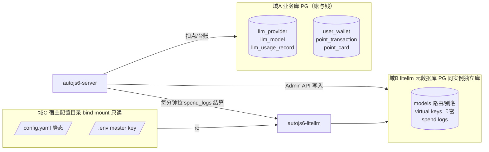

# LiteLLM 业务数据存储与目录规划

- 日期：2026-10-25
- 状态：**已实施并验证**（与服务端实现、总方案 §4.3/§4.4/§5.4 三方互调同步，2026-10-25 定案）
- 依据：`docs/2026-10-24-商业化方案-注册充值与LiteLLM统一网关.md` v2.3 §4（卡密积分）、§5.4（LiteLLM docker 集成）
- 触发诉求：明确「专门为 LiteLLM 产生的业务数据」有哪些、各存哪里；LiteLLM 容器要像 pg/redis/nginx 一样使用——配置与业务文件正确映射到磁盘路径，目录规划一致、命名规整、易于查找理解。
- **机制定案（2026-10-25，实施中裁决）**：扣点触发改为 **spend_logs 每分钟拉取结算**（`LlmUsageSettleService` @Cron），放弃「callbacks.py 回调插件」初案——回调需给容器挂 python 插件文件，与「config.yaml 只放静态设置、容器零文件」定案冲突；spend_logs 是 LiteLLM 既有持久化面，拉取 + requestId 幂等 = 恰好一次扣点，中断可补结算。虚拟 key 亦定案为**启用时才创建**（未启用=网关无 key=不能用）。

---

## 1. 结论（一句话）

**会为 LiteLLM 产生业务数据，但没有任何业务数据存在 LiteLLM 容器内部**——全部落 PostgreSQL 与宿主配置目录，容器本身保持「无状态基础设施」（与 nginx 同性质）：

1. **钱与账**（积分/卡密/扣点/系数/上游 key 密文）→ 我们自己的**业务库**（PG，表 `llm_*` / `point_*` / `user_wallet`）；
2. **网关运行态**（模型路由/虚拟 key/spend 明细）→ PG 同实例的**独立元数据库 `litellm`**（Admin API 写入，自动随 pg 数据卷落盘、同卷备份）；
3. **配置与秘密**（config.yaml / master key）→ 宿主目录 **bind mount 只读** + `.env`，dev/prod 单一事实源。**容器零插件文件**——不挂任何 python 回调（扣点走服务端拉 spend_logs，见机制定案）。

容器删掉重建 = 零数据损失。

---

## 2. 三个存储域总览



- 域A 是**唯一事实源**（对账以它为准）；域B 是域A 的**投影 + 网关自记账**（虚拟 key 预算只是兜底上限，spend 明细供审计）；
- 域C 只放「静态通用设置 + 秘密引用」，**绝不落运营数据、绝不落插件代码**（config.yaml 已定纪律，延续）。

---

## 3. 六类业务数据落位矩阵

| # | 数据 | 事实源落点 | 谁写 | 谁读 | 关键约束 |
| --- | --- | --- | --- | --- | --- |
| 1 | **上游模型 api_key** | 业务库 `llm_provider.api_key_enc`（CryptoService 密文） | 运营在「API 管理」录入 | server 解密后经 Admin API 同步进域B | 永不进配置文件、永不下发 App；轮换=改库重新同步 |
| 2 | **各模型计费系数** | 业务库 `llm_model.coefficient_milli`（M×1000，毫精度） | 运营随时调 | 扣点服务，**扣点时点快照**进 `llm_usage_record.coefficient_milli` | 历史扣点可复算，改系数不追溯 |
| 3 | **基础积分换算方法** | 服务端公式定版（代码常量）：B=(入×1 + 缓存×0.1 + 出×3)÷1000 积分；D=max(0.1, ceil0.1(M×B))，全程毫积分中间单位 | 代码版本管理 | 扣点服务 | 公式不落库，避免与代码双源漂移；可调的只有系数 M（#2） |
| 4 | **积分实时扣减** | 业务库三件套：`user_wallet`（余额）+ `point_transaction`（bizType=LLM_USAGE 流水）+ `llm_usage_record`（token 明细） | 结算服务（`LlmUsageSettleService` 每分钟拉 spend_logs 触发，单事务三写） | App/前端余额展示、报表 | `llm_usage_record.request_id` 唯一索引幂等（重拉/重试不重复扣）；6 小时回看窗口补结算；虚拟 key 预算只作兜底上限（结算延迟/故障防超刷） |
| 5 | **下游用户 + 积分 + 模型选择** | 用户/积分=业务库（`sys_user`+`user_wallet`）；「用哪个模型」=App 本地 AI 设置（baseUrl 指 `/llm/`、Bearer=卡密） | 注册/充值/用户设置 | App | 卡密即 LiteLLM 虚拟 key 凭证（**绑定使用时才创建 key**，未绑定=网关无 key=不能用）；余额≤0 服务端吊销虚拟 key 并报因 |
| 6 | **暴露给下游的模型 API 及参数** | nginx `/llm/` → `litellm:4000` OpenAI 兼容端点；对外模型名=`llm_model.model_key`（LiteLLM 别名，App 预设模型名零改动） | 「API 管理」经 Admin API 注册模型/别名 | App | `drop_params: True` 抹平供应商参数差异；4000 端口仅 compose 内网 |

---

## 4. LiteLLM 容器文件/卷映射（对齐 pg/redis/nginx 口径）

### 4.1 生产（RefConf/hk → `/data/compose/autojs6/`）

| 容器 | 数据/文件 | 宿主落点 | 方式 |
| --- | --- | --- | --- |
| autojs6-postgres | 业务库 + **litellm 元数据库**（同实例独立 database） | named volume `autojs6_pg_data` | 命名卷（=备份单位，deploy.sh 已注同卷备份） |
| autojs6-redis | 缓存 | named volume `autojs6_redis_data` | 命名卷 |
| autojs6-server | uploads / market-private / adb-keys | `/data/app-files/*` | bind |
| **autojs6-litellm** | config.yaml（静态） | `/data/compose/autojs6/litellm/config.yaml` | bind **:ro** → `/app/config.yaml` |
| **autojs6-litellm** | 运行态数据（模型/虚拟 key/spend） | PG `litellm` 库（**无文件卷**） | 随 pg 卷落盘 |
| secrets | `LITELLM_MASTER_KEY` 等 | `/data/compose/autojs6/.env`（deploy.sh 从 Secrets 下发） | env 注入，不进 compose/config |

### 4.2 dev（RefConf/dev/docker-compose.local.yml）

| 文件/数据 | 落点 | 说明 |
| --- | --- | --- |
| config.yaml | **直接挂仓库 `RefConf/hk/litellm/config.yaml`** | dev/prod 同一事实源，零复制零漂移（现况已如此） |
| litellm 元数据库 | `nest-admin-pg` 实例的 `litellm` 库（卷 `nest_admin_pg_data`） | `litellm-db-init` 幂等建库（现况已就位） |
| master key | compose 内固定 dev 值 | 与生产 secret 无关 |

### 4.3 日志口径（与 pg/redis 一致）

容器日志一律走 docker 日志驱动（stdout/json-file），**不单独映射日志目录**；可审计的用量明细在域B 的 spend logs 表与域A 的 `llm_usage_record`，不依赖文件日志。

---

## 5. 目录与命名规范（规整、易查）

```
仓库（单一事实源）                          生产宿主（deploy.sh 下发）
RefConf/hk/litellm/                        /data/compose/autojs6/
  └── config.yaml        ← 静态配置          ├── litellm/
    （无插件文件，容器零文件原则）           │   └── config.yaml
                                             └── .env   (秘密)
```

| 命名对象 | 规范 | 例 |
| --- | --- | --- |
| 容器名 | `autojs6-*` 前缀，dev/prod 同名 | `autojs6-litellm` |
| database | 全小写单词；业务库与网关元数据库并列 | `litellm` |
| 配置子目录 | 按组件建目录（与 nginx `conf.d` 同构） | `litellm/config.yaml` |
| 业务表 | `llm_*`（网关域）、`point_*` + `user_wallet`/`wallet_transaction`（钱域） | `llm_model`、`point_card` |
| 密文列 | `*_enc` 后缀 | `llm_provider.api_key_enc` |
| 毫精度列 | `*_milli` 后缀（积分/系数 ×1000） | `coefficient_milli` |

---

## 6. 端到端数据流（核对用）

1. 运营录入上游 key → `llm_provider`（密文）→ Admin API 注册模型/别名/上游 key 进域B；
2. 卡生成：`point_card` 批次落库（BYO token=卡密明文，哈希落 `card_key_hash`）——**此阶段不建虚拟 key**，未绑定=网关无 key=不能用；
3. 支付回调（`sale-notify`）：写售价/平台订单号并**激活计时**（activatedAt=支付时刻、expiresAt=支付时刻+validityDays，一卡一行订单台账），此时 userId 仍为空；
4. 绑定使用卡密：`point_transaction`(RECHARGE_CARD) 入账 + Admin API 创建虚拟 key（keyName=`card:{cardNo}`，token=卡密明文）并把兜底预算同步为账户积分总余额；计时不重算（保持支付回调写好的值）；
5. 调用：App → nginx `/llm/`（Bearer 卡密）→ litellm 鉴权/路由/计量 → 上游；
6. 扣点：server 每分钟拉 spend_logs → 归因（apiKeyHash→卡密→用户，userId 回退）→ 扣点事务（扣 `user_wallet` + 写 `point_transaction`(LLM_USAGE) + 写 `llm_usage_record` 快照），requestId 幂等、6 小时回看补结算；
7. 余额≤0：吊销虚拟 key + App 报「余额不足，请充值」。

---

## 7. 实施清单（2026-10-25 已全部落地）

**已具备（不动）**：dev/prod compose 的 litellm 服务与建库编排、config.yaml 静态纪律、`litellm` 元数据库（含备份口径）、server 的 `LITELLM_BASE_URL`/`LITELLM_MASTER_KEY` 配置（未配置可降级）、业务表 schema（`llm_*`/`point_*`/`user_wallet`）。

**实施结果**（服务端 `apps/server/src/module/commerce/`，均带单测）：

| # | 初案改动 | 落地结果 |
| --- | --- | --- |
| 1 | ~~计量回调插件 `callbacks.py`~~ | **已裁决取消**：回调需容器挂 python 文件，与「容器零文件」冲突；改由 #2 的拉取式结算取代（`llm-usage-settle.service.ts`） |
| 2 | ~~config.yaml callbacks 引用 + compose 挂载 + deploy.sh 下发~~ | **随 #1 作废**；config.yaml 保持零插件引用（现况即正确，无需改动） |
| 3 | server：用量扣点事务 | **已实现**：`LlmUsageSettleService`（每分钟拉 spend_logs + requestId 幂等 + 6h 回看）+ `PointsLedgerService.deductForUsage`（三写一事务） |
| 4 | 「API 管理」+ Admin API 同步服务 | **已实现**：`LiteLlmGatewayService`（`/key/generate`、`/key/update`、`/key/block`、模型同步、spend 拉取）经 `LlmGatewayPort` 端口注入；接线点：`llm-catalog.service`（模型同步）、`point-card.service`（启用发 key/停用吊销）、`points-ledger.service`（预算同步/不足吊销） |

**验证（2026-10-25）**：commerce 单测（litellm-gateway / llm-usage-settle / points-ledger）+ server 编译 + `check-db-baseline.cjs` 基线门禁 + license 头门禁，全部通过。
