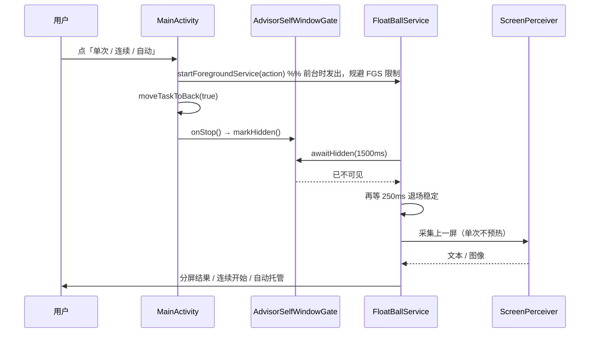
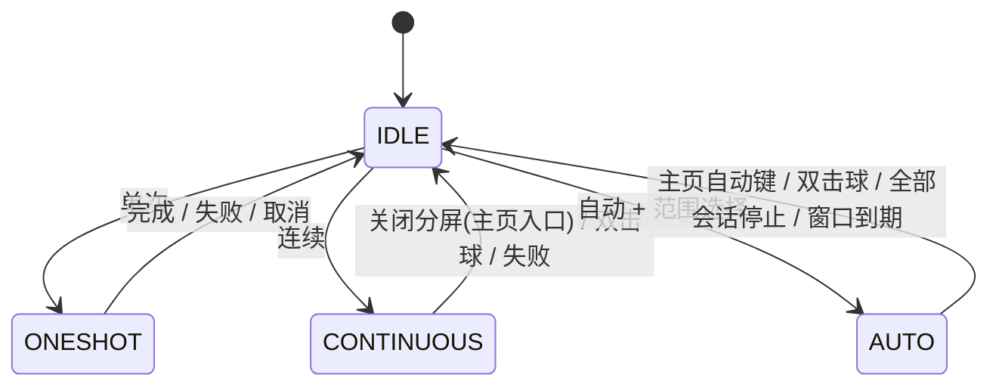

# 主页三态参谋入口 UI 体验方案（单次 / 连续 / 自动）

- 日期：2026-10-25（v2，纳入多会话托管）
- 分支：`laocanmou`
- 状态：**已实施（2026-10-27 复核；实施偏差与批注回复见第十四节）**
- 范围：主页（会话列表页）右下角新增「单次 / 连续 / 自动」三键操作条，与悬浮球扇形菜单同源同状态机；自动档支持「多级菜单多选 → 多会话托管」；不改上游 `feature:*` 模块。

---

## 一、结论先行

1. 在主页「新对话」FAB 的**正上方**新增一条横向「参谋操作条」，三键固定可见：**单次 / 连续 / 自动**。不新增页面、不做折叠隐藏，保证「不碰悬浮球也能一键进入参谋」。
2. 三键**不重建业务逻辑**：单击后统一转成 `FloatBallService` 的 action；单次 / 连续复用长按 / 双击的同一状态机；自动复用陪伴窗口、通知监听与 RPA 发送链路。
3. 从主页触发时，**先让自身窗口真正退到后台**（`moveTaskToBack` + Activity `onStop` 握手确认），再截取上一屏；单次**跳过无障碍预热**，避免把自己主页的文字喂给 LLM。
4. 运行态统一由 `AdvisorRunState` 回传主页与悬浮球：单次=旋转环，连续=红球，自动=红球 + 右上角脉冲红点；主页三键同步置灰 / 激活。
5. **自动档从设计第一天就按「会话集合」建模**：范围选择是 `APP → 联系人/会话` 的多级多选，可跨多个 APP、多个联系人；执行侧新增串行会话调度器，同一时刻只处理一个会话，但整组会话轮转托管。单会话时沿用现有陪伴窗口，多会话时走「来信触发 → 切换会话 → 参谋 → 代答」队列。
6. 自动档的「多会话」不是非目标；本期只把「同一时刻并发执行多个会话」列为非目标（RPA 必须串行，避免切屏互相踩踏）。

---

## 二、已确认口径

| 议题 | 结论 |
| --- | --- |
| 自动入口的监控范围 | **多级多选**：可按 APP 分组跨选多个 APP、多个联系人会话；保留「全部联系人（仅通知拟稿，不自动发送）」入口 |
| 单次 / 连续后截哪一屏 | **立即退后台，截取上一屏**；等自身窗口真正不可见后再采集，超时则取消并报因 |
| 自动运行中单击悬浮球 | **保持现有行为：开 / 合分屏**，不改手势；停止自动只走「双击悬浮球 / 主页自动键」 |
| 入口位置 | **只放主页会话列表**；单个聊天页不放，避免遮挡输入区 |
| 自动执行模型 | **串行会话调度**：同一时刻只处理一个会话，多会话排队轮转；不做并发注入 |

---

## 三、名词与状态

- **单次（ONESHOT）**：一次截屏 → 一轮 OCR/LLM → 弹分屏给答案。
- **连续（CONTINUOUS）**：后台差分循环持续给参谋意见；主页触发的这一档，**关闭分屏即停止**。
- **自动（AUTO）**：对选中的托管目标集合进行后台监控与 RPA 代答。
- **托管目标（AutoTarget）**：`联系人 × APP 会话`；`imPackage = null` 表示「该联系人的所有 APP 会话」。
- **托管组（AutoGroup）**：一次自动运行选中的所有托管目标，1..N 个。
- **活动会话（Active Session）**：调度器当前正在处理的托管目标；同一时刻仅一个。
- **三档互斥**：单次 / 连续 / 自动任意时刻只有一个在途；窗口类与起草档共用现有 `ModeGate` 口径。
- **悬浮球三态**（沿用）：常态蓝球 / 忙碌（灰白蒙层 + 旋转环）/ 录制（红球）。

---

## 四、主页「参谋操作条」视觉与交互

### 4.1 位置与层级

```
屏幕右下角（自下而上）：

                 ┌─────────────────────────────────┐
                 │ 自动托管中 · 3 个会话 · 张三·微信 │  ← 运行状态签（仅运行中，22dp）
                 └─────────────────────────────────┘
                 ┌─────────────────────────────────┐
                 │   单次   │   连续   │   自动    │  ← 参谋操作条（46dp）
                 └─────────────────────────────────┘
                        ┌──────────────┐
                        │  ＋  新对话   │          ← 既有 FAB（56dp）
                        └──────────────┘
```

- 对齐：与 FAB 同为 `Alignment.BottomEnd` + `navigationBarsPadding()` + 横向 `Baic2Spacing.xl`（24dp）。
- 间距：FAB 顶边向上 12dp 为操作条底边；有状态签时再向上 8dp。
- 显示条件：会话列表页、且会话列表非空（与 FAB 一致）；进入单个聊天页、收藏页或其它分区时隐藏。
- 空闲时操作条 + FAB 合计约 114dp，仍在列表既有 150dp 留白内；状态签仅在运行中出现，不长期占位。

### 4.2 操作条结构

- 容器：`RoundedCornerShape(18.dp)`，`surfaceContainerHigh` 96% 不透明，1dp `outlineVariant` 描边，阴影 8dp。
- 三段等宽，每段高 40dp、左右内边距 10dp，段间 1dp 竖分隔线（高 14dp、`outlineVariant` 50%）。
- 每段：18dp 图标 + 5dp 间距 + 12sp `labelMedium` 半粗文字；点击区 ≥ 44×40dp。
- 图标为新增可着色矢量（不用在线图标）：
  - `fb_ic_cmd_oneshot`：闪电 / 取景框
  - `fb_ic_cmd_continuous`：循环箭头
  - `fb_ic_cmd_auto`：机器人头像
- 按钮文字复用现有字符串，保证与扇形菜单一字不差：`float_fan_oneshot`、`float_fan_continuous`、`float_split_auto`。

### 4.3 三键状态矩阵

| 运行态 | 单次 | 连续 | 自动 |
| --- | --- | --- | --- |
| 空闲 | 可点，主色图标 | 可点，主色图标 | 可点，主色图标 |
| 单次运行中 | 激活：转圈 + 「分析中」，不可点 | 置灰不可点 | 置灰不可点 |
| 连续运行中 | 置灰不可点 | 激活：红点 + 「连续中」，不可点 | 置灰不可点 |
| 自动运行中 | 置灰不可点 | 置灰不可点 | **激活：脉冲红点 + 「自动中 · N」，点击=停止全部** |

- **置灰**：图标与文字透明度 0.38，点击无响应；TalkBack 读「当前参谋进行中，不可用」，不静默失效。
- **激活**：底色 `primary.copy(alpha=0.12)`（连续为 `colorScheme.error.copy(alpha=0.12)`）；文字用对应主色。
- **单次转圈**：16dp 圆弧，900ms 匀速旋转，与悬浮球忙碌环同节奏。
- **自动脉冲红点**：8dp 红点，缩放 0.85→1.15、透明度 0.55→1，周期 1000ms；主页与悬浮球同步。
- **点击反馈**：`HapticFeedbackType.TextHandleMove` + 按下缩放 0.96（`Baic2Motion.spatialFast`）。
- **入场 / 退场**：`fadeIn + slideInVertically(8dp)` 180ms；退场 120ms。

### 4.4 运行状态签

- 仅运行中显示，位于操作条上方，高 22dp 小胶囊，11sp：
  - 连续：「连续参谋中 · 关闭分屏即停止」
  - 自动单会话：「自动托管中 · {联系人} · {APP}」
  - 自动多会话：「自动托管中 · {N} 个会话 · 正在处理 {联系人}·{APP}」
- 空闲时完全隐藏。
- **点击状态签**（自动运行中）：打开「自动托管面板」——列出全部托管目标、各自状态（等待 / 处理中 / 冷却 / 失败），支持单个暂停 / 恢复与「全部停止」。这是多会话的必要管理面，避免只能"一键停全部"。

### 4.5 无障碍与语义

- 操作条整体 `contentDescription`：「参谋操作：单次、连续、自动」。
- 每段按状态给出 `contentDescription`（如「自动，3 个会话运行中，点击停止」），`Role.Button`；置灰段仍可聚焦并朗读原因。
- 状态切换用 `liveRegion = Polite` 播报一次。
- 不依赖颜色单独传达状态（文字 / 图标 / 动效三通道）。

---

## 五、流程

### 5.1 单次

1. 点「单次」→ 操作条进入「分析中」，同时：
   - 在 App 仍在前台时发出 `ACTION_ONESHOT_FROM_MAIN`（规避 Android 12+ 后台启动 FGS 限制）；
   - `MainActivity.moveTaskToBack(true)`。
2. 服务等待 `AdvisorSelfWindowGate` 的「已不可见」信号（Activity `onStop`），再等 250ms 退场稳定。
3. 服务撤掉自身全部浮层，**不做无障碍预热**，直接截取上一屏并走 OCR → LLM。
4. 首个 `TurnStarted` 弹分屏；结束后球恢复蓝球，操作条回空闲。
5. 1.5s 内拿不到「已不可见」：取消本次单次，恢复浮层，Toast「未能退出当前界面，已取消本次参谋」；绝不在自己界面上截屏。
6. 采集前后不显示任何自家 Toast / 弹层，避免污染 OCR；失败提示只在确认不采集后出现。

### 5.2 连续

1. 点「连续」→ 与单次相同的「先发 action、再退后台」序列。
2. 确认自身不可见后：撤掉分屏与浮层 → 启动差分循环（运动检测 → 静默 → 掩膜 OCR → 去重 → 串行 LLM）→ 悬浮球切红球；**不弹开始 Toast**（避免首帧污染）。
3. 运行中：
   - 悬浮球单击 = 开 / 合分屏；双击 = 停止（沿用）；
   - **关闭分屏 = 停止连续**（主页入口专属，见 §9.3 `stopOnSplitClose`）；
   - 主页：连续段「连续中」，其余置灰。
4. 停止后：红球恢复蓝球，操作条空闲，轻提示「连续参谋已停止」。

### 5.3 自动：多级多选范围弹层

#### 5.3.1 入口与层级

点「自动」打开 App 内 `ModalBottomSheet`（拖拽把手 + 顶部圆角 28dp + `Baic2Theme`），采用 **APP → 会话 两级多选**：

**一级：APP 列表**

```
┌─────────────────────────────────────────────┐
│                   ───                       │
│  选择自动托管范围                            │  titleLarge 加粗
│  后台按来信轮转处理选中会话，并按纪律代答    │  bodySmall 次要色
│                                             │
│  ⚠ 运行条件（有缺项时才出现）                │
│  · 通知使用权未开启               [去开启]   │
│  · 无障碍与 Shizuku 均不可用      [去处理]   │
│                                             │
│  ┌───────────────────────────────────────┐  │
│  │ ◎ 全部联系人                          │  │
│  │   仅通知拟稿，不自动发送               │  │
│  └───────────────────────────────────────┘  │
│  按 APP 选择                                 │
│  ┌───────────────────────────────────────┐  │
│  │ (微) 微信            已选 4 个会话  › │  │
│  └───────────────────────────────────────┘  │
│  ┌───────────────────────────────────────┐  │
│  │ (企) 企业微信        已选 2 个会话  › │  │
│  └───────────────────────────────────────┘  │
│  ┌───────────────────────────────────────┐  │
│  │ (飞) 飞书            未选择          › │  │
│  └───────────────────────────────────────┘  │
│                                             │
│  已选 2 个 APP · 6 个会话                    │  选中摘要（可点 × 移除）
│  [        开始自动托管（6）        ]         │  底部主按钮
└─────────────────────────────────────────────┘
```

**二级：某 APP 下的联系人 / 会话**

```
┌─────────────────────────────────────────────┐
│  ‹ 返回     微信                            │
│  [全选该 APP 下全部会话]       已选 4/12     │
│  搜索联系人…                                 │
│  ☑ (张) 张三   · 微信 · 张三                 │
│  ☑ (李) 李四   · 微信 · 老李                 │
│  ☐ (王) 王五   · 微信 · 王五                 │
│  ……                                         │
│  [        确认（4）        ]                 │
└─────────────────────────────────────────────┘
```

- 数据源：`ContactRepository.autoScopeEntries()`，按 `imPackage` 分组；同一联系人在多个 APP 下 = 多个可选会话（可同时勾选，也可不选）。
- 选择粒度：
  - 「全部联系人」= 全量通知拟稿（不自动发送，硬前置：通知使用权）；
  - 勾选「联系人」= 该联系人在当前 APP 的会话；
  - 跨 APP 勾选 = 多会话托管组；
  - 二级页支持「全选该 APP 下全部会话」，一级页支持整组摘要移除。
- 选中模型持久化为 `AutoSelection`：
  ```kotlin
  data class AutoTarget(val contactId: Long, val imPackage: String?, val displayName: String)
  data class AutoSelection(val mode: DraftAll | Targets, val targets: List<AutoTarget>)
  ```
  与现有 `autoWhitelistIds` 做一次兼容迁移：旧白名单 → `AutoTarget(contactId, null, name)`。
- 上限：联系人数 ≤ 5（沿用现有白名单口径）、会话数 ≤ 10、至少 1 个；超限时主按钮置灰并提示。

#### 5.3.2 运行条件（硬 / 软）

| 条件 | 口径 | 处理 |
| --- | --- | --- |
| 自动档总闸 | `AdvisorPrefs.autoModeEnabled` | 首次开启弹风险告知（复用 `float_companion_risk_*`），确认后继续 |
| 选中目标非空 | ≥ 1 个会话 | 空则禁用开始 |
| 联系人数 / 会话数 | ≤ 5 / ≤ 10 | 超限禁用并提示 |
| 通知使用权 | **多会话与「全部联系人」硬前置**（事件源） | 缺则禁用多选并给「去开启」 |
| 注入通道 | 无 a11y 时必须有 Shizuku | 两者皆无则禁用开始并提示，不静默执行 |
| 投影 | 启动时 `ScreenCapture.ensureProjection` 编排 | 不预先硬拦，失败按原因 Toast |
| 会话就绪 | 目标 APP 已安装、聊天会话可导航 | 单目标启动前校验；失败只剔除该目标并提示 |

#### 5.3.3 启动时序

1. 选好范围 → 点「开始自动托管（N）」。
2. 总闸未开：风险确认 → `setAutoModeEnabled(true)`。
3. 写入 `AutoSelection` 与白名单；关闭弹层。
4. 先发 `ACTION_AUTO_FROM_MAIN`（携带 selectionId），再 `moveTaskToBack`。
5. 服务等待自身不可见后：
   - **单目标且带 imPackage**：走现有单会话陪伴窗口（`CompanionWindowController.start` + 差分循环），保持与悬浮菜单完全一致；
   - **多目标 / 联系人级 / 全部联系人**：启动 `AutoSessionScheduler`，由通知事件驱动串行处理；首轮可先处理最近一条来信；
   - 悬浮球：红球 + 右上角脉冲红点；主页状态签显示会话数与当前处理对象。
6. 运行中：
   - 双击悬浮球 = 全部停止；
   - 单击悬浮球 = 开 / 合分屏（按已确认口径，不改）；
   - 打开主页：自动键激活且红点闪烁，单击即全部停止；单次 / 连续置灰；
   - 点状态签 = 打开自动托管面板（单会话时展示该会话，多会话时展示队列与各目标状态）。
7. 停止：
   - 主页自动键 / 双击球 → 取消当前任务、清空队列、结束全部窗口 → 红点熄灭 → Toast「自动托管已停止」；
   - 进程被杀后**不自动恢复**托管（选择集保留，需用户再次点开始），避免不可预期的后台代答。

### 5.4 多会话托管架构（新增核心）

#### 5.4.1 为什么不是「并发 N 个引擎」

RPA 同一时刻只能有一个前台 APP 与一个输入焦点；并发跑多个会话会互相抢前台、抢输入、抢投影，必然失败。因此多会话 = **一个串行调度器 + 一个活动会话**，靠队列轮转。

#### 5.4.2 组件

| 组件 | 职责 |
| --- | --- |
| `AutoSessionScheduler`（新） | 持有托管组、队列、活动会话；单 worker 串行执行；状态流给 UI |
| `AdvisorNotificationListener`（改） | 命中托管目标的通知 → 入队（去抖 / 去重）；非托管目标仍走原起草逻辑 |
| `ScreenAdvisor.submitNotificationTurn`（复用） | 按联系人解析 / 复用参谋会话，跑一轮参谋并返回草稿 |
| `ImChatNavigator`（复用） | 把目标 APP 的对应聊天页拉到前台并就绪 |
| `ActionDispatcher`（复用） | 前台就绪后自动发送；失败按现有规则降级为草稿通知 |
| `CompanionWindowController`（复用 / 增强） | 单会话时保持现窗口；多会话时窗口跟随活动会话；暴露 `activeWindow` 流 |
| `AutoSelectionStore`（新，落 `AdvisorPrefs`） | 持久化托管组；兼容旧白名单 |

#### 5.4.3 调度规则

- **入队**：通知监听匹配 `(imPackage, contactId)`；同一目标 3s 内重复通知合并；同一目标已在队列中则只更新内容，不重复排队；队列上限 20，超出丢弃最旧并记一次「积压」。
- **串行**：单 worker + `Mutex`；正在处理时新任务只入队，不抢占。
- **单轮步骤**：
  1. 校验：总闸、目标仍在托管组、未暂停、`ModeGate` 未被他档占用、节奏/配额未超。
  2. 跑参谋：`submitNotificationTurn(通知正文, contact)`；`handoff` → 只发草稿通知，结束本轮。
  3. 导航：`ImChatNavigator.openChat(pkg, contact, entryName)` → 等前台就绪（超时 8s）。
  4. 发送：`ActionDispatcher.dispatch(AutoSendRequest)`；失败 → `degradeToDraft` 发草稿通知。
  5. 反馈：更新目标状态（成功 / 失败原因 / 冷却），写运行态流。
  6. 冷却：该目标最短 4s，再取下一个。
- **节奏与配额**：单目标 ≤ 20 条/小时、全局 ≤ 60 条/小时、连续失败 3 次自动暂停该目标；夜间静默沿用 `EngagementRules` / `proactivePolicy`。
- **失败隔离**：单目标失败只标记该目标，不影响其它目标；失败原因保留在托管面板。
- **切屏体验**：每次切换在状态签显示「正在切换 → 张三·微信」；切换前若用户正在手动操作（`AppVisibility` 前台不是目标 APP 且最近 5s 有触摸），本轮延后 20s，避免抢用户正在用的屏幕。
- **停止**：worker 在步骤边界检查取消；投影、球、通知全部复位；队列清空。

#### 5.4.4 单会话与多会话的边界

- 单会话（带 `imPackage`）：保持现有陪伴窗口 + 差分循环，行为与悬浮菜单相同。
- 多会话 / 联系人级（`imPackage = null`）/ 全部联系人：走通知调度器，窗口仅作为活动会话的可视化，不依赖持续差分截屏。
- 两种模式共用同一套「运行态 + 红点 + 停止」UI，用户无需理解底层差异；状态签会写明「窗口托管」或「N 个会话轮转」。

### 5.5 「跳过自身窗口」握手时序



- 超时：放弃本次任务，恢复浮层并报 `REASON_SELF_WINDOW_VISIBLE`。
- 单次像素路径不调用 `preheat()`；连续与自动同样在确认不可见后才启动。

---

## 六、状态机与互斥



- 三档互斥沿用 `ModeGate`：窗口类全局互斥，起草档按联系人占用。
- 自动内部：`SchedulerSnapshot` 为 `RUNNING / PAUSED / STOPPING / STOPPED`；目标级状态 `QUEUED / ANALYZING / NAVIGATING / SENDING / COOLDOWN / FAILED / DONE / PAUSED`。
- 自动运行中，手动单次 / 连续入口一律置灰；反向亦然。

---

## 七、前置校验与报因

| 场景 | a11y 开 | a11y 关 | 失败提示 |
| --- | --- | --- | --- |
| 单次取帧 | a11y 预读（主页入口禁用）→ 投影 / a11y 截图 | 投影（`ScreenCapture` 自动授权）→ Shizuku `screencap` 兜底 | `float_ask_denied` / `REASON_*` 映射 |
| 连续差分 | 常驻投影 + OCR | 常驻投影 + OCR（Shizuku 静默授权） | 「连续参谋启动失败」+ 原因 |
| 自动单会话 | 陪伴窗口 + a11y 注入 | 陪伴窗口 + Shizuku 注入 | 缺通道启动前禁用并给指引 |
| 自动多会话 | 通知监听 + 导航 + a11y 注入 | 通知监听 + 导航 + Shizuku 注入 | 缺通知/注入时启动前禁用并给指引 |
| 全部联系人拟稿 | 通知使用权硬前置 | 同左 | 跳系统通知使用权设置 |

- 所有失败以 `REASON_*` 回传，展示层映射中文；绝不静默失效。

---

## 八、边界与异常

1. **会话列表为空 / 无 agent**：操作条不显示（与 FAB 同条件）。
2. **无关联 APP 的联系人**：自动弹层显示空状态 +「去绑定」直达画像页。
3. **服务未启动 / 被回收**：`startForegroundService` 拉活；服务内先确保悬浮窗权限，失败报「无法启动参谋服务」。
4. **自身窗口未及时隐藏**：取消 + 报因，不截自己。
5. **投影授权弹窗**：系统 UI，授权后等 `CONSENT_SETTLE_MS`；期间不显示自家 Toast。
6. **自动窗口到期 / 被互斥拒绝**：控制器发汇总通知；服务同步复位运行态，红点熄灭。
7. **自动运行中用户点「新对话」**：允许，不影响后台托管。
8. **多会话通知风暴**：3s 去抖 + 队列上限 20 + 单目标/全局配额；积压时状态签显示「积压 N」。
9. **目标 APP 被卸载 / 会话改名**：单目标启动前校验；运行中失败标记该目标并暂停，不影响其它。
10. **用户在目标 APP 手动操作**：5s 内检测到用户触摸 → 本轮延后 20s 或跳过（可配置），不抢屏。
11. **进程被杀重开**：托管组保留；**不自动恢复运行**，避免意外代答；主页回到空闲态。
12. **连续运行中关闭分屏**：主页入口停止连续；悬浮球双击入口仍保持旧语义。

---

## 九、技术落位（实现阶段的改动清单）

### 9.1 新增文件（`app` 模块 `floatball/home/` 与 `floatball/auto/`）

| 文件 | 职责 |
| --- | --- |
| `home/AdvisorRunState.kt` | 单例运行态 `StateFlow<Snapshot>`：IDLE / ONESHOT / CONTINUOUS / AUTO + 托管组 / 活动目标 / 来源 / 关闭分屏是否停止 |
| `home/AdvisorSelfWindowGate.kt` | Activity `onStop` 握手：`awaitHidden(timeout)` |
| `home/AdvisorHomeLauncher.kt` | 先发 service action、再 `moveTaskToBack`；停止自动 |
| `home/AdvisorHomeViewModel.kt` | Hilt VM：会话非空、分组范围数据、运行条件 |
| `home/AdvisorHomeCommands.kt` | 三键操作条 + 状态签 + 动效 + 语义 |
| `home/AdvisorAutoScopeSheet.kt` | 两级多选弹层 + 运行条件 + 风险确认 |
| `home/AdvisorAutoPanel.kt` | 自动托管面板：目标列表、状态、单目标暂停 / 恢复、全部停止 |
| `auto/AutoSelectionStore.kt` | 托管组持久化 + 旧白名单迁移 |
| `auto/AutoSessionScheduler.kt` | 串行队列调度器、去抖 / 配额 / 失败隔离 / 状态流 |

### 9.2 资源

- `app/src/main/res/drawable/fb_ic_cmd_oneshot.xml`、`fb_ic_cmd_continuous.xml`、`fb_ic_cmd_auto.xml`（24dp 可着色矢量）。
- `strings.xml` 追加 `float_home_*` 键（见 §9.6）。

### 9.3 修改文件

| 文件 | 改动 | 性质 |
| --- | --- | --- |
| `floatball/FloatBallService.kt` | 新 action：`ACTION_ONESHOT_FROM_MAIN`、`ACTION_CONTINUOUS_FROM_MAIN`、`ACTION_AUTO_FROM_MAIN`、`ACTION_STOP_AUTO`；等待自身隐藏；维护 `AdvisorRunState`；`stopOnSplitClose`；自动启动 / 停止（单会话走窗口、多会话走调度器） | 自有 |
| `floatball/FloatUi.kt` | 悬浮球「自动运行脉冲红点」+ `setAutoRunning`；自动态隐藏数字徽章 | 自有 |
| `floatball/auto/CompanionWindowController.kt` | 暴露 `activeWindow: StateFlow<WindowSnapshot?>`；单会话与调度器的窗口协同 | 自有 |
| `floatball/director/AdvisorNotificationListener.kt` | 命中托管组 → 交给调度器入队；非托管组保持原起草；草稿通知抽成共享方法 | 自有 |
| `floatball/AdvisorPrefs.kt` | `AutoSelection` 读写 + 旧白名单迁移 + 配额偏好 | 自有 |
| `MainActivity.kt` | `onStop()` 调 `AdvisorSelfWindowGate.markHidden()`（2 行） | 白名单，纯增量 |
| `app/.../Baic2App.kt` | `ChatsZone` 包裹 `Box`，在会话列表路由叠加操作条；聊天页隐藏 | **非白名单上游文件，`[upstream-touch]` 最小包裹层** |
| `strings.xml` | 追加 `float_home_*` 键 | 白名单，纯增量 |

### 9.4 运行态同步要点

- 服务在 `startOneShot / finishOneShot / startRecording / abortRecording / stopRecording / 自动启动与结束` 更新 `AdvisorRunState`。
- `CompanionWindowController.activeWindow` 变 null 且服务仍 `companionWindow=true` → 服务自动复位（修复「窗口结束但红球还亮」）。
- 调度器 `SchedulerSnapshot` 合并进 `AdvisorRunState`（目标数、活动目标、队列长度、暂停数）。
- 自动运行中用户在设置里关掉总闸 → 立即停止并复位。

### 9.5 依赖与复用

- 范围数据：`ContactRepository.autoScopeEntries()`。
- 通知解析与联系人识别：现有 `AdvisorNotificationListener` + `ContactDirectory.resolve`。
- 参谋回合：`ScreenAdvisor.submitNotificationTurn`（返回草稿 / handoff）。
- 导航与发送：`ImChatNavigator` + `ActionDispatcher`。
- 就绪门：`ReadinessGate`（通知使用权 / 注入通道）。
- 不新增 Gradle 模块，不新写 HTTP / OCR / LLM 调用。

### 9.6 新增文案（草案）

| 键 | 文案 |
| --- | --- |
| `float_home_cmd_bar_cd` | 参谋操作：单次、连续、自动 |
| `float_home_oneshot_running` | 分析中 |
| `float_home_continuous_running` | 连续中 |
| `float_home_auto_running` | 自动中 · %1$d |
| `float_home_disabled_busy` | 当前参谋进行中，暂不可用 |
| `float_home_disabled_auto` | 自动托管运行中，暂不可用 |
| `float_home_status_continuous` | 连续参谋中 · 关闭分屏即停止 |
| `float_home_status_auto_one` | 自动托管中 · %1$s · %2$s |
| `float_home_status_auto_many` | 自动托管中 · %1$d 个会话 · 正在处理 %2$s·%3$s |
| `float_home_status_switching` | 正在切换 → %1$s·%2$s |
| `float_home_auto_stopped` | 自动托管已停止 |
| `float_home_continuous_stopped` | 连续参谋已停止 |
| `float_home_self_hide_timeout` | 未能退出当前界面，已取消本次参谋 |
| `float_home_launch_failed` | 无法启动参谋服务，请检查悬浮窗权限 |
| `float_home_auto_need_rpa` | 自动回复需要无障碍或 Shizuku 注入通道，请先开启其中一项 |
| `float_home_auto_need_notify` | 多会话托管需要通知使用权，请先开启 |
| `float_home_scope_title` | 选择自动托管范围 |
| `float_home_scope_start` | 开始自动托管（%1$d） |
| `float_home_scope_empty` | 本机尚未关联任何 APP，无法执行自动托管 |
| `float_home_scope_selected` | 已选 %1$d 个 APP · %2$d 个会话 |
| `float_home_panel_title` | 自动托管面板 |
| `float_home_panel_pause` | 暂停该会话 |
| `float_home_panel_resume` | 恢复该会话 |

（三键主文案复用 `float_fan_oneshot` / `float_fan_continuous` / `float_split_auto`。）

---

## 十、交付里程碑（同一方案，分批验收）

| 里程碑 | 内容 | 验收闸门 |
| --- | --- | --- |
| A | 操作条 + 单次 / 连续 + 自身窗口隐藏握手 | 编译、licence、单次/连续冒烟、无自家截屏 |
| B | 自动单会话（复用现有陪伴窗口） | 与悬浮菜单行为一致、红点 / 停止 / 到期复位 |
| C | 自动多会话（两级多选 + 调度器 + 托管面板） | 跨 2 个 APP、3 个联系人轮转代答；队列、配额、失败隔离、停止全部 |

- A/B 验收通过后进入 C；范围选择与运行态数据模型在 A 阶段即按多会话设计，避免返工。
- C 的 UI 若需要先上线，可先开放「单会话」限制，但数据结构与弹层层级一次到位，不再二次改版。

---

## 十一、验收清单

### 11.1 构建与门禁

- `tools/check-license-headers.sh` 通过（新增 `.kt` 全部带 GPL 头）。
- `./gradlew :app:assembleDebug` 通过。
- `adb logcat -d | grep -E "FATAL|AndroidRuntime"` 为空。

### 11.2 手工矩阵

1. 主页空闲：三键可见、不压列表最后一项、点击有触感。
2. 单次：自身退后台 → 分屏出现上一屏结果 → 球旋转后恢复；主页键恢复。
3. 连续：红球出现 → 屏幕变化持续参谋；关闭分屏立即停止；双击球也能停止。
4. 自动单会话：「张三 × 微信」→ 自家窗口退后台 → 微信对应聊天被拉起 → 红球 + 红点脉冲；主页只有自动键激活，单击停止。
5. 自动多会话：
   - 勾选「微信 4 个 + 企微 2 个」→ 开始；
   - 两个 APP 先后来信 → 按来信顺序轮转，状态签显示当前处理对象与积压；
   - 发送成功后冷却，继续下一个；
   - 单个目标导航失败 → 只暂停该目标并发草稿通知，其它继续；
   - 关闭总闸 / 双击球 / 主页自动键 → 全部停止、红点熄灭、队列清空。
6. 通知风暴：10s 内 20 条同一联系人消息 → 去抖后最多排队 1 条活动 + 1 条更新，不产生 20 轮。
7. 互斥：连续中点自动置灰；自动中点单次/连续置灰且朗读原因。
8. 自身窗口隐藏失败：人为延迟 `onStop` → 报「未能退出当前界面」，不产生截屏。
9. 进程被杀重开：托管组保留、运行态归零、不自动恢复托管。

### 11.3 截图与证据

- 全部截图 / 录屏证据放 `tests/tempImg/`（已 `.gitignore`），文档引用统一写该目录。

---

## 十二、非目标（本期不做）

- ❌ **同一时刻并发执行多个会话**（RPA 前台/输入互斥；本方案是串行轮转，多会话本身已纳入）。
- ❌ 群聊内按成员分别代答（按会话级处理）。
- ❌ 跨设备 / 云端调度托管。
- ❌ 在单个聊天页新增三键入口。
- ❌ 新增 Gradle 模块或修改 `feature:*` 上游模块。
- ❌ 自动化 UI 测试框架接入（沿用现有 `build-client.ps1` 冒烟）。

---

## 十三、风险与回滚

| 风险 | 对策 |
| --- | --- |
| Android 12+ 后台启动 FGS 被拒 | 先在前台发 action，再退后台 |
| 退后台后仍是自家界面 | `onStop` 握手 + 250ms 稳定；超时取消并报因 |
| Toast / 弹层污染截图 | 采集确认前不显示自家提示 |
| 多会话切屏抢用户前台 | 5s 触摸检测 → 延后 20s；状态签显示切换对象 |
| 通知风暴 / 代答刷屏 | 3s 去抖、队列 20、单目标 20/h、全局 60/h、失败 3 次暂停 |
| 自动窗口到期后状态漂移 | `activeWindow` 流 + 服务复位 |
| 上游合并冲突 | 仅 `Baic2App.kt` 一个包裹层（`[upstream-touch]`）+ 白名单 `MainActivity.kt` 两行；其余全部新文件 |
| 多会话范围过大导致耗电 | 会话上限 10、轮转冷却、夜间静默、悬浮球红点提示 |

**回滚方式**：移除 `AdvisorHomeCommands` 挂载点与新增 service action 分支；调度器与选择存储独立文件，可整文件停用，不影响悬浮球、分屏与既有单会话托管。

---

## 十四、2026-10-27 实施复核（回答批注）

> 本节只记录「代码实际 vs 本文设计」的差异与批注口径，不重复 2026-10-27 的稳定性方案。后者见
> `docs/2026-10-27-自动档稳定性与回复节奏诊断方案.md`。

### 14.1 三入口现状与状态矩阵（批注 3）

三条入口最终都调用 `FloatBallService.applyAutoTargets`：

| 入口 | 实际行为 | 导航 |
| --- | --- | --- |
| 悬浮球子菜单 → 联系人 → 具体 APP | `startAutoForContact` → 统一启动口 | 是 |
| 分屏顶栏「自动」键 | `startCompanionWindow` → 当前屏联系人 → 统一启动口 | 否（信任当前屏，2026-10-27 已列为待补校验） |
| 主页「自动」键 | `startAutoFromMain` → `AutoSelectionStore` 选择集 → 统一启动口 | 是 |

**批注 3「三键状态矩阵」的实施口径：**

- 主页三键的「自动」键在 `AdvisorRunState.Mode.AUTO` 时**点击=停止全部**；单次/连续置灰。代码见 `AdvisorHomeCommands.CommandBar` 的第三个 `Segment`（`enabled = idle || mode == Mode.AUTO`、`description` 按 `float_home_auto_running / float_home_disabled_auto` 切换）。
- **悬浮球单击不是停止**：自动态单击=开/合分屏；双击=停止全部（`FloatBallService` 的 `Mode.AUTO -> toggleSplit()` / `Mode.AUTO -> stopAuto(announce=true)`）。
- 当前矩阵缺一档「启动中/导航中」：导航可能持续数秒到数十秒，球仍是蓝球，用户误判「没反应」。2026-10-27 方案要求新增 `autoPhase=STARTING/NAVIGATING/READY/FAILED`，并在导航前就点亮红球+脉冲红点。这是本期 P0，不是对原矩阵的否定。

### 14.2 自动单会话流程（批注 1/4）

实际顺序：

```
选目标
 → 自动开总闸 + 加白名单 + 持久化选择集
 → openChat（子菜单/主页入口）
 → CompanionWindowController.start
 → mode=AUTO + 红球 + 脉冲红点
 → kickoffAuto（当前固定 12s）
 → 成稿 → Gatekeeper → 拟人节奏 → 发送
```

与原方案一致；差异：

1. **主动首轮**是 2026-10-27 新增（`ScreenAdvisor.runAutoKickoff`），原方案只写「来信触发」。它解决了「窗口里没人说话就永远不动」的问题，但 12s 延迟与静默/已有回合跳过会造成「没反应」的观感；本期改为 3s + 可见状态。
2. **启动失败复位**：导航失败、陪伴窗口启动失败已复位；`beginCompanion` 的 `contact==null` / 已有窗口早退尚未复位，本期 P0 修复。
3. **分屏入口不导航**：如果当前屏不是目标会话，陪伴窗口会录到错误画面；本期 P0 增加会话页校验/必要时导航。
4. **「全部联系人」仍只拟稿不发送**：这是原方案的安全边界，不因自动档改名而改变；UI 需明确提示。

### 14.3 自动多会话流程（批注 2）

实际为「通知事件驱动 + 串行轮转」：

```
applyAutoTargets（targets>1 或 imPackage=null）
 → AutoSessionScheduler.start
 → AdvisorNotificationListener.enqueue（3s 去抖、队列 20）
 → worker 串行：submitNotificationTurn → 抽取 → 硬审 → openChat → dispatch
 → 4s 冷却 → 下一条
```

与原方案一致；差异/缺口：

1. **启动前未校验通知使用权**：`startAutoFromMain` 只在「全部联系人」分支检查；多目标/联系人级直接启动调度器，没有通知就永远不动。本期 P0 增加前置校验。
2. **没有主动首轮**：多会话不 kickoff，只等通知；启动前已经收到的未读消息不会再触发通知。P1 增加「启动扫描当前未读/当前会话」。
3. **没有拟人节奏**：调度器只做 3s 去抖 + 4s 冷却，未使用 `HumanPace`，因此多会话会比单会话明显快。是否统一由产品确认（P1）。
4. **并发仍非目标**：同一时刻只处理一个会话；切换会话时前台会被抢占，方案中的 5s 触摸检测/延后 20s 尚未完全落地，需在真机矩阵中验证。

### 14.4 名词口径（批注 4）

- **自动（AUTO）**：对选中的托管目标集合做后台监控与 RPA 代答；单会话=屏幕差分 + 陪伴窗口，多会话=通知监听 + 串行调度。
- **托管目标（AutoTarget）**：`联系人 × APP 会话`。`imPackage=null` 表示「该联系人的所有 APP 会话」，实际走通知调度器；**不是**「所有联系人都自动发送」。
- **托管组（AutoGroup）**：一次自动运行选中的所有目标，1..N；当前 UI 上限与 `MAX_AUTO_WHITELIST=5` 共同约束。
- **活动会话（Active Session）**：调度器当前处理的唯一目标；单会话陪伴窗口本身就是活动会话。
- **三档互斥**：单次/连续/自动任意时刻只有一个在途；自动启动时若处于连续（RECORDING），会先静默停止连续再进自动（`applyAutoTargets` 已实现）。

### 14.5 2026-10-27 参数与计时补充

| 项 | 值 | 位置 |
| --- | --- | --- |
| 工作/停歇默认 | 1 分钟 / 1 分钟 | `AdvisorPrefs.DEFAULT_WORK_REST_MS` |
| 工作档 | 1/5/10/15 分钟（数据层另允许 20） | `FloatSettingsActivity.WORK_SEGMENT_OPTIONS` |
| 停歇档 | 关闭/1/5/10/20 分钟 | `REST_SEGMENT_OPTIONS` |
| 回复节奏 | 快速 1~3s / 标准 3~10s / 拟人 8~90s / 从容 30~180s | `AdvisorPrefs.PACE_*` |
| 分段账 | `auto_timing:`（turn/gov/exec/感知） | `AutoTiming.kt` |

### 14.6 验收更新

- 三入口启动后 **2s 内**可见红球+脉冲红点（待 P0 落码），30s 内进入 `Mode.AUTO`；
- 单会话至少完成 3 条连续来信的 `out_sent`；多会话在通知权限可用时轮转；
- 工作/停歇 1/1 分钟日志出现；
- 不再以「发出去就算成功」为唯一标准，必须同时满足：无错会话、无重复气泡、无 fake incoming、失败有状态/日志。

### 14.7 未完成项

- 启动可见性/失败复位/通知权限前置/分屏会话页校验：见 2026-10-27 方案 §5.2、§8.1；
- 对话双方归属：见 2026-10-27 方案 §9 R1，单独立项，不在本 UI 方案内继续扩展。
