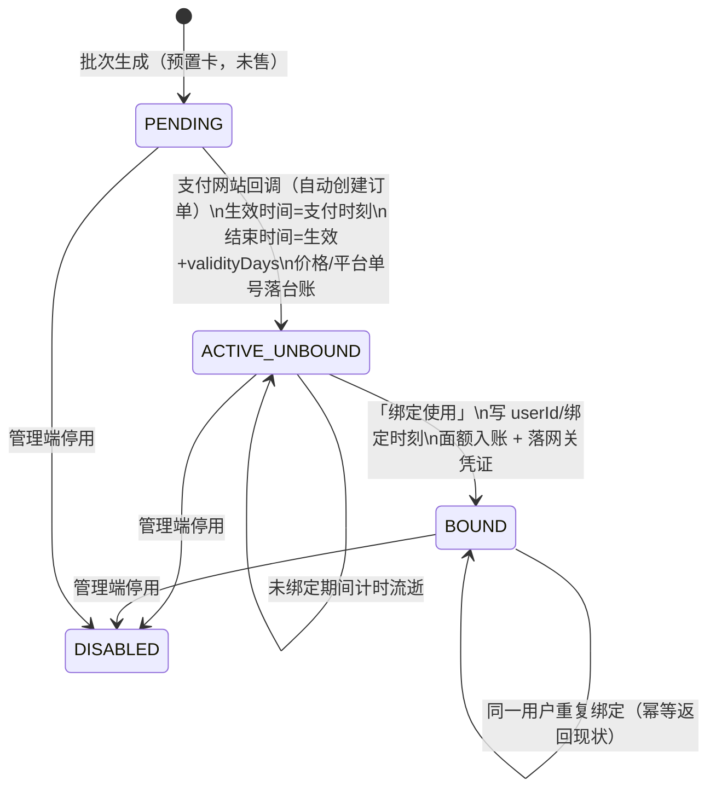
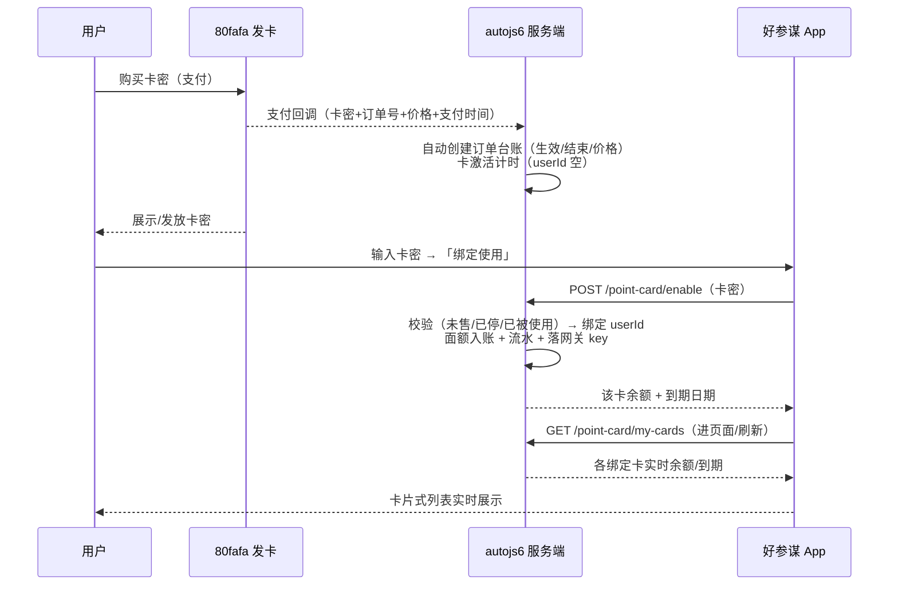

# 卡密「绑定使用」与订单台账方案（客户端简化 + 服务端订单表完善）

- 日期：2026-10-25
- 状态：**已实施并验证**（2026-10-25；§7 四项待确认已按主案裁决落地，见 §7 裁决记录）
- 范围：客户端 `NovaBAIC`（account 包 UI）+ 服务端 `autojs6_Management`（apps/server 卡密/订单台账）
- 前序：`docs/2026-10-24-商业化方案-注册充值与LiteLLM统一网关.md`（本方案修订其 §「购买点卡」口径：点卡交易纳入服务端订单台账并自动激活计时，已回写 §4.2/§4.5）

---

## 0. 需求拆解（用户口径 → 要点）

1. **「启用卡密」太复杂 → 简化**：一个输入框 + 「绑定使用」按钮；绑定成功后，
   该卡密对应的**积分余额 + 到期日期**实时显示在下方（客户端从服务端实时读取）。
2. **「+」添加更多卡密**：可追加更多「输入框 + 绑定使用」条目，逐条独立绑定。
3. **绑定即归属**：从点「绑定使用」那一刻起，卡密在服务端绑定关联到当前用户；
   **一经绑定，不能用于其他客户端**（其他账号/设备再绑同一张卡 → 拒绝）。
4. **购买即激活计时**：用户在支付网站（80fafa 发卡）买到卡密时，支付网站通知后端，
   **自动创建订单并告知服务端对应卡密**——此时还不知道是哪个用户，但**已开始计时**。
   「不绑定使用」的卡密其实已在服务端激活，只是没绑定账户。
5. **订单表**：服务端后台的订单表记录「**卡密、生效时间、结束时间、价格、用户 id**」；
   完善已存在订单表的字段，并**灌入测试数据**进行测试。

---

## 1. 现状（已核实）

### 1.1 服务端 `d:\work\autojs6_Management`（NestJS + Prisma + postgres）

| 事实 | 位置 |
| --- | --- |
| `PointCard` 表：cardNo/cardKeyHash/状态(PENDING/ACTIVE/DISABLED)/userId/activatedAt/expiresAt——**恰缺「价格」** | `apps/server/prisma/schema.prisma` `model PointCard` |
| `PointCardBatch`：facePoints 面额积分、validityDays 有效天数（现口径自「启用」起算） | 同上 |
| 启用卡密 `POST /api/v1/point-card/enable {cardNo?, cardKey}`：PENDING→ACTIVE，**启用即绑定用户+开始计时+面额入账钱包**（与新口径冲突，需改） | `apps/server/src/module/commerce/point-card/point-card.service.ts` |
| 钱包 `UserWallet.pointsBalance`（多卡累加汇总）+ `PointTransaction` 流水 | schema |
| LLM 扣点 `LlmUsageRecord`（**已带 cardId 归属**）+ 每分钟轮询 LiteLLM spend_logs 结算 | `services/llm-usage-settle.service.ts` |
| `MarketOrder`（SCRIPT/RECHARGE/RENEW/ATTACHMENT）**不承载点卡交易**；支付通道仅 WALLET/FAKE，无外部支付回调 | `module/market/` |
| 后台已有卡密批次生成/卡密列表页（web `views/api/card-batch`） | `apps/web` |

### 1.2 客户端 `NovaBAIC`（`app/.../floatball/account/`）

| 文件 | 现状 |
| --- | --- |
| [AccountScreen.kt](file:///e:/_android_work/NovaBAIC/app/src/main/java/com/verlintas/baic2/floatball/account/AccountScreen.kt) | 「启用卡密」卡 = **卡号 + 卡密两个输入框** + 启用按钮；成功后只在「账号信息」卡显示账户汇总余额/到期 |
| [AccountApi.kt](file:///e:/_android_work/NovaBAIC/app/src/main/java/com/verlintas/baic2/floatball/account/AccountApi.kt) | `enableCard(cardNo, cardKey)` / `fetchWallet()`；无「我的卡密列表」接口 |
| [AccountManager.kt](file:///e:/_android_work/NovaBAIC/app/src/main/java/com/verlintas/baic2/floatball/account/AccountManager.kt) | 启用成功后把卡密落成 LiteLLM 网关凭证（`applyGateway`） |

---

## 2. 业务模型定版（生命周期）



规则：

1. **计时起点 = 支付回调时刻**（不是绑定时刻）：`activatedAt = 支付时刻`、
   `expiresAt = 支付时刻 + batch.validityDays`。绑得晚，剩余有效期就短（用户口径「已经开始计时了」）。
2. **绑定排他**：`userId` 一经写入，其他用户再绑 → 报「卡密已被使用」；
   **同一用户**重复绑定 → 幂等返回现状（客户端重试安全）。
3. **未售卡（PENDING）不可绑**：防止未购买的预置卡被冒用；报因文案
   「卡密尚未激活（支付确认中），请稍后再试」（支付回调通常秒级到达）。
4. **停用**沿用现状：DISABLED 不可绑；已绑定卡停用后网关 key 吊销 best-effort。
5. **过期结算**沿用现状：到期剩余积分失效（EXPIRE 流水 + 清零）。
6. 「不能用于其他客户端」按**用户级**解释（同账号换设备仍可用）；如需设备级锁定见 §7 待确认 3。

---

## 3. 服务端改动（autojs6_Management）

### 3.1 订单台账表完善（用户口径五字段一一对应）

**主案（推荐）：完善 `PointCard` 表**——它已记录「卡密、生效时间、结束时间、用户 id」，
只缺「价格」；补 3 个字段即成为完整订单台账（不新增表、不动生成侧逻辑）：

| 用户口径 | 字段 | 说明 |
| --- | --- | --- |
| 卡密 | `cardNo`（+ `cardKeyHash`） | 现有 |
| 生效时间 | `activatedAt` | 现有，语义改为**支付回调时刻** |
| 结束时间 | `expiresAt` | 现有，= 生效时间 + validityDays |
| 价格 | `priceFen` **（新增）** | 售价（分），支付回调写入 |
| 用户 id | `userId` | 现有，**绑定后才写入**（未绑定 = null） |

新增字段（均为订单/审计必需的最小集）：

```prisma
/// 售价（分），支付回调写入
priceFen   Int      @default(0) @map("price_fen")
/// 支付平台订单号（幂等键，唯一）
payOrderNo String?  @unique @map("pay_order_no") @db.VarChar(64)
/// 绑定时刻（审计/展示）
boundAt    DateTime? @map("bound_at") @db.Timestamp(6)
```

状态机口径（**不改 status 枚举**，绑定与否看 `userId` 是否为空，改动面最小）：

| 状态 | 含义 |
| --- | --- |
| `PENDING` | 未售（未收到支付回调） |
| `ACTIVE` + `userId = null` | 已售激活·未绑定（计时中） |
| `ACTIVE` + `userId ≠ null` | 已绑定（使用中） |
| `DISABLED` | 已停用 |

迁移：一条 Prisma migration（加 3 列 + `pay_order_no` 唯一索引），存量数据兼容
（老卡 `priceFen=0`、`payOrderNo=null`）。

**已落地（2026-10-25）**：迁移 `20261025093000_add_point_card_order_fields`，三列已入 schema（`PointCard.priceFen/payOrderNo/boundAt`），生命周期注释与状态机口径同步写入模型。

> 备选（不推荐，除非要求订单进「订单管理」列表）：给 `MarketOrder` 增
> `orderType=POINT_CARD` + `cardNo/生效/结束` 字段。缺点：与 `PointCard` 双份记录、
> 字段重复（expiresAt 两处），且现有 `MarketOrder` 面向脚本/充值/续费交易，混入点卡需动结算统计。

### 3.2 API 契约

**① 支付回调（新增）`POST /api/v1/point-card/sale-notify`**（80fafa 发卡平台 → 服务端）

- 入参：`cardNo`（或 `cardKey`）、`payOrderNo` 平台订单号、`priceFen` 价格、`paidTime` 支付时间。
- 行为（幂等，`payOrderNo` 唯一键兜底）：定位卡 → 写 `priceFen/payOrderNo` →
  激活计时（`activatedAt=paidTime`、`expiresAt=paidTime+validityDays`）→ **userId 仍为空**。
- 鉴权：平台共享密钥/验签。**80fafa 真实回调协议（验签参数/字段）待提供**，
  本期按「共享密钥 + JSON」实现端点，并提供**模拟触发**方式灌测试数据（§3.3）；
  真实对接拿到协议后只调验签层。

**② 绑定使用（改造现有）`POST /api/v1/point-card/enable`**（语义升级为「绑定」）

- 入参：`cardKey`（单输入框，必填）+ `cardNo`（可选，兼容现有契约）。
- 校验链：卡密哈希不匹配 → 「卡密无效」；`DISABLED` → 「已停用」；
  `PENDING` → 「尚未激活（支付确认中）」；`userId` 非空且 ≠ 当前用户 → 「卡密已被使用」；
  `userId` = 当前用户 → **幂等返回现状**。
- 首绑事务：写 `userId/tenantId/boundAt` → 面额入账 `UserWallet`（多卡累加，现状不动）
  → `PointTransaction` 流水（`CARD_ENABLE`，bizId=卡号）→ 返回**该卡**余额/到期 + 钱包快照；
  事务提交后 best-effort 落 LiteLLM 虚拟 key（现状不动）。

**③ 我的卡密列表（新增）`GET /api/v1/point-card/my-cards`**（客户端实时显示的数据源）

- 返回当前用户**有效卡**（ACTIVE / 未过期 / 仍有余额），按绑定时间升序（首张=使用中），每张：

```json
{ "cardNo": "…", "facePoints": 5000,
  "balanceMilli": "3200000", "expireAt": "2026-12-01T00:00:00Z",
  "activatedAt": "…", "boundAt": "…", "status": "ACTIVE" }
```

- **该卡余额口径**：`balanceMilli` 由「时间轴水位法」派生（账户按 `boundAt` 先后逐卡消耗、
  跨卡溢出，卡到 `expiresAt` 冻结剩余）——详见 §9.2；用量不按卡归集也能精确分摊。
- 过期/停用/耗尽的卡不再返回（查询前先卡级过期结算，与 `getWallet` 同口径）。

### 3.3 测试数据灌入（用户点名）

新增/扩展 seed 脚本（`apps/server/prisma/seed.ts` 旁的独立脚本，不动基线 seed）：

1. 生成测试批次（面额 5000 积分 / 有效期 30 天）+ 5 张测试卡（卡号/卡密已知可查）；
2. 模拟支付回调激活 3 张（不同价格 30/50/100 元、不同支付时间，其中 1 张故意设为「昨天支付」以验证计时提前流逝）；
3. 1 张绑定到测试用户（走真实绑定接口，验证入账/幂等）；1 张保持「已激活未绑定」；
4. 1 张保持 PENDING（验证「未激活不可绑」报因）。
5. 灌完输出一张「测试卡清单」（卡号/卡密/价格/状态/预期报因），供客户端联调对照。

**已落地（2026-10-25）**：`apps/server/prisma/seed-point-card-demo.ts`（独立脚本，不动基线 seed.ts），
`npm run seed:point-card-demo -- <测试用户id>`（省略用户 id 则不绑定）；第 5 张卡设为 **DISABLED**
以覆盖「已停用」报因。卡生成/哈希/加密口径与 `PointCardBatchService` 同源（CryptoService 复用）。

---

## 4. 客户端改动（NovaBAIC，仅 account 包 + strings.xml）

### 4.1 「卡密」卡 UI 重构（卡片式，非表格）

```
┌─ 卡密 ────────────────────────────────────────┐
│ ┌─ 已绑定子卡 ─────────────────────────────┐  │
│ │ 卡号 5000-****-1234          积分余额 3200 │  │
│ │ 到期 2026-12-01 00:00                     │  │
│ └──────────────────────────────────────────┘  │
│ ┌─ 输入条目 ───────────────────────────────┐  │
│ │ [ 请输入卡密________________ ] [绑定使用] │  │
│ └──────────────────────────────────────────┘  │
│ ┌─ 输入条目（新增）────────────────────────┐  │
│ │ [ 请输入卡密________________ ] [绑定使用] │  │
│ └──────────────────────────────────────────┘  │
│                    ＋ 添加卡密                 │
└───────────────────────────────────────────────┘
```

- **每条目 = 一个输入框 + 「绑定使用」按钮**（单输入框只收卡密，不再要卡号）；
  「＋ 添加卡密」追加一个空输入条目；空条目可删除（「×」）。
- **绑定成功**：该条目就地变为已绑定子卡，显示 **积分余额 + 到期日期**（服务端实时值）；
  进页面/绑定成功/点「刷新」时从 `my-cards` 重新拉取（实时口径 = 打开页面与手动刷新即取服务端最新值）。
- **报因**：条目行内错误文案（网络/卡密无效/尚未激活/已被使用/未登录），映射 `strings.xml`。
- 观感：`AccountCard` 卡片式布局（已有骨架），子卡用 Surface + 圆角，走 `Baic2Theme` token；
  全屏骨架 `AdvisorPage` 保持不变。

### 4.2 代码落点

| 文件 | 改动 |
| --- | --- |
| `AccountApi.kt` | 新增 `fetchMyCards()`；`enableCard` 改单入参（保留可选 cardNo 兼容）；`CardInfo` 增该卡余额/到期 |
| `AccountManager.kt` | 新增 `myCards()`；`enableCard(cardKey)` 收敛单参（网关凭证落地逻辑不动） |
| `AccountScreen.kt` | 「启用卡密」卡 → 「卡密」卡：条目列表 + 「＋」+ 实时子卡；删卡号输入框 |
| `strings.xml` | 追加 `float_account_*` 键（绑定使用/添加卡密/积分余额/到期/各报因文案），文案全中文 |
| 清理 | 删除仅服务于「卡号输入」的死代码与文案键（用户铁律：及时清理垃圾代码） |

### 4.3 多卡与网关凭证（现状保持，本期不扩）

客户端 AI 网关凭证仍取**最后一次绑定成功**的卡密（`applyGateway` 现状）；
但**额度已不必换卡**：服务端把该用户所有已绑卡的 LiteLLM key 预算统一同步为账户有效总余额
（§9.2），故任一张卡的凭证都能用到账户全部剩余额度，App 端无需切换。

---

## 5. 端到端时序



---

## 6. 本期范围外

- 80fafa 真实支付回调**验签协议**对接（待协议文档/参数；本期模拟回调灌数据）。
- 多卡网关凭证自动切换（用尽自动换下一张卡）。
- 卡密**设备级**锁定（本期按用户级绑定解释，见待确认 3）。
- web 后台卡密列表补「价格/售出时间/绑定用户」列（可选增强，见待确认后顺带做）。
- 「购买点卡」购买后回跳自动填卡密（前序方案遗留项，与本期解耦）。

---

## 7. 待确认问题（2026-10-25 已裁决：四项全取主案）

| # | 问题 | 裁决（=主案，已实现） | 备选（未取） |
| --- | --- | --- | --- |
| 1 | 「积分余额」口径 | **已被 §9 修订取代**：展示=账户有效总积分；每卡余额由时间轴水位法（`boundAt` 升序排队消耗）派生，卡到 `expiresAt` 冻结剩余 | 账户汇总余额（UserWallet，多卡累加） |
| 2 | 订单台账落点 | **完善 `PointCard` 表**（补价格等 3 字段，五字段一一对应；一卡一行即一笔售卡台账） | `MarketOrder` 加 POINT_CARD 类型 |
| 3 | 「一经绑定不能用于其他客户端」 | **用户级**（其他账号不可再绑；同账号换设备可用） | 设备级锁定（绑定设备指纹，换设备需解绑） |
| 4 | 80fafa 回调协议 | 本期**共享密钥 + 模拟回调**灌数据（`X-Notify-Secret` 对 `CARD_NOTIFY_SECRET`，未配置回退 dev 值），真实验签待协议后只调验签层 | 有现成协议/文档则直接按真协议实现 |

---

## 8. 验证结果（2026-10-25 全部通过）

1. **服务端**：
   - commerce 相关单测 3 套件 50 测试过；全量 jest 189 套件 / 3072 测试过，typecheck 干净；
     db:guard 61 个迁移校验通过（含 `20261025093000_add_point_card_order_fields`）。
   - sale-notify 五链路 curl 实测：①激活计时正确（expiresAt=支付时刻+30 天）②同订单号幂等回显
     ③同卡异订单报 8017 ④错密钥报 401 ⑤卡密不匹配报 8002。
   - 测试数据脚本 `seed-point-card-demo`（`npm run seed:point-card-demo -- <userId>`）灌入
     5 卡场景矩阵：已绑定 / 昨天支付未绑定 / 新鲜未绑定 / 未售 PENDING / 已停用 DISABLED。
2. **客户端**（真机 Xiaomi 23077RABDC / Android 15，debug 包 `debugToken` 注入登录）：
   - `tools/check-license-headers.sh` 过、`./gradlew :app:assembleDebug` 过。
   - 冒烟链路全通：账号管理页 → 条目绑定卡③（每卡余额 5000、到期=支付时刻+30 天、
     账户汇总 10000→15000、提示「卡密已绑定，积分已入账」）→ 「＋添加卡密」追加条目绑卡②
     （到期=昨天支付时刻+30 天，汇总 20000）→ 重复绑定卡③**幂等**（余额保持 20000 不重复入账）→
     未激活卡报「操作失败：卡密尚未激活（支付确认中），请稍后再试」（8012）→
     已停用卡报「操作失败：该卡已停用」（8011）。
   - `adb logcat` 无 FATAL 崩溃；证据截图进 `tests/tempImg/`，用后已清理。
3. 门槛：license 过 + 编译过 + 冒烟过 + logcat 干净（AGENTS.md §6）✓

---

## 9. 展示与扣点口径修订（2026-10-25 用户裁定）

### 9.1 问题

原设计把「每卡独立余额」同时当展示与使用口径，导致：
- 账号信息卡显示**卡密号码明文**（那是网关凭证/API Key，属内部实现），下面又列逐卡余额，
  用户看到「卡密号码 / 卡密 / 已绑定卡密」三层概念重叠；
- 每卡各建一把 LiteLLM 虚拟 key，App 只用最近绑定那张卡的 key：该卡面额耗尽即被吊销，
  **不会自动用下一张卡**——违背「多卡合并、按顺序消耗」的业务预期；
- 过期按账户钱包「最晚到期」整笔清零，先到期那张卡的积分会被继续消费（真 bug）。

### 9.2 定版口径

| 维度 | 口径 |
| --- | --- |
| 展示 | 「我的账户」卡 = 账号名 + **有效总积分**（不显示到期、不显示卡密明文）；「我的卡密」卡 = 仅**有效卡**（ACTIVE / 未过期 / 余额>0），按绑定顺序标「使用中 / 待用」，每行剩余积分 + 到期日。过期、停用、已耗尽的卡不渲染 |
| 消耗顺序 | **从前往后**：按 `boundAt` 升序逐卡消耗，一张面额扣尽自动溢出到下一张（同一次请求可跨卡） |
| 计算权威 | 纯函数「时间轴水位法」：卡入账（boundAt，额度=面额）→ 用量按 `createTime` 升序从队首扣 → 卡到 `expiresAt` 冻结剩余额度。每卡余额由它派生，无需拆用量记录、无需新表 |
| 卡级过期 | 每张过期卡单独做 EXPIRE 结算（幂等键 `expire:card:{cardId}`），扣回其冻结的剩余额度；替代账户整笔清零 |
| 网关预算 | 该用户**所有已绑定有效卡**的 LiteLLM key 预算统一同步为**账户有效总余额**，因此任一张卡密都能用到账户全部剩余额度，App 端无需切凭证 |

### 9.3 落点

- 服务端：`card-consumption.ts`（水位法纯函数）、`usage-record.repository.ts`（按用户取用量序列）、
  `point-card.service.ts`（`loadCardBalanceView` 改水位法、`listMyCards` 只回有效卡、绑定时同步全卡预算）、
  `points-ledger.service.ts`（卡级过期结算、扣点后同步全卡预算）。
- 客户端：`AccountScreen.kt`（账号卡删「卡密号码/复制」与到期行，卡列表过滤无效卡并按顺序标注）、
  `strings.xml`（新增「使用中/待用」文案，移除卡密号码相关键）。
- 订单台账模型不变：支付回调建行激活计时、绑定才归户（`priceFen/payOrderNo/boundAt` 一卡一行）。

### 9.4 验证结果（2026-10-25 通过）

1. **服务端**：`npx jest commerce` 4 套件 62 测试全过（`card-consumption.spec` 7 例覆盖顺延/跨卡/
   到期冻结/未绑定不参与）、`npm run typecheck` 干净。
   `GET /api/v1/point-card/my-cards`（admin，4 张已绑卡）实测返回**仅有效卡且按 `boundAt` 升序**：
   TESTPC0003（10-24 18:54）→ TESTPC0005（18:57）→ PC3228C5322AFCB80A（10-25 03:26）→
   PC4748DF152BEE4ADD（03:28），各 `balanceMilli=5000000`（=5000 积分，尚无用量）。
2. **客户端**（真机 449c98301422 / Android 15，debug 包 `debugToken` 注入登录）：
   - `./gradlew :app:assembleDebug` 过；账号管理页实测：
     「账号信息」卡 = 账号名称 + **有效总积分：20000** + 说明行（**无卡密号码、无复制、无到期行**）；
     「卡密」卡 = 有效卡 4 张按绑定先后排列，首张 TESTPC0003 标**使用中**（主色），
     其余 TESTPC0005 / PC3228C5322AFCB80A / PC4748DF152BEE4ADD 标**待用**，
     每行 = 剩余积分 + 到期日期（本地时区）。
   - `adb logcat` 无 FATAL 崩溃；证据截图进 `tests/tempImg/`，用后已清理。
3. 门槛：license 过 + 编译过 + 冒烟过 + logcat 干净（AGENTS.md §6）✓
