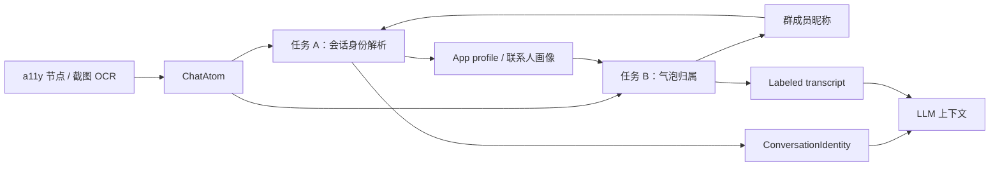

# 判断聊天气泡的主人归属可靠方法（2026-10-26）

> **二次复核修正（2026-10-26）：**
> 用户确认，上一轮上传的三张图应为：
> **新图 1 = 微信群聊，新图 2 = 飞书群聊，新图 3 = 微信群聊。**
> 上一版把新图 1/新图 3 标成「企业微信」是错的；旧图 2 的蓝色服务卡片样本才是企业微信 1:1。
> 本文以修正后的样本为准，并把「App 误识别」和「会话身份误匹配」列为一等风险。
>
> **第三次重构（2026-10-27）：** 全文按两个核心问题重新组织：
> **A 会话身份解析**（App + 标题/成员 -> 联系人/群画像）与
> **B 气泡发言归属**（每条气泡 -> 我/对方/群成员/机器人/系统）。
> **App 识别只是 A 的输入，不是目的**；A 匹配不到就走“关联已有/新建画像”，
> B 不确定就弃权；两者都不允许用单一边缘、颜色或关键词硬判。
>
> **目标：** 只解决两个核心问题：
> ① **这是哪个 App、哪个联系人/群的对话？** —— 用 App + 会话标题确定“对方是谁”，
>    匹配已有联系人画像；匹配不到就进入“关联已有 / 新建画像”流程。
> ② **聊天里的每条气泡分别是谁说的？** —— 输出
>    「对方说：… / 我说：… / 群成员 X 说：…」的结构化对话，方便 LLM 分析。
>
> **约束：** 速度优先；不为归属增加第二次 OCR；不修改上游 `device:api` / `device:impl`；
> 聊天正文不落盘。
>
> **一句话结论：** ML Kit 只负责读字和给行框。可靠方案必须把「会话身份解析（A）」
> 和「气泡发言归属（B）」拆成两条流水线，共享 App/标题/成员证据，但各自有输出契约、
> 置信度和失败降级；绝不能把“识别 App”当成目的，也不能用单一边缘/颜色/关键词硬判。

---

## 0. 先修正样本：三张图分别是什么

| 代号 | 对应样本 | 正确 App | 会话类型 | 关键画面 |
|---|---|---|---|---|
| N1 | 新图 1（`6a1dea…`） | **微信** | 群聊 | 标题「滔为智能专+ZL22…-ZL2224720(9)」；左侧未读角标「21」；左侧白气泡上方有「T吴总」「顾伟励\|专利商标版权知产」；居中「撤回了一条消息」 |
| N2 | 新图 2（`473495…`） | **飞书** | 群聊 | 标题「80lili+topway」；「外部」徽章；「3 名群成员 1 个机器人」；左侧「用户227235」「80lili 机器人」；系统入群提示 |
| N3 | 新图 3（`e1c4b9…`） | **微信** | 群聊 | 标题「滔为财务群(3)」；左侧「张玉洁 @微信」「吴瑞曦」；底部群工具条「企业名片 / 发起收款 / 快捷回复 / 推荐客服」 |
| W1 / W2 | 旧图 1 / 旧图 3 | 微信 | 1:1 | 右侧绿色气泡、左侧白色气泡、底部「按住 说话」 |
| Q1 | 旧图 2 | **企业微信** | 1:1 | 标题「吴瑞曦」；左侧青蛙头像 PDF；蓝色「收到文件/发票识别」服务卡片；底部「发消息或按住…」 |
| F1 | 旧图 4 / 旧图 5 | 飞书 | 1:1 | 标题「财务老刘」；底部「发送给 财务老刘」+ 展开；右侧回执 |

### 0.1 上一版错在哪里

| 错误 | 根因 | 修正 |
|---|---|---|
| 把 N1/N3 标成企业微信 | 看到白气泡、群工具条、类似企业微信的群结构，就按“像不像”猜 App | **包名优先**；没有包名时 UI 指纹必须 2-of-3 且低置信度要弃权/让用户确认 |
| 把 Q1 标成微信 | 蓝色服务卡片靠右，被当成普通聊天气泡 | 服务卡片按外层消息行/卡片类型判；**右边缘和蓝色都不等于“我”** |
| 把 F1 标成「企微/飞书」 | 飞书与企业微信都可能白气泡，单看气泡颜色无法区分 | 飞书用「发送给 X」「外部/群成员/机器人」等组合指纹；仍以包名为准 |
| 把“识别 App”当成最终目的 | App 只是手段 | App 识别服务于：选 App profile、组成会话键、解析群成员、正确分边 |

**N3 的「企业名片/发起收款/快捷回复/推荐客服」是微信群里的小程序/群工具入口，
不是企业微信独有的证据。** 这是本次误判的关键教训：**不要用单个 UI 元素给 App 定案。**

---

## 1. 两个核心问题：A 与 B 必须分开

### 1.1 问题 A：会话身份解析（Conversation Identity）

要回答：

- 这是哪个 App？（微信 / 企业微信 / 飞书 / 未知）
- 这是 1:1 还是群聊？
- 1:1 的对方是谁？群聊的群名是什么、成员有哪些？
- 这个会话对应已有的哪个联系人/群画像？
- 如果没有匹配，是“关联已有”还是“新建画像”？

输出契约：

```kotlin
enum class AppKind { WECHAT, WECOM, FEISHU, UNKNOWN }
enum class ChatType { ONE_TO_ONE, GROUP, UNKNOWN }

data class ConversationIdentity(
    val app: AppKind,
    val packageName: String?,
    val chatType: ChatType,
    val title: String?,              // 原始主标题
    val contactName: String?,        // 1:1 对方显示名
    val groupName: String?,          // 群聊群名
    val memberNames: List<String>,   // 群聊可见成员显示名（已剥离 @微信/机器人标签）
    val match: ProfileMatch,
    val confidence: Float,
    val evidence: Set<IdentityEvidence>,
)

sealed interface ProfileMatch {
    data class Matched(val contactId: Long, val displayName: String, val score: Float) : ProfileMatch
    data class Candidate(val key: ConversationKey, val displayName: String) : ProfileMatch
    data class Ambiguous(val candidates: List<String>) : ProfileMatch
    data object NoTitle : ProfileMatch
}

data class ConversationKey(
    val app: AppKind,
    val packageName: String?,
    val chatType: ChatType,
    val normalizedTitle: String,
)
```

**关键原则：**

- `App + 标题` 才是会话键；不能只凭“联系人名字”跨 App 合并画像。
- 1:1：`contactName = 主标题`；群聊：`groupName = 主标题`，成员来自气泡上方昵称。
- 匹配到 -> 用已有画像；匹配不到 -> `Candidate`，进入关联/新建；多个相近 -> `Ambiguous`，
  不自动合并、不自动建重复档案。
- 群聊先建/匹配“群画像”，不要因为看到几个昵称就批量新建成员画像。
- App 未知时仍可保留 `title` 做候选；但不要套用某个 App 的颜色/布局 profile。

### 1.2 问题 B：气泡发言归属（Utterance Attribution）

要回答：每个气泡/消息块是谁说的。

输出契约：

```kotlin
enum class Speaker { SELF, OTHER, GROUP_MEMBER, BOT, SYSTEM, UNKNOWN }
enum class Kind { TEXT, QUOTE, CARD, VOICE, FILE, FORWARD }

data class ChatUtterance(
    val speaker: Speaker,
    val text: String,                 // 群昵称/系统词已剥离
    val memberName: String? = null,   // GROUP_MEMBER 必填
    val kind: Kind = Kind.TEXT,
    val order: Int,                   // 屏幕从上到下
    val box: Rect,
    val confidence: Float,
    val evidence: Set<UtteranceEvidence>,
)
```

最终给 LLM 的格式必须是带标签的对话，而不是裸文本：

```text
[会话] App=微信, 类型=1:1, 对方=财务老刘, 画像=已匹配#123
[对方] 你上月报销有些问题
[我] 好的好的，收到领导，明天搞定
```

```text
[会话] App=飞书, 类型=群聊, 群=80lili+topway, 画像=已匹配群#45
[群成员:用户227235] @80lili 这里上传发票吗？
[机器人] 抱歉，您的问题超出……业务范围
[系统] 7月1日 22:42
```

**关键原则：**

- 一条气泡只投一票；多行消息不能拆成“上半句我、下半句对方”。
- 群昵称、日期、输入框提示、服务卡片内部文字不得混进正文。
- 系统消息/机器人/卡片独立标注，不默认归给“对方”。
- `UNKNOWN` 保留原文但不归属；宁可弃权，不要硬判。

### 1.3 A 和 B 的关系：共享证据，但不互相阻塞



- A 需要：包名/前台、标题、群标题、成员昵称。
- B 需要：App profile（若 A 已确定）、气泡行框、颜色、头像、群昵称、自发送锚点。
- 群成员昵称既是 A 的成员证据，也是 B 的发言归属证据；先抽昵称，再并行。
- **A 未确定时，B 不能停摆**：短气泡仍可按通用几何分边；长气泡/颜色相关规则降权或弃权。
- **B 未完成时，A 也不该被阻塞**：A 只用标题/包名也能匹配画像；成员列表可以后续补。
- 只有“人设语义复核”必须等 A 给出联系人/群画像后再做，且只针对 `UNKNOWN`。

---

## 2. 任务 A：会话身份解析（App + 标题/成员 -> 联系人/群画像）

### 2.1 App 识别优先级

**优先级 0：包名（决定性）**

| 来源 | 说明 |
|---|---|
| 自动模式已选 `ChatChannel.imPackage` | 已知，直接加载对应 profile；仍需校验实际前台/标题 |
| a11y `foregroundPackage()` | 精确，最快 |
| a11y 关闭但 Shizuku 可用 | `ShizukuInjector.foregroundPackage()` 走 `dumpsys`，可取 `com.tencent.mm` / `com.tencent.wework` / `com.ss.android.lark` 等 |
| 连续模式 | 首帧/切换时取一次并缓存，不要每帧跑 dumpsys |

**优先级 1：UI 指纹（没有包名时）**

必须 2-of-3 命中，禁止单关键词/单颜色定案：

1. **标题/头部结构**：`外部`、`外部群`、`群成员`、`机器人`、群名尾 `(n)`；
2. **底部/输入区结构**：`发送给 X`、展开编辑、`按住 说话`、`发消息或按住…`；
3. **视觉/布局**：自己气泡色、对方气泡色、背景、头像列、回执、标题带高度、底部栏高度。

| App | 决定性证据 | 辅助证据 | 已知误判风险 |
|---|---|---|---|
| 微信 | `com.tencent.mm` | 绿色自己气泡（浅色主题常见 `#95EC69` 附近，实际采样为准）；群聊昵称在气泡上方；底部「按住 说话」/「发消息」；群工具条可能含「企业名片/发起收款/快捷回复/推荐客服」 | 微信群工具条/群结构与企微相似，**不能拿这些单独判企微** |
| 企业微信 | `com.tencent.wework` | 蓝色服务卡片；已读状态；工作台/企业群结构；底部「发消息或按住…」 | UI 可能与微信高度相似；旧图 Q1 才是企微样本 |
| 飞书 | `com.ss.android.lark`（海外 Lark 为变体） | 底部「发送给 X」+ 展开；头部「外部/群成员/机器人」；「用户227235」「80lili 机器人」；入群系统提示；自己浅蓝/回执 | 白气泡与企微相似；颜色随主题变化 |
| 未知 | — | — | 置信度不足时 `APP_UNKNOWN`，不套任何 App 的颜色/边距 profile |

**识别 App 的目的不是显示一个名字，而是：**

1. 选该 App 的 `ChatLayoutProfile`，给 B 提供边距/颜色/头像列/回执规则；
2. 用 `(App, 标题)` 组成 `ConversationKey`，匹配/新建联系人画像；
3. 群聊时按该 App 的成员标签规则解析群成员。

### 2.2 标题解析：主标题、副标题、角标分开

- 优先 `windowTitle()`（a11y）；没有 a11y 时 OCR 标题带。
- 标题带内按**字号高度**选主标题，不选副标题/徽章：
  - N2：主标题「80lili+topway」字号大于「3 名群成员 1 个机器人」；
  - N1/N3：主标题是群名，`(n)` 是成员数，`21` 可能是未读角标；
  - W1/W2：主标题是联系人/群名。
- 规范化时：
  - 去过期未读角标（`21`、`(9)` 等，按位置判断）；
  - 去掉「外部」「外部群」「群成员」「机器人」等副标题；
  - 群名尾 `(n)` 保留 raw，匹配时可去；
  - 复用 `ContactNames.normalize` / `ContactRepository.resolve` / `resolveGroup`；
  - 但**不要复用上游接口本身来做 App 判定**；App 判定是新 app 层逻辑。

### 2.3 画像匹配：Matched / Candidate / Ambiguous

```text
1. 归一化标题、包名、会话类型
2. 1:1：
   a. ContactRepository 按 (package, 标题/别名) 精确/模糊匹配
   b. 命中 -> Matched
   c. 未命中 -> Candidate（等待关联/新建）
3. 群聊：
   a. 先用标题匹配群画像（resolveGroup）
   b. 昵称列表作为成员证据；不要用群标题当成员
   c. 群命中 -> Matched；未命中 -> 群 Candidate
4. 多个近似候选 -> Ambiguous，禁止自动合并/自动新建
5. 标题缺失 -> NoTitle；仍保留 App + 可见成员，等待后续绑定
```

**新建/关联流程：**

- `Matched`：直接使用画像（含对方人设、历史、称呼）。
- `Candidate`：进入“关联已有 / 新建画像”卡片或队列；卡片预填 App、标题、群名、
  可见成员、最近一条对方来信，用户确认后落库。
- `Ambiguous`：列出候选，让用户选；不自动选最像的。
- 自动模式已选联系人：作为强先验；但若实际标题/前台不符，降级为 Candidate，
  **不要覆盖或串用已选画像**。
- 同一名字在不同 App 默认是不同画像；跨 App 同一人需用户显式关联。

### 2.4 标题/成员/画像的边界

- 1:1 标题 = 对方；这是“对方是谁”的主依据。
- 群标题 = 群；不是成员，也不是“对方”。
- 群成员 = 气泡上方昵称；匹配已有联系人用别名/历史，未匹配保留显示名。
- 群聊不要求一次性建全成员画像；先群画像，成员按需关联。
- 标题和人设语义不能反推气泡归属；归属仍由 B 的版面证据决定。

---

## 3. 任务 B：气泡归属

### 3.1 证据表（按可靠性/成本）

| 证据 | 提取 | 适用 | 建议初始权重 | 备注 |
|---|---|---|---|---|
| a11y 行容器/精确 bounds | 节点树、父容器、头像子节点 | a11y 开 | 0.50 | 最可靠，可到行级 |
| 群昵称 | 气泡上方小字/节点 | 群聊 | 0.50 | 决定成员身份；我方无昵称 |
| 自发送锚点 | RPA 刚发送文本 + 时间 | 自动/自动回复 | 0.50 | 模糊匹配右下气泡，极高置信 |
| 气泡颜色 | 3×3 中位数 + profile | 微信强；企微/飞书弱 | 0.30 | 只在可信 profile/主题下用 |
| 左右边缘/中心 X | 气泡块而非文字行 | 短气泡 | 0.25 | 满宽长气泡降权/禁用 |
| 头像列 | 左/右列非背景小块 | 通用 | 0.15 | 头像可能只在组首条 |
| 回执/已读 | 气泡右下 ✓/已读 | 飞书/企微 | 0.10 | 辅助，不可单用 |
| 时序差分 | 新气泡出现 | 连续模式 | 0.10 | 用户可能手动发，低权 |
| 标题/人设语义 | 标题匹配 + 人设风格 | 仅 `UNKNOWN` | 0.05 | 只复核，不覆盖版面 |

权重是初始建议；必须按 App/主题真机回归调参。

### 3.2 气泡分组：一条气泡只投一票

1. 按 `top` 升序、`left` 升序排序。
2. 相邻行满足任一条件则开新气泡：
   - `gap > max(0.7 × medianLineHeight, 10dp)`；
   - 背景/气泡色变化（可采样时）；
   - 中间夹时间/系统消息；
   - 水平重叠率过低。
3. 群昵称行单独标记 `SENDER_LABEL`，挂到下方气泡，不并入正文。
4. 连续多条同侧消息宁可分开，不要合并成一条。
5. 卡片/语音/文件的外层是一个 `ChatUtterance`；内部文字跟随外层，不单独分边。

### 3.3 硬规则（先跑，低成本）

```text
居中日期/撤回/入群/正在输入                 -> SYSTEM
群昵称挂载成功（含 @微信/机器人）            -> GROUP_MEMBER / BOT
a11y 行容器明确在右                         -> SELF
a11y 行容器明确在左                         -> OTHER / GROUP_MEMBER
RPA 自发送锚点命中                          -> SELF (0.98)
短气泡(width < 0.6W) 右对齐、左侧不贴边      -> SELF
短气泡(width < 0.6W) 左对齐、右侧不贴边      -> OTHER
```

“贴边”用相对屏宽比例 + App profile 的左右内容边距；宽度 ≥ `0.65W` 视为满宽块，
禁止仅凭边缘判。

### 3.4 软规则（只对满宽/冲突块）

```text
scoreSelf  = wEdge*rightAligned + wColor*selfColor + wAvatar*rightAvatar + wRead*selfRead + wAnchor*anchor
scoreOther = wEdge*leftAligned  + wColor*otherColor + wAvatar*leftAvatar  + wRead*otherRead
margin = top1 - top2
if top1 < MIN_SCORE or margin < MIN_MARGIN -> UNKNOWN
```

- 颜色采样每个气泡只取 2-3 个点，每点 3×3 中位数；只对模糊块做。
- 先判背景，再比调色板；深色主题单独 palette；颜色两方都接近 -> 弃权。
- 服务卡片/机器人卡片的蓝色不进入 `selfPalette`；右边缘不决定归属。
- 群昵称优先于颜色；颜色优先于语义；语义只兜底。

### 3.5 决策卡

| 观察 | 结论 |
|---|---|
| 右侧短气泡，左侧空白 | `SELF` |
| 左侧短气泡，右侧空白 | `OTHER` |
| 满宽 + 自己气泡色 + 右侧头像 | `SELF` |
| 满宽 + 对方气泡色 + 左侧头像 | `OTHER` |
| 群聊左侧 + 昵称「张玉洁 @微信」 | `GROUP_MEMBER("张玉洁")` |
| 群聊右侧 + 无昵称 | `SELF` |
| 居中日期/撤回/入群 | `SYSTEM` |
| 昵称含「机器人」/机器人图标 | `BOT` |
| 服务卡片靠右、无右侧发送者证据 | 不判 `SELF`；按外层行/发送者判 |
| 昵称缺失/同名/证据冲突 | `UNKNOWN` / `UNKNOWN_MEMBER` |

### 3.6 置信度建议

| 置信度 | 用途 |
|---|---|
| ≥ 0.90 | 可用于自动发送/自动回复触发、画像写入 |
| 0.80–0.90 | 可用于参谋上下文、人工确认提示 |
| 0.65–0.80 | 只作参考，标 `[可能:我/对方]`，不自动执行 |
| < 0.65 | `UNKNOWN`，保留原文但不归属 |

自动执行只消费 `OTHER` 且 ≥0.90 的真人文本；`BOT` / `CARD` / `SYSTEM` 不触发自动回复。

---

## 4. a11y 模式（A + B 完整线）

### 4.1 采集：要节点，不要扁平字符串

现状：

- `ScreenPerceiver.readA11yText()` 返回 `joinToString("\n")` 的纯字符串；
- `AssistsA11yBridge.screenText()` 只收集 `text/contentDescription`，没有 bounds；
- 结果只能继续用 `IncomingCue` 扁平启发，无法分边。

建议新增 **app 层** `A11yChatReader`（不改 `device:api`）：

```kotlin
data class A11yChatSnapshot(
    val packageName: String?,
    val windowTitle: String?,
    val titleAtoms: List<ChatAtom>,
    val messageAtoms: List<ChatAtom>,
    val scrollableNodeKey: String?,
)
```

- 用现有 `AssistsCore.getAllNodes()` / `AccessibilityService` 根节点遍历一次；
- 收集 `text/contentDescription`、`Rect`、`className`、`viewIdResourceName`、
  `isEditable`、`isScrollable`、`isVisibleToUser`、父节点 key；
- 过滤零面积、不可见、输入法窗口、系统状态栏；
- 一次遍历最多 400 节点；不要对每个气泡调 `findText`。

### 4.2 A：会话身份

- `packageName` 直接给 `AppKind`；
- `windowTitle()` 给标题；
- 群聊昵称节点给 `memberNames`；
- 输入框/发送按钮/工具栏节点不参与标题/成员；
- 调 `ConversationIdentityResolver` 得 `ConversationIdentity`；
- 标题/包名缺失时，仍返回 `Candidate`/`NoTitle`，不要空转。

### 4.3 B：气泡归属

- 找聊天内容区的最大可滚动容器；
- 按纵向聚类消息行：头像节点、气泡/文本节点、可选昵称节点；
- 分边：
  - 行/气泡中心在右，或右缘贴右内容边 -> `SELF`；
  - 中心在左，或左头像列有头像 -> `OTHER`；
  - 昵称节点在气泡上方 -> `GROUP_MEMBER`；
  - 居中且无行容器 -> `SYSTEM`；
- 缓存 App 的 `viewId`/容器特征；自动模式直接定位，单次/连续先通用后学习。

### 4.4 失败与降级

以下情况降级截图 OCR，并标记 `source=OCR`：

- 聊天区文本节点 < 阈值（例如 3 行）；
- 所有文本在一个巨型节点（WebView/Flutter/自绘）；
- 行/气泡 bounds 大量重叠或为零；
- 标题/正文明显缺失；
- 节点树过期/滚动后未刷新。

a11y 不是绝对可靠；IM 也可能对 a11y 做风控。降级必须有原因，不能把空结果当“无消息”。

### 4.5 速度

- 无截图/OCR，通常最快；
- 一次树遍历 + O(N) 分类；
- 缓存 App 行容器特征；
- 主线程不做遍历/分类。

---

## 5. 无 a11y 模式（A + B 完整线）

### 5.1 采集：一次 OCR，保留行框

- 截图走现有 `ScreenCapture`（投影/Shizuku）或 `FrameDiffEngine` 已有帧；
- OCR 用 `OcrProvider.recognize(bytes)`，**不要用 `recognizeText()`**；后者只返回字符串；
- `MlKitOcrProvider` 已把 `line.boundingBox` 写入 `OcrLine`；这是分边原料；
- 复用已解码 `Bitmap` 做颜色采样；不要为取色再 decode/压缩；
- 底部输入带继续掩膜；标题带单独保留给 A。

### 5.2 A：App 识别

**先包名：**

- a11y 关但 Shizuku 活：`ShizukuInjector.foregroundPackage()`；
- 连续模式首帧/切换时取一次并缓存，不每帧 dumpsys；
- 自动模式已选 `imPackage`，直接已知并校验。

**没有包名再 UI 指纹：**

- 一次**底部带小 OCR** 读「发送给 X」「按住 说话」等（只在识别 App 时做一次，缓存）；
- 标题带 + 头部结构 + 气泡色/布局；
- 2-of-3 命中；top1 ≥ 0.65 且与 top2 差 ≥ 0.15 才锁定；
- 否则 `APP_UNKNOWN`，用通用 profile。

**重要：**

- `ScreenAdvisor.recognizeCleanBody` 在 OCR 前会掩膜底部带，所以底部指纹不在正文里；
  这也是为什么要“首帧单独小 OCR”，而不是每帧全屏 OCR。
- 微信/企微 UI 有重叠，**没有包名时不要硬判**；低置信度让用户确认，避免再次把
  微信群聊判成企业微信。

### 5.3 B：气泡归属

- `ChatAtom` 来自 `OcrLine` 行框；
- 分组按 §3.2；
- 短气泡几何；满宽用颜色/头像/回执；群聊昵称单独挂载；
- 颜色采样只对模糊块；服务卡片/机器人卡片颜色不进入 self palette；
- 连续模式只判新增/变化气泡；
- 多屏滚动合并 `ChatUtterance`，不合并成裸文本。

### 5.4 颜色/profile 的使用边界

- 只有 A 的 App 置信度足够（包名精确或指纹 2-of-3 锁定）才用该 App 的调色板；
- 否则用通用 profile：
  - 短气泡几何仍可用；
  - 满宽长气泡颜色不采信，直接 `UNKNOWN`；
  - 群昵称仍可判成员；
- 学习只从高置信样本（a11y 行、短右气泡、自发送锚点）进行；
- 只存颜色/布局，不存聊天正文。

### 5.5 连续/多屏

- 首帧识别 App/标题/画像，锁定 `ConversationIdentity`；
- 后续 A 不重复识别，B 增量；
- 滚动只改 y，不改左右归属；`x` 相对屏幕稳定；
- 切 App/标题变化/主题变化 -> 重识别 A，带回差/滞回；
- `MultiScreenStitcher` 按 `(speaker, memberName, normalizedText, box overlap)` 去重。

---

## 6. 自动 / 单次 / 连续模式矩阵

| 模式 | A：App + 联系人 | B：气泡归属 | 画像行为 | 置信度 |
|---|---|---|---|---|
| 自动模式 | 已选 App + 联系人；校验实际前台/标题 | 直接加载该 App profile；a11y 行或 OCR 色+几何 | 已选画像优先；标题不符降 Candidate，不覆盖 | 最高，可到 A 档 |
| 单次模式 | 包名（a11y/Shizuku）-> UI 指纹 -> 标题 | App 未知则通用 profile；短气泡几何，长气泡弃权 | 匹配不到 -> Candidate；提示关联/新建 | 中；A 锁定后升 B/A |
| 连续模式 | 首帧识别并锁定；标题变化重识别 | 首帧同单次；后续只判新增/变化气泡 | 锁定画像；变化时重匹配，不串用 | 中高；锁定后升 B/A |

### 6.1 自动模式

- `ChatChannel` 已选 App/联系人：A 基本是“验证”；
- 加载对应 `ChatLayoutProfile`，B 最稳、最快；
- 仍校验实际 `foregroundPackage` 和标题：
  - 不符 -> 不要套旧 profile；进入 Candidate/重新识别；
- 可用 RPA 自发送文本锚点锁死自己气泡。

### 6.2 单次模式

- 用户单击悬浮球，不知道 App/联系人；
- A 必须先识别 App + 标题，再匹配画像；
- B 不等 A：短气泡通用几何先分；A 锁定后用 App profile 复核；
- 画像匹配不到 -> Candidate，提示“关联已有/新建”，不静默建重复档案。

### 6.3 连续模式

- 首帧做一次完整 A + B；后续 A 缓存、B 增量；
- 标题/包名变化才重识别；
- 对 A 的 App/联系人切换加滞回（连续 2 帧一致才切）；
- 不为每帧做底部小 OCR/dumpsys/全屏 App 指纹。

**再次强调：单次/连续识别 App 的目的不是“知道 App 名字”，而是为了
A 的会话画像匹配和 B 的 App profile 分边；App 识别失败时，A/B 仍要各自降级运行。**

---

## 7. 群聊：A 和 B 分别怎么处理

### 7.1 A：群身份

- 群标题 = 群名；`(n)` = 成员数；`21` 可能是未读角标，不是标题；
- `resolveGroup(package, 群名)` 匹配群画像；
- 群成员来自气泡上方昵称，不是群标题；
- 机器人/外部成员单独标记，不进入真人画像匹配；
- 群未匹配 -> 群 Candidate；不要因为看到成员就批量新建个人画像。

### 7.2 B：成员归属

三层文本：

1. **群标题**：群档案，不是成员，不是气泡主人；
2. **发送者昵称行**：N1「T吴总」「顾伟励|专利商标版权知产」；N3「张玉洁 @微信」
   「吴瑞曦」；N2「用户227235」「80lili 机器人」；
3. **气泡正文**：去掉昵称后的内容，才进入 `ChatUtterance.text`。

规则：

- 左侧 + 昵称 -> `GROUP_MEMBER(nickname)`；
- 右侧 + 无昵称 -> `SELF`（再结合颜色/头像/锚点）；
- 右侧 + 有昵称 -> 先怀疑引用/转发/系统卡片，不直接当成员；
- 昵称含「机器人/Bot/助手」-> `BOT`；
- 昵称缺失/头像无可读描述 -> `UNKNOWN_MEMBER`，不默认成 `OTHER`；
- 昵称规范化：
  - `张玉洁 @微信` -> 显示名 `张玉洁`，标签 `@微信`；
  - `顾伟励|专利商标版权知产` -> 匹配时尝试整串、`|` 前段；
  - `用户227235` -> 保留 raw，不强匹配；
  - 同名成员 -> 头像/节点/历史消歧，否则 `UNKNOWN_MEMBER`。

### 7.3 样本对应

| 样本 | A（身份） | B（归属） |
|---|---|---|
| N1 微信群聊 | 群「滔为智能专+…(9)」；成员 T吴总、顾伟励… | 左侧白气泡 = 对应成员；居中撤回 = SYSTEM；无自己气泡则不造 SELF |
| N2 飞书群聊 | 群「80lili+topway」；外部群；3 名成员 + 1 机器人 | 左侧「用户227235」= GROUP_MEMBER；「80lili 机器人」= BOT；入群提示 = SYSTEM |
| N3 微信群聊 | 群「滔为财务群(3)」；成员 张玉洁 @微信、吴瑞曦 | 左侧白气泡 = 对应成员；底部群工具条不是消息；群标题不是成员 |
| Q1 企业微信 1:1 | 对方「吴瑞曦」；企微 1:1 | 左侧 PDF = OTHER；蓝色服务卡片 = BOT/CARD；不因右边缘判 SELF |
| W1/W2 微信 1:1 | 对方标题；微信 1:1 | 右绿 = SELF；左白 = OTHER |
| F1 飞书 1:1 | 对方「财务老刘」；飞书 1:1 | 右侧/回执辅助 = SELF；左侧蓝头像 = OTHER；回执不是唯一证据 |

---

## 8. 标题、联系人与双方人设的正确用法

### 8.1 标题

- 1:1：标题用于 A 确定对方是谁；
- 群聊：标题用于 A 确定群，不决定成员；
- 标题不参与 B 的单条气泡分边；B 的版面证据优先。

### 8.2 人设语义

只用于 `UNKNOWN` 的低权重复核：

```text
visualTop1 / visualTop2 的分数差 < margin
且二者都 < 0.80
-> 用双方人设/说话风格做一次批量复核
-> 若 selfFit - otherFit > 阈值：选高者
-> 否则 UNKNOWN
```

适用：

- 1:1 某条气泡视觉证据冲突；
- 群聊昵称缺失/同名，需成员人设辅助确认；
- 标题与正文发言人冲突时的实体判别（现有 `EntityResolver` 的保守门控）。

不适用：

- 版面/颜色/昵称已强证据时，语义不得反转；
- 不能逐条气泡调 LLM；
- 不能因为“像领导口吻”就把右侧绿色气泡判成对方。

### 8.3 给 LLM 的会话头

在对话前加一行会话身份，避免 LLM 自行猜：

```text
[会话] App=微信, 类型=1:1, 对方=财务老刘, 画像=已匹配#123
[会话] App=飞书, 类型=群聊, 群=80lili+topway, 画像=群候选(未绑定)
```

画像未匹配时也要继续，标 `候选/未绑定`；不要让 LLM 把“未绑定”当成“没有对方”。

---

## 9. 置信度、冲突与画像写入

### 9.1 A 的置信度

| 条件 | 建议 |
|---|---|
| 包名精确 + 标题精确/别名 | ≥0.95，Matched |
| 包名精确 + 标题模糊 | 0.80–0.95，Matched/Candidate，视别名质量 |
| 标题精确 + App 指纹 2-of-3 | 0.75–0.90，可 Matched，但 App 可提示确认 |
| 只有标题/指纹低置信 | 0.50–0.75，Candidate/Ambiguous |
| App/标题都缺失 | <0.50，NoTitle/Unknown |

**错误画像合并的代价高于新建候选**：宁可 Candidate，不要自动合并。

### 9.2 B 的置信度与冲突

冲突优先级：

1. a11y 精确行容器
2. 群昵称
3. 自发送锚点
4. 可信 profile 下的气泡颜色
5. 短气泡几何
6. 头像列
7. 时序差分
8. 人设语义

- a11y vs OCR：a11y 精确行优先；a11y 稀疏/合并时 OCR 优先；
- 颜色 vs 几何：微信浅色绿色优先；企微/飞书不要用颜色压几何；
- 昵称 vs 颜色：昵称优先；
- 两项强证据互斥且无锚点 -> `UNKNOWN`。

### 9.3 画像写入边界

- 自动模式已选画像：只更新非文本特征/记忆，不在标题不符时改写绑定；
- 单次/连续：`Matched` 才能写画像；`Candidate` 等用户确认；`Ambiguous` 禁止写入；
- 群聊只写群画像；成员按需关联，不批量建卡；
- 跨 App 同名默认不合并；用户显式关联后才共享；
- 只存颜色/布局/画像元数据，不存聊天正文。

---

## 10. 性能设计

### 10.1 成本拆分

| 步骤 | A | B | 频率 |
|---|---|---|---|
| 包名 | a11y/Shizuku/已选 | — | 每会话一次，缓存 |
| 标题 OCR | 标题带一次 | — | 每会话/标题变化 |
| 底部小 OCR | 无包名时一次 | — | 仅 App 识别，不每帧 |
| 全屏 OCR | — | 一次 `recognize` | 每帧/变化帧 |
| 气泡分组/分边 | — | O(N) | 每帧/变化帧 |
| 取色 | — | 仅模糊块 2-3 点 × 3×3 | 少量 |
| 语义复核 | — | 仅 `UNKNOWN` 批量 | 低频/默认关闭 |

### 10.2 工程约束

- A 每会话一次，B 每帧/变化一次；不要每帧重复 A。
- a11y 线无截图/OCR；无 a11y 线仍只跑一次 OCR。
- 复用 `Bitmap`；避免重复 decode/压缩。
- 连续模式只判新增/变化气泡；缓存上一帧 utterance。
- 分类在 `Dispatchers.Default`，主线程只更新 UI。
- 不引入 OpenCV/轮廓检测；不做逐气泡模板匹配；不逐条调 LLM。
- 分类器 p95 目标 <5ms；ML Kit 仍是主要成本。

### 10.3 不要做

- 不要用单一边缘/蓝色服务卡片判“我”。
- 不要用单个 UI 关键词判企微/微信。
- 不要在 A 未定时套用某 App 的颜色 profile。
- 不要把群标题当成员。
- 不要为了分边做第二次 OCR/全图聚类。
- 不要在 `UNKNOWN` 时强行填 `OTHER`。

---

## 11. 本仓库落位

### 11.1 现状断点

| 位置 | 现状 | 影响 | 改法 |
|---|---|---|---|
| `MlKitOcrProvider.kt:51-64` | 已输出 `OcrLine` 行框 | 原料足够 | 不改 |
| `OcrProvider.kt:35-38` | `recognizeText()` 只返回字符串 | 用它做正文会丢坐标 | 聊天正文只走 `recognize()` |
| `ScreenAdvisor.recognizeCleanBody` | `clean` 后 `joinToString` | B 无法分边 | join 前接 `ChatSideClassifier` |
| `FrameDiffEngine.recognizeCleanBody` | 同上；`titleLines` 未返回 | 连续模式 A/B 都缺标题 | 返回 `ChatUtterance` + 标题带 |
| `MultiScreenStitcher` | 合并后 `joinToString` | 滚动后归属丢失 | 合并 `ChatUtterance`，按 side+text 去重 |
| `ScreenPerceiver.readA11yText` / `screenText` | 只返回扁平字符串 | a11y 无法分边/A 标题 | 新增 app 层带 bounds 的 `A11yChatReader` |
| `ScreenAdvisor.resolveContact` | 包名 + 标题 + 扁平 `speakerOf` | 无 a11y 时包名缺失；群昵称无冒号会漏 | 用 `ConversationIdentityResolver` 的 App/标题/成员证据 |
| `IncomingCue.latestIncoming` / `speakerStatsOf` | 扁平文本 + 「名字：」启发 | 群昵称无冒号；最后来信可能误取 | 优先消费结构化 `ChatUtterance`，旧逻辑仅兜底 |
| `EntityResolver` | 同一套「名字：」 | 群成员识别受限 | 用 `GROUP_MEMBER` 列表判 Person/Group |
| `pickTitleBand` | 取首个短行 | 飞书副标题/角标可能抢占 | 按字号高度选主标题，剥离副标题/角标 |
| `cropBands` 先掩膜底部 | 底部指纹被裁 | 单次/连续读不到「发送给/按住」 | 首帧一次底部小 OCR，或走包名 |
| `PostSendVerifier` / RPA 发送 | 已有发送结果 | 未作为 B 的锚点 | 发送成功后缓存文本/时间，下一帧匹配 |

### 11.2 新增文件（保持上游零侵入）

建议分两个包：

`app/src/main/java/com/verlintas/baic2/floatball/identity/`

| 文件 | 职责 |
|---|---|
| `ConversationIdentity.kt` | `AppKind/ChatType/ConversationKey/ProfileMatch` |
| `ConversationIdentityResolver.kt` | A：包名 + 标题 + 成员 -> 身份/画像匹配 |
| `AppFingerprint.kt` | 无包名时的 2-of-3 UI 指纹 |
| `ContactProfileMatcher.kt` | `ContactRepository`/`resolveGroup` 匹配、Candidate/Ambiguous |
| `TitleNormalizer.kt` | 主标题/角标/副标题/群成员数规范化 |

`app/src/main/java/com/verlintas/baic2/floatball/chat/`

| 文件 | 职责 |
|---|---|
| `ChatAtom.kt` | a11y/OCR 共用中间表示 |
| `ChatBubbleGrouper.kt` | 行 -> 气泡；群昵称挂载；系统/卡片分组 |
| `ChatSideClassifier.kt` | 硬规则 + 软打分 + 置信度/弃权 |
| `ChatLayoutProfile.kt` | App/主题 profile 数据模型 |
| `ChatProfileStore.kt` | assets 默认 profile + prefs 学习覆盖 |
| `A11yChatReader.kt` | app 层带 bounds 节点采集 |
| `OcrChatReader.kt` | 截图 -> `OcrLine` -> `ChatAtom`；取色适配 |
| `ChatTranscriptFormatter.kt` | `[会话]/[我]/[对方]/[群成员]/[机器人]/[系统]` 格式化 |

### 11.3 接入点

- **A**：
  - `ScreenAdvisor.resolveContact` 用 `ConversationIdentityResolver` 的结果；
  - `lastChatCandidate`/快速绑定卡片消费 `ProfileMatch.Candidate`；
  - `EntityResolver` 用 `GROUP_MEMBER` 成员列表判 Person/Group；
  - 自动模式用 `ChatChannel.imPackage` + 联系人校验。
- **B**：
  - `ScreenAdvisor.recognizeCleanBody`：`clean` 后、join 前分边，输出带标签正文；
  - `FrameDiffEngine.recognizeCleanBody`：复用 bitmap，返回 utterance + 标题；
  - `MultiScreenStitcher`：合并 utterance；
  - `ScreenPerceiver`：a11y 优先 `A11yChatReader`；
  - `IncomingCue`：新增 `latestIncoming(utterances)`，优先最后一条 `OTHER/GROUP_MEMBER`；
  - `ChatBriefBuilder`/`AdvisorHistory`：消费带标签 transcript。
- **profile**：
  - `chat_profiles.json` 放 assets；学习覆盖存 prefs；
  - 骨架含颜色/边距/头像列/回执/底部/标题指纹；不存正文。

### 11.4 约束

- 不改 `device:api` / `device:impl`；`OcrLine` 现有字段足够。
- 新 `.kt` 文件带 GPL-3.0-or-later 头。
- 用户可见文案进 `strings.xml`。
- 临时截图只放 `tests/tempImg/`，不进版本库。
- 聊天正文不落盘；profile 只存非文本特征。

---

## 12. 测试与验收

### 12.1 A 的测试

| 样本 | 期望 A |
|---|---|
| N1 微信群聊 | App=WECHAT；群「滔为智能专+…(9)」；成员 T吴总/顾伟励…；群 Candidate/Matched |
| N2 飞书群聊 | App=FEISHU；群「80lili+topway」；成员 用户227235；机器人 80lili；群 Candidate/Matched |
| N3 微信群聊 | App=WECHAT；群「滔为财务群(3)」；成员 张玉洁/吴瑞曦；群工具条不是消息 |
| Q1 企业微信 1:1 | App=WECOM；联系「吴瑞曦」；1:1 |
| W1/W2 微信 1:1 | App=WECHAT；联系人标题；1:1 |
| F1 飞书 1:1 | App=FEISHU；联系「财务老刘」；1:1 |

指标：

- 包名可得时 App 准确率 100%（自动模式/有 Shizuku/a11y）；
- UI 指纹无包名时 ≥95%，且低置信度必须 Unknown/确认，不能硬判；
- 联系人匹配精确/别名 ≥95%；
- 错误合并率 0；Candidate/Ambiguous 比例可接受；
- 跨 App 同名不自动合并。

### 12.2 B 的测试

| 样本 | 期望 B |
|---|---|
| W1 | 右绿 = SELF（表情、番茄长文、「？？？」、表单截图）；左白 = OTHER（bilibili、「你是谁啊」） |
| W2 | 右绿两条 = SELF；左白两问句 = OTHER |
| N1 | 左白 + 昵称 = GROUP_MEMBER；撤回 = SYSTEM；无自己气泡则不造 SELF |
| N2 | 左「用户227235」= GROUP_MEMBER；「80lili 机器人」= BOT；入群提示 = SYSTEM |
| N3 | 左「张玉洁 @微信」「吴瑞曦」= GROUP_MEMBER；群标题/工具条不是消息 |
| Q1 | 左 PDF = OTHER；蓝卡片 = BOT/CARD；不因右边缘/蓝色判 SELF |
| F1 | 右/回执 = SELF；左蓝头像 = OTHER；回执不是唯一 |

指标（建议真机标定）：

| 指标 | 目标 |
|---|---|
| 1:1 浅色整体分边准确率 | ≥95% |
| 误判率（对方<->我） | ≤2% |
| `UNKNOWN` 率（浅色 1:1） | ≤5% |
| 群聊分边准确率 | ≥90% |
| 群昵称成员识别 | ≥85% |
| 深色/自定义主题 | ≥85%，Unknown ≤15% |
| 分类器 p95 | <5ms（不含 OCR） |
| 自动发送门禁 | 仅 `OTHER` ≥0.90 且非系统/卡片 |

### 12.3 必测矩阵

- App：微信 / 企业微信 / 飞书（含包名变体）
- 会话：1:1 / 群聊 / 外部群 / 机器人
- 主题：浅色 / 深色 / 自定义
- 消息：短气泡 / 满宽长文 / 语音转写 / 文件 / 链接 / 图片 / 表单截图 /
  引用 / 合并转发 / 服务卡片 / 系统
- 布局：键盘弹起 / 输入框草稿 / 滚动 / 多屏 / 横屏（若支持）
- 模式：a11y 开/关；自动/单次/连续
- 群聊：有昵称 / 无昵称 / 同名 / 外部 `@微信` / 机器人 / 撤回

### 12.4 验收步骤

1. 纯函数单测：标题规范化、画像匹配、分组、短气泡规则、群昵称挂载、系统、冲突弃权；
2. 合成 fixture 单测：无真实聊天内容，覆盖左右/满宽/服务卡片/机器人/同名；
3. 真机人工回归：6 类样本 + 深色/键盘/滚动变体；
4. a11y 开关两轮：同一页比较 A/B 结果与耗时；
5. 单次/连续/自动三模式：确认 `ConversationIdentity` 和带标签 transcript 进入 LLM；
6. 性能：全屏 OCR 次数仍为 1 次/帧；A 不每帧重复；无新增全图扫描；
7. 回归：构建通过、无 FATAL、现有冒烟不降级。

隐私：真实截图只放 `tests/tempImg/` 本地人工回归，**不提交仓库**；
仓库单测用合成 `ChatAtom`/纯函数 fixture。

---

## 13. 风险与边界

- **微信 vs 企业微信 UI 重叠**：微信群工具条/白气泡/群结构可能像企微；
  **包名优先**，无包名时 2-of-3 + 低置信度弃权/确认；不能再用单元素判 App。
- **服务卡片/机器人**：蓝色、靠右都不等于“我”；按外层消息行/发送者判。
- **a11y 不保证完整**：WebView/Flutter/自绘、节点合并、风控关闭。
- **标题/角标/副标题**：未读角标、成员数、外部标签可能混入；按字号/位置规范化。
- **联系人重名/跨 App**：默认不合并；Candidate/Ambiguous 让用户确认。
- **群昵称重复/缺失**：`UNKNOWN_MEMBER`，不默认成对方；同名需头像/节点/历史消歧。
- **长消息/双方同色/深色主题**：允许 `UNKNOWN`，不硬判。
- **引用/转发/卡片**：内部文字可能属于别人；只归外层或标 `QUOTE/FORWARD/CARD`。
- **隐私**：聊天正文不落盘；profile 只存颜色/布局；LLM 兜底遵守现有策略。

---

## 14. 分阶段实施

### P0：先打通两个契约（最快见效）

- 新增 `ConversationIdentity` + `ChatUtterance` + `ChatTranscriptFormatter`；
- A：包名（a11y/Shizuku/已选）+ 标题 -> 联系/群画像 Matched/Candidate；
- B：短气泡几何 + 系统消息 + 群昵称挂载 + 满宽 `UNKNOWN`；
- 接入 `ScreenAdvisor`/`FrameDiffEngine`/`MultiScreenStitcher`，先输出
  `[会话]/[我]/[对方]/[群成员]/[系统]`；
- 纯函数单测 + 6 类样本人工回归。

### P1：a11y 快路径

- `A11yChatReader` 带 bounds 采集；
- A 用 package/windowTitle；B 用行容器/头像/昵称；
- 稀疏树降级 OCR；
- 自动/单次/连续共用同一核心。

### P2：无 a11y 完整线

- `AppFingerprint` + 首帧底部小 OCR；
- `ChatLayoutProfile` + 3×3 取色 + 学习；
- `ContactProfileMatcher` 的 Candidate/Ambiguous 流程；
- 自动模式 profile 校验。

### P3：增强与兜底

- RPA 自发送文本锚点；
- 同名群成员头像/节点消歧；
- 人设语义仅对 `UNKNOWN` 批量兜底；
- 校准 UI/设置项（可关闭语义兜底）；
- 真机指标调参。

---

## 15. 附录：两张快速判定卡

### A：会话身份

```text
1. 有包名？ -> App 精确
2. 无包名？ -> UI 指纹 2-of-3；不够 -> APP_UNKNOWN
3. 主标题规范化（去角标/副标题/群人数）
4. 1:1 -> ContactRepository 匹配对方
5. 群聊 -> resolveGroup 匹配群；成员来自昵称
6. 命中 -> Matched；未命中 -> Candidate；多个 -> Ambiguous
7. 跨 App 同名不自动合并
8. 未命中不阻塞 B；提示关联/新建
```

### B：气泡归属

```text
1. 居中日期/撤回/入群/正在输入          -> SYSTEM
2. 气泡上方昵称（含 @微信/机器人）       -> GROUP_MEMBER / BOT
3. a11y 行容器在右                      -> SELF
4. a11y 行容器在左                      -> OTHER / GROUP_MEMBER
5. RPA 刚发送文本命中                    -> SELF (0.98)
6. 短气泡右对齐、左侧不贴边              -> SELF
7. 短气泡左对齐、右侧不贴边              -> OTHER
8. 满宽：自己色 + 右头像/回执一致        -> SELF
9. 满宽：对方色 + 左头像一致             -> OTHER
10. 服务卡片/机器人卡片                  -> 看外层行，不按右边缘/蓝色
11. 昵称缺失/同名/证据冲突               -> UNKNOWN / UNKNOWN_MEMBER
12. 只有人设语义像某方                   -> 不单独定案
```

**最终原则：A 先确定“和谁/哪个群”，B 再确定“每句话是谁”；
A 失败不阻塞 B，B 不确定就弃权；App 识别以包名为准，UI 指纹只做低置信兜底。**
