# 好参谋系统架构手册（开发手册 · 架构篇）

> 版本 v1（2026-10-22）。本文是 `laocanmou` 分支（好参谋）的**系统总体架构手册**，
> 面向技术人员，覆盖四件事：**业务功能目标、底层实现架构、组件连接方式、模块组织方式**。
> 事实来源以代码为准；方案沿革见文末「参考文献」。与上游
> [ARCHITECTURE.md](ARCHITECTURE.md)（Nova 底座架构）配套阅读：
> 上游文档讲「底座怎么搭」，本手册讲「参谋怎么当」。

---

## 目录

1. [系统定位与业务全景](#一系统定位与业务全景)
2. [总体架构分层](#二总体架构分层)
3. [模块组织与依赖](#三模块组织与依赖)
4. [多代理协作体系（五岗 + 两器官）](#四多代理协作体系五岗--两器官)
5. [感知体系（感知器官）](#五感知体系感知器官)
6. [执行体系（执行器官 · RPA 双模）](#六执行体系执行器官--rpa-双模)
7. [大脑：回合编排（ScreenAdvisor）](#七大脑回合编排screenadvisor)
8. [策略与目标体系](#八策略与目标体系)
9. [画像与记忆体系（档案官）](#九画像与记忆体系档案官)
10. [保温机制（话题引擎）](#十保温机制话题引擎)
11. [保活体系](#十一保活体系)
12. [数据架构](#十二数据架构)
13. [AI 能力底座（上游复用）](#十三ai-能力底座上游复用)
14. [安全与治理](#十四安全与治理)
15. [端到端流程走查](#十五端到端流程走查)
16. [术语表](#十六术语表)

---

## 一、系统定位与业务全景

### 1.1 一句话定位

**「好参谋」是常驻手机本机的 AI 智能参谋军师**：智能化辅助用户进行聊天决策，
并可自动化执行聊天托管回复。用户在任何 IM（微信 / 企业微信 / 飞书 / 钉钉 / QQ /
淘宝 / 闲鱼等）里唤起悬浮球，系统悄悄完成 **感知屏幕 → 理解对方 → 决定打法 →
撰写回复 → 风控审查 → 自动执行** 的全流程，实现**目标任务驱动型自动化聊天**。

### 1.2 业务场景

- **商业销售**：跟进客户、促成交易、报价谈判
- **同事沟通**：职场分寸、向上管理、跨部门协作
- **恋爱交友**：关系推进、情感保温、话术参谋
- **亲朋好友**：日常寒暄、人情往来、节日维护

### 1.3 业务能力全景

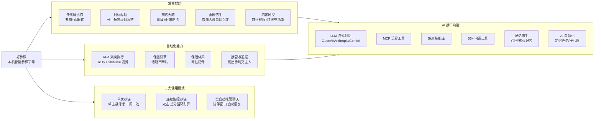

### 1.4 三大使用模式（用户视角）

| 模式             | 入口                 | 体验                                                                     | 底层                                                                  |
| ---------------- | -------------------- | ------------------------------------------------------------------------ | --------------------------------------------------------------------- |
| **单次参谋**     | 单击悬浮球           | 截屏 → OCR → 记忆召回 → LLM 流式分析 → 分屏浮窗给参考答案；用户零等待感  | `Mode.ONESHOT`，拍完即关投影（Android 14+ 一授权一投影）              |
| **连续监控参谋** | 双击悬浮球           | 差分循环持续盯屏：画面静止不动作、有新内容自动参谋；可拖分界线的上下分屏 | `Mode.RECORDING` + 常驻投影 + `FrameDiffEngine`                       |
| **全自动托管**   | 扇形菜单开启陪伴窗口 | 全自动：来消息自动起草→审查→**自动发送**回 IM；该交主人时通报/挂起       | `CompanionWindowController` + `ActionDispatcher`，总闸+白名单双重保险 |

服务状态机（`FloatBallService`）与三档发送决策位（`AdvisorGear`）：

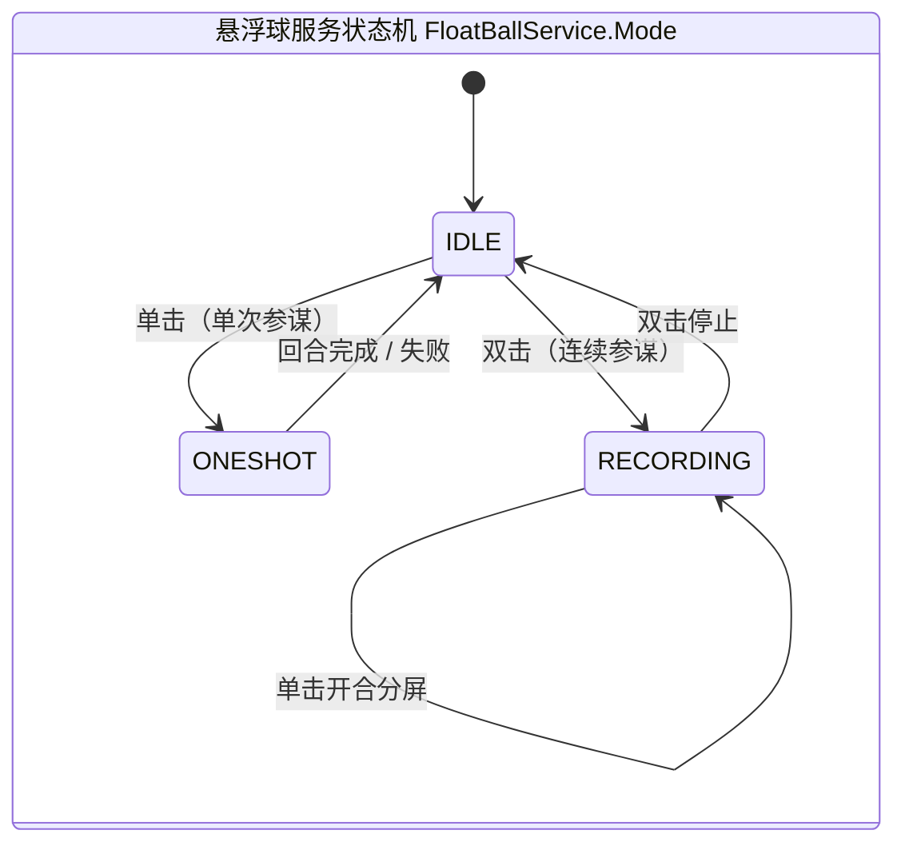

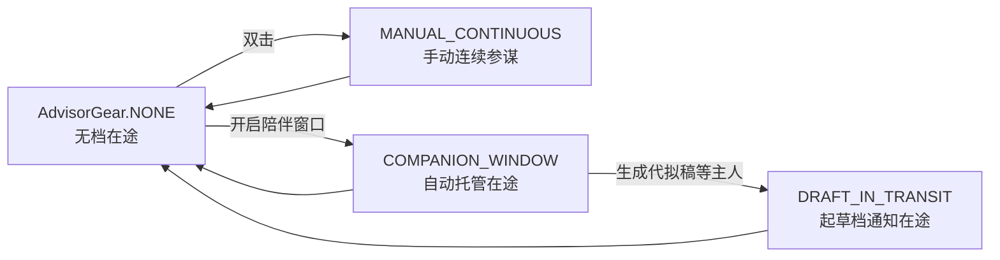

> 同一联系人同一时刻只允许一档激活；窗口类档位（手动连续 / 自动陪伴）共用差分引擎
> 与服务状态机，**全局互斥**（`CompanionWindowController` 声明）。

---

## 二、总体架构分层

系统分四层，**上层编排、下层能力**；所有扩展代码位于 `app` 模块 `floatball` 包，
底座能力全部来自上游 Nova 模块（上游零侵入铁律）。

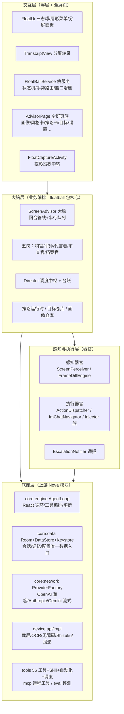

**分层纪律**：

- UI 不得直连 DAO（只走 Repository）；悬浮窗 Service 保持「瘦」——业务管道一律进
  Advisor 的协程（`Dispatchers.Default`/`IO`），主线程只做视图更新。
- `core:model` / `core:engine` 是纯 Kotlin/JVM 模块，不 import 任何 Android 类。
- 感知/执行是**器官**（零 LLM 判断职责），决策是**岗位**（五岗）——业务判断与技术策略分离。

---

## 三、模块组织与依赖

### 3.1 Gradle 模块依赖图（上游架构，本分支零改动）

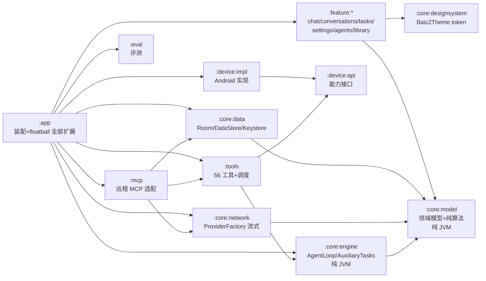

**技术栈**：Kotlin + Jetpack Compose（M3）+ Hilt/KSP + Room + DataStore +
OkHttp + ML Kit（离线 OCR）+ MediaProjection + Shizuku + JobScheduler/AlarmManager。
minSdk 26 / targetSdk 36 / compileSdk 37，JDK 17，AGP 9.4.1 + Gradle 9.6.1。

### 3.2 本分支扩展：floatball 包组织（全部新代码的家）

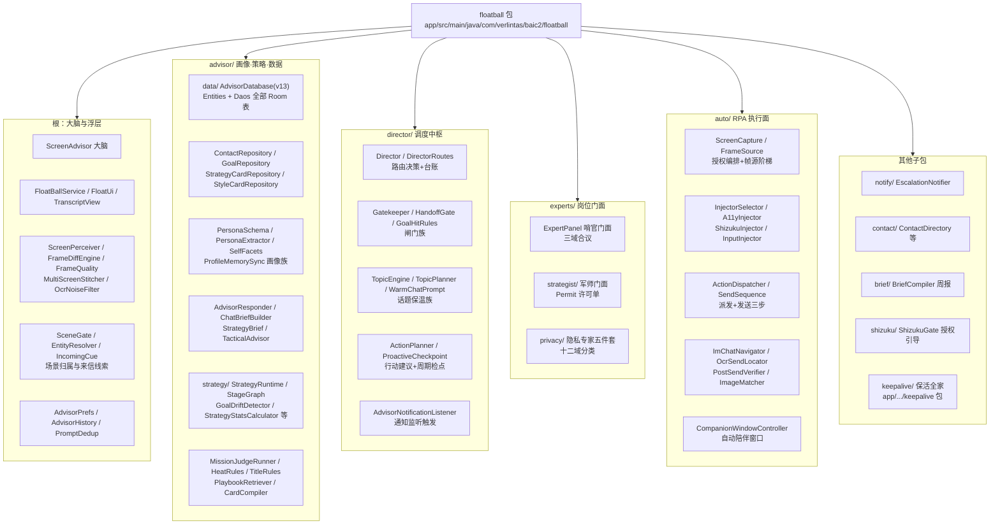

**新增能力的落位铁律**：编排进 Advisor / Perceiver，视觉进 FloatUi，接线进 Service，
数据进 advisor/data，决策进 director 或 experts。用户可见文案进 `strings.xml`
（`float_*` 前缀）；每个源文件带 GPL-3.0-or-later 头。

### 3.3 上游零侵入原则（分支生存根基）

- 上游模块文件（`core/*`、`feature/*`、`device/*`、`tools`、`mcp`、`eval`）**一字不动**；
- 仅 4 个白名单上游文件允许**纯增量**改动（Manifest、MainActivity 小块 gate、
  strings.xml 追加、gradle-wrapper 镜像）；
- 一切扩展通过**组合/包装/新文件**在 app 模块完成——持续合并上游时冲突面最小。

---

## 四、多代理协作体系（五岗 + 两器官）

这是系统的心脏。**岗位 = 有独立判断职责的决策实体**（子代理）；
**器官 = 无业务判断的技术执行单元**。唯一口径见
[五岗子代理架构整合方案](2026-10-21-五岗子代理架构整合方案.md)。

### 4.1 组织架构

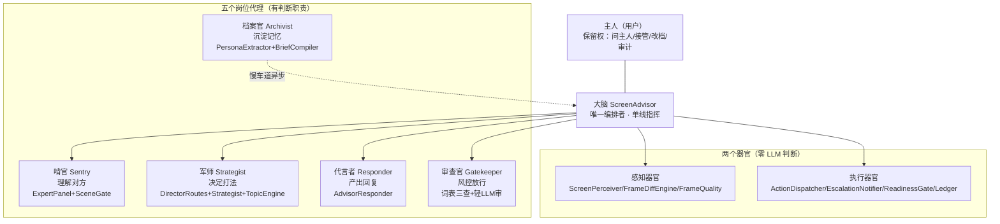

> **单线指挥**：五岗之间禁止横向互调，一切调用沿回合管线单向流动；**提案-执法分离**：
> 烧 LLM 的岗位只能提案，放行/拦截/发送只在纯代码执法面强制执行——**模型永远不是执法者**。

### 4.2 岗位职责速查表

| 岗位              | 唯一职责                       | 快车道（每回合）                                                                                            | 慢车道（低频）                                                                          | 门面实体                        |
| ----------------- | ------------------------------ | ----------------------------------------------------------------------------------------------------------- | --------------------------------------------------------------------------------------- | ------------------------------- |
| 哨官 Sentry       | 理解对方：来信在干什么         | ExpertPanel 三域合议（接管H / 隐私 / 达成G，**词表优先零 LLM**）+ SceneGate 场景兜底（仅 UNCERTAIN 才 LLM） | —                                                                                       | `ExpertPanel`                   |
| 军师 Strategist   | 决定打法：本回合怎么打         | DirectorRoutes 路由（纯函数）+ Strategist 许可单（条件圈定 + 90s 缓存）+ TopicEngine 话题（本地算法）       | TopicPlanner 周规划 + ActionPlanner 行动建议                                            | `experts/strategist/Strategist` |
| 代言者 Responder  | 产出回复：写出可发的话         | AdvisorResponder 流式生成 + ChatBriefBuilder 素材 + SendableDraftExtractor 纯回复抽取                       | —                                                                                       | `AdvisorResponder`              |
| 审查官 Gatekeeper | 风控放行：稿子能不能发         | 确定性三查 + 轻量 LLM 审 + 越许可检测 + 红线死清单恒拦                                                      | —                                                                                       | `Gatekeeper`                    |
| 档案官 Archivist  | 沉淀记忆：从对话沉淀可复用资产 | —                                                                                                           | 画像萃取（互斥锁节流）+ 会话摘要 + 事实记忆三源捕获 + 上游记忆镜像 + BriefCompiler 周报 | `experts/facts/` + 既有萃取组件 |

### 4.3 回合决策管线（快车道）

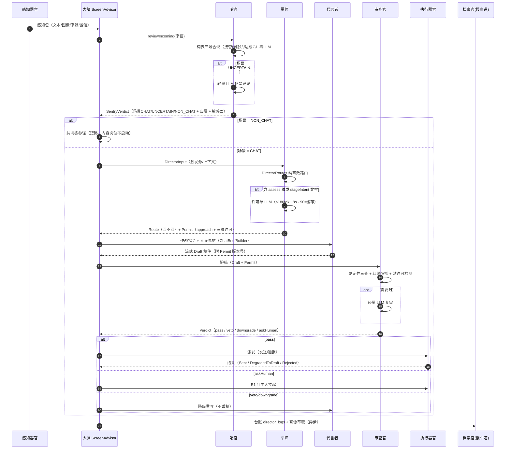

**交接物契约**（数据只沿管线传递，字段即合同）：

| 交接物            | 产出     | 消费          | 关键字段                                           |
| ----------------- | -------- | ------------- | -------------------------------------------------- |
| 感知包            | 感知器官 | 哨官          | 文本 / 图像 / 来源（a11y/截图/投影）/ 置信         |
| SentryVerdict     | 哨官     | 大脑→军师     | 场景（CHAT/UNCERTAIN/NON_CHAT）+ 敏感面 + 红线初筛 |
| Permit 许可单     | 军师     | 代言者+审查官 | approach 方针 + 三维逐档许可 + within + needsHuman |
| Draft 稿件        | 代言者   | 审查官        | 文本 + 引用的 Permit 版本号                        |
| GatekeeperVerdict | 审查官   | 执行器官      | pass / veto(reason) / downgrade / askHuman         |
| 台账记录          | 各岗     | 档案官        | director_logs 键值                                 |

### 4.4 权限四级与红线死清单

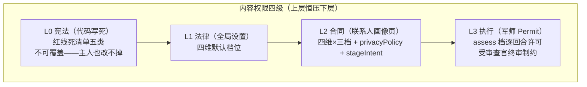

- **四维内容权限**：隐私披露 disclosure / 撒谎 lying / 许诺 promising / 举例
  exemplifying，每维三档 **never / assess / free**；默认档位（D1 拍板）：
  隐私=交主人、其余三维=自评。
- **红线死清单（L0，五类恒拦）**：金钱交易事实性欺骗 ｜ 法律后果承诺 ｜
  医疗人身安全谎言 ｜ 冒充真实机构/职务背书 ｜ 泄露第三方隐私。
- **冲突裁决顺位**：主人 > 审查官 > 军师 > 代言者；哨官 NON_CHAT 短路优先于一切内容岗位。
- **知情权限四档**：静默 / 轻通报（30min 节流）/ 问主人（E1 挂起）/ 交主人（handoff 停机）。

### 4.5 LLM 预算纪律（成本铁律）

- 每回合 LLM **典型 2 次**（代言者 + 审查官），**上限 4 次**；
- 哨官词表短路零成本；军师许可单 90s 缓存 + 来信指纹骤变失效；
- 档案官走慢车道，不计入回合预算；
- 故障降级：任何岗位超时/畸形不得中断回合——军师失效→无许可单走保守路径；
  哨官失效→保守判 NON_CHAT；审查官 LLM 失效→纯函数规则兜底。

---

## 五、感知体系（感知器官）

### 5.1 感知阶梯（ScreenPerceiver）

同一时刻按成本从低到高选感知通道，**a11y 关闭时整条链依然可走通**：

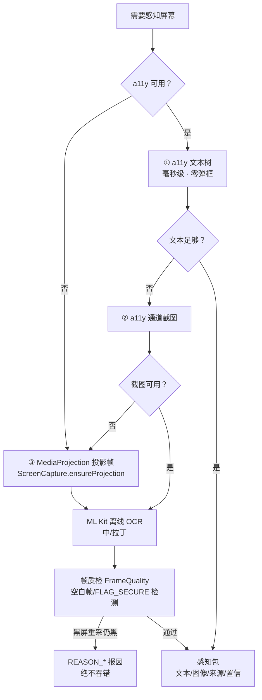

### 5.2 差分循环（FrameDiffEngine · 连续模式心脏）

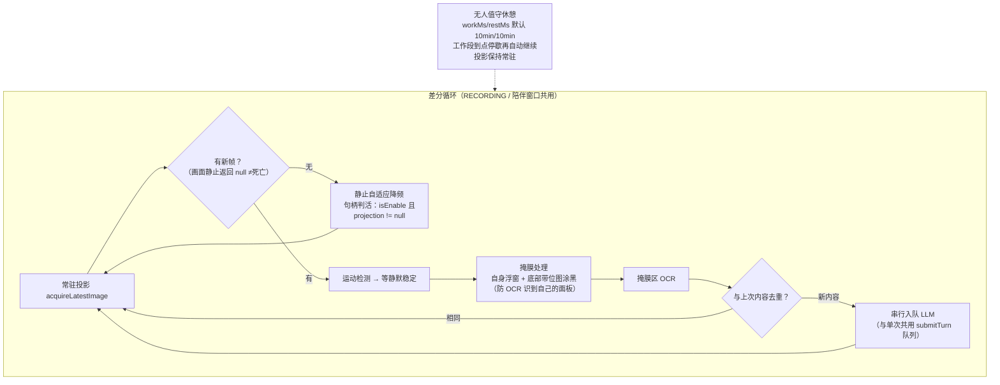

### 5.3 投影授权编排（ScreenCapture.ensureProjection · 唯一入口）

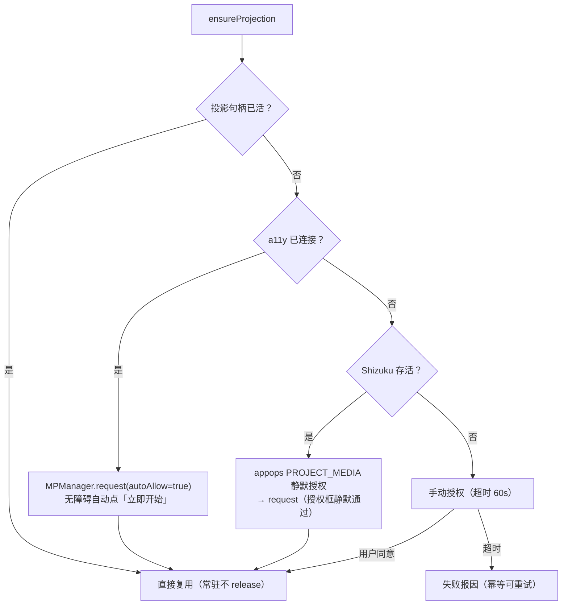

> 禁令：除 `Baic2Application` 的 SDK init 与 `FrameSource` 找图阶梯两处例外，
> 任何代码不许绕过 `ScreenCapture` 直调 `MPManager`。

---

## 六、执行体系（执行器官 · RPA 双模）

### 6.1 双模总览（2026-10-21 定版铁律）

a11y 关闭不是「功能受限」，而是**完整的第二套执行面**——两条线各自独立完整交付。

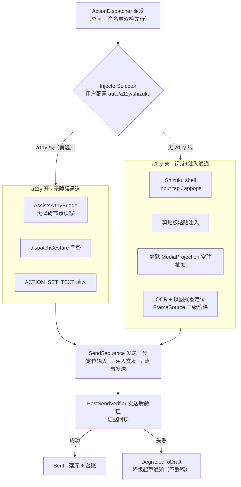

**每条线执行前必过本线就绪校验门（ReadinessGate）**：a11y 线查无障碍连接；
无 a11y 线查 Shizuku 存活 + 投影句柄 + appops。条件不满足 → **提示缺项与操作指引**
（禁用入口或 toast 报因），严禁不校验就执行、严禁静默切线、严禁静默失效。

### 6.2 帧源三级阶梯（FrameSource · 找图/感知）

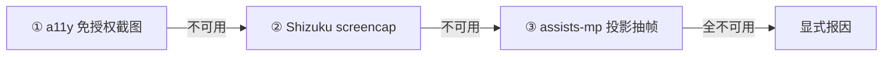

### 6.3 自动发送时序（从决定发送到验证落库）

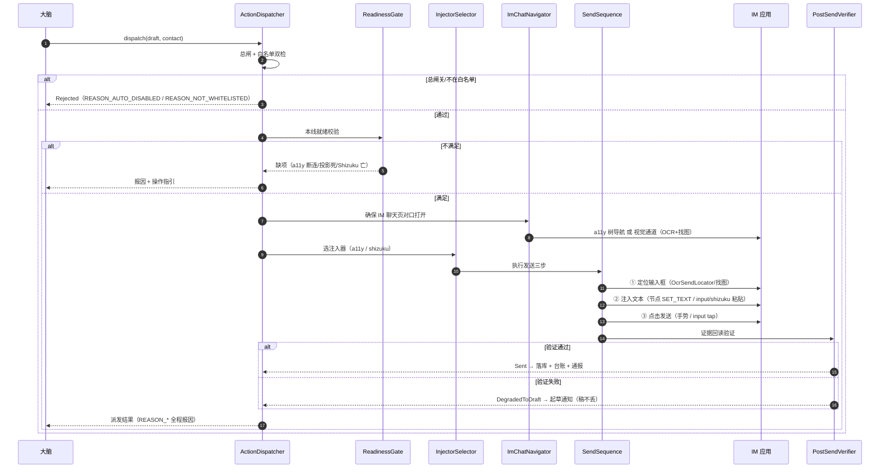

**IM 导航（ImChatNavigator.openChat）双模**：a11y 开走无障碍树/手势直达目标联系人
聊天页；a11y 关且 Shizuku 可用走 `openChatByVision`（Shizuku screencap 优先，否则
`ensureProjection` 建立静默投影，再 OCR + 以图找图导航）；双模皆不可用返回明确失败。
支持微信 / 企业微信 / 飞书 / 钉钉 / QQ / 淘宝 / 闲鱼等主流 IM。

### 6.4 脚本设计器（编辑 UI · 2026-10-29 改版）

脚本设计器的编辑 UI 已完成浮窗化改版：全屏拖拽编辑器 `RpaEditorScreen` 已退场删除，
替换为「属性页（RpaPropertyScreen）→ 模式确认门（RpaModeGateDialog）→ 浮窗动作面板
（RpaActionPanel，墨板、55% 屏宽可拖 45–75%、贴边吸附/收起圆球）→ 步骤编辑弹框
（RpaStepDialog，字段矩阵/跳转选择器/运行条件）+ 全局设置弹框（RpaGlobalSettingsDialog）」。

| 环节 | 文件 |
| --- | --- |
| 脚本库 | `app/.../floatball/rpa/RpaLibraryScreen.kt` |
| 属性页 | `app/.../floatball/rpa/RpaPropertyScreen.kt` |
| 模式确认门 | `app/.../floatball/rpa/RpaModeGate.kt`（`RpaModeGateDialog`） |
| 浮窗动作面板 | `app/.../floatball/rpa/RpaActionPanel.kt` + `RpaActionPanelController.kt` |
| 步骤编辑弹框 | `app/.../floatball/rpa/RpaStepDialog.kt` |
| 全局设置弹框 | `app/.../floatball/rpa/RpaGlobalSettingsDialog.kt` |

---

## 七、大脑：回合编排（ScreenAdvisor）

`ScreenAdvisor` 是系统唯一编排者（@Singleton，注入约 30 个协作者）。
**会话管道与主界面聊天同构**：OCR / a11y 文本作为用户消息写入持久化「参谋会话」，
由同一个上游 `AgentLoop` 以 Chat 模式作答——参谋与主聊天共享同一套记忆、模型配置
与流式管道。

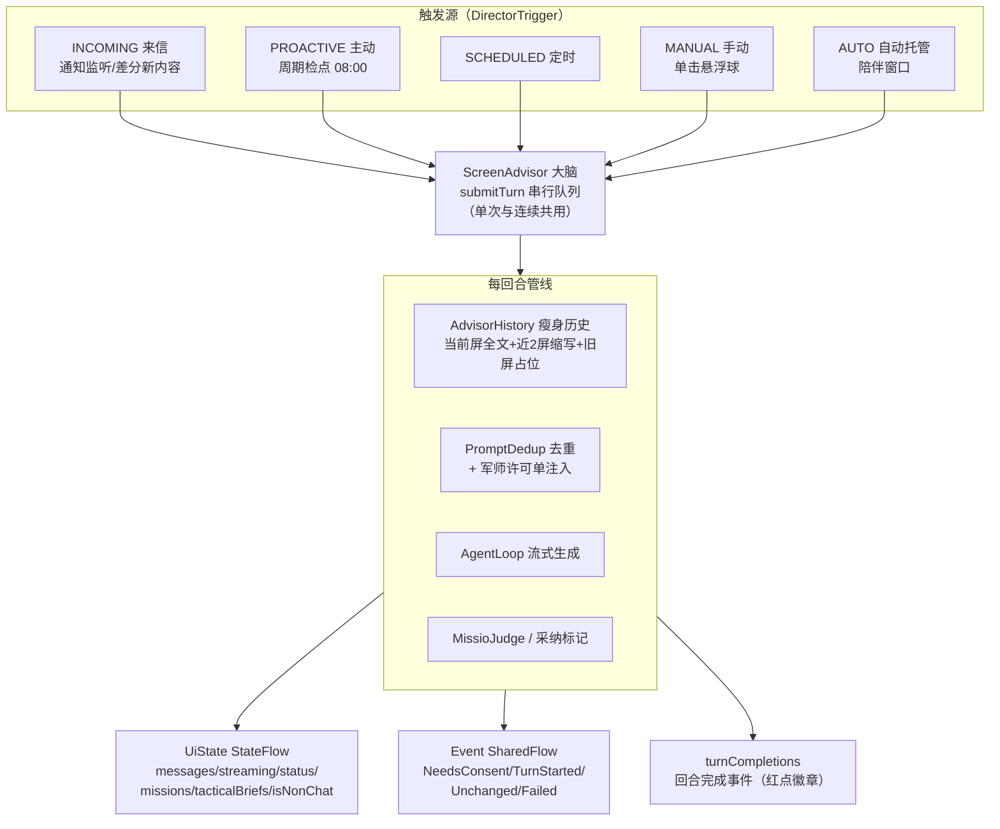

要点：

- **串行队列**：同一时刻只跑一个回合，感知结果排队，天然防并发踩踏；
- **许可单共享**：`tacticRulings`（contactId → RuledPermit）让手动回合与自动发送
  路径共享同一份军师许可单（90s 缓存），零重复 LLM 调用；
- **上下文瘦身**：发 LLM 前才组装瘦身副本，落库原文不动（`AdvisorHistory`）；
- **投影授权事件**：`NeedsConsent` 由服务层接 `FloatCaptureActivity` 中转授权后重跑。

---

## 八、策略与目标体系

### 8.1 三级目标链（L3 → L2 → L1 → 任务令）

目标驱动是「参谋」区别于「聊天机器人」的本质：每一回合的回复都服务于目标。

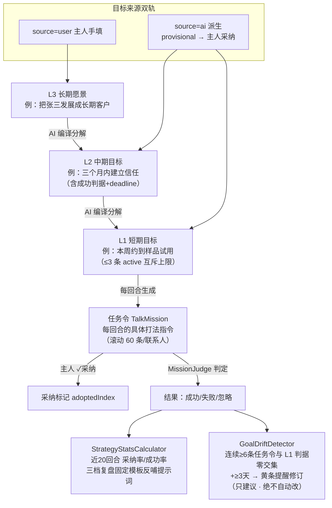

**铁律**：L1 自动完成**永不立项**（绝不自动勾选，只建议、人拍板）；AI 派生的
provisional 目标必须主人采纳才生效。

### 8.2 策略阶段图（StageGraph · 有向图阶段机）

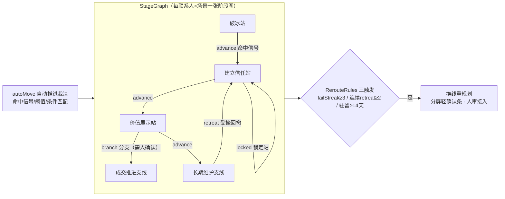

- 站点分 backbone（主干）与 privateStages（私有支线），边有 retreat/advance/skip/branch
  四种，branch 边必须人确认；
- 阶段状态存 `stage_states`（contactId + scenarioCode 主键），跃迁轨迹存 `stage_history`；
- **策略卡**（strategy_cards）：draft → confirmed 状态机 + 手动重编译，是注入代言者
  提示词的作战方案（场景打法/话术依据/禁忌）。

### 8.3 增强档（TacticalAdvisor）

三档参谋强度：**智能档**（标准）/ **增强档**（preAnalyze 预分析出 TacticalBrief：
hardActions / donts / mustAnswer / toneGuard 四段硬约束，注入主调用；失败静默回退
REASON_ENHANCED_FALLBACK）/ 起草档。战术约束在分屏气泡下折叠可见（增强档专属）。

---

## 九、画像与记忆体系（档案官）

### 9.1 三术语模型（全系统口径铁律，严禁混用）

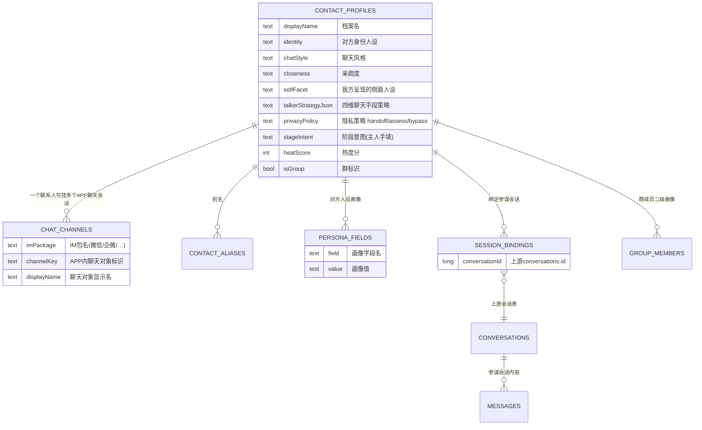

| 术语         | 定义                                    | 存什么                                                         | 不存什么                               |
| ------------ | --------------------------------------- | -------------------------------------------------------------- | -------------------------------------- |
| **参谋会话** | 主人与 LLM 的对话（软件中的「对话项」） | 全部消息（屏幕正文 + 参谋回答），上游 conversations + messages | —                                      |
| **聊天会话** | 与 IM 里对方的真实聊天                  | **仅** APP 包名 + 聊天对象标识 + 显示名（chat_channels）       | **聊天内容一概不存储**（本地优先红线） |
| **联系人**   | 「人/群」档案：双方人设画像             | 画像主档 + 别名（contact_profiles 等）                         | —                                      |

### 9.2 双向人设自动沉淀

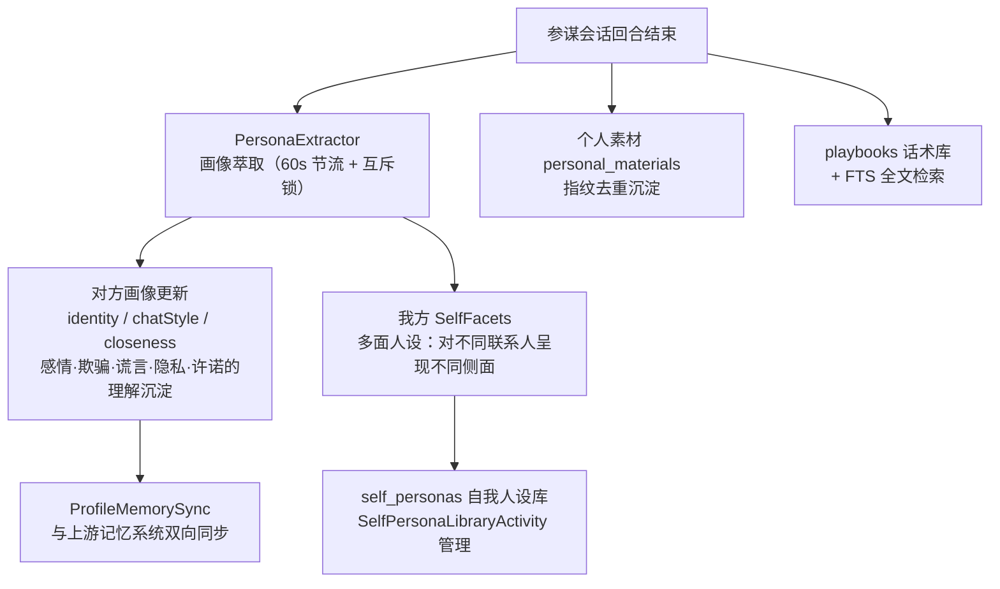

- **画像 schema**：persona_schema.json，8 基调 → 16 意图（含 6 个 defend/职场意图），
  13 个场景包五组，schema v2 含 emotionStyle / replyPace / loveLanguage / my_aspiration；
- **风格卡**（style_cards）：16 意图 × 场景的可复用应答风格资产，CardCompiler 编译；
- 群聊 = 单一对方 + `group_members` 二级画像（P5 群成员画像）。

---

## 十、保温机制（话题引擎）

目标：**聊天不断片**——冷场时系统主动找话聊，配合长中短目标让关系持续有节奏地推进。

```mermaid
flowchart TB
    subgraph TE["TopicEngine（本地确定性算法 · 零 LLM 选题）"]
        E1["topic_plans 话题弹药库<br/>TopicPlanner 周规划补充"]
        E2["选题规则：去重 / 冷却 / 阶段门控<br/>（话题必须匹配当前阶段）"]
        E3["silence_24h 冷场信号"]
    end

    CK["ProactiveCheckpoint 周期检点<br/>（每日 08:00 · proactive_policies 策略）"] --> TE
    TE --> ROUTE{"DirectorRoutes"}
    ROUTE -->|ROUTE_SMALL_TALK| WARM["WarmChatPrompt 保温话术<br/>TopicStyleRules 风格分层"]
    ROUTE -->|ROUTE_ACTION_HINT| ACT["ActionPlanner 行动建议<br/>（如「明日生日→提醒送礼」仅主人可见）"]
    ROUTE -->|ROUTE_NOOP| WAIT["不动作（尊重冷却）"]
    WARM --> AUTO["自动发起 smalltalk 回合<br/>（proactive 触发源）"]
```

**分工铁律**：LLM 只负责「聊活」（把话题写生动），**不负责「选什么题」**——选题是
确定性本地算法，保证不重复、不越阶段、不骚扰。

---

## 十一、保活体系

目标：悬浮球常驻陪伴，不被系统轻易杀死。**保活强度交给用户选档**。

```mermaid
flowchart TB
    subgraph LV1["第 1 层 · 常驻"]
        K1["FloatBallService<br/>specialUse 前台服务 + START_STICKY"]
        K2["常驻通知 IMPORTANCE_LOW"]
    end

    subgraph LV2["第 2 层 · 拉活"]
        K3["KeepAliveBootReceiver<br/>开机/更新自启"]
        K4["JobScheduler 心跳 15min<br/>（智能档起）"]
        K5["精确闹钟链<br/>（A15+ 硬豁免 · 永久档）"]
        K6["reviveServiceIfNeeded 三级降级：<br/>电池白名单/闹钟豁免直启<br/>→ 占位 overlay 再启 → 放弃"]
    end

    subgraph LV3["第 3 层 · 授权引导"]
        K7["电池优化白名单<br/>（智能/永久档必要条件）"]
        K8["厂商自启跳转表<br/>AUTO_START_TABLE"]
        K9["通知权限 / 精确闹钟引导"]
    end

    subgraph LV4["第 4 层 · 隐身与恢复"]
        K10["最近任务隐藏"]
        K11["可选无声音乐 FGS<br/>（永不从 BOOT 黑名单启动）"]
        K12["崩溃时间戳落盘诊断"]
    end

    LV1 --> LV2 --> LV3
    LV1 --> LV4
```

| 档位                | 机制                             | 耗电   |
| ------------------- | -------------------------------- | ------ |
| 🌙 低耗电           | 仅 START_STICKY + 开机自启       | ⚡     |
| ⚖️ 智能保活（默认） | + Job 心跳 15min（需电池白名单） | ⚡⚡   |
| 🛡️ 永久保活         | + 精确闹钟双保险 + 可选无声音乐  | ⚡⚡⚡ |

> 版本适配事实：Android 15+ 仅持悬浮窗权限**不能**后台启 FGS（还需此刻存在可见
> overlay）；电池优化白名单与精确闹钟是两条独立豁免——这是三级降级设计的原因。

---

## 十二、数据架构

### 12.1 数据库全景（advisor/data/AdvisorDatabase，按域分组）

```mermaid
erDiagram
    CONTACT_PROFILES ||--o{ CHAT_CHANNELS : "挂多APP聊天会话"
    CONTACT_PROFILES ||--o{ SESSION_BINDINGS : "绑定参谋会话"
    CONTACT_PROFILES ||--o{ PERSONA_FIELDS : "对方人设"
    CONTACT_PROFILES ||--o{ STYLE_CARDS : "风格卡"
    CONTACT_PROFILES ||--o{ STRATEGY_CARDS : "策略卡"
    CONTACT_PROFILES ||--o{ TALK_MISSIONS : "任务令"
    CONTACT_PROFILES ||--o{ STAGE_STATES : "阶段状态"
    CONTACT_PROFILES ||--o{ GOALS : "目标"
    CONTACT_PROFILES ||--o{ DIRECTOR_LOGS : "决策台账"
    CONTACT_PROFILES ||--o{ ACTION_PLAYS : "行动剧本"
    CONTACT_PROFILES ||--o{ BRIEF_OUTPUTS : "周报"
    CONTACT_PROFILES ||--o{ PROACTIVE_POLICIES : "主动策略"
    CONTACT_PROFILES ||--o{ PERSONAL_MATERIALS : "个人素材"
    GOALS ||--o{ GOAL_DECOMPS : "编译产物"
    GOALS }o--o{ GOALS : "parentId 父子链"
    STAGE_STATES ||--o{ STAGE_HISTORY : "跃迁轨迹"
    SESSION_BINDINGS }o--|| CONVERSATIONS : "上游会话表"
```

| 域     | 表                                                                                                                                                        | 用途                                       |
| ------ | --------------------------------------------------------------------------------------------------------------------------------------------------------- | ------------------------------------------ |
| 画像域 | contact_profiles / contact_aliases / persona_fields / extraction_holds / group_members / self_personas / style_cards / personal_materials / merge_records | 联系人档案、双方人设、风格卡、素材         |
| 话术域 | playbooks（+ playbooks_fts）                                                                                                                              | 话术库与全文检索                           |
| 会话域 | chat_channels / session_bindings                                                                                                                          | 聊天会话行、参谋会话绑定                   |
| 策略域 | goals / goal_decomps / stage_states / stage_history / strategy_cards / talk_missions / topic_plans                                                        | 三级目标、阶段机、策略卡、任务令、话题弹药 |
| 调度域 | director_logs / action_plays / brief_outputs / proactive_policies                                                                                         | 决策台账、行动剧本、周报、主动策略         |

上游库（core:data）：conversations / messages（参谋会话内容）、memory（记忆）、
agents（模型配置）、runs / steps（Agent 运行记录）。

### 12.2 数据红线（本地优先）

- 无云端、无埋点、无遥测；API Key 走 Android Keystore 加密；
- **IM 聊天内容一概不落库**（chat_channels 只存「哪个 APP 的谁」）；
- 截屏 / OCR 中间产物不落盘；临时证据图仅放 `tests/tempImg/`（gitignore）；
- secret 档事实**永不进入代言上下文**，仅主人可见路径。

---

## 十三、AI 能力底座（上游复用）

### 13.1 LLM 调用三档选择（禁止手搓 HTTP）

```mermaid
flowchart LR
    NEED["要调 LLM？"] --> Q1{"要工具/多轮？"}
    Q1 -->|是| AL["AgentLoop.run<br/>完整 React 循环"]
    Q1 -->|否| Q2{"一次性小任务？"}
    Q2 -->|是| AX["AuxiliaryTasks.complete<br/>标题/摘要/判定"]
    Q2 -->|否| PF["ProviderFactory.create<br/>.stream → Flow（自定义流式 UI）"]
    AL --> PROV["core:network<br/>OpenAI 兼容 / Anthropic / Gemini"]
    AX --> PROV
    PF --> PROV
```

### 13.2 AgentLoop React 循环（上游 core:engine）

```mermaid
flowchart TB
    T["TASK 任务"] --> P["PLAN 计划<br/>（plan_update 一等工件）"]
    P --> A["ACT 执行工具"]
    A --> O["OBSERVE 观察"]
    O --> V["VERIFY 验证<br/>操作前后 UI diff"]
    V -->|未达| RP["REPLAN 重规划"]
    RP --> P
    V -->|达成| DN["DONE"]
    A -.工具熔断：同名 3 次失败即拒.-> A
    A -.spawn_agent 子代理<br/>独立上下文+预算继承.-> A
```

配套能力：56+ 内置工具（ToolCatalog / ToolRunner 统一注册）、MCP 远程工具
（Streamable HTTP，权限与内置工具一致）、Skill 技能库（SkillRepository /
SkillCodec）、AI 自动化（AutomationExecutor + 定时调度）、eval 评测
（mock 供应商 + 模拟设备 + 场景判分，CI 回归门禁）、记忆仿生
（MemoryRepository：recall 线索召回 / getCore 核心记忆 / addNote 去重合并冲突裁决）。

---

## 十四、安全与治理

```mermaid
flowchart TB
    subgraph SEC["三道防线"]
        S1["防线一 · 本地优先<br/>无云端/无遥测/Key 加密<br/>IM 内容不落库"]
        S2["防线二 · 模型不可信<br/>模型输出只是提案<br/>代码执法：权限门+危险等级+策略"]
        S3["防线三 · 红线死清单<br/>L0 宪法五类恒拦<br/>主人也改不掉"]
    end

    subgraph OPS["失败治理"]
        O1["失败必须报因<br/>REASON_* 全链路字符串"]
        O2["严禁静默失效<br/>就绪门缺项即禁用+指引"]
        O3["降级不丢稿<br/>发送失败→起草通知"]
        O4["E1 问主人挂起<br/>该出手时交主人"]
    end

    SEC --> OPS
```

隐私分级：十二域 + 中性域分类学（PIPL / GB-T 35273 / GDPR Art.9 底座），
secret 档事实双通道渲染（renderForReply 永远脱敏 / renderForCounsel 主人可见）。

---

## 十五、端到端流程走查

**场景**：自动托管模式下，微信里客户张三发来一条消息，系统全自动处理。

```mermaid
sequenceDiagram
    autonumber
    participant WX as 微信(张三聊天页)
    participant NL as AdvisorNotificationListener
    participant FD as FrameDiffEngine
    participant B as 大脑 ScreenAdvisor
    participant S as 哨官
    participant M as 军师
    participant R as 代言者
    participant G as 审查官
    participant E as 执行器官
    participant ARC as 档案官

    WX->>NL: 新消息通知（触发源 AUTO/INCOMING）
    NL->>FD: 唤醒差分循环
    FD->>FD: 投影取帧→静默稳定→掩膜→OCR→去重
    FD->>B: 感知包（新消息文本）
    B->>S: 哨官合议
    S->>S: 词表三域 + 场景判定 + EntityResolver 归属
    S-->>B: CHAT · 联系人=张三 · 无接管信号
    B->>M: DirectorInput
    M->>M: 路由=REPLY · Permit=empathy+benefit_list
    M-->>B: Route + Permit（90s 缓存命中则免调）
    B->>R: 素材（画像+目标L1+阶段站+话术库+近期复盘）
    R-->>B: Draft（流式稿件）
    B->>G: 验稿
    G->>G: 三查 + 越许可检测 + 红线恒拦
    G-->>B: pass
    B->>E: dispatch(draft, 张三)
    E->>E: 总闸白名单 → ReadinessGate → InjectorSelector
    E->>WX: ImChatNavigator 确保聊天页 → 定位输入框 → 注入 → 点击发送
    E->>E: PostSendVerifier 证据回读 → Sent
    E-->>B: 派发结果 + 台账
    B-->>ARC: 慢车道：画像萃取 + mission 判定 + 记忆镜像
    ARC-->>ARC: BriefCompiler 周报 / 明日行动建议
```

---

## 十六、术语表

| 术语                         | 含义                                                                                           |
| ---------------------------- | ---------------------------------------------------------------------------------------------- |
| 好参谋                       | 本分支产品名：常驻悬浮球的屏幕参谋军师                                                         |
| 参谋会话 / 聊天会话 / 联系人 | 见 §9.1 三术语铁律，全系统严禁裸用「会话」                                                     |
| 五岗                         | 哨官（理解对方）/ 军师（决定打法）/ 代言者（产出回复）/ 审查官（风控放行）/ 档案官（沉淀记忆） |
| 两器官                       | 感知器官（产感知帧）/ 执行器官（发送/通报/台账）                                               |
| 回合                         | 从感知到执行的一个完整决策周期（快车道）                                                       |
| 慢车道                       | 与回合解耦的后台异步任务（画像萃取/周报/检点）                                                 |
| Permit 许可单                | 军师产出的本回合内容手段授权（approach + 三维许可）                                            |
| 红线死清单                   | L0 宪法级五类恒拦内容，代码写死不可覆盖                                                        |
| E1 / handoff                 | 问主人挂起 / 交主人停机（主人保留权）                                                          |
| 任务令 mission               | 每回合生成的具体打法指令，可采纳可判定                                                         |
| 阶段图 StageGraph            | 每联系人×场景的关系推进有向图状态机                                                            |
| 差分循环                     | 连续模式的运动检测→OCR→去重→入队循环                                                           |
| 双模执行面                   | a11y 开（节点/手势）与 a11y 关（Shizuku+投影+OCR+找图）两套完整执行线                          |
| 就绪校验门                   | ReadinessGate：执行前校验本线前置条件，缺项即提示                                              |
| 陪伴窗口                     | CompanionWindowController：全自动托管档位                                                      |
| 台账                         | director_logs 决策记录，可复盘可调参                                                           |

---

## 参考文献（方案沿革，按时间序）

| 日期  | 文档                                                                                                                                                                 | 交付内容                    |
| ----- | -------------------------------------------------------------------------------------------------------------------------------------------------------------------- | --------------------------- |
| 10-13 | [好参谋 v3：单击与连续参谋](2026-10-13-好参谋v3-单击与连续参谋方案.md)                                                                                               | 悬浮球/分屏/差分循环底座    |
| 10-14 | [v3 架构：AI 辅助自动化聊天](2026-10-14-好参谋AI辅助自动化聊天功能方案架构设计.md)                                                                                   | 感知/绑定/画像/双写骨架     |
| 10-15 | [做好 RPA 的基础工作方案](2026-10-15-做好RPA的基础工作方案.md)                                                                                                       | RPA 执行面基座              |
| 10-15 | [v4 策略大脑](2026-10-15-智能优化增强的聊天策略方案.md)                                                                                                              | 三级目标链/13 场景包/阶段机 |
| 10-18 | [多代理协作自动参谋](2026-10-18-多代理协作自动参谋方案.md)                                                                                                           | director/ 路由管线          |
| 10-19 | [自动聊天托管执行面](2026-10-19-自动聊天托管执行面方案.md)                                                                                                           | 双模执行面+就绪门铁律       |
| 10-20 | [隐私闸门与事实记忆](2026-10-20-隐私闸门与事实记忆方案.md)                                                                                                           | 隐私十二域/合议团           |
| 10-20 | [子代理化代码组织模式](2026-10-20-子代理化代码组织模式.md)                                                                                                           | 专家五件套+合议团纪律       |
| 10-20 | [接管与达成通报](2026-10-20-接管与达成通报方案.md)                                                                                                                   | H/G 判定 + Escalation       |
| 10-21 | [五岗子代理架构整合](2026-10-21-五岗子代理架构整合方案.md)                                                                                                           | 五岗+两器官唯一口径         |
| 10-21 | [聊天策略与五岗架构总方案](2026-10-21-聊天策略与五岗架构落地总方案.md)                                                                                               | 总纲：裁量层/权限矩阵/排期  |
| 10-21 | [投影免弹窗授权](2026-10-21-投影免弹窗授权方案.md)                                                                                                                   | 静默 MediaProjection        |
| 10-22 | [连续模式录屏优化与免无障碍截屏](2026-10-22-连续模式录屏优化与免无障碍截屏方案.md)                                                                                   | 无 a11y 感知链定版          |
| 10-22 | [设置权限统一合并](2026-10-22-设置权限统一合并方案.md) / [列表增删体系](2026-10-22-列表增删体系改版方案.md) / [悬浮菜单改版](悬浮菜单改版-单次连续自动与更多弹窗.md) | 交互整合                    |
| 10-22 | [策略体系功能最大化](../.trae/documents/2026-10-22-策略体系功能最大化方案.md)                                                                                        | 统计反哺/漂移检测/战术可见  |
| —     | [keepalive-design](keepalive-design.md) / [ARCHITECTURE](ARCHITECTURE.md) / [HOW_IT_WORKS](HOW_IT_WORKS.md)                                                          | 保活设计/上游架构/上游原理  |
